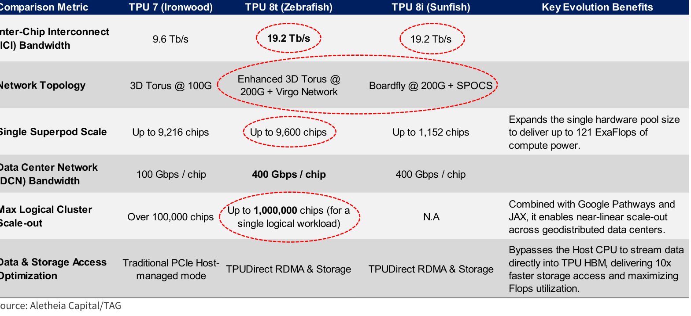
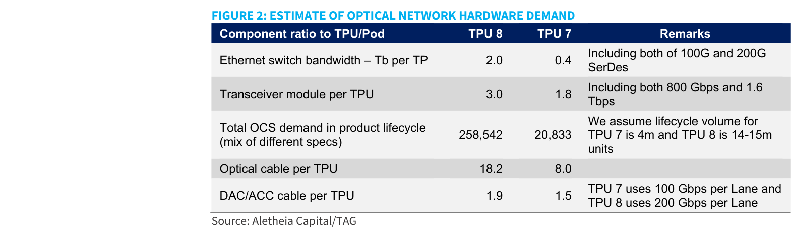
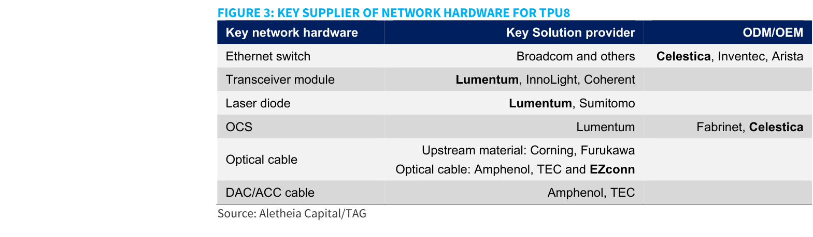
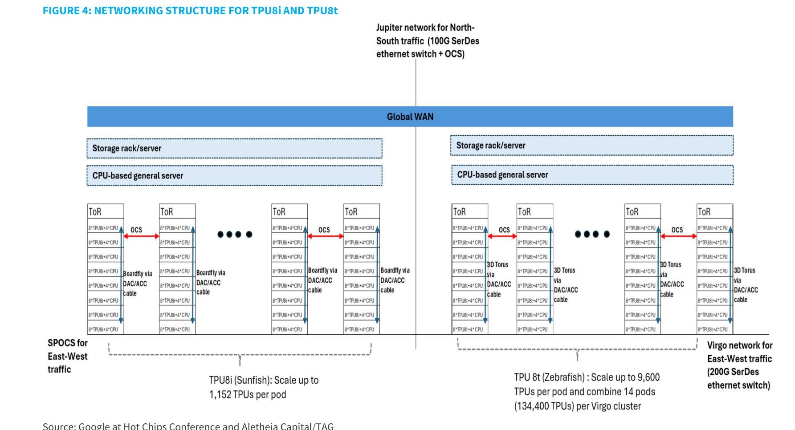
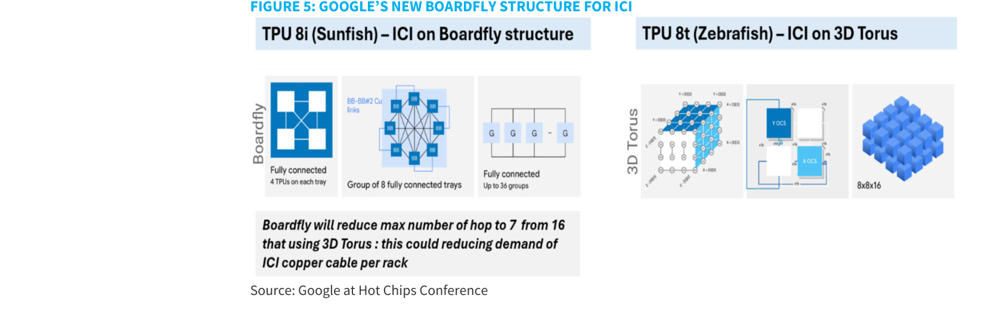
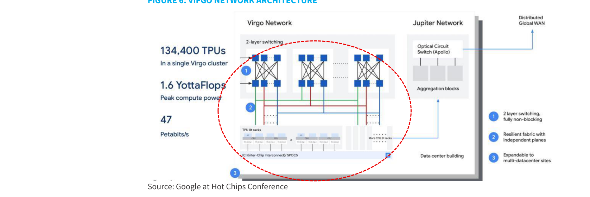
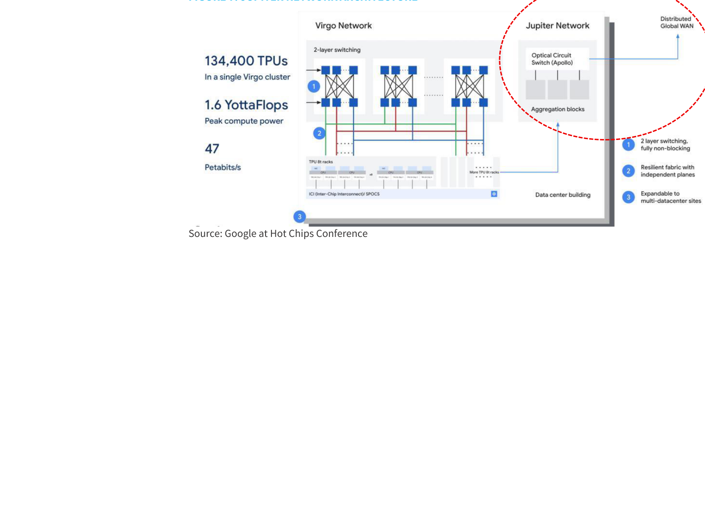

# Aletheia Capital｜AI Networking — Upside Surprise from TPU8 Networking Upgrade

**券商**：Aletheia Capital  
**分析師**：Skye Chen、Warren Lau  
**日期**：2026-10-06  
**主題**：Google TPU8 網路架構升級對光通訊供應鏈的需求衝擊  
**評級**：Technology Hardware（Global）；Lumentum / EZconn / Celestica 均 BUY  
<a href="https://layx.uk/dl?g=產業&b=Aletheia&d=20261006&h=AI-Networking">📎 下載 PDF</a>

---

## 報告總結

Aletheia Capital 在 Google 於 Hot Chips Conference（2026 年 8 月）公開 TPUv8 詳細網路架構後發布此報告，論點核心是 TPU8 的網路硬體含量將比 TPU7 提升 2–5 倍，且需求涵蓋以太網交換器、光纖收發模組、雷射二極體、光纜及 OCS（Optical Circuit Switch）全鏈路。Google 同時導入 Virgo（東西向）與 Jupiter（南北向）雙架構，使集群規模從 TPU7 的 10 萬晶片擴展至 100 萬晶片。受益公司中 Lumentum（收發器＋雷射二極體＋OCS）、EZconn（光纜）、Celestica（以太網交換器 ODM＋OCS 組裝）因高度集中的 Google 曝險與主導市場地位，被列為重點 BUY。

---

## Aletheia Capital 完整投資邏輯鏈

| 論點層次 | Exhibit | 內容 |
|---|---|---|
| 架構升級確認 | Fig. 1 | TPU8 ICI 頻寬從 9.6 Tb/s 翻倍至 19.2 Tb/s；DCN 頻寬從 100→400 Gbps/chip；Virgo 支援 134,400 晶片集群規模 |
| 需求量化 | Fig. 2 | 光收發模組 1.8→3.0/TPU、光纜 8.0→18.2/TPU、OCS 終身需求 20,833→258,542 units（12.4x）；銅纜微增 1.5→1.9/TPU |
| 供應商定位 | Fig. 3 | Lumentum 同時主導收發器、雷射二極體、OCS 三個高增長環節；EZconn 在光纜具關鍵地位；Celestica 負責 Ethernet switch ODM 及 OCS 組裝 |
| 架構壁壘 | Fig. 4/5 | TPU8i（Sunfish）採 Boardfly 拓撲（SPOCS 光路由），TPU8t（Zebrafish）維持 3D Torus + Virgo；兩路徑均對 OCS 需求顯著加速 |
| 集群經濟放大 | Fig. 6/7 | Virgo 東西向（134,400 TPU, 1.6 YottaFlops）與 Jupiter 南北向同步建設，OCS/Apollo 在兩套系統中均不可或缺 |
| **結論** | 封面 | **TPU8 升級推動 2027–28 光學供應鏈盈利上行；三大受益者均 BUY，列入 Google G7 投資組合** |

> **報告最大邏輯缺口**：TPU8 出貨量假設（14–15m units 終身產量）是 OCS 需求 12x 增長的關鍵前提，報告未提供量化依據；若 Google 縮減 TPU8 採購或 Boardfly 拓撲的 SPOCS 用量低於預期，OCS 增幅將大幅壓縮。

---

## 報告核心觀點

| 主題 | Aletheia 觀點 | 市場共識 | 是否 Contra-Consensus |
|---|---|---|---|
| OCS 終身需求量 | TPU8 週期 258,542 units vs TPU7 的 20,833，增幅 12.4x | 市場聚焦單季出貨，較少從生命週期總量切入 | 是（12x 量級遠超一般認知）|
| 光纜需求增幅 | 每 TPU 由 8.0 增至 18.2（+128%），優先受益 EZconn | 市場注意力多放在收發器，光纜含量增長被低估 | 是 |
| 銅纜（DAC/ACC）方向 | 僅微增 1.5→1.9（Boardfly 拓撲降低每機架銅纜用量，抵消 SerDes 升速帶來的需求） | 市場可能預期銅纜因 200G SerDes 而顯著增長 | 是（方向偏差：微增非大增）|
| 收發模組用量 | 每 TPU 從 1.8 增至 3.0（+67%），涵蓋 800G 及 1.6Tbps 兩種規格 | 市場已知增長，但三環節均 Lumentum 獨大的集中度可能低估 | 部分 contra |
| 關鍵受益者 | Lumentum（最廣泛曝險）、EZconn（光纜）、Celestica（組裝）均 BUY | Celestica 的 OCS 組裝受益度認知較不足 | 是 |

**偏好排序**：Lumentum ＞ EZconn ＞ Celestica  
**核心受益鏈**：收發器（Lumentum/InnoLight/Coherent）→ 雷射二極體（Lumentum/Sumitomo）→ OCS（Lumentum + Fabrinet/Celestica 組裝）→ 光纜（EZconn/Amphenol/TEC）→ 以太網交換器（Broadcom IC + Celestica/Inventec/Arista ODM）

---

## Fig. 1｜Key Network Upgrade in TPU v8 vs TPU v7

### 解讀摘要

TPU8 是一次全面的網路架構代際換代，而非漸進式優化。ICI 頻寬翻倍（9.6→19.2 Tb/s）改變的不只是速率，而是整個拓撲：TPU8t 引入 Virgo 東西向網路，TPU8i 以 Boardfly 取代 3D Torus；DCN 頻寬更跳升 4 倍至 400 Gbps/chip，驅動以太網交換器從 ToR 到匯聚層的全面升級。最關鍵的是最大邏輯集群規模——TPU8t 理論上可支援 100 萬晶片作為單一邏輯工作負載，這代表 Google 有能力把多個資料中心的 TPU 作為一個統一計算池調度，對 OCS 的跨機房光路由需求是根本性催化。

> **原文補充**：報告指出 TPUDirect RDMA 讓 TPU HBM 可直接流接儲存資料，避免 Host CPU 中繼，儲存存取速度提升 10 倍並最大化 Flops 利用率——這代表即便計算量不變，儲存架構的光通訊頻寬需求也會同步放大。

### 表格

| 比較指標 | TPU 7（Ironwood） | TPU 8t（Zebrafish） | TPU 8i（Sunfish） | 關鍵演進說明 |
|---|---|---|---|---|
| 晶片間互聯（ICI）頻寬 | 9.6 Tb/s | **19.2 Tb/s** | 19.2 Tb/s | — |
| 網路拓撲 | 3D Torus @100G | Enhanced 3D Torus @200G + Virgo Network | Boardfly @200G + SPOCS | — |
| 單一 Superpod 規模 | 最多 9,216 晶片 | 最多 9,600 晶片 | 最多 1,152 晶片 | 擴展至 121 ExaFlops 算力 |
| 資料中心網路（DCN）頻寬 | 100 Gbps/chip | **400 Gbps/chip** | 400 Gbps/chip | — |
| 最大邏輯集群規模 | 超過 100,000 晶片 | **最多 1,000,000 晶片**（單一邏輯工作負載） | N/A | 結合 Google Pathways/JAX 實現近線性擴展 |
| 資料與儲存存取優化 | 傳統 PCIe 主機管理模式 | TPUDirect RDMA & Storage | TPUDirect RDMA & Storage | 儲存存取提速 10x，最大化 Flops 利用率 |

> **洞察一**：DCN 頻寬 4 倍跳升（100→400 Gbps/chip）是此表最重要的數字，因為它直接驅動以太網交換器從 ToR 到匯聚層全面升級，三個層次的交換器同步升級代表 Broadcom 晶片需求與 Celestica 機架組裝需求的雙重放大。

---

## Fig. 2｜Estimate of Optical Network Hardware Demand

### 解讀摘要

OCS 終身需求從 TPU7 的 20,833 跳至 TPU8 的 258,542（+12.4x），其背後機制是雙重乘數：TPU8 生命週期出貨量假設為 14–15 百萬台（TPU7 約 4 百萬台），而每台的 OCS 密度也因 Virgo/Jupiter 雙網路架構而大幅提升。光纜每 TPU 從 8.0 增至 18.2（+128%），是量的擴張；收發模組從 1.8 增至 3.0（+67%）且跨越 800Gbps 及 1.6Tbps 雙規格。銅纜（DAC/ACC）的微增（1.5→1.9，+27%）是表中唯一「低於市場想象」的數字——Boardfly 拓撲降低每機架的銅纜根數，部分抵消了 SerDes 升速帶來的潛在增量。

> **原文補充**：以太網交換器頻寬從每 TP（TPU Pod）的 0.4 Tb 增至 2.0 Tb（+400%）；備注說明同時涵蓋 100G 和 200G SerDes 兩種規格，意味著從舊世代設備到新世代的整體替換效應。

### 表格

| 組件（比例基準：TPU/Pod） | TPU 8 | TPU 7 | 說明 |
|---|---|---|---|
| 以太網交換器頻寬（Tb per TP） | 2.0 | 0.4 | 含 100G 及 200G SerDes |
| 收發模組（per TPU） | 3.0 | 1.8 | 含 800Gbps 及 1.6Tbps |
| OCS 終身需求量（混合規格） | 258,542 | 20,833 | 假設 TPU7 終身量 4m、TPU8 終身量 14–15m |
| 光纜（per TPU） | 18.2 | 8.0 | — |
| DAC/ACC 銅纜（per TPU） | 1.9 | 1.5 | TPU7：100Gbps/Lane；TPU8：200Gbps/Lane |

> **洞察一**：OCS 12.4x 的增長是雙重乘數。出貨量倍數 ≈ 14.5m / 4m = **3.6x**，OCS 密度倍數 ≈ 258,542 / 20,833 / 3.6 ≈ **3.5x**，兩者相乘得 12.4x。即便 TPU8 出貨量僅達 8m，OCS 增幅仍約 6.8x，遠超市場通常估計的 2–3x。
>
> **值得驗證**：「TPU8 終身量 14–15m units」是整個模型最大不確定性。若 Google 採購縮減至 6–8m 台，OCS 需求將從 258K 縮水至約 107–143K——仍高於 TPU7，但增速幅度從「12x」降至「5–7x」。

---

## Fig. 3｜Key Supplier of Network Hardware for TPU8

### 解讀摘要

這張供應商圖揭示的關鍵是 **Lumentum 的多環節壟斷**：它同時主導收發模組（tier-1）、雷射二極體（tier-1）、OCS（唯一 Solution Provider）三個 Fig. 2 中增幅最大的品項，形成 Google 光學採購的絕對單一依賴。Celestica 跨越兩個環節——Ethernet switch ODM 及 OCS 組裝——Google 的光路由架構升級直接帶動 Celestica 兩個業務線同步擴張。EZconn 在光纜環節被粗體標示（與 Amphenol、TEC 並列），而光纜是 Fig. 2 中絕對量增長最顯著的環節（從 8.0 增至 18.2/TPU）。

### 表格

| 網路硬體 | 關鍵 Solution Provider | ODM/OEM |
|---|---|---|
| 以太網交換器 | Broadcom and others | **Celestica**、Inventec、Arista |
| 收發模組 | **Lumentum**、InnoLight、Coherent | — |
| 雷射二極體 | **Lumentum**、Sumitomo | — |
| OCS | **Lumentum** | Fabrinet、**Celestica** |
| 光纜 | 上游：Corning、Furukawa；光纜：Amphenol、TEC、**EZconn** | — |
| DAC/ACC 銅纜 | Amphenol、TEC | — |

> **洞察一**：Lumentum 是此供應鏈的「三叉壟斷者」——收發器、雷射二極體、OCS 三環節，對應 Fig. 2 中累計增幅最高的三個品項。三環節同步出貨的槓桿效果不容低估。
>
> **洞察二（配合 Fig. 2）**：光纜環節（EZconn/Amphenol/TEC）的需求增幅在絕對數量上最顯著（+10.2 條/TPU），但 Fig. 3 沒有指定 tier-1 供應商，份額競爭格局比 OCS 或收發器更分散。EZconn 的相對優勢在於 Google 採購關係的深度，而非市場結構性保護。

---

## Fig. 4｜Networking Structure for TPU8i and TPU8t

### 解讀摘要

這張雙欄架構圖是理解 TPU8 光學需求增長的底層機制：**TPU8i（Sunfish）用 Boardfly + SPOCS 替代傳統 3D Torus + 銅纜，TPU8t（Zebrafish）則維持 3D Torus 但疊加 Virgo 東西向網路**。兩者共享 Jupiter 南北向網路（以太網交換器 + OCS）連接 Global WAN。關鍵差異在規模：TPU8i 一個 Pod 最多 1,152 TPU，TPU8t 一個 Pod 達 9,600 TPU，且 14 個 Pod 可組成 134,400 TPU 的 Virgo 集群。兩條路徑都讓 OCS 需求顯著增加——TPU8i 靠 SPOCS 在 ICI 層引入光路由，TPU8t 靠 Virgo 在 Pod 間引入規模化光互聯。

> **原文補充**：TPU8i（Sunfish）的 Boardfly 設計讓跳躍數從 3D Torus 的最多 16 跳降至最多 7 跳，降低 ICI 銅纜的使用量——正是 Fig. 2 中 DAC/ACC 纜線僅微增而非爆增的原因（每機架銅纜需求減少，被 200G SerDes 升速帶來的少量增量部分抵消）。

### 表格

| 屬性 | TPU 8i（Sunfish） | TPU 8t（Zebrafish） |
|---|---|---|
| 東西向（ICI）拓撲 | Boardfly via DAC/ACC cable | 3D Torus via DAC/ACC cable |
| 南北向拓撲 | SPOCS（光路由）via OCS | Virgo Network via 200G SerDes ethernet switch |
| 單 Pod 最大規模 | 1,152 TPUs | 9,600 TPUs |
| 最大集群（多 Pod） | N/A（單 Pod） | 134,400 TPUs（14 pods per Virgo cluster）|
| 連接上層 | Global WAN、Storage rack/server、CPU-based general server | 同左 |

> **洞察一**：TPU8t 的 14-Pod Virgo 集群是本報告所有 OCS 需求計算的核心假設。134,400 TPU 集群意味著 Pod 間互聯的光路由需求是 TPU8i 的 10 倍以上，Lumentum 的 OCS（Apollo 系統）在此架構中是非可選項。

---

## Fig. 5｜Google's New Boardfly Structure for ICI

### 解讀摘要

Boardfly 是 Google 為 TPU8i（Sunfish）設計的全新 ICI 拓撲，三層結構：4 TPU 全連接的 Tray → 8 個 Tray 全連接的群組 → 最多 36 個 Groups 全連接，合計 1,152 TPU。對比右欄 TPU8t 的 3D Torus（8×8×16 配置），Boardfly 的最大跳躍數從 16 降至 7，顯著降低 inference 延遲。**這個拓撲轉變直接解釋了為何 TPU8 的 DAC/ACC 銅纜用量僅微增——Boardfly 每機架所需的銅纜根數少於 3D Torus，Boardfly 的採用（佔 TPU8 約 50% 出貨量）拉低了整體均值。**

### 表格

| 屬性 | TPU 8i（Sunfish）— Boardfly | TPU 8t（Zebrafish）— 3D Torus |
|---|---|---|
| 拓撲型態 | Boardfly（高基數分層 Mesh） | 3D Torus（8×8×16）|
| ICI 連線介質 | DAC/ACC 銅纜（每機架用量少於 3D Torus） | DAC/ACC 銅纜 |
| 最大跳躍數 | 7 | 16 |
| 最大 Pod 規模 | 1,152 TPUs（36 groups × 8 trays × 4 TPUs） | — |
| 光路由（OCS） | SPOCS（東西向光路由） | Y OCS + X OCS（3D Torus 光路由）|

> **洞察一**：Boardfly 的跳躍數減半（16→7）對 inference workload 的延遲改善是非線性的。TPU8i 定位為 MoE 與 AI agent 推論，其 fan-out/fan-in 模式在 Boardfly 的任意節點直連架構下延遲最小，這讓 Sunfish 成為 Google inference 業務的首選架構。

---

## Fig. 6｜VIRGO Network Architecture（東西向）

### 解讀摘要

Virgo 網路是 Google 用來解決 TPU8t 東西向橫向擴展的解決方案，核心指標是 134,400 TPUs 組成單一 Virgo 集群，峰值算力 1.6 YottaFlops，Bisection 頻寬 47 Petabits/s。架構上採雙層非阻塞交換搭配相互獨立的多平面冗餘設計，並可延伸至多資料中心站點。圖中圈出的是 Virgo 網路的東西向部分（虛線圓圈內），與右側 Jupiter 網路（OCS Apollo + 匯聚塊）共存於同一資料中心架構。這代表在 TPU8t 叢集中，以太網交換器、OCS 兩套系統是**同時建置**的，而非互相替代。

> **原文補充**：TPU 8i 使用 Boardfly + SPOCS 在 36 個機架間建立低延遲任意互聯，實現 1,152 個 TPU8i 晶片在單一 Pod 內作為統一算力池運行，針對 MoE 和 AI agent 工作負載優化。TPU8t（Virgo）則強調訓練導向的大規模橫向擴展能力。

### 表格

| 指標 | 數值 |
|---|---|
| 單一 Virgo 集群規模 | 134,400 TPUs |
| 峰值算力 | 1.6 YottaFlops |
| Bisection 頻寬 | 47 Petabits/s |
| 交換架構 | 2 層非阻塞交換 |
| 冗餘設計 | 獨立多平面（Resilient fabric with independent planes） |
| 擴展能力 | 可延伸至多資料中心站點 |
| OCS（Apollo） | 連接 Virgo 與 Jupiter 之間的光路由核心 |

> **洞察一**：134,400 TPUs × 3.0 收發模組/TPU = 約 40 萬個收發模組需求。Virgo 一個滿載集群對光學模組的需求量相當於 4–5 個 TPU7 規模集群，Lumentum 若在此環節維持主導地位，收入增長的絕對量級將非常顯著。

---

## Fig. 7｜Jupiter Network Architecture（南北向）

### 解讀摘要

Jupiter 是 Google 的南北向網路，負責連接 TPU 集群與儲存系統、通用伺服器及 Global WAN。圖中圈出的是 Jupiter 網路（與 Fig. 6 同一底層圖但圓圈位置改為右側的 Jupiter 部分）：Optical Circuit Switch（Apollo 系統）連接匯聚塊（Aggregation blocks）到資料中心邊界。Jupiter 同時服務 TPU8i 和 TPU8t——即兩個 TPU8 路徑均需要 Jupiter 基礎設施，OCS 需求是**兩者共同的底層**，而非 Virgo 或 Boardfly 其中之一的專屬。

> **原文補充**：Jupiter 網路以 OCS 和以太網交換器共同建構，接收外部用戶的 inference 請求（prompts）並回傳 token，同時加載 HBM 所需的模型權重。Jupiter 的頻寬需求直接隨 AI 推論規模擴張，不依賴 Virgo 建設進度。

### 表格

| 屬性 | 說明 |
|---|---|
| 功能 | 南北向流量（North-South traffic） |
| 核心元件 | Optical Circuit Switch（Apollo）+ 以太網匯聚交換器 |
| 交換架構 | 2 層非阻塞交換 |
| 冗餘設計 | 獨立多平面 |
| 服務對象 | TPU8i 和 TPU8t 均共用此網路 |
| 延伸能力 | 可擴展至多資料中心站點 |
| OCS 型號 | Apollo（Lumentum 提供） |

> **洞察一（配合 Fig. 6）**：Fig. 6 和 Fig. 7 共用同一底層圖但圈出不同部分，強調 Virgo（東西向）和 Jupiter（南北向）是同一資料中心物理環境中的**兩套並行架構**，而非替代關係。每個 Virgo 叢集建設必然同步建設 Jupiter，OCS 在東西向（SPOCS/Y/X OCS）和南北向（Apollo）都有需求，單一叢集建設可能觸發兩套 OCS 的採購。

---

## 相關個股清單

| 類別 | 公司 | Ticker | 評等 | 2026E EPS | 2027E EPS | 2028E EPS | 備註 |
|---|---|---|---|---|---|---|---|
| 核心受益（光學） | Lumentum | LITE | BUY | N/A | N/A | N/A | 收發器＋雷射二極體＋OCS 三環節主導；Google G7 組合 |
| 核心受益（光纜） | EZconn | 2371.TW | BUY | N/A | N/A | N/A | 光纜主力供應商；Google 高曝險；Google G7 組合 |
| 核心受益（組裝） | Celestica | CLS | BUY | N/A | N/A | N/A | Ethernet switch ODM＋OCS 組裝；Google G7 組合 |
| 關鍵元件 | InnoLight | — | — | N/A | N/A | N/A | 收發模組（tier-2） |
| 關鍵元件 | Coherent | COHR | — | N/A | N/A | N/A | 收發模組 |
| 關鍵元件 | Sumitomo Electric | 5802.T | — | N/A | N/A | N/A | 雷射二極體 |
| 關鍵元件 | Broadcom | AVGO | — | N/A | N/A | N/A | Ethernet switch 晶片 |
| 關鍵材料 | Corning | GLW | — | N/A | N/A | N/A | 光纜上游材料（光纖母材） |
| 關鍵材料 | Furukawa Electric | 5801.T | — | N/A | N/A | N/A | 光纜上游材料 |
| ODM/組裝 | Inventec | 2356.TW | — | N/A | N/A | N/A | Ethernet switch ODM |
| ODM/組裝 | Arista Networks | ANET | — | N/A | N/A | N/A | Ethernet switch |
| ODM/組裝 | Fabrinet | FN | — | N/A | N/A | N/A | OCS 組裝 |
| 連接器 | Amphenol | APH | — | N/A | N/A | N/A | DAC/ACC 銅纜＋光纜 |
| 連接器 | TEC（泰澤）| — | — | N/A | N/A | N/A | DAC/ACC 銅纜＋光纜 |

*本報告為產業主題研究報告，未提供個股 EPS 預估；EPS 欄位 N/A 並非指無成長，而是報告本身未包含此數據。*
