# UBS｜漢測 啟動覆蓋：Shift-Left + CPO 雙引擎

**券商**：UBS  
**分析師**：Ryan Sun、Sunny Lin  
**日期**：2026-10-08  
**主題**：漢測（HTSI, 7856）啟動覆蓋；探針 Shift-Left 測試與 CPO 測試設備雙重受益  
**評級**：個股 Buy  
<a href="https://layx.uk/dl?g=產業&b=UBS&d=20261008&h=HTSI-CPO-Testing">📎 下載 PDF</a>

---

## 報告總結

UBS 以 Buy 評等啟動覆蓋漢測（HTSI），目標價 NT\$8,880。報告時機：漢測 2026 年 YTD 股價已漲 264%，但仍僅交易在 15x 2028E P/E，相較同業 handler/equipment 股約 35x NTM PE 仍有顯著折讓——UBS 認為市場低估了 2027E CPO 測試設備出貨量（特別是 insertion 2），並看好 thermal control module 出貨量從 2026E 1,200 台飆升至 2027E 3,000 台。

兩大成長驅動：(1) 晶圓級 CP 測試 shift-left：AI 晶片功耗上升使 thermal control module 成為必備，漢測是 TSMC TEL prober 生態的關鍵配套供應商；(2) CPO 測試新 TAM：透過德國 ficonTEC 夥伴關係，捕捉 insertion 2+3 測試設備約 30% 的設備價值。UBS 預估 2026-31E 營收 CAGR 46%，EPS 從 2026E NT\$29 跳升至 2028E NT\$286。

---

## UBS 完整投資邏輯鏈

| 論點層次 | Figure | 內容 |
|---|---|---|
| 測試 TAM 擴張 | Fig 2 | Yole：探針卡 US\$3.8→5.5bn（+8% CAGR）、Sockets +5.9%、Interface boards +3.6%（2026→2031） |
| Shift-left 結構性驅動 | Fig 4, 5 | 先進封裝成本每步驟遞增（CP→RDL→WLCP→AST）；AI 晶片 TDP 2025 年達 2021 年 5 倍，傳統 WLCP 因 probe pitch 縮窄 + 高功率密度面臨物理瓶頸 |
| Thermal control module 壟斷地位 | Fig 6, 12 | 漢測與 TSMC+TEL 深度綁定，提供 prober 配套 thermal control；2027E 出貨 3,000 台（+150% YoY），Gen 2 平台 ASP 再升 25-50% |
| CPO 全新 TAM | Fig 7-11 | 與 ficonTEC 合作承接 insertion 2+3 本地化製造/安裝/售後；2027E 估出貨 ins2/ins3 各 40/70 套，市場預期為 0/有限，分歧極大 |
| 財務跳升 | Fig 3, 13 | OPM 從 2026E 19.5%（含 NT\$1bn 員工股購計畫一次性費用）飆升至 2027E 44.3%；2026E EPS NT\$29→2028E NT\$286 |
| **結論** | 封面 | **Buy，PT NT\$8,880（31x avg 2028E P/E）；現價隱含 2028E 15x，重評潛力顯著** |

> **報告最大邏輯缺口**：insertion 2 跳過風險——若業界選擇跳過 insertion 2，僅保留 insertion 3，則 2027E CPO 設備收入大幅下修；UBS 認為此風險被市場過度定價，主因 PIC yield 仍不足以省略 insertion 2 validation。

---

## 報告核心觀點

| 主題 | UBS 觀點 | 市場共識 | Contra-Consensus |
|---|---|---|---|
| Insertion 2 skipping 風險 | 不會發生，至少維持 2 年 | 市場普遍擔心被跳過 | ✅ 是（UBS 更樂觀） |
| 2027E thermal module 出貨 | 3,000 台 | 不明確，但 UBS 估高於共識 | ✅ 是 |
| 2027E insertion 2 出貨 | 40 台 | 市場預期 0 台 | ✅ 強烈 contra |
| 2027E insertion 3 出貨 | 70 台 | 市場預期極少量 | ✅ 是 |
| LT 營收 CAGR | 27%（reverse DCF implied） | 當前股價隱含 17% | ✅ 是 |

**個股偏好**：Buy 漢測（7856），目標 NT\$8,880；報告末尾亦列出探針卡供應鏈（探針卡 MOC 相關個股）

---

## Figure 1｜半導體測試流程：從晶圓到封裝

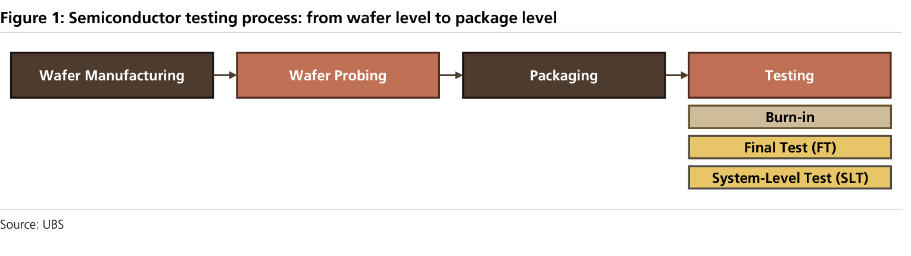

### 解讀摘要
半導體測試分四段：CP（晶圓探針）→ Packaging → FT（最終測試）→ SLT → Burn-in。Shift-left 策略把更多測試工作從封裝後前移至晶圓階段（CP），因為封裝後發現缺陷的成本遠高於晶圓階段——這是整份報告的核心邏輯起點。

---

## Figure 2｜Yole：測試耗材 TAM 未來 5 年持續擴張

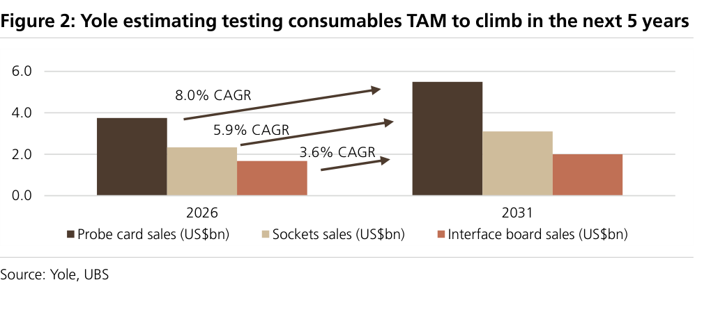

### 解讀摘要
探針卡（CAGR 8%）是三項耗材中成長最快的，主因 AI 晶片功率密度上升讓探針卡損耗加速（需要 thermal control 配套）、且 CP 測試插次數增加。Sockets（5.9%）與 Interface boards（3.6%）成長相對溫和。

### 表格

| 耗材 | 2026E（US\$bn） | 2031E（US\$bn） | CAGR |
|---|---|---|---|
| 探針卡 | 3.8 | 5.5 | 8.0% |
| Sockets | 2.3 | 3.1 | 5.9% |
| Interface boards | 1.7 | 2.0 | 3.6% |

> **洞察一**：漢測在三項耗材中選擇最高成長率的探針卡（清潔材料）切入，但 thermal control module 才是核心收入（Fig 3 顯示 2027E 佔總銷售 52%），估值上行潛力更大。

---

## Figure 3｜漢測 46% 2026-31E 銷售 CAGR 詳細預測

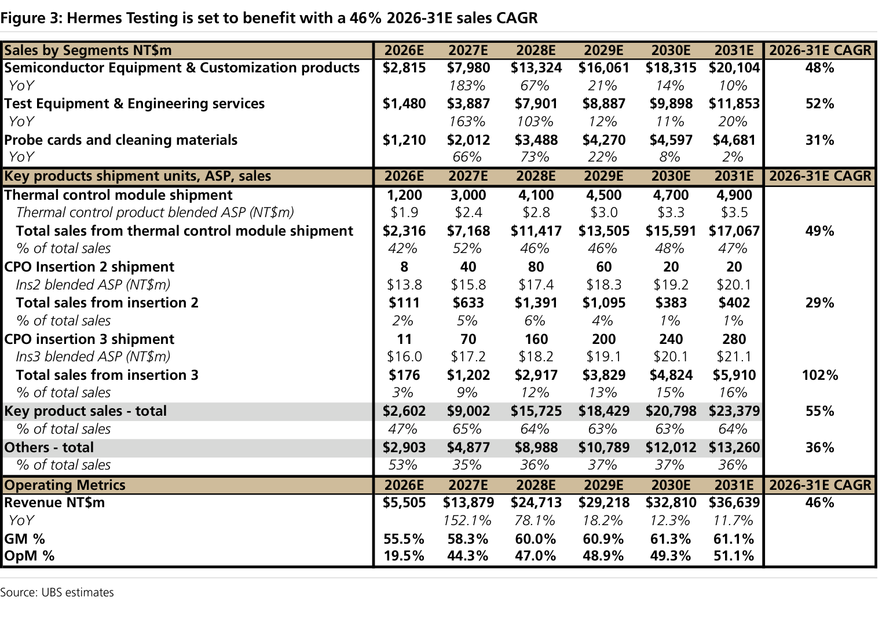

### 解讀摘要
這是整份報告最重要的數據表。兩個核心驅動：(1) thermal control module 從 2026E 1,200 台→2027E 3,000 台，ASP 同步升 26%（NT\$1.9m→2.4m），帶動 semiconductor equipment 銷售 +183% YoY；(2) CPO insertion 2+3 combined 從 2026E 19 套→2027E 110 套（+479%），但由於 ASP 高（NT\$14-16m），即使數量不大、金額也不小。

> **原文補充**：2027E thermal control module 達 3,000 台的判斷來自 read-across Advantest 產能擴張計畫（宣布目標 FY2027/3 前達 5,000 台 tester 產能）——漢測 thermal control module 與 prober 1:1 配套，因此可用 Advantest 擴產規模反推需求上限。

### 表格

**銷售分部（NT\$m）**

| 業務 | 2026E | 2027E | 2028E | 2026-31E CAGR |
|---|---|---|---|---|
| 半導體設備與客製化 | 2,815 | 7,980 | 13,324 | 48% |
| 測試設備與工程服務 | 1,480 | 3,887 | 7,901 | 52% |
| 探針卡與清潔材料 | 1,210 | 2,012 | 3,488 | 31% |
| **總營收** | **5,505** | **13,879** | **24,713** | **46%** |

**關鍵產品出貨量與 ASP**

| 產品 | 2026E | 2027E | 2028E |
|---|---|---|---|
| Thermal control module 出貨量（台） | 1,200 | 3,000 | 4,100 |
| 　ASP（NT\$m） | 1.9 | 2.4 | 2.8 |
| 　收入（NT\$m） | 2,316 | 7,168 | 11,417 |
| 　佔總銷售 | 42% | 52% | 46% |
| CPO Insertion 2 出貨量（套） | 8 | 40 | 80 |
| 　ASP（NT\$m） | 13.8 | 15.8 | 17.4 |
| 　收入（NT\$m） | 111 | 633 | 1,391 |
| CPO Insertion 3 出貨量（套） | 11 | 70 | 160 |
| 　ASP（NT\$m） | 16.0 | 17.2 | 18.2 |
| 　收入（NT\$m） | 176 | 1,202 | 2,917 |

**獲利能力**

| 指標 | 2026E | 2027E | 2028E |
|---|---|---|---|
| GM | 55.5% | 58.3% | 60.0% |
| OPM | 19.5% | 44.3% | 47.0% |

> **洞察二**：OPM 從 2026E 19.5% 飆升至 2027E 44.3%，關鍵在於 2026E 包含 NT\$1bn 員工股購計畫一次性費用（相當於 2026E 總營收 18%）；若剔除此費用，2026E adj. OPM 接近 38%，2027E OPM 擴張幅度遠小於表面數字顯示。
>
> **洞察三（配合 Fig 13）**：2026E Opex bar 明顯高於 2027E（NT\$2,000m vs NT\$1,940m），儘管 2027E 營收高出 152%——此反常現象完全來自 2026E 的 NT\$1bn 一次性員工股購費用，若不理解此點將誤判 2027E 管銷費用「大幅節省」，實際上是一次性費用消失。

---

## Figure 4｜Shift-Left 下的 CP 測試擴張流程

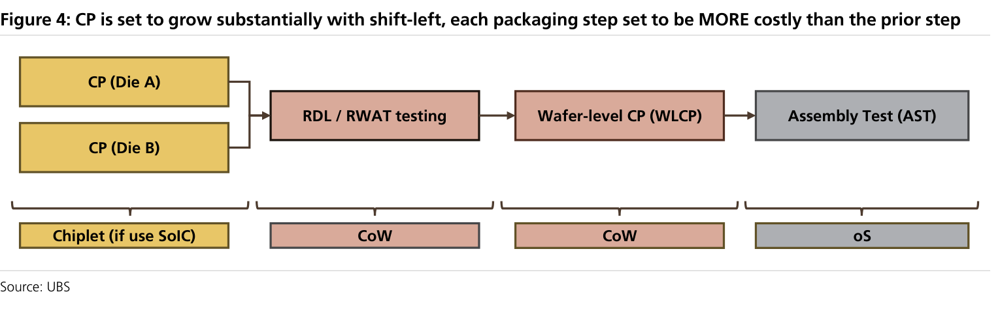

### 解讀摘要
先進封裝的「每步驟比前步驟更昂貴」特性，使 Chiplet/SoIC 流程中 CP（Die A/B）→ RDL/RWAT → WLCP → AST 每一道測試的 cost-of-defect 呈指數增加。這直接驅動晶圓廠（TSMC）投入更多 CP 次數和更長測試時間，以避免缺陷件進入後段昂貴的封裝流程——漢測 thermal control module 需求的結構性支撐。

---

## Figure 5｜CP 功率需求 5 年增長 5 倍

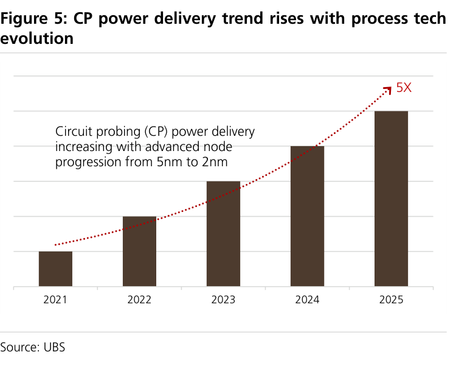

### 解讀摘要
CP 功率需求從 2021 到 2025 年增長 5 倍，驅動力為製程從 5nm→2nm 的縮微。更高功率 = 更高 TDP = 晶圓探針卡面臨燒針風險，thermal control module 從「可選配件」轉為「必備設備」。漢測的市場機會源自這個物理需求，不依賴客戶的主觀採購意願。

---

## Figure 6｜Thermal Control Module 在 Prober 內部架構

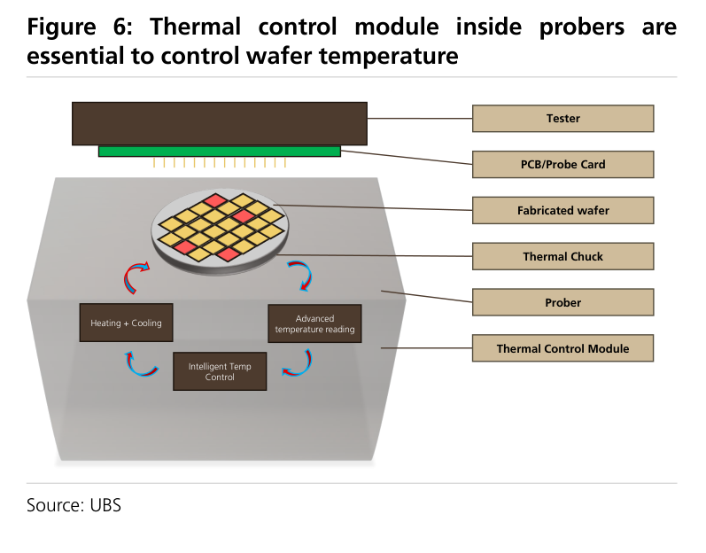

### 解讀摘要
Thermal control module 透過 Heating+Cooling + Advanced temperature reading + Intelligent Temp Control 三模組閉環控制 chuck 溫度，保護 probe card 避免損壞。漢測提供的是 prober 的「附屬必備系統」，且需要客製化配合各代 prober 設計——這道客製化壁壘使競爭者難以複製，HTSI 競爭地位隨每代 prober 升級而強化。

---

## Figure 7｜Insertion 2 測試方法示意

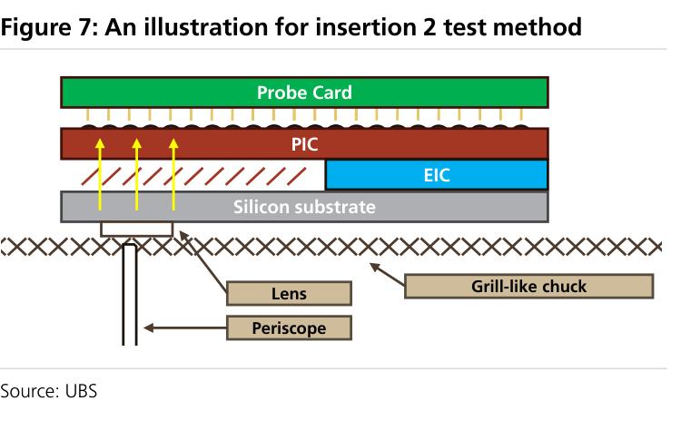

### 解讀摘要
Insertion 2 是在 EIC+PIC 混合鍵合後（wafer 級）做雙面光電測試：頂面測電訊號（Probe Card + PIC 上的電），底面透過 Periscope+Lens 測光訊號。這個雙面測試是整個 CPO 流程中技術難度最高的一道，也是市場最懷疑「能否量產」的環節——UBS 認為難度確實存在但不至於被跳過。

---

## Figure 8｜Insertion 3 測試方法示意

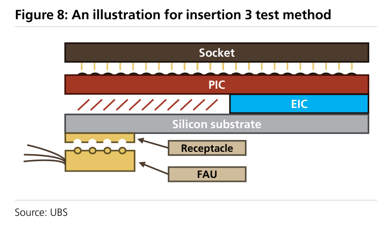

### 解讀摘要
Insertion 3 對 Optical Engine（EIC+PIC 奇化後的光學引擎）做 die/chip 級測試，需要 FAU（Fiber Array Unit）與 Receptacle 連接光纖，確認 224G per channel 訊號完整性。相較 insertion 2 難度較低，但對每顆 OE 的 100% KGD 驗證是商業必要條件（32顆 OE 任一顆壞 → 整個 switch ASIC CoW 報廢）。

---

## Figure 9｜CPO 四段測試流程與關鍵供應商

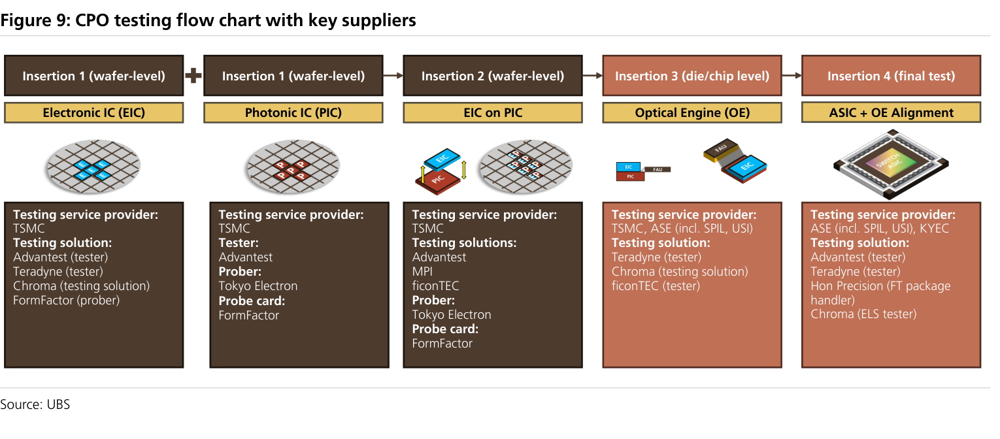

### 解讀摘要
CPO 完整測試鏈橫跨四道 Insertion：Ins1（EIC/PIC wafer 測試，主要供應商：Advantest/Teradyne/Chroma/FormFactor）→ Ins2（EIC on PIC 光電測試，ficonTEC 是關鍵）→ Ins3（OE 測試，Chroma+ficonTEC）→ Ins4（ASIC+OE 最終測試，ASE/KYEC 做服務）。漢測透過 ficonTEC 參與 Ins2+3，同時在 Ins1 有客製化 PIC prober solution。

---

## Figure 10｜HTSI CPO 設備銷售 2027/28E 飆升 541%/135%

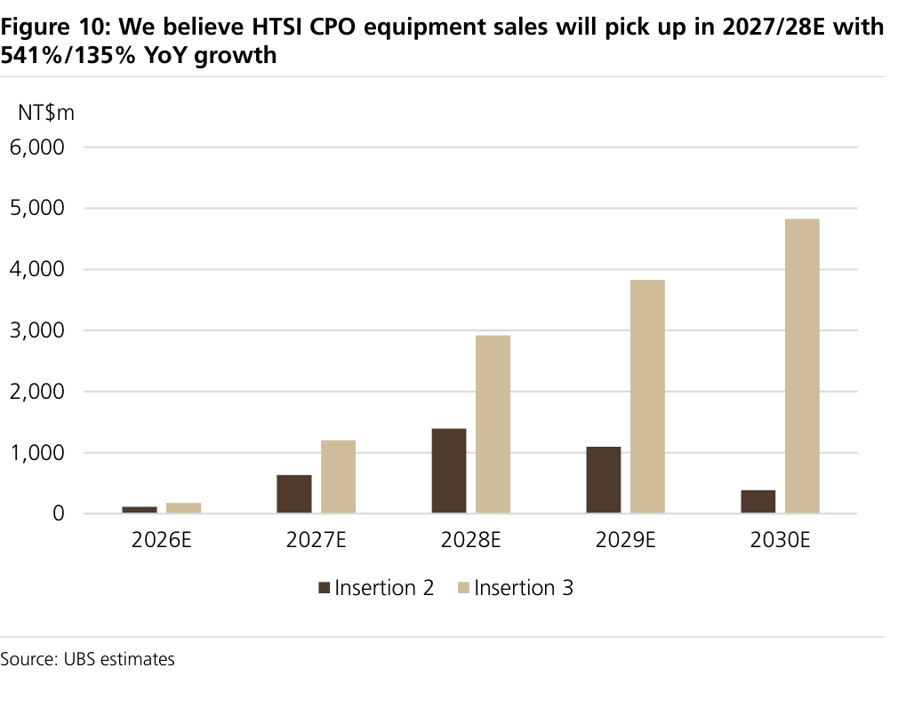

### 解讀摘要
CPO 設備銷售在 2026E 尚屬樣品階段（合計約 NT\$287m），2027E 隨 Ins2（40套）+Ins3（70套）放量跳升至約 NT\$1,835m（+541% YoY），2028E 進一步至 NT\$4,308m（+135%）。2029E Ins2 出貨量開始下降（Ins2 long-term 可能隨 PIC yield 提升而式微），但 Ins3 持續成長，整體 CPO 設備收入仍維持高位。

### 表格

| 年度 | Ins2 收入（NT\$m） | Ins3 收入（NT\$m） | 合計（NT\$m） | YoY |
|---|---|---|---|---|
| 2026E | 111 | 176 | 287 | — |
| 2027E | 633 | 1,202 | 1,835 | +541% |
| 2028E | 1,391 | 2,917 | 4,308 | +135% |
| 2029E | 1,095 | 3,829 | 4,924 | +14% |
| 2030E | 383 | 4,824 | 5,207 | +6% |

> **值得驗證**：2027E 40套 ins2 出貨假設是整份報告最大的 alpha 來源，也是最大的風險點。若市場普遍預期 0 台，漢測現價已「完全未定價」這部分收入（NT\$633m ≈ 2027E 總營收 4.6%）。若 ins2 因良率改善或業界決定跳過而延遲至 2028E，2027E EPS 將從 NT\$153 降至約 NT\$130-140（約 -10%），TP 相應下調。

---

## Figure 11｜32 OE Switch Chip 與 CPO 封裝供應鏈

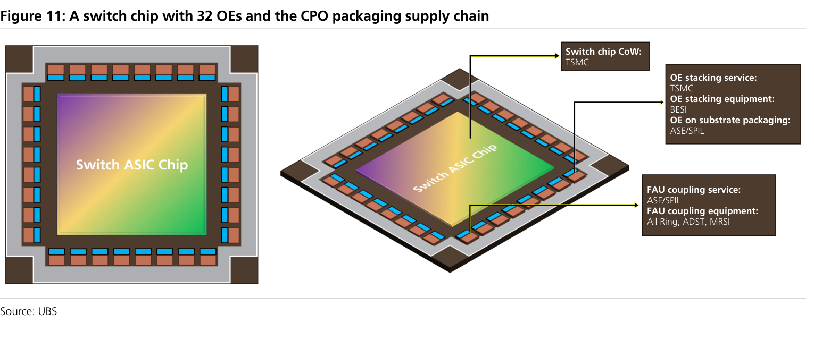

### 解讀摘要
Nvidia Spectrum-X 架構使用 32 顆 OE 封裝在 Switch ASIC 上（CoW by TSMC），OE 堆疊服務（BESI）+基板封裝（ASE/SPIL）+FAU coupling（All Ring/ADST/MRSI）各有專屬供應商。任何一顆 OE 在 Ins3 測試不通過都必須報廢整個封裝——這是為什麼 Ins3 「100% KGD」測試是商業不可或缺的核心邏輯，支持 UBS 對 ins3 出貨量的樂觀預測。

---

## Figure 12｜HTSI 營收 + 毛利率 2024-2028E

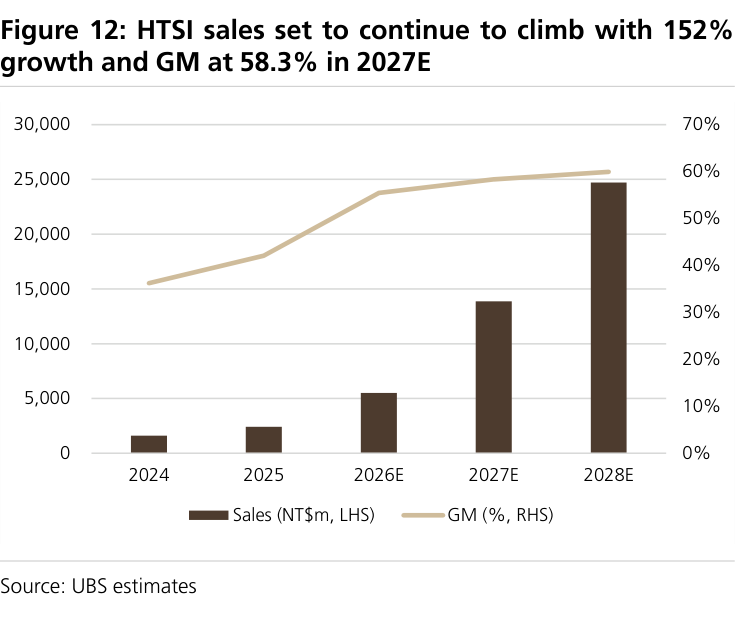

### 解讀摘要
營收呈現「曲棍球棍」形態：2024-2025 年 NT\$1,598/2,425m 的小規模基期，2026E 開始快速起飛（NT\$5,505m，+127%）；GM 同步從 2024 年約 36%（低值，無 thermal module 規模效應）提升至 2026E 55.5%、2027E 58.3%，顯示 thermal control module 高毛利率驅動整體組合改善。

---

## Figure 13｜OPM 2027E 達 44.3%（2026E 含一次性費用偏低）

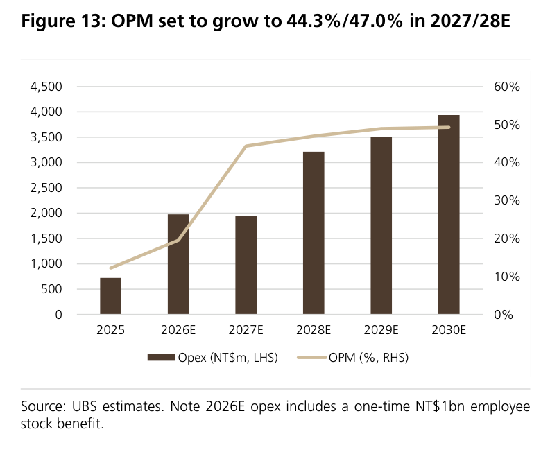

### 解讀摘要
2026E Opex NT\$2,000m 異常高於 2027E NT\$1,940m，主因 NT\$1bn 員工股購計畫一次性費用。2027E OPM 44.3% 反映的是正常化後的高毛利+固定費用槓桿效果，是更具代表性的盈利能力水準。2030E OPM 進一步升至約 51%，呈現顯著的 operating leverage。

---

## Figure 14｜三大業務段收入預測 2025-2030E

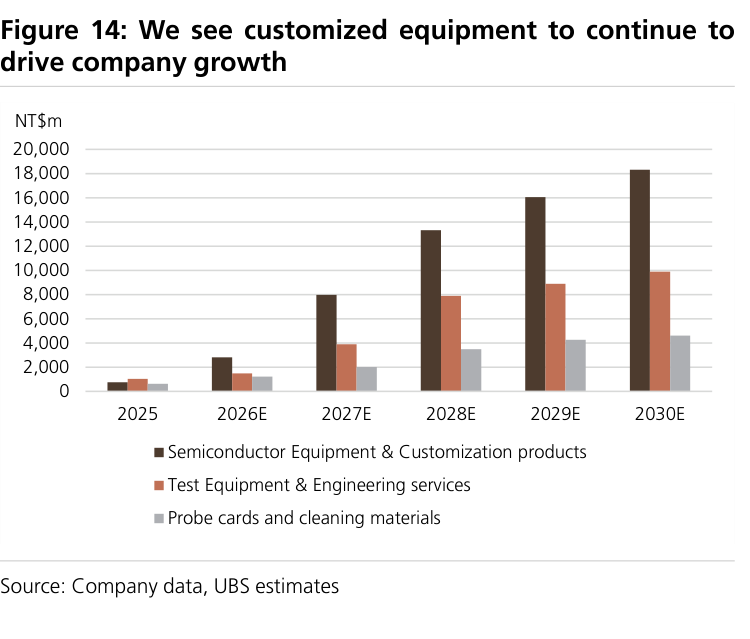

### 解讀摘要
半導體設備（深色）是主要驅動，從 2026E NT\$2,815m 飆升至 2028E NT\$13,324m（×4.7）；測試設備與工程服務（橘色）是第二驅動，從 NT\$1,480m 升至 NT\$7,901m；探針卡材料（灰色）是穩定基礎，成長相對緩慢。三業務協同代表漢測是「全方位 CP+CPO 測試生態系統服務商」，而非單一產品公司。

---

## Figure 15｜HTSI H126 銷售結構

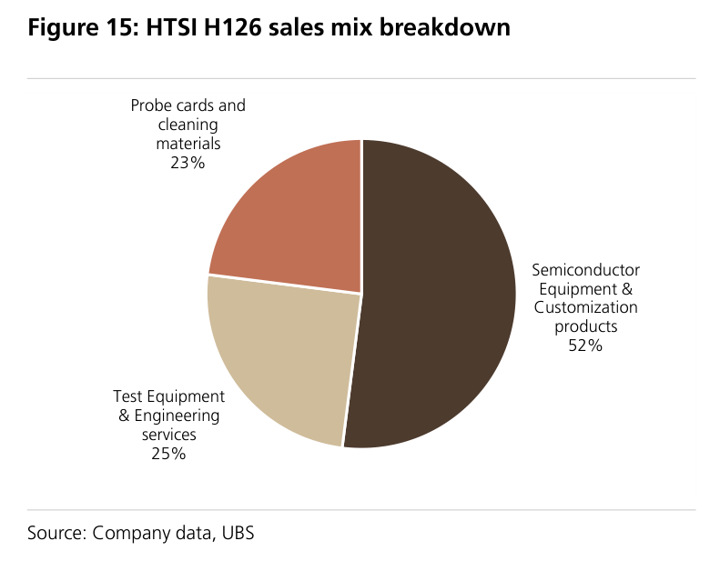

### 解讀摘要
H126 時（報告基期）：半導體設備 52%、測試設備 25%、探針卡 23%。相較 2027E 預測（thermal module >50% 單項 ≈ 整體 semiconductor equipment 大部分），目前結構偏向早期均衡配置；這說明 thermal control module 的比例還在 H126 奠基，2H26 才開始快速放量，2027E 才真正成為主角。

---

## 相關個股清單

| 類別 | 公司 | Ticker | 評等 | 備註 |
|---|---|---|---|---|
| 核心標的 | 漢測 | 7856.TWO | Buy | PT NT\$8,880，31x avg 2028E PE |
| CPO 測試夥伴 | ficonTEC | N/A（德商） | N/A | 提供 CPO 測試設備，漢測負責台灣本地化 |
| CPO 測試競爭者 | 致茂電子（Chroma） | 2360.TW | N/A | Ins3 主要競爭者 |
| Prober（漢測配套） | 東京電子（TEL） | 8035.JP | N/A | 主要 prober 供應商，漢測提供配套 thermal module |
| 下游 OSAT | ASE、SPIL | 3711/2325 | N/A | Ins3/Ins4 測試服務業者 |
