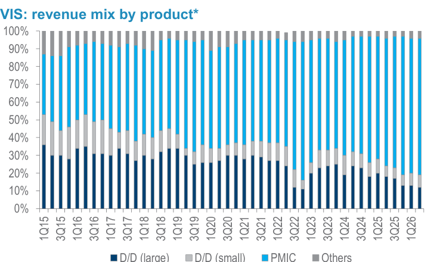
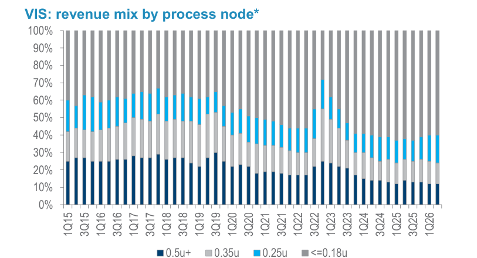
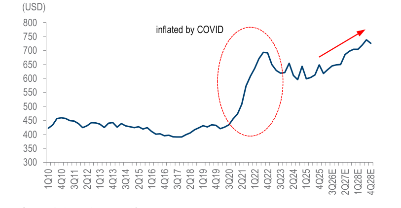
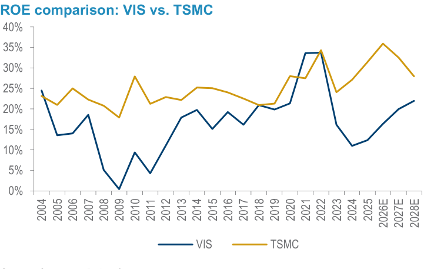
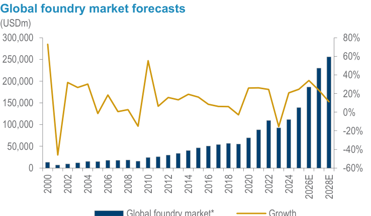
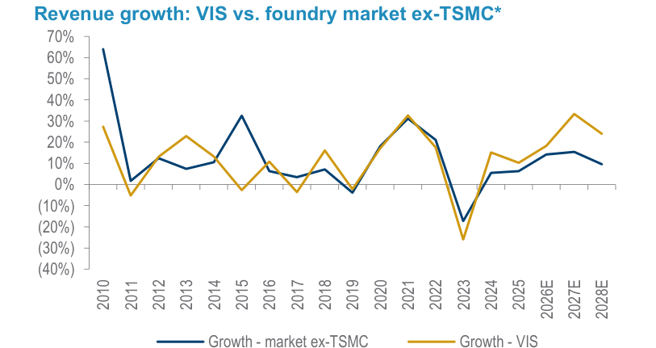
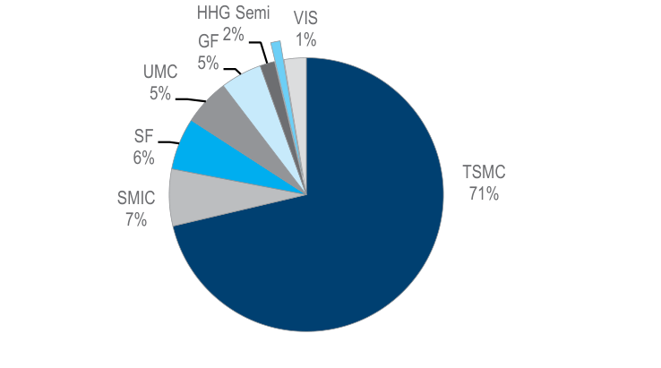

# Daiwa｜世界先進（VIS）啟動覆蓋：AI 漣漪效應下的特殊製程晶圓代工

**券商**：Daiwa Capital Markets  
**分析師**：Rick Hsu、Sam Weng  
**日期**：2026-10-09  
**主題**：世界先進 (5347 TT) 啟動覆蓋——快速建廠搶佔 AI 漣漪效應  
**評級**：Outperform (2)，TP TWD210  
<a href="https://layx.uk/dl?g=產業&b=Daiwa&d=20261009&h=VIS-Initiation">📎 下載 PDF</a>

---

## 報告總結

Daiwa 以 Outperform (2) 啟動覆蓋世界先進（VIS），目標價 TWD210（vs 市價 TWD190，+10.5%）。核心論點：AI 算力需求漫延至電源與連接，形成對特殊製程晶圓代工的「漣漪效應」；加上母公司台積電的廠房優化重新分配成熟製程訂單，VIS 的晶圓載入率預計在 2027 年前接近滿載，且已透過 LTA 鎖定所有規劃產能、消化折舊衝擊。新加坡 12 吋廠（VSMC）搶提前半年於 1Q27 量產，2028 年底達 44,000wpm 一期產能，其中 30% 供台積電 CoWoS 矽中介層，其餘供 PMIC 及嵌入式快閃。Daiwa 預估 2026-28E 營收 CAGR 30%、EPS CAGR 26%，以 ROE 調整 PBR 法（5.2x BVPS）設目標價，相當於 26x 4Q 前向 PER，股價折讓顯著。

---

## Daiwa 完整投資邏輯鏈

| 論點層次 | 依據 | 內容 |
|---|---|---|
| 基本面：需求結構改變 | Fig 16、Fig 17 | AI 需求從算力漫延至電源管理，造成對特殊製程代工的漣漪需求；全球代工市場 2026E +30% YoY，VIS 預估超越 ex-TSMC 市場成長速度 |
| 基本面：供給緊繃 + 定價力 | Fig 4、Fig 9 | PMIC 佔比升至 77%，LTA 鎖定所有 VSMC 產能；ASP 每 QoQ+1-5% 持續至 2028 超過 USD700/wafer，抵消折舊稀釋 |
| 結構性優勢：台積電夥伴關係 | 封面 | VSMC 30% 產能供台積電 CoWoS 矽中介層（65/55nm）；台積電提供技術授權（GaN）與設備寄存；台積電廠房優化持續將訂單溢出至 VIS |
| 估值：PBR 方法 | Fig 13 | VIS 長期 ROE（16-23%）vs TSMC（35-43%）→ 33% 折扣 → 5.2x 目標 PBR = TWD210 TP；隱含 26x 4Q 前向 PER，PEG 僅 0.8x（30% EPS CAGR） |
| 股價落後 | 封面 | 市價 TWD190 = 24x 4Q 前向 PER，處於後 GFC 區間 5-30x 上緣；Daiwa 2027E EPS 比共識高 5%，市場上修空間存在 |
| 催化劑 | 封面 | 1) 月營收連創新高；2) 季度展望優於預期；3) 毛利率韌性（Daiwa 估 GM 維持 32-34%，2H28 回升至 35%+）|
| **結論** | 啟動覆蓋 | **Outperform (2)，TP TWD210；12" 建廠提前、LTA 全鎖定是核心邏輯，折舊擔憂已在報告中量化且可控** |

> **報告最大邏輯缺口**：VSMC 40% 股東 NXP 的訂單黏著度未有詳細揭露；若 NXP 未來因策略調整縮減對 VSMC 的投片承諾，VIS 的定價力假設可能需要下修。

---

## 報告核心觀點

| 主題 | Daiwa 觀點 | 市場共識 | 是否 Contra-Consensus |
|---|---|---|---|
| 2027 年產能利用率 | 接近滿載（95%），LTA 鎖定所有 VSMC 新產能 | 12" 快速擴廠通常伴隨稼動率稀釋，市場疑慮較大 | ✅ 是，Daiwa 認為 LTA 消除稀釋疑慮 |
| 折舊對毛利率衝擊 | GM 維持 32-34% 至 2028 1Q，之後回升至 35%+ | 市場擔憂折舊激增（D&A 2027E +54% YoY）壓縮獲利 | ✅ 是，Daiwa 認為定價力 + 節點升級足以對衝 |
| 2027E EPS | TWD7.92（高於共識約 5%） | 共識 TWD7.54 | ✅ 是 |
| 台積電持股減少影響 | 無直接關聯，技術授權（GaN）及設備寄存不受影響 | 市場曾擔憂台積電減持 8pp 是策略撤退信號 | ✅ 是，Daiwa 認為戰略合作持續 |
| VSMC 相 2 建廠可能性 | 台積電若持續關閉成熟 12" 廠，VIS 有誘因啟動第二期（40-50,000wpm，28nm-以下） | 市場普遍尚未定價相 2 |  ✅ 是，長期看多論點 |

**偏好排序**：VIS > UMC（台股晶圓代工），TSMC 由 Buy (1) 獨立覆蓋  
**相關個股偏好**：VIS Outperform (2)、TSMC Buy (1)、UMC Hold (3)、HHGrace 1347 HK Buy (1)

---

## Fig 4｜VIS 產品別營收結構（1Q15-2Q26）

### 解讀摘要

PMIC 佔比從 2015 年的約 40% 一路攀升至 2Q26 的 77%，顯示 VIS 在台積電的策略引導下，已完成從消費電子顯示驅動 IC（D/D）到工業/AI 電源管理晶片（PMIC）的商業模式轉型。D/D（大尺寸）佔比持續萎縮（預估降至 10%+ 維持基線），Others（LED driver、embedded memory、CMOS image sensor 等）維持小比例。PMIC 的進一步上升反映 AI 伺服器對高電壓 PMIC 需求的結構性增長——這是純增量 TAM，而非搶奪 D/D 市占，意味著 VIS 不需要犧牲現有客戶關係就能擴大收入。

### 表格

| 產品類別 | 趨勢 | 2Q26 估計佔比 |
|---|---|---|
| D/D（大尺寸） | 持續下滑 | 低個位數% |
| D/D（小尺寸） | 小幅下滑 | 低個位數% |
| **PMIC** | **持續上升** | **~77%** |
| Others（LED、嵌入記憶、CIS） | 相對穩定 | 中個位數% |

---

## Fig 5｜VIS 製程節點別營收結構（1Q15-2Q26）

### 解讀摘要

製程節點組合顯示明確的「向先進製程移動」趨勢：≤0.18μm（含 0.18/0.15/0.13/0.11μm）在 2Q26 佔比達 46%，且 Daiwa 預估 VSMC 12" 廠上線後（全部在 0.13μm 至 40nm 節點）以及台積電矽中介層（65/55nm）佔比 30%，整體 ≤0.13μm 組合將升至超過 60%。更先進的節點 = 更高 ASP 與更高毛利率——這是對抗 VSMC 折舊壓力的關鍵緩衝機制。0.25μm 和 0.35μm 的相對穩定反映 D/D 基線客戶的繼續支撐，不會急劇萎縮。

### 表格

| 製程節點 | 2Q26 估計佔比 | 趨勢（2026-28E） |
|---|---|---|
| 0.5μm+ | 低個位數% | 萎縮 |
| 0.35μm | ~10% | 緩降 |
| 0.25μm | ~16% | 緩降 |
| ≤0.18μm（含≤0.13μm） | ~46%→>60% | 顯著上升 |

> **洞察一**：VSMC 新增產能（全部≤0.13μm）+ TSMC 矽中介層（65/55nm）的組合使 ≤0.13μm 比重從 46% 跳升到 >60%，直接推動 ASP 從 USD632（2Q26）提升至 USD700+（2028E）——節點升級和 VSMC 量產是同一時間軸，強化了定價力的可預測性。

---

## Fig 9｜VIS 季度均混合 ASP 趨勢（2010-2028E，USD/wafer，8"等效）

### 解讀摘要

均混合 ASP 從 2Q26 的 USD632/wafer 逐季提升，Daiwa 預估每 QoQ +1-5%，2028 年全年平均達 USD723，超越 2022 年 COVID 高峰的 USD670。這不是單純的週期性漲價，而是節點組合升級的結構性提升（更高≤0.13μm 比重 + 台積電矽中介層高規格）。值得注意的是 2025 年 ASP 跌至 USD616（COVID 後庫存修正低點）後的 V 型回升幅度——2026-28E 兩年漲幅 +17%，遠超典型代工週期漲幅。

### 表格

| 季度 | ASP（USD） | QoQ 變化 |
|---|---|---|
| 1Q26 | 618 | — |
| 2Q26 | 632 | +2.3% |
| 3Q26E | 645 | +2.1% |
| 4Q26E | 649 | +0.6% |
| 1Q27E | 650 | +0.2% |
| 2Q27E | 685 | +5.4% |
| 3Q27E | 697 | +1.8% |
| 4Q27E | 704 | +1.0% |
| **年均** | | |
| 2025A | 616 | — |
| 2026E | 637 | +3.4% |
| 2027E | 686 | +7.7% |
| 2028E | 723 | +5.4% |

> **洞察一**：2Q27E 的 USD685 (+5.4% QoQ) 是整個預測期最大的單季跳升，對應 VSMC 第一批高規格 0.13μm 矽中介層產能加入組合的時間點，印證 Daiwa 的「製程升級驅動 ASP」假設。若 VSMC 量產進度延遲，此節點的 ASP 跳升也會後移。

> **值得驗證**：USD685/wafer 的 2Q27E ASP 假設 TSMC 矽中介層（預估 30% VSMC 產能）能在 1Q27 量產後迅速在 2Q27 達到滿載。若矽中介層爬坡速度比預期慢，2027 ASP 有低估風險。

---

## Fig 13｜ROE 比較：VIS vs TSMC（2004-2028E）

### 解讀摘要

VIS 長期 ROE 結構性低於台積電（TSMC ROE 2026E 42.8% vs VIS 16.8%），這是 Daiwa 估值方法的核心——以 33% 折扣（VIS vs TSMC 長期 ROE 比率）調整台積電的目標 PBR 7.7x，得出 VIS 目標 PBR 5.2x。然而 VIS ROE 上升趨勢明確（16.8%→20.8%→22.6%，2026-28E），TSMC 則處於高原（37-43%）；隨著 VSMC 折舊週期在 2029 過峰，VIS ROE 有望進一步向上，壓縮估值折扣，成為再評等的潛在動力。

### 表格

| 年份 | VIS ROE | TSMC ROE | VIS/TSMC 比率 |
|---|---|---|---|
| 2025A | 12.4% | 35.4% | 35% |
| 2026E | 16.8% | 42.8% | 39% |
| 2027E | 20.8% | 37.6% | 55% |
| 2028E | 22.6% | — | — |

> **洞察一**：2027E VIS/TSMC ROE 比率從 35%（2025）跳升至 55%（2027），若 Daiwa 維持同樣的折扣方法，到 2028 年底重新評估目標 PBR 時，比率改善意味著折扣空間縮小，TWD210 的目標價可能需要上修——Daiwa 本報告並未量化這一潛在上修空間。

---

## Fig 16｜全球晶圓代工市場預測（2000-2028E）

### 解讀摘要

全球晶圓代工市場在 2023 年後 COVID 庫存修正低點後急速回升，2024-25 年各成長超過 20% YoY，Daiwa 預估 2026E 加速至超過 30% YoY，達 USD186bn；2028E 達 USD255bn+，2025-28E CAGR 為 23%。若排除台積電（以成熟製程代工市場為代理），市場 2026E +14% YoY，2028E 接近 USD60bn，CAGR 13%——VIS 目標超越此成長速度，反映 12" 擴廠的市占提升邏輯。注意：Daiwa 的市場定義為純代工服務，不含台積電定義的 Foundry 2.0（含封測）。

### 表格

| 年份 | 全球代工市場規模（USD bn，估計） | YoY |
|---|---|---|
| 2023 | ~90 | 下滑後 |
| 2024 | ~110+ | +20%+ |
| 2025 | ~140 | +20%+ |
| 2026E | ~186 | +30%+ |
| 2027E | ~215 | +16% |
| 2028E | ~255+ | +19% |

> **洞察一（配合 Fig 17）**：全球代工市場 2025-28E CAGR 23%，VIS 同期 CAGR ~30%——超額成長來自 12" VSMC 擴廠，屬純增量；而 ex-TSMC 代工市場 CAGR 僅 13%，VIS 的超額表現意味著市占從 ~4%（ex-TSMC）持續提升，是整個投資邏輯的量化支柱。

---

## Fig 17｜VIS vs ex-TSMC 代工市場成長率比較（2010-2028E）

### 解讀摘要

線圖比較 VIS 與 ex-TSMC 代工市場（以成熟製程市場為代理）的 YoY 成長率，2010-2025 期間兩者高度同步（代工市場拉力主導）；2026-28E 開始顯著分岔，VIS 在整個預測期持續超越市場 ex-TSMC。分岔的驅動因子是 VSMC 純增量容量（不是奪取其他代工廠份額），搭配 TSMC 廠房優化後的訂單溢出效益——兩者相疊加放大了 VIS 的超額成長。歷史上 VIS 每次擴廠期（2015-18、2021-22）都伴隨強烈的超額成長，之後跟隨產業週期同步修正——此次的差異在於 LTA 鎖定。

> **洞察一**：2026-28E 的分岔幅度（VIS +30% CAGR vs 市場 ex-TSMC +13% CAGR）是 Daiwa 估值溢價的核心支撐。若 VSMC 爬坡慢於預期，此分岔就會收斂，直接衝擊目標價。

---

## Fig 18｜2025 年全球晶圓代工市場份額（佔比）

### 解讀摘要

台積電以 71% 市占獨霸全球代工市場，SMIC 7%、Samsung Foundry 6%、UMC 5%、GlobalFoundries 5%、HHGrace 2%，VIS 以 1% 位列第七。若以 ex-TSMC 成熟製程代工市場計算，VIS 份額約 4%，是有意義的市場參與者。1% 的小基數意味著 VIS 即使顯著增加市占（例如從 1% 到 1.5%），絕對增量對整體代工市場規模影響微小，但對 VIS 自身就是 50% 的體量增長——高成長的低基數優勢。

### 表格

| 代工廠 | 2025 年估計市場份額 |
|---|---|
| TSMC | 71% |
| SMIC | 7% |
| Samsung Foundry (SF) | 6% |
| UMC | 5% |
| GlobalFoundries (GF) | 5% |
| HHGrace（華虹半導體） | 2% |
| VIS（世界先進） | 1% |
| 其他 | 3% |

---

## 相關個股清單

| 類別 | 公司 | Ticker | 評等 | 備註 |
|---|---|---|---|---|
| 主要覆蓋 | 世界先進 | 5347 TT | Outperform (2) | 目標價 TWD210 |
| 同業 | 台積電 | 2330 TT | Buy (1) | VSMC 戰略夥伴，矽中介層主要客戶 |
| 同業 | 聯電 | 2303 TT | Hold (3) | 競爭對手，成熟代工 |
| 同業 | 華虹半導體 | 1347 HK | Buy (1) | 競爭對手，估值比較用 |
| D/D 客戶 | 聯詠 | 3034 TT | Hold (3) | VIS 主要 D/D 客戶之一 |
| 電源客戶 | Renesas | 6723 JP | Outperform (2) | VIS PMIC 代工客戶（IDM） |
| 電源客戶 | Qualcomm | QCOM US | Outperform (2) | VIS PMIC 代工客戶 |
| JV 夥伴 | NXP | NXPI US | — | VSMC 40% 股東，未覆蓋 |
| 媒體科技 | 聯發科 | 2454 TT | Buy (1) | 透過子公司 Richtek 為 VIS PMIC 客戶 |
