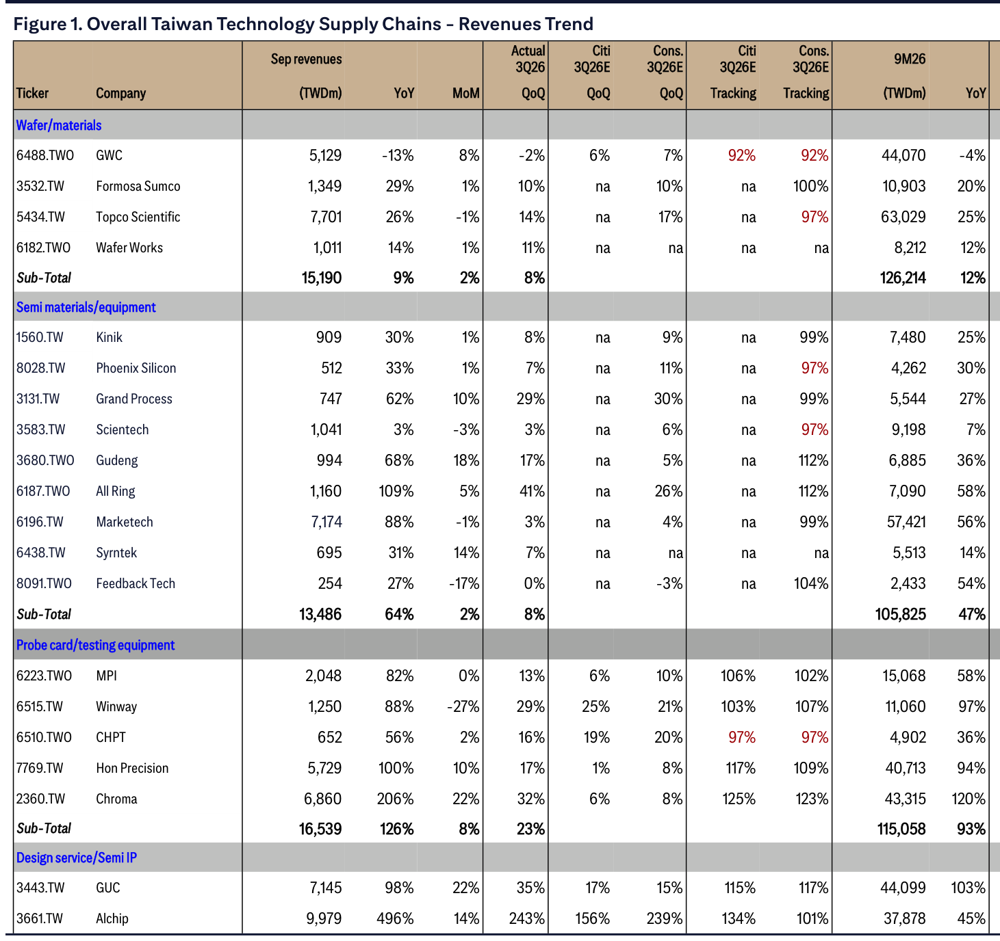

# Citi｜Taiwan Monthly Tracker & AI Update

**券商**：Citi Research  
**分析師**：Laura (Chia Yi) Chen、Jack Chen、Angela Hsu、Michael Hung、Nicholas Lai  
**日期**：2026-10-12  
**主題**：Taiwan Tech Supply Chain 9月月營收追蹤 + 3Q26 業績前瞻  
**評級**：N/A（月度追蹤報告）  
<a href="https://layx.uk/dl?g=產業&b=Citi&d=20261012&h=TW-Monthly-Tracker">📎 下載 PDF</a>

---

## 報告總結

台灣科技供應鏈 3Q26 整體繳出穩健成績：晶圓代工（TSMC +18% QoQ）、OSAT（ASEH +28% QoQ）、測試介面持續超預期，ABF 基板與 CCL 加速成長，Server ODM 受惠 Rubin 系統與 ASIC 機架拉貨。ASIC 設計端尤為突出——Alchip +243% QoQ 反映 Trainium 3 急速放量。Citi 點名 TSMC 3Q26 法說會為 AI 供應鏈能見度關鍵催化劑，預期公司將提供更清晰的 4Q26/2027 展望。配置偏好：基板（Unimicron > NYPCB > Kinsus）> CCL（EMC > TUC）> PCB。

---

## Citi 完整投資邏輯鏈

| 論點層次 | Exhibit | 內容 |
|---|---|---|
| 需求信號明確 | 封面 | AI 算力需求驅動晶圓代工、封測、測試介面全面超預期；TSMC 3Q26 +18% QoQ，ASEH +28% QoQ |
| 供應鏈彈性呈現分化 | 封面 | AI 相關（基板/CCL/ASIC）加速成長；PC/NB 4Q26E 轉弱（-7% QoQ/-28% YoY）|
| 新催化劑浮現 | 封面 | Rubin Ultra CPO 測試需求 late 2026/early 2027；CCL 第二輪漲價 11 月啟動 |
| 季報能見度提升 | 封面 | TSMC 法說會為 2027 AI 供應鏈最重要指標，預期提供 4Q26/2027 清晰展望 |
| **結論** | 封面 | **AI 供應鏈正向進入法說季；維持基板 > CCL > PCB 配置偏好** |

---

## 報告核心觀點

| 主題 | Citi 觀點 | 市場共識 | 是否 Contra-Consensus |
|---|---|---|---|
| TSMC 2026 全年成長 | 有望超越全年指引，達 mid-40% YoY | 市場原預期達標 | 輕微偏多 |
| ABF 基板 4Q26 | 4Q26E 成長動能比 3Q 更強（所有 AI 晶片同步 ramp） | 普遍正向 | 略偏樂觀 |
| CCL 第二輪漲價 | 11 月起新一輪漲價，EMC>TUC | 尚未完全定價 | Contra-consensus |
| Alchip 3Q26 | +243% QoQ，Trainium 3 放量，訂單流入至 4Q26/2027 | 市場預期 +156% QoQ | 顯著超預期 |
| PC/NB 4Q26 | -7% QoQ/-28% YoY，零件採購受限加劇毛利稀釋 | 普遍偏弱 | 與共識方向一致 |
| Dynapack Sep | -54% MoM（BBU 出貨遞延），Oct 大幅反彈 | 市場已知偏弱 | 確認 |

**偏好排序**：基板（Unimicron > NYPCB > Kinsus）> CCL（EMC > TUC）> PCB  
**個股亮點**：Alchip（Trainium 3 爆發）、Chroma（Sep +22% MoM）、Hon Precision（順利 ramp）、AVC（ASIC + Vera Rubin 創月銷售新高）

---

## Figure 1｜Overall Taiwan Technology Supply Chains - Revenues Trend

### 解讀摘要

Figure 1 是 Citi 台灣科技供應鏈月度追蹤總表，涵蓋晶圓/材料、半導體材料設備、探針卡/測試設備、IC 設計服務、晶圓代工、封測、ABF 基板/PCB/CCL、Server ODM、PC/NB、光學、散熱、電源/BBU、被動元件等所有次產業約 100+ 家公司，記錄 Sep-26 月營收（TWDm）、YoY、MoM、3Q26 實際 QoQ、Citi/共識 3Q26E QoQ 追蹤比率及 9M26 累計數據。Citi/共識追蹤率（紅色高亮欄）>100% 表示實際已超過全季預期，探針卡子板塊整組 Citi 追蹤達 106-125%，顯示測試需求最為強勢；TSMC 及 Alchip 追蹤率亦分別達 102-103% 及 134%，遠超共識。

> **原文補充**：表格由 Citi Research、TEJ、Bloomberg 資料彙整。紅色數字代表實際 3Q26 超過 Citi/共識全季預估（追蹤率 >100%，本季提前到位）。

### 表格（主要子板塊彙整）

| 子板塊 | Sep-26 YoY | 3Q26 QoQ | Citi 追蹤 | 亮點公司 |
|---|---|---|---|---|
| 晶圓/材料 | +9% | +8% | — | GWC、Topco |
| 半導體材設備 | +64% | +8% | — | All Ring +109% YoY、Gudeng +68% YoY |
| 探針卡/測試設備 | +126% | +23% | 106-125% | Chroma +206% YoY、Hon Precision +100% YoY |
| IC 設計服務 | — | — | 115-134% | GUC +98% YoY (+35% QoQ)、Alchip +496% YoY (+243% QoQ) |
| 晶圓代工 | +53% | +17% | 97-112% | TSMC +55% YoY (+18% QoQ) |
| 封測（OSAT） | — | +28% | — | ASEH +46% YoY (+28% QoQ) |

> **洞察一**：Alchip 3Q26 +243% QoQ（vs 共識 +156%）反映 Amazon Trainium 3 晶片迅速放量，Citi 追蹤率達 134%——提前一季拉完全季訂單，4Q26/2027 訂單可見度高。GUC 的 ARM-based CPU 同樣 beat 共識，兩家合計印證 ASIC 設計為本輪台股最高 QoQ 成長子板塊。

> **洞察二**：Chroma +206% YoY、Hon Precision +100% YoY，探針卡/測試設備整組追蹤率 106-125%——高晶片複雜度與 Rubin Ultra CPO 測試需求為成長動能，2027 上半年仍是正向催化劑。

---

## 各子板塊 Citi 快評

### 晶圓代工與封測
TSMC 3Q26 +18% QoQ，ASEH +28% QoQ，均超 Citi/共識預估。Citi 預期 TSMC 2026 全年達 mid-40% YoY，有望超越全年指引。VIS 因 TSMC 外包 interposer 業務受惠，毛利率有望進一步回升。

### 測試介面與設備
Chroma、Hon Precision 9 月及 3Q26 均優於預期。WinWay 9 月 MoM 下滑係大型探針卡專案出貨暫告段落（非需求轉弱）；MPI/Winway 3Q26 仍超共識。Rubin Ultra CPO 測試需求預計成為 2026 年底至 2027 年初的下一波催化劑。

### IC Fabless / ASIC
GUC（ARM CPU）+35% QoQ，Alchip（Trainium 3）+243% QoQ，均大幅超越共識。訂單能見度延伸至 4Q26/2027。Mediatek 3Q26 超公司指引（智慧型手機市占提升），TPU 預計 4Q26 開始貢獻，AI ASIC 管線豐富。

### PCB 基板與 CCL
Unimicron 3Q26 +23% QoQ，超 Citi/共識 4-6%；4Q26E ABF 動能預期比 3Q 更強。CCL 全面受益產品組合提升及 2Q26 漲價，11 月起預計啟動第二輪漲價（EMC>TUC 優先受益）。PCB 方面 GCE 9 月受泰國洪災物流影響，Tripod 創月銷售新高（記憶體需求＋中國十一前拉貨）。

### PC/NB
3Q26 NB 出貨 QoQ -17%（1H 提前拉貨後修正）；4Q26E 預估 -7% QoQ/-28% YoY。零件採購限制加劇 NB ODM 毛利稀釋壓力，漲價部分抵銷出貨下滑影響。

### 光學（Largan / Genius）
Largan 9 月 NT\$5,779m（+15% MoM/-7% YoY），3Q26 低於市場預期。Genius 3Q26 略好於預期。長期看好 CPO FAU 與 Genius 與美國大客戶光連接器/插芯項目（1H27 出貨）。

### 散熱
AVC 創月銷售新高（ASIC 需求 + Vera Rubin 初始出貨）；Auras 因客戶遞延拉貨及泰國洪災下滑。4Q26E 兩家預計均有 QoQ 成長（AWS Trainium 氣冷轉液冷、TPU/Vera Rubin 量產）。

### 電源與 BBU
Delta 9 月 +1% MoM（低於預期），3Q26 +8% QoQ 低於 Citi 及市場預期；4Q26E 預計恢復雙位數 QoQ 成長（±400V 初期過渡期）。Dynapack 9 月 -54% MoM（BBU 出貨遞延）；10 月起受高功率 BBU 新品出貨帶動大幅反彈。AES 9 月 +25% YoY，BBU 需求基本面穩健。

### 被動元件
Yageo 9 月銷售上行（歐美暑假後需求回升 + 持續 AI 需求），3Q26 略超共識；4Q26E 特殊規格/合約通路的 ASP 漲價效果可望更明顯。

---

## 相關個股清單

| 類別 | 公司 | Ticker | 評等 | 備註 |
|---|---|---|---|---|
| 晶圓代工 | TSMC | 2330.TW | Buy（1） | 3Q26 +18% QoQ，超指引，法說會為 AI 催化劑 |
| 封測 | ASEH | 3711.TW | Buy（1） | 3Q26 +28% QoQ |
| ASIC | Alchip | 3661.TW | Buy（1） | +243% QoQ，Trainium 3 |
| ASIC | GUC | 3443.TW | Buy（1H） | +35% QoQ，ARM CPU |
| 測試設備 | Chroma | 2360.TW | Buy（1） | +206% YoY，+32% QoQ |
| 測試介面 | MPI | 6223.TWO | Buy（1H） | 3Q26 超共識 |
| 測試介面 | WinWay | 6515.TW | Buy（1H） | 3Q26 超共識 |
| ABF 基板 | Unimicron | 3037.TW | Buy（1） | +23% QoQ，超共識 4-6% |
| CCL | EMC | 2383.TW | Buy（1） | 第二輪漲價首選 |
| CCL | TUC | 6274.TWO | Buy（1） | 第二輪漲價受益 |
| 散熱 | AVC | 3017.TW | Buy（1） | 月銷售新高 |
| 被動元件 | Yageo | 2327.TW | Buy（1） | 3Q26 略超共識 |
| 電源 | Delta | 2308.TW | Buy（1） | 4Q26E 恢復雙位數 QoQ |
| BBU | Dynapack | 3211.TWO | Buy（1） | Oct 反彈 |
| 光學 | Genius | 3406.TW | Buy（1） | 1H27 CPO 連接器出貨 |
