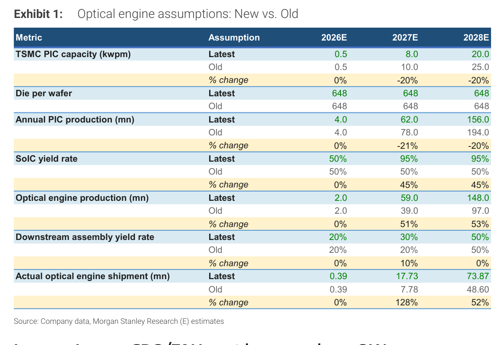
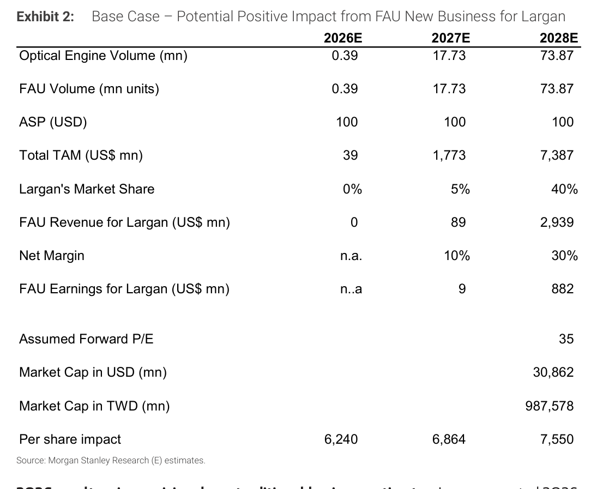
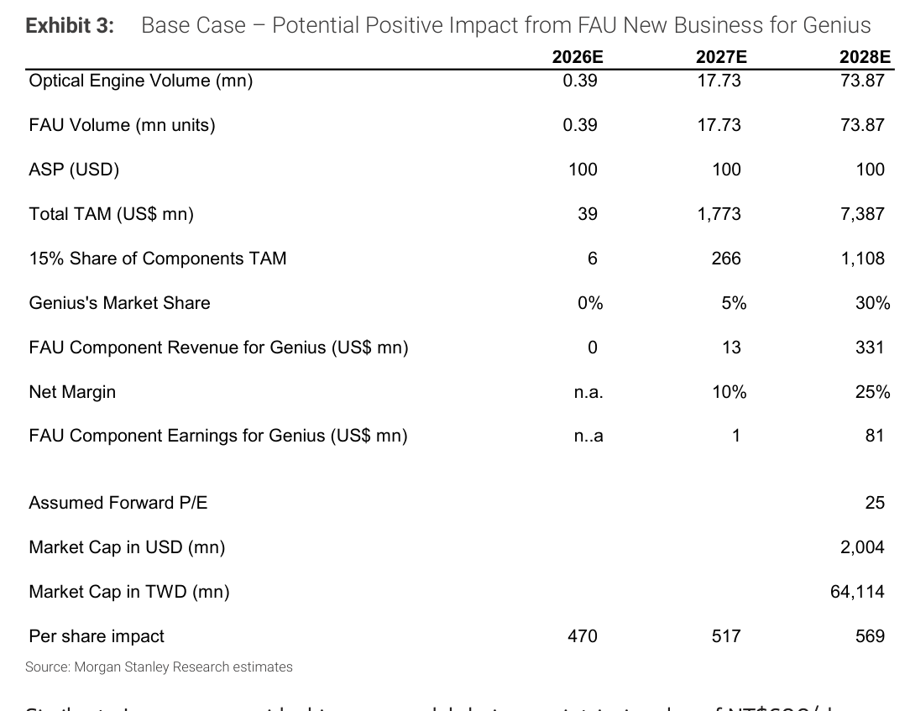

# MS｜Higher OE Estimates, Upgrade Largan and Genius

**券商**：Morgan Stanley  
**分析師**：Andy Meng, CFA、Betty Chen  
**日期**：2026-10-12  
**主題**：光學引擎（OE）出貨假設大幅上修→ 升評 Largan（OW）、Genius（EW）  
**評級**：Industry View In-Line  
<a href="https://layx.uk/dl?g=產業&b=MS&d=20261012&h=Lens-OE-Upgrade">📎 下載 PDF</a>

---

## 報告總結

MS 半導體團隊最新供應鏈調查確認 SoIC 封裝良率大幅改善（50%→95%），使 2027E 光學引擎（OE）出貨量從 7.78mn 上修至 17.73mn（+128%），帶動同等數量的 FAU（光纖陣列單元）TAM 從 US\$778mn 擴大至 US\$1.773bn。這是觸發本次升評的關鍵催化劑。

MS 同步下修大立光（3008）傳統業務估值（3Q26 毛利率 miss，綠電成本壓力），但 FAU 新業務帶來 NT\$6,240/股的增量價值，合計目標價升至 NT\$9,040（OW 升評）；玉晶光（3406）目標價升至 NT\$1,070（UW → EW），FAU 選擇權價值 NT\$470/股，但 Genius 只參與 15% 的 FAU 零件 TAM，能見度低於大立光。

---

## Morgan Stanley 完整投資邏輯鏈

| 論點層次 | Exhibit | 內容 |
|---|---|---|
| 瓶頸鬆動 | Exhibit 1 | SoIC 良率 50%→95%（2027E），主線瓶頸轉移至下游組裝 |
| 需求結構 | Exhibit 1 | OE 出貨 +128%（2027E）/ +52%（2028E），FAU TAM 同步翻倍+ |
| 受益排序 | Exhibit 2 | 大立光：40% 市占（2028E）+ 30% 淨利率→ FAU 貢獻 NT\$6,240/股 |
| 受益排序 | Exhibit 3 | 玉晶光：FAU 零件 TAM 15% 切口 + 30% 市占→ FAU 貢獻 NT\$470/股 |
| **結論** | 報告封面 | **Largan OW（NT\$9,040）；Genius EW（NT\$1,070）** |

> **報告最大邏輯缺口**：Largan 2028E 40% 市占假設係單一最關鍵假設——若良率問題持續、市占僅達 20%，NT\$6,240 增量每股值將減半；FAU 耦合/匹配良率為 MS 明確點名的最大下行風險。

---

## 報告核心觀點

| 主題 | MS 觀點 | 市場共識 | 是否 Contra-Consensus |
|---|---|---|---|
| OE 出貨 2027E | 17.73mn（上修 +128%） | 舊估 7.78mn | 是，大幅高於舊估 |
| FAU TAM 2027E | US\$1.773bn | 前估 US\$778mn | 是，翻倍以上 |
| TSMC PIC 產能 2027E | 8kwpm（下修 -20%） | 前估 10kwpm | 部分負面修正 |
| Largan FAU 市占 2028E | 40% | 共識尚無明確估值 | Contra（大膽假設） |
| FAU 耦合良率風險 | 仍是主要不確定因素 | 共識未明確定量 | Neutral |

**偏好排序**：大立光（3008）> 玉晶光（3406）；Largan 具全解決方案能力，Genius 僅限零件層次。

---

## Exhibit 1｜Optical engine assumptions: New vs. Old

### 解讀摘要

SoIC 良率從 50%→95% 是整個上修鏈的決定性假設：TSMC PIC 產能反而下調 20%（10→8 kwpm），但良率提升幾乎接近翻倍（+45ppt），使實際 OE 出貨從 7.78mn 跳升至 17.73mn（+128%）。下游組裝良率同步從 20%→30%（+10ppt）進一步提升轉換率。這意味著整個 2027E 的 OE 增量幾乎全部來自製程良率改善，不是產能增加——對供應鏈來說，這是更難被複製的競爭護城河。

### 表格

| 指標 | 假設 | 2026E | 2027E | 2028E |
|---|---|---|---|---|
| TSMC PIC 產能（kwpm） | 最新 | 0.5 | **8.0** | **20.0** |
| | 舊 | 0.5 | 10.0 | 25.0 |
| | 變動% | 0% | -20% | -20% |
| Die per wafer | 最新/舊 | 648 | 648 | 648 |
| 年 PIC 產量（mn） | 最新 | 4.0 | **62.0** | **156.0** |
| | 舊 | 4.0 | 78.0 | 194.0 |
| | 變動% | 0% | -21% | -20% |
| SoIC 良率 | 最新 | 50% | **95%** | **95%** |
| | 舊 | 50% | 50% | 50% |
| | 變動% | 0% | **+45%** | **+45%** |
| OE 生產量（mn） | 最新 | 2.0 | **59.0** | **148.0** |
| | 舊 | 2.0 | 39.0 | 97.0 |
| | 變動% | 0% | +51% | +53% |
| 下游組裝良率 | 最新 | 20% | **30%** | **50%** |
| | 舊 | 20% | 20% | 50% |
| | 變動% | 0% | **+10%** | 0% |
| 實際 OE 出貨（mn） | 最新 | 0.39 | **17.73** | **73.87** |
| | 舊 | 0.39 | 7.78 | 48.60 |
| | 變動% | 0% | **+128%** | **+52%** |

> **洞察一**：SoIC 良率從 50%→95% 這 +45ppt 的改善，在 OE 生產量貢獻 +51%（2027E）。若下游組裝良率沒有同步從 20%→30%，實際出貨上修幅度只有約 +72%（51% × 生產量增量通過率不變），MS 報告隱含下游組裝良率改善貢獻了另外 ~56ppt 的出貨增量（128% - 72%）。兩個良率改善缺一不可，任何一個比預期慢都會大幅壓縮最終出貨。

> **值得驗證**：MS 假設 SoIC 良率 2027E 達 95%，但 2026E 仍在 50%——這是從低谷跳至幾乎完美良率的假設。若 2027E 良率實際僅達 70%（中間值），OE 出貨將從 17.73mn 降至約 8.8mn，MS 的整個 FAU TAM 計算將需要重做。

---

## Exhibit 2｜Base Case – Potential Positive Impact from FAU New Business for Largan

### 解讀摘要

大立光的 FAU 新業務估值完全由三個假設驅動：FAU 量（= OE 量）、市占（2028E 40%）、淨利率（2028E 30%）。以 35x 2028E P/E 計算，FAU 事業估值 US\$30.862bn，摺回 2026 年每股貢獻 NT\$6,240。這個數字已遠超傳統業務估值 NT\$2,800——意味著現在大立光的股價幾乎全部是在定價 FAU 期望值，而非現有相機鏡頭業務的 earnings power。

> **原文補充**：MS 指出大立光目前股價已隱含 >30% 全球 FAU 市占（在正式量產尚未開始的情況下）。Largan 確認首個 FA（光纖陣列）專案已通過客戶驗證，正在從 FA 擴展至 FAU（含耦合、FAU-to-carrier 組裝），預計 2H27 支持量產的專用產能到位。

### 表格

| 指標 | 2026E | 2027E | 2028E |
|---|---|---|---|
| OE 量（mn） | 0.39 | 17.73 | 73.87 |
| FAU 量（mn） | 0.39 | 17.73 | 73.87 |
| ASP（US\$） | 100 | 100 | 100 |
| FAU TAM（US\$ mn） | 39 | 1,773 | 7,387 |
| 大立光市占 | 0% | 5% | **40%** |
| 大立光 FAU 營收（US\$ mn） | 0 | 89 | 2,939 |
| 淨利率 | n.a. | 10% | 30% |
| 大立光 FAU 盈利（US\$ mn） | n.a. | 9 | 882 |
| 假設 Forward P/E | | | 35x |
| 市值（US\$ mn） | | | 30,862 |
| 市值（TWD mn） | | | 987,578 |
| 每股貢獻（NT\$） | 6,240 | 6,864 | 7,550 |

> **洞察一**：FAU 2028E 盈利 US\$882mn 以 35x P/E 算出 US\$30.862bn 市值，折回 2026 年（10% 折現率）後每股 NT\$6,240——這已是大立光整個傳統業務估值（NT\$2,800）的 2.2 倍。若 Largan 2028E 市占達不到 40%（只有 20%），FAU 貢獻將只有 NT\$3,120，整體目標價降至 NT\$5,920，與當前股價（推斷約 NT\$6,600+）已所剩有限。

> **值得驗證**：40% 市占假設（US\$2.939bn FAU 收入）是整個論點中最激進的單一數字。MS 自認目前股價已 embed >30% 市占預期——意味著 40% 市占是提供「進一步上行」的 bull case 假設，而非 base case 的保守估計。

---

## Exhibit 3｜Base Case – Potential Positive Impact from FAU New Business for Genius

### 解讀摘要

玉晶光只參與整體 FAU TAM 的 15%（零件層次，非整體解決方案），2028E 30% 市占下 FAU 零件收入 US\$331mn，以更保守的 25x P/E 計算貢獻 NT\$470/股。與大立光相比，Genius 的 FAU 增量規模是大立光的 1/13（US\$81mn vs US\$882mn 盈利），但估值倍數也更保守（25x vs 35x），反映能見度差異。這解釋了 MS 維持 EW（而非 OW）的原因——風險回報更趨均衡而非有利。

> **原文補充**：MS 認為 Genius 有更多產能在中國大陸，相比大立光面臨較小的綠電成本壓力；3Q26 盈利估計暫時維持不變，待下季財報驗證。

### 表格

| 指標 | 2026E | 2027E | 2028E |
|---|---|---|---|
| OE 量（mn） | 0.39 | 17.73 | 73.87 |
| FAU 量（mn） | 0.39 | 17.73 | 73.87 |
| ASP（US\$） | 100 | 100 | 100 |
| FAU TAM（US\$ mn） | 39 | 1,773 | 7,387 |
| 15% 零件 TAM | 6 | 266 | 1,108 |
| Genius 市占 | 0% | 5% | **30%** |
| Genius FAU 零件收入（US\$ mn） | 0 | 13 | 331 |
| 淨利率 | n.a. | 10% | 25% |
| Genius FAU 零件盈利（US\$ mn） | n.a. | 1 | 81 |
| 假設 Forward P/E | | | 25x |
| 市值（US\$ mn） | | | 2,004 |
| 市值（TWD mn） | | | 64,114 |
| 每股貢獻（NT\$） | 470 | 517 | 569 |

> **洞察一（配合 Exhibit 2）**：大立光 vs 玉晶光的 FAU 增量懸殊源於三層放大效應：（1）TAM 切口 100% vs 15%（6.7x）；（2）市占 40% vs 30%（1.33x）；（3）淨利率 30% vs 25%（1.2x）→ 三者相乘約 10.7x，接近實際盈利差距（882mn / 81mn = 10.9x）。即使同處 FAU 供應鏈，入口的市場定位差異導致最終估值差距極大。

---

## 相關個股清單

| 類別 | 公司 | Ticker | 評等 | 備註 |
|---|---|---|---|---|
| 升評 | 大立光 Largan | 3008.TW | OW（↑ 從 EW） | TP NT\$9,040（↑ 從 NT\$7,100），SOTP：傳統 NT\$2,800 + FAU NT\$6,240 |
| 升評 | 玉晶光 Genius | 3406.TW | EW（↑ 從 UW） | TP NT\$1,070（↑ 從 NT\$910），傳統 NT\$600 + FAU 零件 NT\$470 |

> 本報告聚焦 2 檔個股，建議參照 [[3008_大立光]] 與 [[3406_玉晶光]] 的個股整理卡追蹤後續更新。
