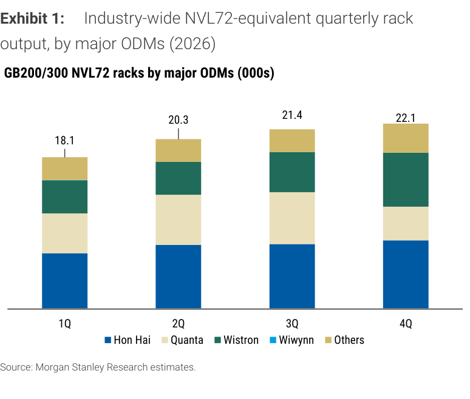
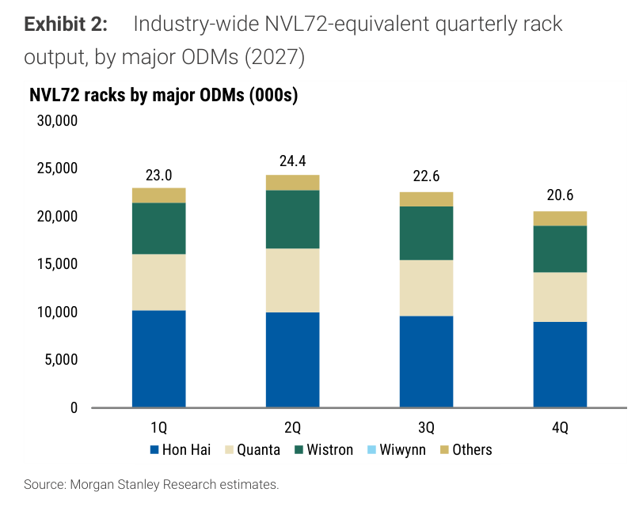
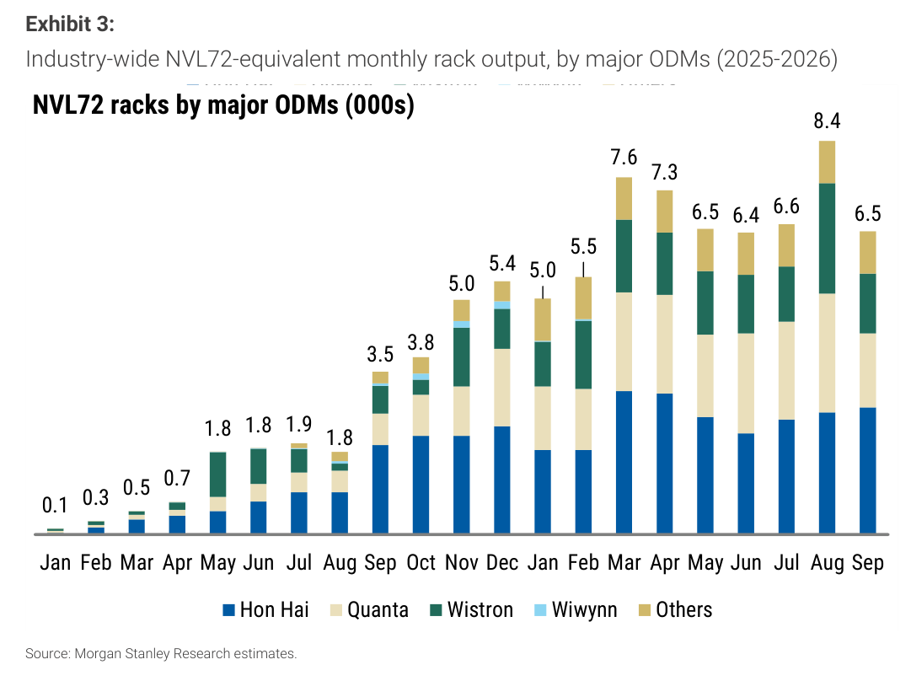
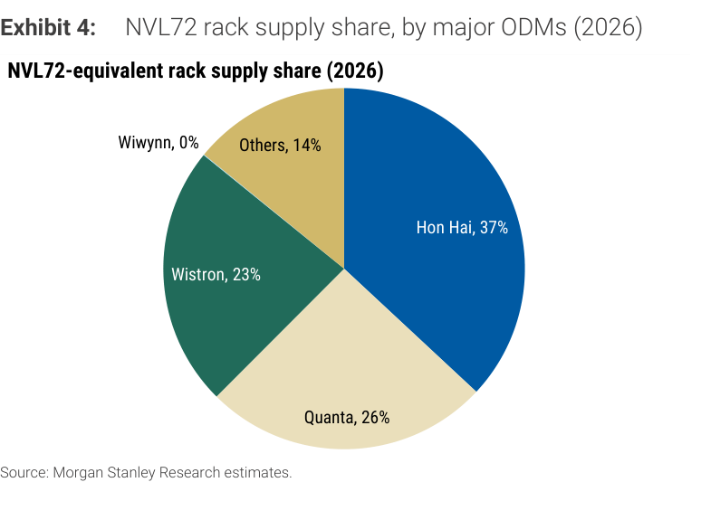
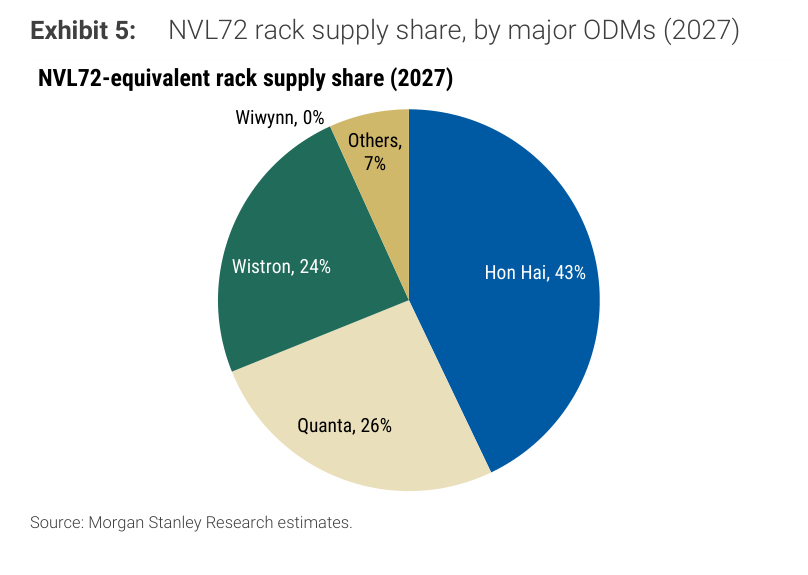

# MS｜GB200/GB300 NVL72 Racks September 2026 + 2027 Forecast

**券商**：Morgan Stanley  
**分析師**：Howard Kao、Irene Yen、Andy Meng  
**日期**：2026-10-12  
**主題**：GB200/GB300 NVL72 機架 9 月出貨量追蹤 + 2027 年預測首次發布  
**評級**：Industry View In-Line  
<a href="https://layx.uk/dl?g=產業&b=MS&d=20261012&h=NVL72-Racks-Shipment">📎 下載 PDF</a>

---

## 報告總結

MS 追蹤 9 月 GB200/GB300 NVL72 機架工業出貨量約 6.5K 台（-23% MoM），月環比下滑主因 Quanta/Wistron 在 3Q 末交貨後進行切換、季節性庫存調整，Hon Hai 維持 +4% MoM 相對穩健。2026 年全年 MS 預測維持 82K 台（+209% YoY）。同時首次發布 2027 年預測 90.4K 台（+10% YoY），Hon Hai 將是最大市占增量（37% → 43%），Others 大幅萎縮（14% → 7%）。MS 選股偏好 Wistron > Hon Hai > Quanta（依目標價上行空間排序）。

---

## MS 完整投資邏輯鏈

| 論點層次 | Exhibit | 內容 |
|---|---|---|
| 需求信號確認 | Exhibit 3 | Sep 出貨 6.5K，月環比下滑為季節性，非需求轉弱；Aug 創高後正常回調 |
| 2026 年整體強勁 | Exhibit 1 | 全年 82K 機架（+209% YoY），4Q 加速至 22.1K |
| 2027 仍有增量 | Exhibit 2 | 90.4K（+10% YoY），1Q-2Q 為旺季（23.0K/24.4K），下半年季節性回落 |
| 市占格局重組 | Exhibit 4+5 | Hon Hai 37%→43%（+6ppt），Others 14%→7%（-7ppt），Quanta/Wistron 維持 |
| **結論** | 封面 | **Wistron（PT 上行最大）> Hon Hai（最大市占成長）> Quanta** |

> **報告最大邏輯缺口**：Wistron 的「rack equivalents」基於 computing tray (L10) 折算，尚未計入 L11 組裝測試時間，實際交付給終端客戶的數量可能較 MS 預測值低。

---

## 報告核心觀點

| 主題 | MS 觀點 | 市場共識 | 是否 Contra-Consensus |
|---|---|---|---|
| Sep MoM 下滑 | 季節性，非需求問題；Oct 可望反彈 | 部分擔憂需求轉弱 | Contra（偏樂觀） |
| 2027 成長率 | +10% YoY（90.4K），下半年季節性更弱 | 市場尚未有明確預期 | 首次定錨 |
| Hon Hai 市占 | 2027 達 43%（2026 年僅 37%）| 普遍知道 HH 強 | 市占增量更大 |
| Wistron 選股優先 | Wistron > HH > Quanta（PT 上行空間） | 大部分看好 HH | Contra（Wistron 優先） |

**偏好排序**：Wistron > Hon Hai > Quanta  
**個股**：3231.TW（OW）、2317.TW（OW）、2382.TW（OW）

---

## Exhibit 1｜2026 季度 NVL72 機架出貨量

### 解讀摘要

2026 年季度出貨呈穩定加速態勢：1Q 18.1K → 2Q 20.3K → 3Q 21.4K → 4Q 22.1K，全年合計 81.9K（≈ MS 預測 82K）。逐季加速代表 GB200/GB300 系統整合產能持續爬坡，沒有明顯的「交貨後需求真空」現象——4Q 繼續成長意味著 hyperscaler 端部署時程仍未出現延後訊號。

### 表格

| 季度 | 出貨量（千台） | QoQ |
|---|---|---|
| 1Q26 | 18.1 | — |
| 2Q26 | 20.3 | +12% |
| 3Q26 | 21.4 | +5% |
| 4Q26E | 22.1 | +3% |
| **2026 全年** | **81.9** | **+209% YoY** |

> **洞察一**：4Q 僅 +3% QoQ 顯示增速明顯放緩，但仍在成長——這與「出貨高峰已過」的市場疑慮不同，MS 的預測結構暗示 2026 是平滑 ramp 而非單季爆量。

---

## Exhibit 2｜2027 季度 NVL72 機架出貨量

### 解讀摘要

2027 年呈現「前高後低」結構：1Q 23.0K → 2Q 24.4K → 3Q 22.6K → 4Q 20.6K，全年 90.6K（≈ MS 預測 90.4K）。2Q 是全年最高點，3Q-4Q 下行反映季節性而非需求崩壞。2026 年全年是加速型，2027 年轉為先衝後回歸，對 ODM 全年盈利預測的可預期性更高。

### 表格

| 季度 | 出貨量（千台） | QoQ |
|---|---|---|
| 1Q27E | 23.0 | — |
| 2Q27E | 24.4 | +6% |
| 3Q27E | 22.6 | -7% |
| 4Q27E | 20.6 | -9% |
| **2027 全年** | **90.6** | **+10% YoY** |

> **洞察二**：2027 年 2H 季節性走弱（3Q -7%、4Q -9%），若 GB300 Ultra 或後續架構（Rubin Ultra 量產）在 2H27 有增量，則下行風險可被對沖；目前預測偏保守，存在上行可能。

---

## Exhibit 3｜2025-2026 月度 NVL72 機架出貨量

### 解讀摘要

月度序列完整呈現了 NVL72 從 2025 年 1 月幾乎為零（0.1K）到 2026 年 8 月峰值 8.4K 的全程爬坡，9 月回落至 6.5K。Hon Hai（深藍）是出貨量最大的單一貢獻者，在後段月份（2026 Mar 起）比例明顯提升；Quanta 和 Wistron 分別為米色和深綠。8 月 8.4K → 9 月 6.5K 的 -23% MoM 下滑主因是 Quanta -38% MoM 和 Wistron -46% MoM（3Q 末交貨後進行 GB300 系統切換），Hon Hai +4% MoM 部分抵銷。

> **原文補充**：MS 說明，實際交付給終端客戶的數量可能低於此追蹤值，因 Wistron 的 computing tray (L10) 尚需 L11 組裝測試才算完整交付機架。

### 表格（月度出貨量，千台）

| 月份 | 總計 | 月份 | 總計 |
|---|---|---|---|
| 2025-01 | 0.1 | 2026-01 | 5.0 |
| 2025-02 | 0.3 | 2026-02 | 5.5 |
| 2025-03 | 0.5 | 2026-03 | 7.6 |
| 2025-04 | 0.7 | 2026-04 | 7.3 |
| 2025-05 | 1.8 | 2026-05 | 6.5 |
| 2025-06 | 1.8 | 2026-06 | 6.4 |
| 2025-07 | 1.9 | 2026-07 | 6.6 |
| 2025-08 | 1.8 | 2026-08 | 8.4 |
| 2025-09 | 3.5 | 2026-09 | 6.5 |
| 2025-10 | 3.8 | — | — |
| 2025-11 | 5.0 | — | — |
| 2025-12 | 5.4 | — | — |

> **洞察三**：從 2025-09 到 2026-09 整整一年，月出貨量從 3.5K 成長至 6.5K（+86% YoY），但 8 月峰值 8.4K 顯示有能力達到更高水準——9 月的回落是切換期短暫調整，而非產能天花板。

---

## Exhibit 4｜2026 年 NVL72 機架供應市占（各 ODM）

### 解讀摘要

2026 年市占：Hon Hai 37%、Quanta 26%、Wistron 23%、Others 14%。Hon Hai 主導地位最強，但 Others（各小廠）還保有 14% 的份額，意味著市場仍未充分集中在三大 ODM。2026 年 82K × 14% = 約 11.5K 台由其他廠商承接，是潛在競爭者的基盤。

### 表格

| ODM | 2026 份額 | 2026 台數（推算） |
|---|---|---|
| Hon Hai | 37% | ~30.3K |
| Quanta | 26% | ~21.3K |
| Wistron | 23% | ~18.9K |
| Others | 14% | ~11.5K |
| Wiwynn | 0% | — |

---

## Exhibit 5｜2027 年 NVL72 機架供應市占（各 ODM）

### 解讀摘要

2027 年市占：Hon Hai 43%（↑6ppt）、Quanta 26%（持平）、Wistron 24%（↑1ppt）、Others 7%（↓7ppt）。Others 的大幅萎縮（14%→7%）是市場集中度提升的核心驅動——這 7ppt 幾乎全流向 Hon Hai。Quanta 和 Wistron 份額幾乎不變，市占之戰主要在 Hon Hai 與 Others 之間。

### 表格

| ODM | 2026 份額 | 2027 份額 | 變化 | 2027 台數（推算） |
|---|---|---|---|---|
| Hon Hai | 37% | 43% | +6ppt | ~38.9K |
| Quanta | 26% | 26% | 持平 | ~23.5K |
| Wistron | 23% | 24% | +1ppt | ~21.7K |
| Others | 14% | 7% | -7ppt | ~6.3K |
| Wiwynn | 0% | 0% | 持平 | — |

> **洞察四（配合 Exhibit 4）**：Hon Hai 的 +6ppt 份額增量折合約 8.6K 台（38.9K - 30.3K）；而 Others 的萎縮折合約 5.2K 台（11.5K - 6.3K）。差距暗示部分原 Others 份額也流向 Wistron，或 Foxconn 直接拿到更多新機台訂單。MS 未解釋具體遷移機制，是此預測最不確定的部分。

---

## 跨 Exhibit 彙整表

### 彙整 1｜各 ODM 2026/2027 年出貨量對比（Exhibit 1+2+4+5 合算）

| ODM | 2026E 台數 | 2027E 台數 | YoY | 2026 份額 | 2027 份額 |
|---|---|---|---|---|---|
| Hon Hai | ~30.3K | ~38.9K | +28% | 37% | 43% |
| Quanta | ~21.3K | ~23.5K | +12% | 26% | 26% |
| Wistron | ~18.9K | ~22.0K | +16% | 23% | 24% |
| Others | ~11.5K | ~6.3K | -45% | 14% | 7% |
| **合計** | **~82K** | **~90.6K** | **+10%** | 100% | 100% |

> **洞察五（彙整視角）**：Others 從 11.5K 銳減至 6.3K（-45% YoY），在整體市場 +10% 的環境下大幅萎縮，說明大廠的產能和 Nvidia 認證優勢已明顯壓縮小廠生存空間。MS 選股偏好 Wistron 因為其 +16% YoY 成長與 +1ppt 份額增加，在三大 ODM 中 PT 上行空間最大。

---

## 相關個股清單

| 類別 | 公司 | Ticker | 評等 | 備註 |
|---|---|---|---|---|
| ODM | Wistron | 3231.TW | OW | MS 首選；2027E 22K 機架（+15% YoY）；PT 上行最大 |
| ODM | Hon Hai | 2317.TW | OW | 2027 份額 43%；38.8K 機架（+28% YoY） |
| ODM | Quanta | 2382.TW | OW | 2027E 23.5K 機架（+12% YoY）；份額維持 26% |
| 子系統 | Wiwynn | 6669.TW | — | 目前 NVL72 份額 0%（Wistron 子公司，以 NT\$172.6B 月營收貢獻 Wistron） |
