# Citi｜Voltronic Power — Recharging Growth: UPS Recovery and HVDC Potential

**券商**：Citi Research  
**分析師**：Angela Hsu  
**日期**：2026-10-13  
**主題**：旭隼（6409.TW）首評 — UPS 復甦 + HVDC 電源架進入新成長階段  
**評級**：Buy（首評）；Industry View 未標示  
<a href="https://layx.uk/dl?g=產業&b=Citi&d=20261013&h=Voltronic-Initiation">📎 下載 PDF</a>

---

## 報告總結

Citi 首評旭隼（Voltronic Power, 6409.TW），給予 Buy，目標價 NT\$1,050（25x 2027E P/E）。報告撰寫時機為股價自 2024 年高點約 NT\$2,000 修正至 NT\$854，市場情緒因逆變器業務疲弱、關稅不確定性而悲觀。Citi 認為 2026E 是盈利谷底（EPS NT\$33.00），核心論點為：UPS 結構性外包驅動市占持續提升、Online UPS 比重升級改善毛利率、HVDC 電源架（800VDC）提供中長期再評級機會。

投資人面臨的主要疑慮是逆變器的持續拖累，但 Citi 認為 2027E 盈利可反彈 28%（EPS NT\$42.30），受益於 Online UPS 組合升級（CAGR 12%，2026-2028E）與 HVDC 電源架的潛在高成長選擇權。87% 高股息率與淨現金結構（NT\$6.2bn）提供持有成本支撐。

---

## Citi 完整投資邏輯鏈

| 論點層次 | Figure | 內容 |
|---|---|---|
| 市場基礎確認 | Fig 10, 11 | 全球 UPS 市場 US\$13bn（2025），CAGR 7.1%→US\$26.8bn（2035E）；DC 佔 Online UPS 終端需求 42% |
| 結構性外包驅動 | Fig 15, 16, 17 | 西方品牌轉向 AIDC 整合基礎建設，釋出中小型 UPS 外包機會；Voltronic 純 ODM 無品牌競爭為核心護城河 |
| 產品組合升級 | Fig 14, 19, 20 | Online UPS CAGR +12%（2026-2028E）；GPM 27.1%（2026E 谷底）→ 29.0%（2028E）；Inverter 佔比下降為主要上行催化 |
| HVDC 電源架新機會 | Fig 7, 8, 9 | EV 充電器高壓技術支持 800VDC PSU 開發；西方四大品牌（Schneider/Eaton/ABB/Vertiv）均瞄準 2027E 部署；Voltronic 客戶 sampling 進行中，最早 2H27E 量產 |
| 盈利谷底＋高股息 | Fig 2, 5 | 2026E EPS NT\$33.00 為谷底，2027E+28%；87% 股息率、淨現金 NT\$6.2bn，FCF yield 2026-2028E 達 2.7-5.6% |
| **結論** | 封面 | **Buy，TP NT\$1,050（25x 2027E P/E），與歷史均值 P/E 相符；HVDC 進展為額外再評級期權** |

> **報告最大邏輯缺口**：HVDC 電源架的具體 Content per rack 及 Voltronic 的供應鏈範疇（PSU alone vs. 整合 BBU+BMS+DCDC）尚未揭露，Citi 未量化 HVDC 對 2027-2028E 的財務貢獻。

---

## 報告核心觀點

| 主題 | Citi 觀點 | 市場共識 | 是否 Contra-Consensus |
|---|---|---|---|
| 2026E 盈利谷底 | EPS NT\$33.00，逆變器拖累疊加 RMB 升值；2027E 回彈 +28% | 市場多數預期弱勢持續，對回彈幅度存疑 | 偏 Contra（更早更大的回彈） |
| UPS 外包速度 | 西方品牌 AIDC 優先級提升將加速 ODM 外包轉移，為多年期機會 | 市場可能低估外包轉移的速度與規模 | 偏 Contra（更積極的外包展望） |
| HVDC 機會 | 有技術路徑（EV charger），已進入 sampling，最早 2H27E | 市場多數未定價此機會，視為早期選擇權 | Contra-Consensus（提前建倉） |
| 逆變器回升 | 維持低迷，2028E 僅貢獻 18% 銷售（vs 2025 年 29%），非回升驅動 | 部分市場仍寄望逆變器反彈 | 與市場一致（不依賴逆變器） |
| 估值 | 25x 2027E P/E 與歷史均值相符，合理 | 當前 ~25.9x 2026E P/E 反映谷底，向前看估值吸引 | 輕微偏多 |

**偏好排序**：唯一覆蓋股 — Voltronic Power (6409.TW)  
**個股偏好**：Buy，TP NT\$1,050

---

## Fig 2｜Voltronic: Margins Trend

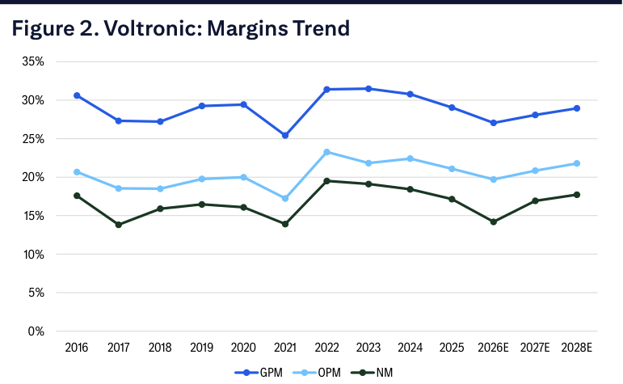

### 解讀摘要
GPM 從 2022 年峰值約 31.6% 連續下滑至 2026E 谷底 27.1%，驅動因子是逆變器（Inverter）業務比重過高（2025 年佔銷售 29%）且該業務毛利率因巴基斯坦市場需求萎縮、中國廠商競爭加劇而崩潰（見 Fig 20 拆解）。2027-2028E 的回升路徑依賴兩個機制：Inverter 佔比持續下降（29%→18%），以及 Online UPS 比重提升（37%→44%）帶動加權平均毛利率改善。OPM 與 NM 的路徑與 GPM 高度相關，費用率控制穩定（Opex 7.4% of sales 2026E→7.2% 往後）提供額外槓桿。

### 表格

| 指標 | 2021 | 2022 | 2023 | 2024 | 2025 | 2026E | 2027E | 2028E |
|---|---|---|---|---|---|---|---|---|
| GPM (%) | 25.4 | 31.4 | 31.5 | 30.8 | 29.0 | 27.1 | 28.1 | 29.0 |
| OPM (%) | 17.3 | 23.4 | 21.8 | 22.4 | 21.1 | 19.7 | 20.9 | 21.8 |
| NM (%) | 13.8 | 19.7 | 19.0 | 18.4 | 17.2 | 14.2 | 16.9 | 17.7 |

> **洞察一**：GPM 谷底（27.1%）距歷史峰值（31.6%）差距 4.5ppt。若 2028E 達 29.0%，回升幅度為 1.9ppt，仍未完全收復。這意味著即使 HVDC 未落地，純靠組合升級就足以支撐估值回升，因為市場多數可能只看到谷底、未完整定價到 29% GPM 水準對應的利潤彈性。

---

## Fig 5｜Voltronic: Historical Share Price and Key Drivers

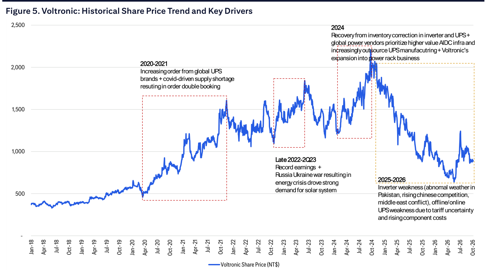

### 解讀摘要
股價從 2018 年 ~NT\$370 到 2024 年高點 ~NT\$2,000，走過三個主要週期：(1) 2020-2021 COVID 訂單雙重下單 + UPS 缺貨驅動，(2) 2022-2Q23 俄烏戰爭推動能源危機與逆變器需求，(3) 2024 AIDC 外包故事 + 電源架擴張，每個週期高點都較前次更高。現在 2025-2026 的修正源自多個逆風同時發生：逆變器需求萎縮、巴基斯坦天氣異常、中東衝突影響物流、關稅不確定性、RMB 升值，股價回落至 ~NT\$854。

> **洞察一**：三次上漲週期的高點分別為 ~NT\$1,650、~NT\$1,800、~NT\$2,000，呈現逐步抬高的格局，而各次修正低點也在提升（~NT\$1,150→~NT\$1,200→~NT\$810+），若 HVDC 商業化成真，下一個週期高點可能突破前高。

---

## Fig 7｜Western Power Vendors' Positioning in 800VDC Power Racks

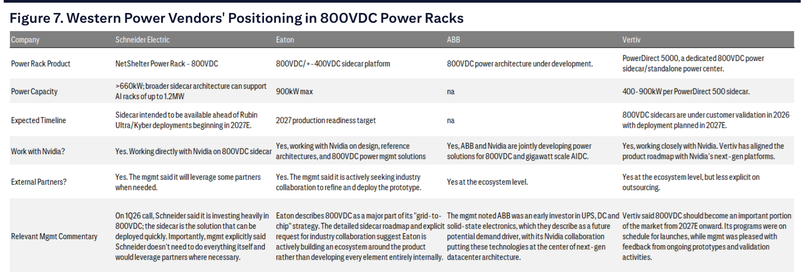

### 解讀摘要
全球四大 UPS 品牌（Schneider、Eaton、ABB、Vertiv）均在開發 800VDC 電源架，且全部與 Nvidia 協作或對齊其平台路線。這個表格的投資意義在於：Voltronic 的 UPS ODM 客戶關係已涵蓋 Schneider（18% 銷售佔比）和 Vertiv（5%），若此二廠商成功切入 AI DC 800VDC 市場，Voltronic 作為其製造夥伴的外包機會就會直接開啟。Eaton 的 2027 production readiness 和 Vertiv 的 2026 customer validation 時間線意味著 2H27E 量產節奏是合理的。

> **原文補充**：Schneider 明確表示不需要自己做所有事（"doesn't need to do everything itself and would leverage some partners when needed"）；這是最直接支持外包論點的聲明，也最直接受益 Voltronic。

### 表格

| 公司 | 產品 | 功率容量 | 預計時程 | 與 Nvidia 協作 | 外部夥伴 |
|---|---|---|---|---|---|
| Schneider Electric | NetShelter Power Rack – 800VDC | >660kW（可擴至 1.2MW） | 2027E Rubin Ultra/Kyber 部署前 | 是，直接協作 800VDC sidecar | 是，明確表示將尋求外部夥伴 |
| Eaton | 800VDC/+-400VDC sidecar | 900kW max | 2027 production readiness | 是，設計+架構+電源管理 | 是，積極尋求產業協作 |
| ABB | 800VDC 架構開發中 | n/a | n/a | 是，共同開發 800VDC | 是，生態系統層級 |
| Vertiv | PowerDirect 5000 sidecar/standalone | 400-900kW | 2026 客戶驗證，2027E 部署 | 是，路線圖對齊 Nvidia 次世代平台 | 是，生態系統層級，較不明確 |

> **洞察一**：四大品牌全部鎖定 2027E 部署，意味著 Voltronic 管理層的「2H27E 最早量產」時程與客戶端節奏吻合——這不是 Voltronic 單方面的樂觀預測，而是整個供應鏈同步的時間線。

---

## Fig 8｜Voltronic: Prototype of Power Racks（室內展示版）

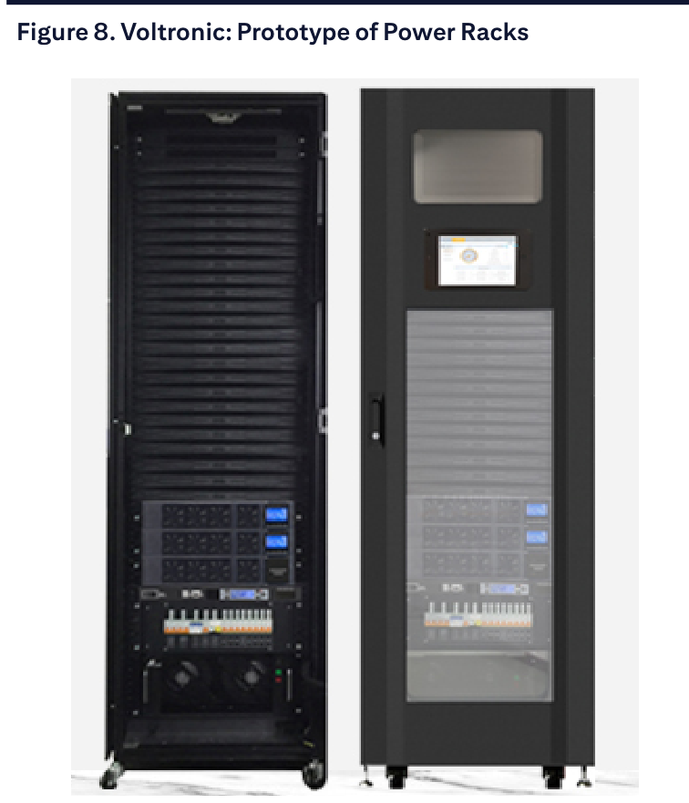

### 解讀摘要
展示兩款電源架原型機——左側為開放框架型（可見內部模組化結構與電纜管理），右側為封閉機箱型（含觸控顯示器），均帶輪移動設計，為數據中心部署形式。這些原型機展示的是當前技術成熟度，Citi 表示開發已進入客戶 sampling 階段，但規格仍在與客戶共同演進。

---

## Fig 9｜Voltronic: Prototype of Power Racks（展覽現場版）

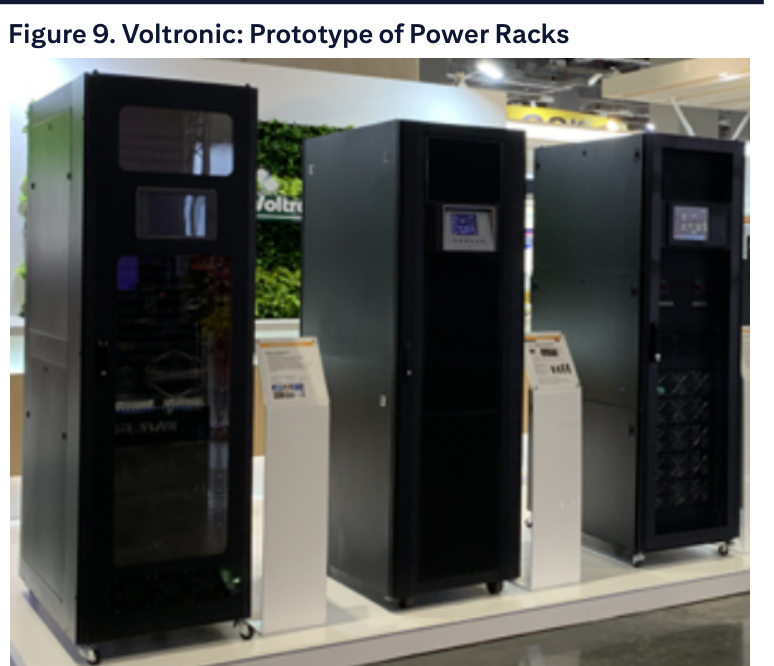

### 解讀摘要
旭隼在展覽現場展示的三款 HVDC 電源架產品，包括一款帶 Voltronic 品牌標識的設備，顯示公司已有實物展示能力。展覽現場曝光也是品牌建設與客戶接觸的手段，符合 Citi 所述「建立在西方品牌眼中的合格供應商地位」的策略脈絡。

---

## Fig 10｜Global UPS Market Size 2025-2035E

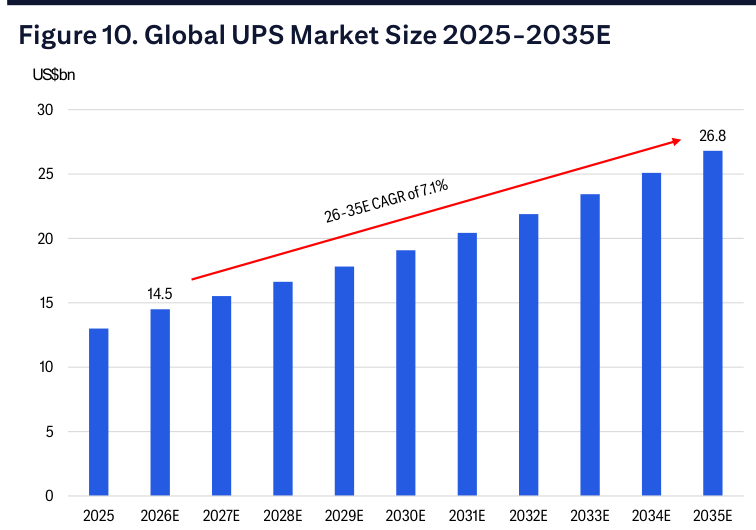

### 解讀摘要
全球 UPS 市場從 2025 年 US\$13bn 成長至 2035E US\$26.8bn，CAGR 7.1%。關鍵觀察點是成長為線性加速（非 J 曲線），反映的是結構性基礎建設需求（數據中心、工業化、電力基礎設施現代化），而非週期性拉貨。這意味著 Voltronic 的底層市場支撐穩定，即使在單一地區（如逆變器的巴基斯坦）發生波動，整體 UPS 市場也不會從根本動搖。

### 表格

| 年度 | 市場規模（US\$bn） |
|---|---|
| 2025 | 13.0 |
| 2026E | 14.5 |
| 2027E | 15.6 |
| 2028E | 16.7 |
| 2029E | 19.1 |
| 2030E | 19.3 |
| 2031E | 20.5 |
| 2032E | 21.9 |
| 2033E | 23.3 |
| 2034E | 24.9 |
| 2035E | 26.8 |

> **洞察一**：從 2025 到 2035E 翻倍（US\$13→26.8bn），CAGR 7.1%，遠高於全球 GDP 成長率。這種超越 GDP 的成長結構讓 Voltronic 不需要靠市占率提升就能有機成長，外包驅動的市占擴張則是額外的超額回報來源。

---

## Fig 11｜Global UPS Market Share by Brand (2025)

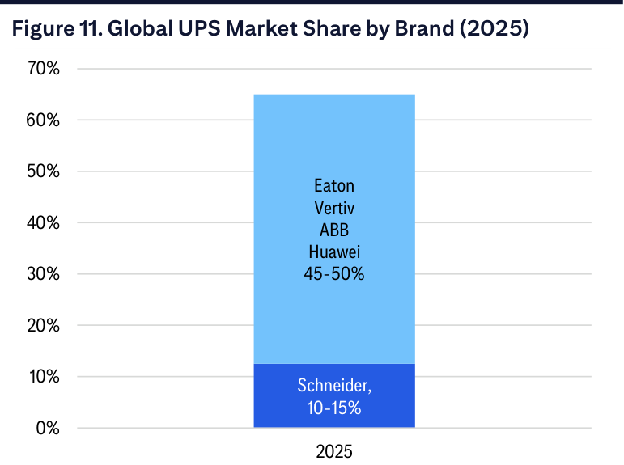

### 解讀摘要
UPS 市場集中度高：Schneider 10-15%，Eaton+Vertiv+ABB+Huawei 合計約 45-50%，前幾大廠商合計控制 60-65%。這種高集中度結構對 Voltronic 是護城河而非風險——少數大客戶能提供穩定且大量的製造機會，每個客戶的訂單規模足以驅動顯著增量。

### 表格

| 品牌 | 市占率（約） |
|---|---|
| Schneider Electric | 10-15% |
| Eaton + Vertiv + ABB + Huawei | 45-50% |
| 其他（KSTAR、Kehua、Delta、Riello 等） | ~35-40% |

---

## Fig 12｜Global Online UPS by Power Rating

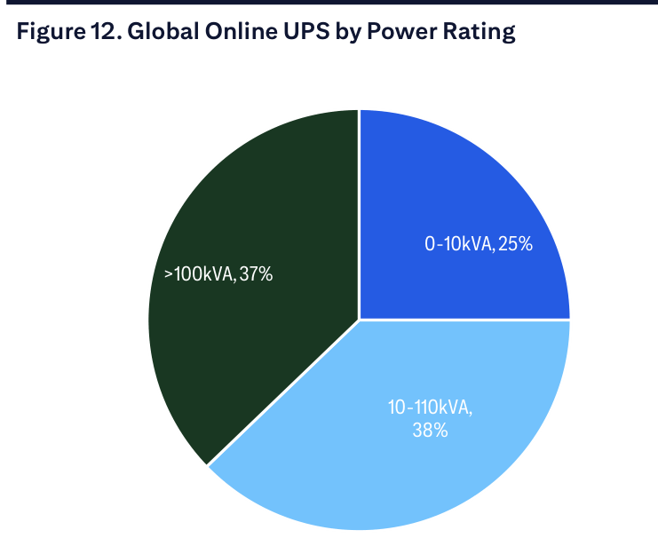

### 解讀摘要
Online UPS 按功率段分佈：0-10kVA（25%）、10-110kVA（38%）、>100kVA（37%）。Voltronic 傳統優勢在中低功率段，但 Citi 的論點是成長機會在 >10kVA 的中高功率段（合計 75%），這些產品技術門檻更高、利潤更豐厚，也更適合 ODM 外包（品牌商更傾向保留低功率簡單產品的直接製造）。

---

## Fig 13｜Global Online UPS by End Use

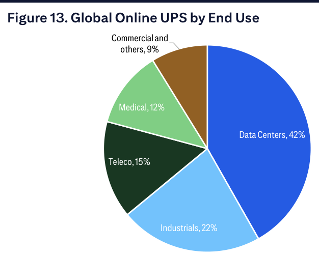

### 解讀摘要
Online UPS 終端需求以數據中心為最大應用（42%），其次是工業（22%）、電信（15%）、醫療（12%）、商業（9%）。AI 基礎建設投資直接推動 DC 用量的增加，同時工業化、5G、醫療設施現代化提供多元化底座，不過度依賴單一應用，符合 Citi「結構性成長」的論述框架。

---

## Fig 14｜Voltronic: Online UPS and Offline UPS Sales and Y/Y

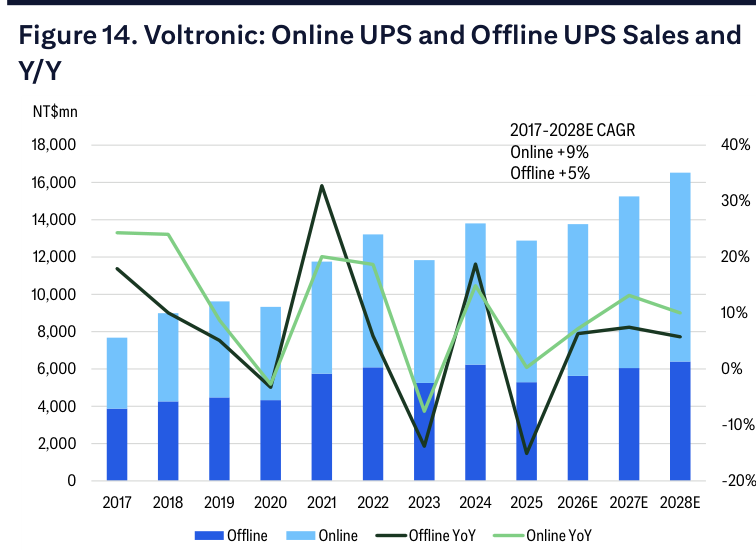

### 解讀摘要
2017-2028E 期間，Online UPS（CAGR +9%）持續優於 Offline UPS（CAGR +5%），但兩者均曾在 2023 年受到去庫存衝擊（Online -10%，Offline -15%）、並於 2024 年復甦（Online +15%，Offline +19%）。2026E 預估 Online +10%/Offline +8%，反映持續回升。這個趨勢圖的核心洞察是：Offline UPS 的長期 CAGR 更低，但因它是高量標準品，其高峰期（2022-2023）對毛利率有拉低效果；未來 Offline 佔比下降不代表業務萎縮，而是組合結構朝高利潤方向優化。

### 表格

| 年度 | Online 銷售（NT\$mn） | Offline 銷售（NT\$mn） | Online YoY | Offline YoY |
|---|---|---|---|---|
| 2017 | ~4,400 | ~3,800 | +25% | +18% |
| 2021 | 6,002 | 5,751 | — | — |
| 2022 | 7,124 | 6,090 | — | — |
| 2023 | 6,586 | 5,249 | -10% | -15% |
| 2024 | 7,567 | 6,233 | +15% | +19% |
| 2025 | 7,587 | 5,293 | ~0% | -15% |
| 2026E | 8,359 | 5,710 | +10% | +8% |
| 2027E | 9,456 | 6,058 | +13% | +6% |
| 2028E | 10,402 | 6,361 | +10% | +5% |

> **洞察一**：2025 年 Online UPS 銷售幾乎持平（+0%，NT\$7,587mn），顯示實際上在關稅與成本壓力下也受到影響，並非純粹的防禦性業務。2026E +10% 的回升假設有賴外包訂單加速落地，是 Citi 預測的關鍵催化劑，值得追蹤。

---

## Fig 15｜Voltronic UPS Sales vs. Global UPS Sales Growth

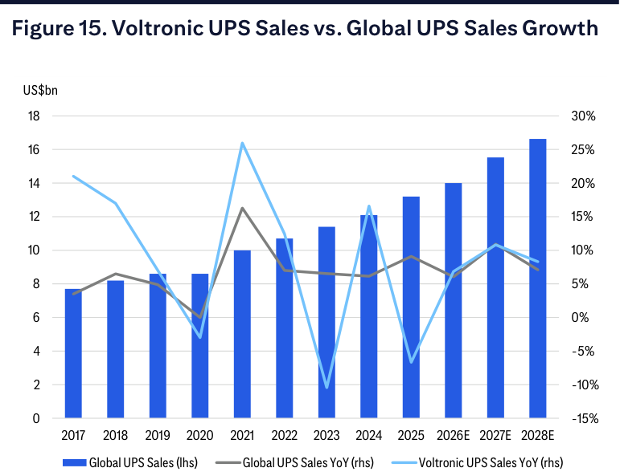

### 解讀摘要
Voltronic UPS 銷售成長率（YoY %）歷史上多數年份高於全球 UPS 市場成長率（~5-7%），證明外包市占擴張假設有歷史支撐。2025 年是例外（Voltronic 負成長，全球市場正成長），但 Citi 認為這是短暫的供應端干擾（原料短缺、逆變器弱），而非外包趨勢逆轉。2026E 以後預估 Voltronic UPS 再度跑贏全球市場。

> **值得驗證**：如果 2027E 的 Online UPS +13% YoY 假設未能成真（例如西方客戶外包進度延誤），整個 28% EPS 回彈預測將大幅下修。這是報告最大的單一假設。

---

## Fig 16｜Voltronic: Customer Mix in 1H26

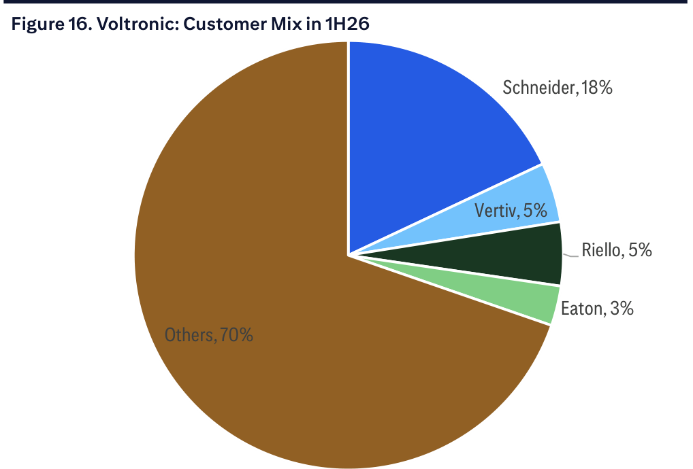

### 解讀摘要
1H26 客戶結構：Others（非具名品牌客戶）70%、Schneider 18%、Vertiv 5%、Riello 5%、Eaton 3%。Others 70% 是重要的多元化因素，但同時也顯示 Voltronic 在西方大品牌的滲透率仍有提升空間。Schneider 是最大具名客戶，恰好也是 800VDC 立場最明確（"doesn't need to do everything itself"）的品牌，若外包訂單來自 Schneider，集中度風險反而會轉化為成長動能。

---

## Fig 17｜Online UPS vs Offline UPS

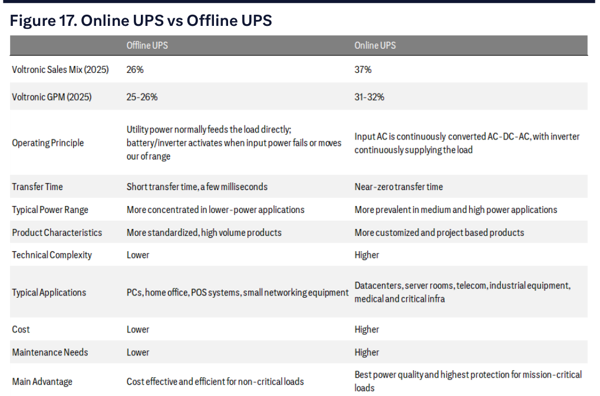

### 解讀摘要
Online UPS 採雙重轉換架構（AC→DC→AC），轉換時間近零，適用數據中心、工業自動化、醫療等關鍵基礎設施；Offline UPS 採被動保護（僅在斷電時切換），轉換時間幾毫秒，適用家用/小型辦公。兩者的 Voltronic 2025 銷售比重分別為 37%（Online）和 26%（Offline），毛利率分別為 31-32% 和 25-26%，GPM 差距 5-7ppt 解釋了為什麼 Online 比重提升是毛利率回升的結構性驅動。

### 表格

| 維度 | Offline UPS | Online UPS |
|---|---|---|
| Voltronic 銷售比重（2025） | 26% | 37% |
| Voltronic GPM（2025） | 25-26% | 31-32% |
| 工作原理 | 市電直通，斷電才切換 | 持續雙重轉換 AC→DC→AC |
| 轉換時間 | 幾毫秒 | 近零 |
| 功率範圍 | 低功率為主 | 中高功率為主 |
| 產品特性 | 標準化、高量 | 客製化、專案型 |
| 技術複雜度 | 低 | 高 |
| 典型應用 | PC、家庭、POS、小型網路 | 數據中心、伺服器、電信、工業、醫療關鍵基礎設施 |

> **洞察一**：Online UPS 的「高混低量、客製化、專案型」特性正是 ODM 外包的理想形態——品牌商最不想自己做的就是這種需要工程彈性但量小的產品，而 Voltronic 的工程能力和靈活生產正好契合。

---

## Fig 19｜Voltronic: Online UPS vs. Offline UPS Sales Growth

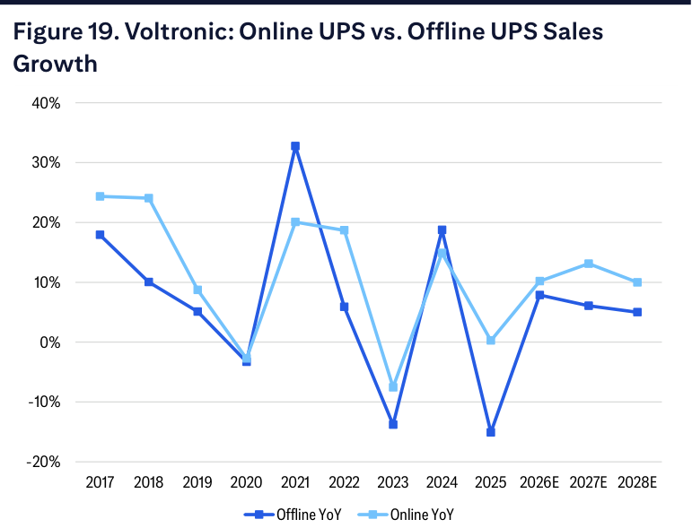

### 解讀摘要
Online UPS 銷售成長率在大多數年份領先 Offline，但波動性更大（因專案型業務特性）。2023 年是唯一兩個業務均大幅負成長的年份（Offline -15%、Online -10%），反映去庫存週期的全面衝擊。2024 年的強力復甦（兩者均 +15-19%）建立了良好基期，Citi 的 2027E +13%（Online）/+6%（Offline）預測在趨勢脈絡下屬合理中性偏保守。

---

## Fig 20｜Voltronic: GPM by Product

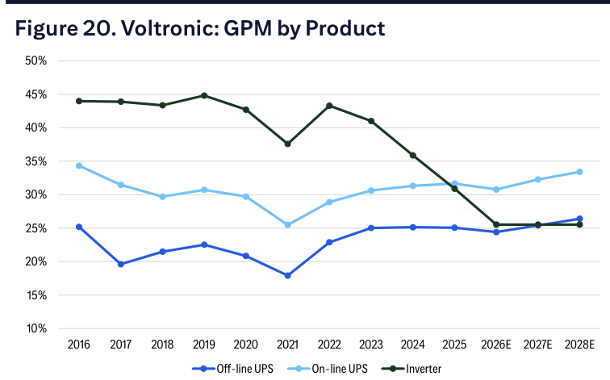

### 解讀摘要
逆變器（Inverter）毛利率從 2016-2024 年維持在 36-44% 的高位，但 2025 年急遽下滑至約 31-32%，2026E 估計進一步壓縮至約 26%，與 Offline UPS 的毛利率趨近。這是 Citi 預測 2026E 整體 GPM 谷底的核心機制——Inverter 不只是銷售下滑，連毛利率也從高利潤品轉為拖累項。2027-2028E Inverter 比重持續萎縮（佔比 29%→22%→18%），自然讓加權平均 GPM 往 Online UPS 的 31-34% 靠攏。

### 表格

| 產品 | 2016 GPM | 2022 GPM | 2025 GPM | 2026E GPM | 2028E GPM |
|---|---|---|---|---|---|
| Offline UPS | ~25% | ~23% | ~25% | ~25% | ~26% |
| Online UPS | ~35% | ~29% | ~31% | ~31% | ~33-34% |
| Inverter | ~44% | ~43% | ~32% | ~26% | ~26% |

> **洞察一**：Inverter 毛利率從 ~44% 崩至 ~26%，幅度達 18ppt，等於消滅了這個業務幾乎全部的利潤優勢。若 Inverter 毛利率無法回升（巴基斯坦需求恢復 + 中國競爭壓力，Citi 也不押注回升），那麼 Voltronic 的 GPM 回升完全依賴組合重組，回升速度受限於 Online UPS 比重提升的節奏（2025 年 37%→2028E 44%）。

---

## Fig 31｜Voltronic: Capacity Mix

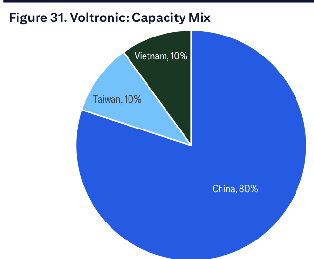

### 解讀摘要
產能結構：中國 80%、台灣 10%、越南 10%。中國產能高度集中是地緣政治風險的主要來源。Citi 提到對 ODM 廠商而言，客戶通常要求多元化產能布局作為供應鏈韌性條件，若要快速移轉大量中國產能，越南的 10% 比重不足以吸收。然而，UPS 屬於後端基礎設施設備，直接受到關稅影響可能較 IT 硬體（筆電、伺服器）更為延遲，短期衝擊相對可控。

---

## Fig 32｜Voltronic: Sales by Product (2025)

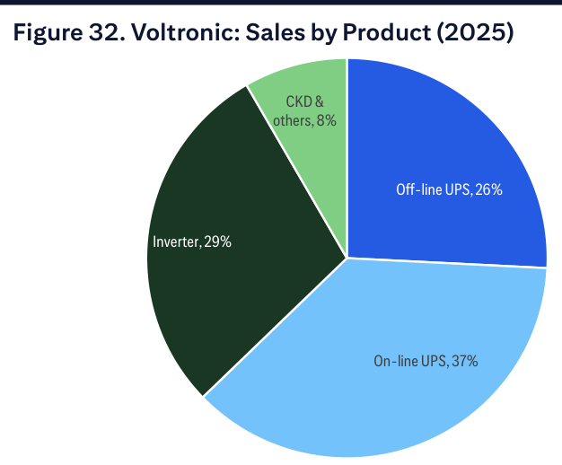

### 解讀摘要
2025 年銷售產品結構：On-line UPS 37%、Inverter 29%、Off-line UPS 26%、CKD & others 8%。逆變器佔近三成，這正是 Citi 論點的起點——29% 的銷售佔比、且毛利率已從 44% 崩至 32%，是 2025-2026E 盈利最大的拖累。Citi 預測 2028E 逆變器降至 18%，若比預期更快下降（例如巴基斯坦需求未能恢復），反而對毛利率有正面效果，因為拖累項退場速度更快。

---

## Fig 33｜Voltronic: Photo of Offline UPS

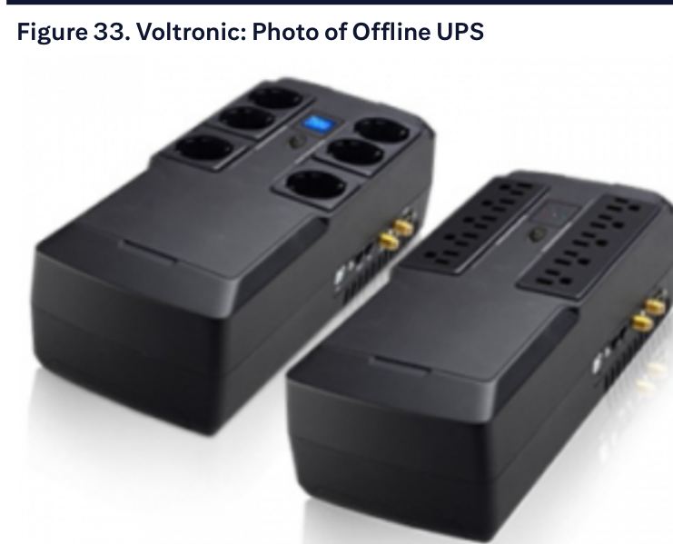

### 解讀摘要
旭隼的消費/SOHO 級 Offline UPS 產品，多插槽設計，體積小巧，為標準化高量產品。這類產品技術門檻低，面臨中國廠商直接競爭，是 Citi 認為最難提升定價的業務。

---

## Fig 34｜Voltronic: Photo of Online Power Modular UPS

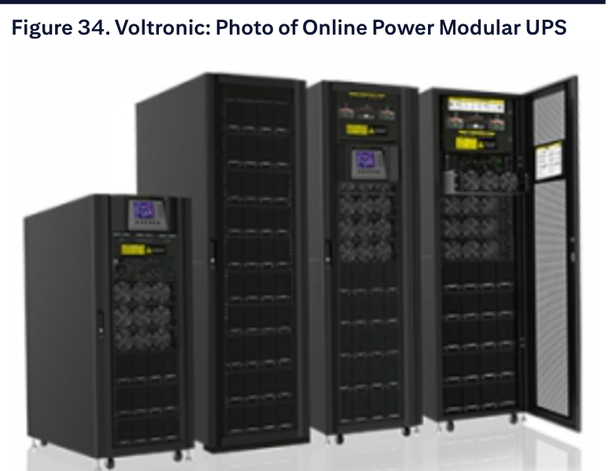

### 解讀摘要
旭隼的模組化 Online UPS 產品線（大型機架型），支援模組化擴充（可見多個風扇模組、電源模組），設計適用數據中心和工業關鍵應用。這類產品正是 Citi 看好外包需求擴張的核心品類，也是最難以被中國廠商快速複製的高工程門檻產品。

---

## Fig 35｜Voltronic: Shareholder Mix

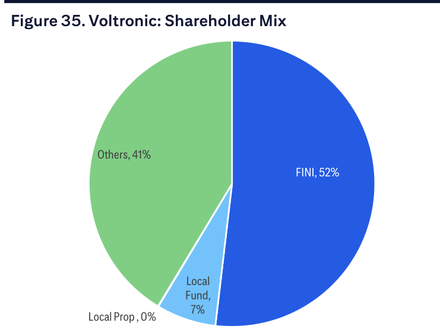

### 解讀摘要
外資（FINI）持股 52%，其他（散戶+法人）41%，本地基金 7%，本地自然人 0%。外資持股過半意味著股價對外資情緒敏感，也代表若 Citi 的論點引發外資回補，潛在的訂單效應更直接。

---

## Fig 36｜Voltronic: FINI Holding %

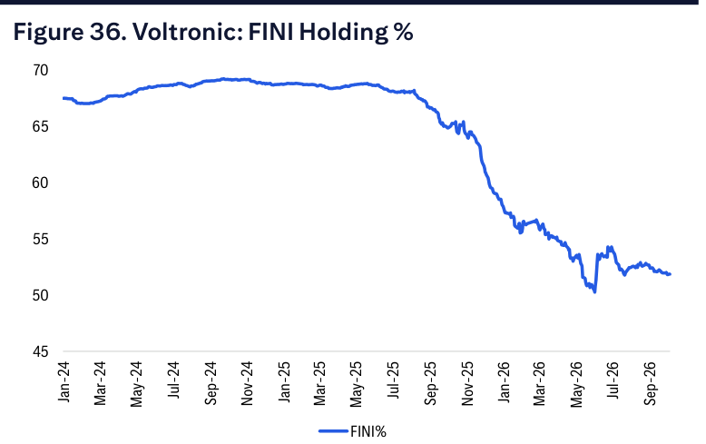

### 解讀摘要
FINI 持股比例從 2024 年初約 70% 持續下降至 2026 年 10 月約 52%，2026 年 4-7 月間出現最大單段降幅（從 ~55% 跌至 ~50%），隨後略為回穩。外資持續減持反映對逆變器弱勢和成長前景的擔憂，也意味著若 2027E 盈利回彈兌現，外資重新加碼的空間相當大（從 52% 回升至歷史 70% 水準隱含 ~18% 的潛在外資資金流入）。

> **洞察一**：外資持股的下降本身已部分反映了悲觀預期，2026 年的回穩可能是籌碼逐漸穩定的信號。若 2027E 盈利數字開始超預期，外資回補的速度和力度可能比 EPS 成長本身帶來更大的股價彈性。

---

## 相關個股清單

| 類別 | 公司 | Ticker | 評等 | 備註 |
|---|---|---|---|---|
| 電源管理 ODM | 旭隼 Voltronic Power | 6409.TW | Buy | TP NT\$1,050，25x 2027E P/E；EPS 2026E NT\$33 / 2027E NT\$42.3 / 2028E NT\$47.25 |
| 競爭/比較 | Delta Electronics | 2308.TW | — | UPS 品牌競爭者（Delta 兼品牌+ODM） |
| 客戶/受益 | Schneider Electric | SU FP | — | Voltronic 最大具名客戶（18%），800VDC sidecar 開發最進取 |
| 客戶/受益 | Vertiv Holdings | VRT US | — | 第二大具名客戶（5%），AI DC 電源佈局最積極 |
