# Morgan Stanley｜ABF Substrates：More Capex, More Tightness

**券商**：Morgan Stanley  
**分析師**：Howard Kao; Irene Yen; Andy Meng, CFA  
**日期**：2026-10-14  
**主題**：ABF 基板供需模型更新；新增產能公告不改變多頭觀點  
**評級**：Industry View In-Line  
<a href="https://layx.uk/dl?g=產業&b=MS&d=20261014&h=ABF-Substrates">📎 下載 PDF</a>

---

## 報告總結

MS 以 "Idea" 報告更新 ABF 基板供需模型，核心結論是：儘管行業已宣布 \$143億美元資本支出（SEMCO \$50億、Ibiden \$32億、AT&S \$20億等），多數新產能在 2028 年底至 2030 年才投產，CY27-28 的供不應求缺口反而比前一版模型更嚴重（CY27 缺口 +3.1ppt 至 9.3%；CY28 +4.3ppt 至 13.7%）。缺口擴大的主因是中國 AI 芯片（包括華為、Cambricon 等）需求大幅上修，CY27/28 出貨量估計分別上調至 6.4M/8.7M 單位（原 4.6M/6.2M）。MS 預期 CY27 ABF 基板漲價 25%+，供應商中偏好 Unimicron（廣富二廠 CY27 擴產 10-15%），其次 NYPCB（AMD CPU 與 Networking 曝險）；兩者均維持 OW，PT 分別上調至 NT\$1,775（+41% 上行空間）與 NT\$2,000（+39%）。

---

## MS 完整投資邏輯鏈

| 論點層次 | Exhibit | 內容 |
|---|---|---|
| 需求升級 | Exhibit 8 | 中國 AI 芯片 CY27e +39%、CY28e +40%，是本輪需求上修的主力 |
| 供給不足 | Exhibit 2/3 | CY27-28 供不應求缺口分別達 9.3%/13.7%，較前模型再擴大 |
| 資本支出 | Exhibit 4/5 | 行業已宣布 \$143億美元投資，但多在 2028-30 才投產，近期無救 |
| 結構轉型 | Exhibit 18/20 | PC 從 70%（2015）降至 <10%（2030e），AI GPU/ASIC/Server 升至 75%+ |
| 市場成長 | Exhibit 19 | ABF 市場 CAGR 從 2015-2025 的 9.9% 加速至 2025-30e 的 22.2% |
| 個股偏好 | 封面 | Unimicron（CY27 自建擴產）優先於 NYPCB；兩者均 OW |
| **結論** | 封面 | **CY27-28 供需缺口寬化，漲價 25%+ 動能確立；持續看好整個 ABF 供應商族群** |

> **報告最大邏輯缺口**：中國 AI 芯片需求上修 39-40% 為本輪估算的核心假設，而此需求數字透明度較低（不依賴公開財報），若實際出貨低於預期，供需缺口將顯著縮窄。

---

## 報告核心觀點

| 主題 | MS 觀點 | 市場共識 | 是否 Contra-Consensus |
|---|---|---|---|
| CY27 ABF 漲價幅度 | +25%+ | 買方共識 ~50% | 保守（MS 低於共識） |
| 新產能對供需的影響 | 不足以抵消需求成長；缺口持續至 2030 | 部分市場擔心新產能過剩 | Contra-Consensus |
| 中國 AI 芯片需求 | CY27e 6.4M / CY28e 8.7M（大幅上修） | 尚無廣泛公開估計 | 偏積極 |
| Unimicron vs NYPCB | 偏好 Unimicron（自有擴產 CY27）| — | — |

**偏好排序**：Unimicron（廣富二廠 CY27 ramp 10-15% 產能增加）> NYPCB（CY27 去瓶頸 5-10%，但 AMD CPU 與 Networking 曝險為差異化賣點）

---

## Exhibit 2｜ABF 基板供需缺口預計在 2030 年持續擴大

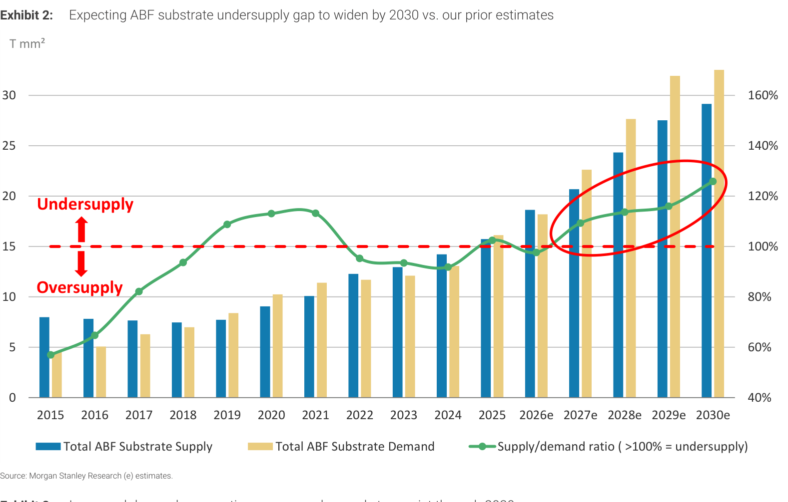

### 解讀摘要
圖表呈現 2015-2030e ABF 基板總供給（T mm²）、總需求（T mm²）與供需比（>100% = 供不應求）的歷史與預測走勢。關鍵轉折在 2026e：本年度市場大致平衡（SD ratio ~97.7%），但 2027e 起正式進入缺貨狀態，且缺口在 2028e 達到峰值（SD ratio ~113.7%），此後緩步擴大至 2030e（~125.9%）。供給曲線的緩慢爬升反映各廠資本支出已啟動，但多數新廠不在近期——SEMCO Sejong 2028年9月投產、NYPCB 新廠 2H29 ramp，對 CY27-28 缺口幾乎無貢獻。

> **原文補充**：MS 指出缺口持續的另一原因是「製造複雜度上升」——更大 body size、更高層數、更嚴苛的製程會壓縮可用輸出，即使安裝產能增加，有效供給增幅也小於帳面數字。

### 表格

| 年度 | 供需狀況 | SD Ratio（新） | YoY 變化 |
|---|---|---|---|
| 2025 | 供過於求 | <97% | — |
| 2026e | 大致平衡 | ~97.7% | — |
| 2027e | 供不應求 | ~109.3% | +11.6ppt |
| 2028e | 缺口峰值 | ~113.7% | +4.4ppt |
| 2029e | 持續缺貨 | ~116.0% | +2.3ppt |
| 2030e | 最緊 | ~125.9% | +9.9ppt |

> **洞察一**：2026e 至 2030e 的 SD ratio 一路從 97.7% 升至 125.9%，代表整個 2027-2030 都是持續缺貨的結構，漲價能力不受新產能公告干擾——因為大量新產能在 2028-30 才投入。這讓 CY27-28 的漲價週期具有高能見度。

---

## Exhibit 3｜需求假設上調，導致缺貨缺口更深

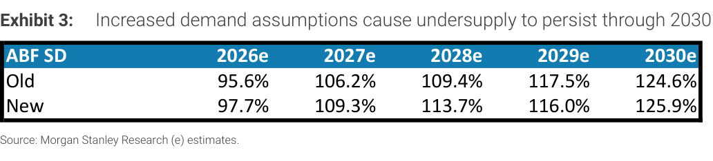

### 解讀摘要
Exhibit 3 呈現 MS 本次報告對供需比（SD ratio）的「舊估 vs 新估」修訂對比表。新估相比舊估在 CY27 高出 3.1ppt（109.3% vs 106.2%），CY28 高出 4.3ppt（113.7% vs 109.4%）。缺口在 2029-2030 的差異縮窄（2029e 新估略低於舊估 1.5ppt），說明 2030 前投產的新產能對長期有效，但對 CY27-28 無效。這是「更多資本支出，卻更緊缺」的矛盾核心：供給側增加但時間不對。

### 表格

| 年度 | Old SD Ratio | New SD Ratio | 差異（ppt） |
|---|---|---|---|
| 2026e | 95.6% | 97.7% | +2.1 |
| 2027e | 106.2% | 109.3% | **+3.1** |
| 2028e | 109.4% | 113.7% | **+4.3** |
| 2029e | 117.5% | 116.0% | -1.5 |
| 2030e | 124.6% | 125.9% | +1.3 |

> **洞察一**：需求上修（主要來自中國 AI 芯片，見 Exhibit 8）對 CY27-28 缺口的貢獻比任何已宣布的新產能更大。2029e 的新估略低於舊估（新廠陸續投產），說明這個模型並非「只升不降」——但 2027-28 這兩年的窗口正是漲價最有力的時期。

---

## Exhibit 4｜ABF 基板廠已宣布總計 \$143 億美元投資

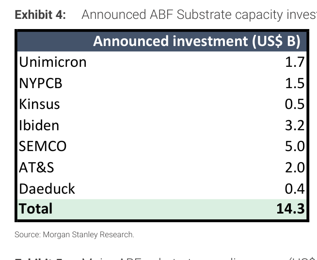

### 解讀摘要
ABF 供應鏈今年已宣布 \$143 億美元資本支出承諾，規模遠超近年年均水準。SEMCO 以 \$50 億美元（Sejong+越南）獨佔三成，Ibiden \$32 億排第二。然而 MS 測算，每 \$1 美元投資可支持 \$0.50-0.60 年化收入，即 \$143 億對應 \$72-86 億增量年收入，但 MS 預測市場到 2030 年需要額外 \$114 億增量收入（從 \$95 億升至 \$209 億）。換言之，即使以最樂觀估算，已宣布投資仍不夠——需要更多擴產才能在 2030 年前滿足需求。

> **原文補充**：MS 指出統計不完整：LG Innotek 尚未披露 ABF 二期投資規模，Shinko 的 JDI Mobara 廠收購所需額外資本支出也未量化。實際宣布總額可能更高。

### 表格

| 廠商 | 宣布投資（\$B） | 備註 |
|---|---|---|
| SEMCO | 5.0 | Sejong（2028年9月投產）+ 越南（2030年6月） |
| Ibiden | 3.2 | F3/29 \¥500bn 電子領域擴產 |
| AT&S | 2.0 | 馬來西亞 Kulim；AMD + Marvell 支持 |
| Unimicron | 1.7 | 廣富二、楊梅二/三/四、龍潭橋石新廠 |
| NYPCB | 1.5 | 台灣南部新廠；2H29 ramp |
| Kinsus | 0.5 | k6c（2028）+ k6d（2029）新增 |
| Daeduck | 0.4 | 2027年底前投產 |
| **合計** | **14.3** | — |

> **洞察一**：\$143 億投資中，SEMCO + Ibiden（合計 \$82 億，佔 57%）都在 2028 年後才有大量產出。前三大投資者反而是「離近期供需最遠」的廠商，這結構上鎖定了 CY27-28 的缺貨。
> **洞察二（配合 Exhibit 2）**：\$143 億所能支持的最大增量年收入上限 \$86 億，vs 模型需求的 \$114 億增量，資本支出缺口約 \$28-42 億——等於仍需再追加 50% 的宣布量。

---

## Exhibit 5｜ABF 供應商歷史資本支出（\$M，2010-2025）

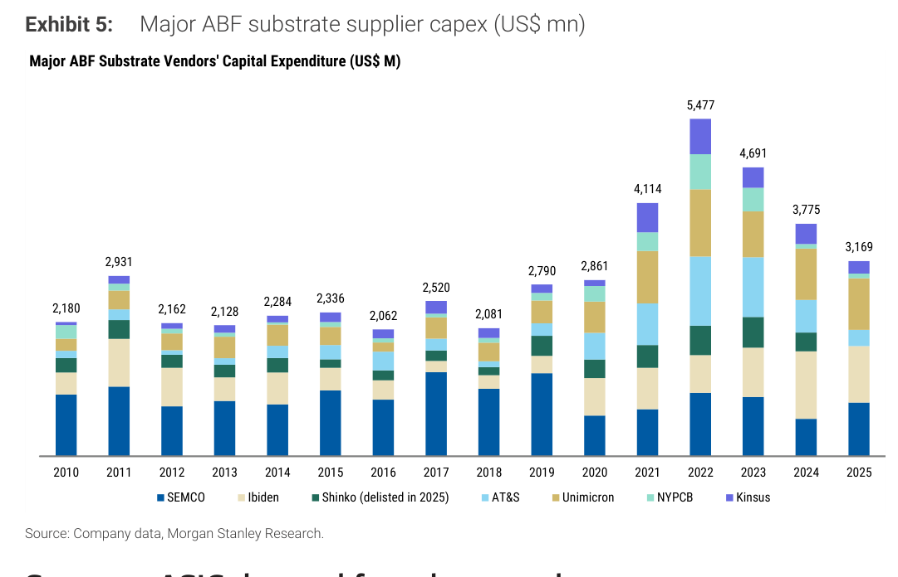

### 解讀摘要
Exhibit 5 呈現 Unimicron、NYPCB、Kinsus、Ibiden、SEMCO、Shinko（2025 下市）、AT&S 七大供應商 2010-2025 年合計資本支出走勢。最高點是 2022 年的 \$5,477M，反映 Covid WFH 推動的擴產週期。2023 年起出現需求正常化後的收縮，2025 年降至 \$3,169M。重要的是，即使在「下行週期」的 2025 年，產業資本支出仍遠高於 2012-18 年（年均 ~\$2.2B），顯示廠商對新需求結構（AI 伺服器）的長期信心從未消失。

### 表格（關鍵年份）

| 年份 | 合計資本支出（\$M） | 說明 |
|---|---|---|
| 2010-2018 均 | ~\$2,200 | PC 下行週期；保守擴產 |
| 2019-20 | ~\$2,800 | 供應緊縮前夕，小幅回升 |
| 2021 | 4,114 | WFH 需求爆發，大舉擴產 |
| 2022 | **5,477** | 歷史最高點 |
| 2023 | 4,691 | 需求正常化，但擴產計畫未停 |
| 2024 | 3,775 | 明顯收斂 |
| 2025 | 3,169 | 仍高於 2012-18 均值 |

> **洞察一**：CY22-25 的高 capex 期所建設的產能，正是讓 CY26 市場「大致平衡」的基礎——但多數設備在 CY23-24 訂購、CY25-26 安裝，導致 CY26 供給集中湧現而需求尚未完全拉起。CY27 起 AI 需求加速超越這波產能，才形成缺口。

---

## Exhibit 6｜Amazon Trainium 出貨量估計變動

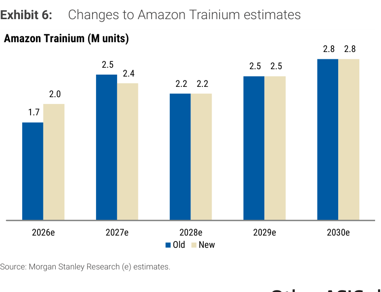

### 解讀摘要
Trainium 需求在 2026e 有實質上修（1.7M→2.0M，+18%），主因是 MS 半導體團隊更新估計。但 2027e 輕微下修（2.5M→2.4M），之後維持不變。整體而言，Trainium 的更新對 ABF 需求模型的貢獻相對有限（因為下修部分與上修幾乎抵消），核心影響仍來自 Exhibit 8 的中國 AI 芯片大幅上修。

### 表格

| 年度 | Old（M units） | New（M units） | 變動 |
|---|---|---|---|
| 2026e | 1.7 | 2.0 | **+18%** |
| 2027e | 2.5 | 2.4 | -4% |
| 2028e | 2.2 | 2.2 | 不變 |
| 2029e | 2.5 | 2.5 | 不變 |
| 2030e | 2.8 | 2.8 | 不變 |

> **洞察一**：Trainium 2026e 上修 +18% 僅貢獻整體需求缺口擴大的一小部分；2027e 反而輕微下修，說明 MS 對 Amazon 短期節奏趨於審慎。Trainium 體量（2026e 2.0M 單位）遠小於 Nvidia GPU（8.1M）或中國 AI 芯片（2026e 2.9M），後者的修訂才是推動整體模型的驅動力。

---

## Exhibit 7｜Google TPU 出貨量估計變動

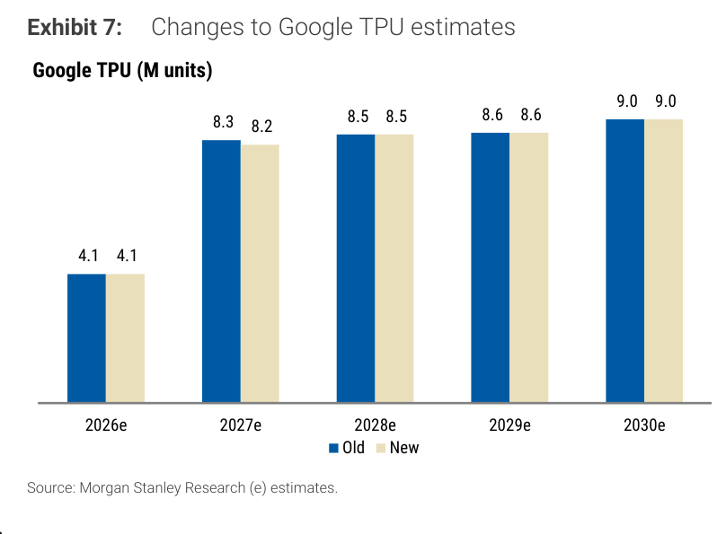

### 解讀摘要
Google TPU 整體維持不變：2026e 4.1M 不動，2027e 從 8.3M 微降至 8.2M，2028-2030e 完全未修。TPU 基數大（2030e 9.0M），但這次沒有推升 ABF 需求——Google TPU 的穩定性反而凸顯中國 AI 芯片的增量貢獻更為顯著。

### 表格

| 年度 | Old（M units） | New（M units） | 變動 |
|---|---|---|---|
| 2026e | 4.1 | 4.1 | 不變 |
| 2027e | 8.3 | 8.2 | -1% |
| 2028e | 8.5 | 8.5 | 不變 |
| 2029e | 8.6 | 8.6 | 不變 |
| 2030e | 9.0 | 9.0 | 不變 |

---

## Exhibit 8｜中國 AI 芯片（Other ASIC）需求大幅上修

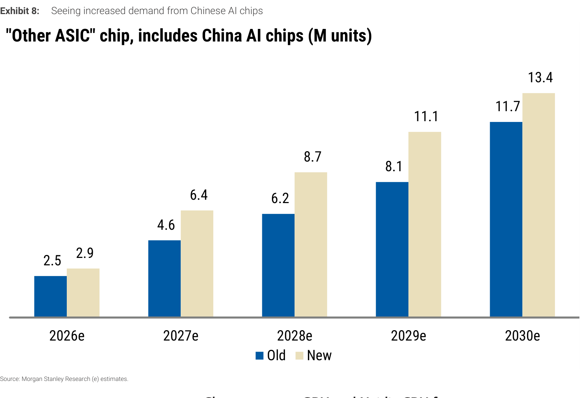

### 解讀摘要
這是本次模型最大的修訂來源。「Other ASIC」涵蓋 Microsoft 及其他美國 ASIC、以及中國 AI 芯片（華為、Cambricon、Hygon、T-Head 等）。CY27e 從 4.6M 大幅上修至 6.4M（+39%），CY28e 從 6.2M 升至 8.7M（+40%），2030e 達 13.4M（原估 11.7M，+15%）。中國 AI 芯片需求的上修反映出：全球 AI 加速器市場由「單一 Nvidia 主導」轉向「更廣泛 ASIC 生態」，而每一顆高階 ASIC 都需要大面積、高層數的 ABF 基板，直接拉動需求。

> **原文補充**：MS 說明，這次不只是數量修訂，也提高了部分芯片的 substrate content 假設（基於最新供應鏈調查），包括 Server CPU 與 Networking 應用的基板面積假設也有所上調。

### 表格

| 年度 | Old（M units） | New（M units） | 增幅 |
|---|---|---|---|
| 2026e | 2.5 | 2.9 | +16% |
| 2027e | 4.6 | **6.4** | **+39%** |
| 2028e | 6.2 | **8.7** | **+40%** |
| 2029e | 8.1 | 11.1 | +37% |
| 2030e | 11.7 | 13.4 | +15% |

> **洞察一**：Other ASIC 在 CY27-28 的 +39/40% 修訂，是 ABF 缺口從 3.0ppt 擴大至 3.1/4.3ppt 的核心驅動——一個類別的修訂就足以讓整個產業供需平衡翻轉。這也反映中國 AI 芯片的需求對外部分析師而言透明度偏低，此假設存在雙向風險：若中國 AI 投資低於預期，ABF 缺口會顯著縮窄。
> **洞察二（配合 Exhibit 2）**：Other ASIC 2030e 13.4M 單位 vs Nvidia GPU 7.2M，Other ASIC 屆時將是 ABF 基板最大的單一需求類別，超過 Nvidia GPU，反映地緣政治驅動的多元 AI 芯片生態圈的長期結構意義。

---

## Exhibit 9｜Nvidia GPU 出貨量估計（維持不變）

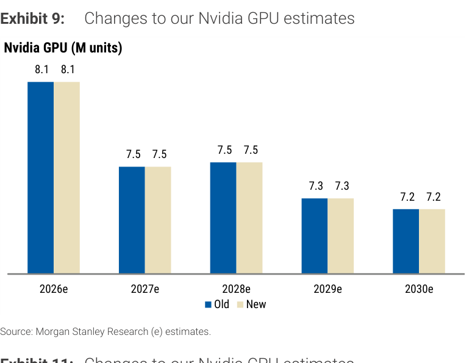

### 解讀摘要
Nvidia GPU 估計完全不變：2026e 8.1M，2027e 7.5M，之後逐步降至 2030e 7.2M。Nvidia GPU 數量小幅下降反映的是 Blackwell 架構的基板面積大幅增加（每顆 GPU 所需 ABF 基板面積更大），即使出貨量持平或小降，對 ABF 需求的貢獻仍維持高水準。AMD GPU 另有大幅下修（本報告未保留 Exhibit 10）。

### 表格

| 年度 | Old（M units） | New（M units） | 變動 |
|---|---|---|---|
| 2026e | 8.1 | 8.1 | 不變 |
| 2027e | 7.5 | 7.5 | 不變 |
| 2028e | 7.5 | 7.5 | 不變 |
| 2029e | 7.3 | 7.3 | 不變 |
| 2030e | 7.2 | 7.2 | 不變 |

---

## Exhibit 18｜我們正進入 AI 普及時代（Period VII）

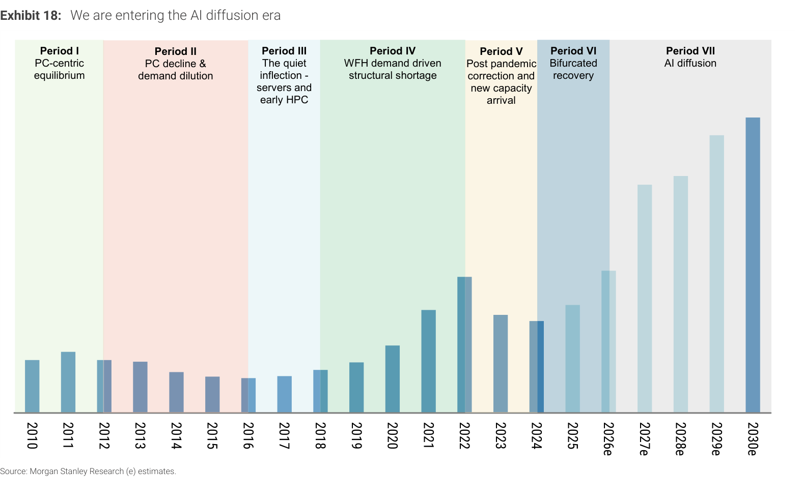

### 解讀摘要
MS 將 ABF 基板歷史分為七個時期（2010 至 2030e），用時程軸圖展示每個週期的需求驅動力、供需狀態與主要催化劑。當前時期（Period VII，2026-2030）命名為「AI diffusion」，是 AI 需求從訓練滲透到推理的關鍵五年。重要的是，這段分析指出：2022-2024 的下行週期持續僅兩年（遠短於 2012-18 的六年下行週期），反映 AI 需求提前了結構性轉折的到來。

### 表格

| 時期 | 時間 | 描述 |
|---|---|---|
| Period I | 2010-2012 | PC-centric equilibrium（PC 主導，伺服器次之） |
| Period II | 2012-2016 | PC 衰退；競價壓低利潤，幾乎無擴產 |
| Period III | 2016-2018 | 靜悄悄的轉折——伺服器 CPU 與早期 HPC 加速器崛起 |
| Period IV | 2018-2022 | WFH 驅動的結構性缺貨；供商開始大規模擴產 |
| Period V | 2022-2024 | 後疫情需求正常化 + 新產能落地，市場過剩 |
| Period VI | 2024-2026 | 分化式復甦：PC 緩復，AI server 高速成長 |
| **Period VII** | **2026-2030e** | **AI 普及——訓練擴展至推理，ABF 需求再加速** |

> **洞察一**：Period VII 的意義不只是技術週期，而是說明 ABF 基板正在完成「從消費電子→企業伺服器→AI 基礎設施」的終極轉型。當 AI 推理在邊緣端普及，連 Networking 和 Auto 都成為 ABF 基板的新需求來源（見 Exhibit 20），這才是 22% CAGR 假設的根本基礎。

---

## Exhibit 19｜ABF 基板市場規模：CAGR 從 9.9%（2015-25）加速至 22.2%（2025-30e）

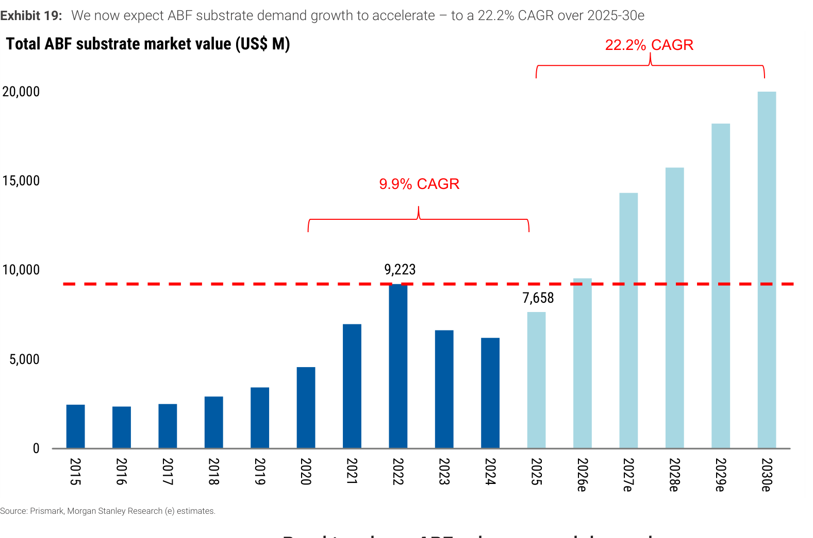

### 解讀摘要
Exhibit 19 呈現 ABF 基板市場 2015-2030e 的總市值（\$M）走勢，將歷史 CAGR 與預測 CAGR 並排比較。歷史上 2015-2025 的年均複合成長率為 9.9%，但其中包含了 2022 高點（\$9,223M）和 2025 低點（\$7,658M）的 V 型波動。MS 現在預測 2025-2030e CAGR 達 22.2%，代表市場將在五年內從 \$7.66B 成長至 \$20.9B——不只是週期復甦，而是需求結構重塑（PC→AI）所帶來的量級躍升。

### 表格

| 時間段 | 起點 | 終點 | CAGR |
|---|---|---|---|
| 2015-2025（歷史） | — | \$7,658M（2025） | 9.9% |
| 2022 高點 | \$9,223M | — | — |
| 2025-2030e（預測） | \$7,658M | ~\$20,900M | **22.2%** |

> **洞察一**：22.2% CAGR 在五年複利下等於 2.73 倍成長（\$7,658M × 2.73 = \$20.9B，與報告正文的 \$20.9B 一致）。關鍵是：這不依賴 PC 或遊戲市場復甦，而是 AI GPU/ASIC/Server/Networking 的接力驅動。
> **洞察二**：從 2022 年高點 \$9,223M 到 2025 年低點 \$7,658M 的跌幅（-17%），反映下行週期對市值的侵蝕，但 MS 認為 2030e \$20.9B 代表從高點算起仍有 2.27 倍成長——即使以最悲觀的起點計算，上行空間依然顯著。

---

## Exhibit 20｜ABF 需求結構大轉移：PC 從 ~70%（2015）降至 <10%（2030e），AI 相關升至 75%+

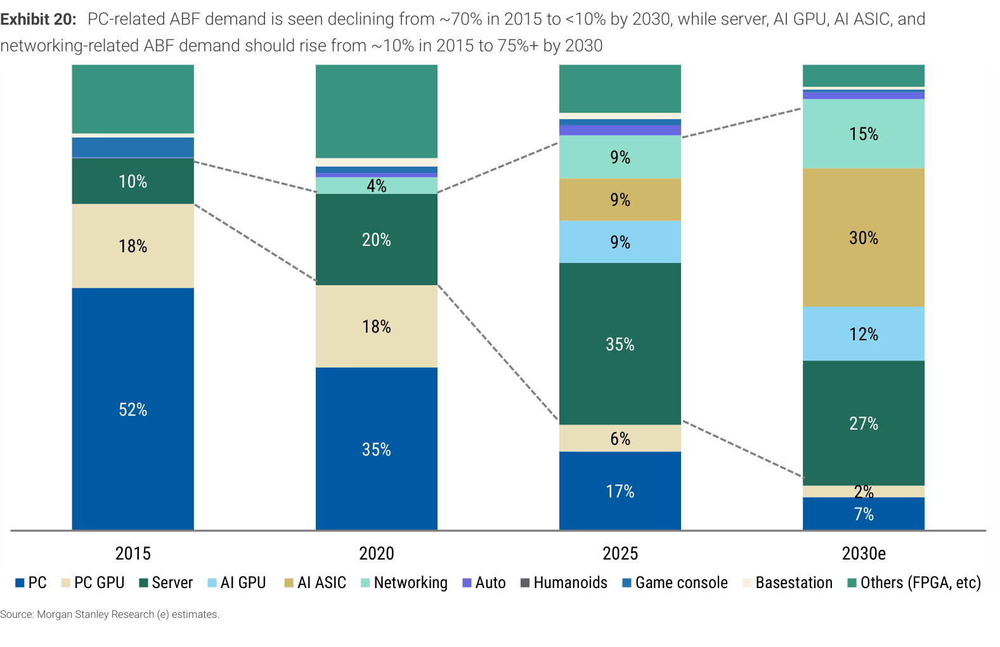

### 解讀摘要
這是整份報告最能說明「為什麼現在」的核心展示圖：ABF 基板從 PC 為核心（2015 年 PC+PC GPU 合計 70%）徹底轉型為 AI 基礎設施。2030e 時，PC 相關僅剩 9%，而 AI ASIC 獨佔 30%、Server CPU 27%、AI GPU 9%、Networking 12%——合計 78%。值得注意的是，2030e 新增了「Humanoids」（4%）與「Auto」（9%）兩個從 2025 年前近乎缺席的類別，說明 ABF 基板的潛在市場還在擴大。

> **原文補充**：MS 強調，2015 年 PC 相關佔 ~70%，但文中同時指出伺服器、AI GPU、AI ASIC 與 Networking 加總在 2015 年「只有約 10%」——這意味著其餘 ~20% 在 2015 年由遊戲機、基帶站、其他 FPGA 等消費/通信應用組成，這些類別正在逐步被 AI 相關用途取代。

### 表格

| 類別 | 2015 | 2020 | 2025 | 2030e |
|---|---|---|---|---|
| PC（CPU） | 52% | 35% | 17% | 7% |
| PC GPU（離散 GPU） | 18% | 18% | 6% | 2% |
| **PC 合計** | **70%** | **53%** | **23%** | **9%** |
| Server CPU | 10% | 20% | 35% | 27% |
| AI GPU | ~0% | ~2% | ~9% | 9% |
| AI ASIC（超大規模+中國） | ~0% | ~2% | ~5% | **30%** |
| Networking | ~0% | ~2% | 15% | 12% |
| Auto | ~0% | ~0% | ~0% | 9% |
| Humanoids | 0% | 0% | 0% | 4% |
| 其他（遊戲機/FPGA/基帶站） | ~20% | ~21% | ~13% | ~0% |

（2025/2030e 各欄數值依 Exhibit 20 原文提取，2015/2020 部分為推算或近似值）

> **洞察一**：AI ASIC 在 2030e 以 30% 躍升為最大單一需求類別（超越 Server CPU 的 27%，也超越 Nvidia GPU 的 9%），這是本報告最具顛覆性的結論——ABF 基板的最大客戶將不再是伺服器或 Nvidia，而是廣義的 ASIC 生態系（含中國廠商）。
> **洞察二（配合 Exhibit 8）**：Other ASIC 在 Exhibit 8 的 2030e 13.4M 單位，對應 Exhibit 20 中 AI ASIC 的 30% 市場份額。若以 2030e ABF 市場 \$20.9B 計算，AI ASIC 的市場規模約達 \$6.3B——這是一個全新的、從幾乎為零成長起來的市場。

---

## 相關個股清單

| 類別 | 公司 | Ticker | 評等 | PT（MS） | 備註 |
|---|---|---|---|---|---|
| ABF 基板（台） | Unimicron（聯亞） | 3037.TW | **OW** | NT\$1,775（↑ from NT\$1,465） | 廣富二 CY27 ramp；首選；+41% upside |
| ABF 基板（台） | NYPCB（南亞電路） | 8046.TW | **OW** | NT\$2,000（↑ from NT\$1,550） | AMD CPU + Networking 差異化；+39% upside |
| ABF 基板（日） | Ibiden | 4062.T | OW | ¥15,000 | F3/29 ¥500bn 擴產；Sato 覆蓋 |
| ABF 基板（韓） | SEMCO | 009150.KS | OW | KRW2,620,000 | Sejong+越南 \$50億最大投資方；Kim 覆蓋 |
| ABF 基板（韓） | LG Innotek | 011070.KS | OW | KRW640,000 | 越南海防廠建設中；ABF Phase 2 規劃 |
| ABF 基板（奧） | AT&S | ATSV.VI | NC | — | AMD/Marvell 客戶背書；馬來西亞 Kulim |
| ABF 基板（台） | Kinsus（景碩） | 3189.TW | NC | — | k6c(2028)+k6d(2029) 共三廠擴産 |
| ABF 基板（韓） | Daeduck | 353200.KS | NC | — | ₩497億投資至 2027 年底 |
