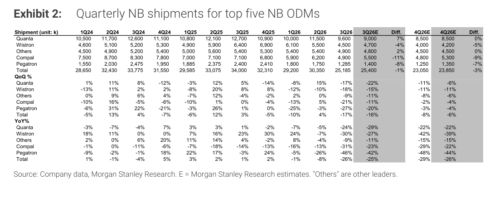

# Morgan Stanley｜Monthly NB Databook：Sep-26 出貨 -2% vs MSe；4Q26e 下修 3%

**券商**：Morgan Stanley  
**分析師**：Howard Kao; Irene Yen; Andy Meng, CFA  
**日期**：2026-10-14  
**主題**：台灣五大 NB ODM 月度出貨追蹤  
**評級**：Industry View In-Line  
<a href="https://layx.uk/dl?g=產業&b=MS&d=20261014&h=Monthly-Databook-NB">📎 下載 PDF</a>

---

## 報告總結

Sep-26 NB 出貨 9,660k（+32% m/m，-2% vs MSe），季末拉貨效應帶動環比大幅反彈，但仍略低於預期，弱點集中於 Compal（-26% vs E）和 Wistron（-12% vs E），主因 Dell 訂單疲弱（Dell 佔 Compal CY25 NB 出貨 ~60%、Wistron ~55%）。3Q26 合計 25.2M (-17% q/q, -26% y/y)，次於季節性（15 年均值 +5% q/q）。MS 認為前拉效應已結束、通路庫存已滿、OEM 對通路放緩供貨，因此將 4Q26e 下修 3% 至 23.1M (-8% q/q, -29% y/y)；CY26 全年 ~107.8M (-16% y/y)。

---

## MS 完整投資邏輯鏈

| 論點層次 | Exhibit | 內容 |
|---|---|---|
| 需求信號 | Exhibit 1 | Sep-26 出貨 -2% vs MSe；Compal/Wistron 明顯低於預期（Dell 疲弱） |
| 需求結構 | 封面文字 | 前拉需求已結束，通路存貨飽和，OEM 主動放緩 sell-in |
| 供需追蹤 | Exhibit 2 | 3Q26 實際 25.2M，次季節性；4Q26e 下修至 23.1M |
| **結論** | 封面 | **CY26 台灣五大 ODM NB ~107.8M (-16% y/y)** |

---

## Exhibit 1｜Monthly NB Shipments for Top Five NB ODMs

### 解讀摘要
Sep-26 出貨總計 9,660k，+32% m/m（季末拉貨），但低於 MS 預期的 9,875k（-2%）。Quanta 大幅超預期（+17%），主因客戶訂單組合有利；Compal 嚴重低於預期（-26%），Dell 訂單疲弱是主因；Wistron 亦低於預期（-12%）。Oct-26E 僅 6,775k，環比大幅下降（-30% m/m），反映季末拉貨消化後的正常回落。

### 表格

| ODM | Aug-26 | Sep-26實際 | Sep-26E | vs E | Oct-26E |
|---|---|---|---|---|---|
| Quanta | 2,600 | 4,200 | 3,600 | +17% | 2,500 |
| Wistron | 1,400 | 1,500 | 1,700 | -12% | 1,200 |
| Others | 1,500 | 1,800 | 1,700 | +6% | 1,300 |
| Compal | 1,400 | 1,700 | 2,300 | -26% | 1,400 |
| Pegatron | 425 | 460 | 575 | -20% | 375 |
| **Total** | **7,325** | **9,660** | **9,875** | **-2%** | **6,775** |
| MoM | — | +32% | — | — | -30%E |

（單位：千台）

---

## Exhibit 2｜Quarterly NB Shipments for Top Five NB ODMs

### 解讀摘要
3Q26 實際出貨 25,185k，QoQ -17%（遠低於 15 年均值 +5% q/q）、YoY -26%，次季節性明顯。4Q26E 下修至 23,850k（-3% q/q vs 3Q）。全年弱勢的根本原因是前拉需求提前在 1H26 消耗，現在通路正在消化庫存。各家中 Compal 和 Wistron 全年 YoY 跌幅最大（-22% 至 -39%），反映 Dell 依賴度高所承受的最大衝擊。

### 表格

| ODM | 3Q26 | 3Q26E | 4Q26E | 3Q26 YoY | 4Q26E YoY |
|---|---|---|---|---|---|
| Quanta | 9,600 | 9,000 | 8,500 | -24% | -22% |
| Wistron | 4,500 | 4,700 | 4,200 | -30% | -27% (→-39%) |
| Others | 4,900 | 4,800 | 4,500 | -9% | -11% (-15%) |
| Compal | 4,900 | 5,500 | 5,300 | -21% | -23% (-22%) |
| Pegatron | 1,285 | 1,400 | 1,350 | -46% | -42% (-44%) |
| **Total** | **25,185** | **25,400** | **23,850** | **-26%** | **-25% (-26%)** |

（單位：千台；括號內為 4Q26E vs 4Q25 YoY%）

> **洞察一**：3Q26 次季節性（-17% q/q vs 歷史 +5%）疊加 4Q26 亦不如預期（-5% q/q vs 歷史 flat），說明 CY26 前拉效應已在上半年完全提前消費，下半年全面承壓。
> **洞察二**：Dell 佔比高的 Compal 和 Wistron 是最大輸家，客戶集中度風險已實質兌現。

## 相關個股清單

| 類別 | 公司 | Ticker | 評等 | 備註 |
|---|---|---|---|---|
| 台灣 ODM | Compal | 2324 | — | Dell 曝險最高 |
| 台灣 ODM | Wistron | 3231 | — | Dell 曝險高 |
| 台灣 ODM | Quanta | 2382 | — | 相對強勢 |
| 台灣 ODM | Pegatron | 4938 | — | — |
