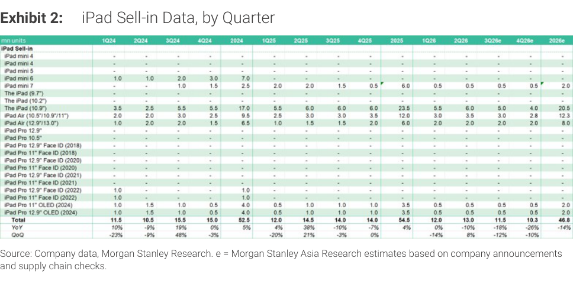

# Morgan Stanley｜Monthly iOS Databook：舊款 iPhone 下修，iPhone 18 不變；iPad 下修

**券商**：Morgan Stanley  
**分析師**：Howard Kao; Derrick Yang; Andy Meng, CFA; Irene Yen; Vivi Huang; Betty Chen  
**日期**：2026-10-14  
**主題**：iPhone / iPad 供應鏈月度出貨追蹤  
**評級**：Industry View In-Line  
<a href="https://layx.uk/dl?g=產業&b=MS&d=20261014&h=Monthly-Databook-iOS">📎 下載 PDF</a>

---

## 報告總結

3Q26 iPhone build 維持 54M 不變（+4% q/q, -2% y/y）；4Q26 下修 1M 至 72M，主因 iPhone 16/17e 等舊款需求不振，但新款 iPhone 18 系列 2H26 合計維持 71M。iPad 雙下修：3Q26 降 0.5M 至 11.5M（1H 前拉＋漲價壓制）、4Q26 降 0.7M 至 10.3M。CY26 全年 iPhone 234M (+3% y/y)、iPad 46.8M (-14% y/y)。

---

## MS 完整投資邏輯鏈

| 論點層次 | Exhibit | 內容 |
|---|---|---|
| 需求信號（iPhone） | 封面文字 | 3Q26 不變；4Q26 降 1M（舊款拖累） |
| 需求信號（iPad） | Exhibit 2 | 3Q/4Q 雙下修；前拉消化＋漲價壓制 |
| 新品動態 | 封面文字 | iPhone Duo 2H26 7M，Pro Max ↑0.5M；Duo 銷售啟動，密切監控 |
| **結論** | 封面 | **CY26 iPhone 234M (+3%)；iPad 46.8M (-14%)** |

---

## Exhibit 1｜iPhone Sell-in Data, by Quarter

### 解讀摘要
Exhibit 1 為 iPhone 季度 sell-in 圖表（圖像型，文字層僅含標題）。關鍵更新已在封面文字中給出：3Q26e 維持 54M，4Q26e 下修 1M 至 72M，調整來自舊款機型（iPhone 16/17e）需求下滑，新款 iPhone 18 系列維持不變。CY26 全年 234M (+3% y/y)，在有限 SKU 情況下達成年增，主要靠 Pro/Pro Max 拉動。iPhone 18 Duo 作為新形態機型，2H26 7M 出貨是關鍵追蹤指標。

### 表格

| 指標 | 3Q26e | 4Q26e | 2H26 | CY26 |
|---|---|---|---|---|
| iPhone build 總量（M） | 54（不變） | 72（↓1M） | 126 | 234 |
| YoY | -2% | -5% | — | +3% |
| QoQ | +4% | +33% | — | — |
| iPhone 18 系列（M） | — | — | 71（-21% y/y） | — |
| 　iPhone Duo | — | — | 7（↓0.5M for 3Q） | — |
| 　iPhone 18 Pro Max | — | — | +0.5M 至 8.5M | — |

---

## Exhibit 2｜iPad Sell-in Data, by Quarter

### 解讀摘要
iPad 雙下修反映兩個獨立壓力：(1) 1H26 前拉消費了 3Q 需求；(2) 漲價壓制入門款需求。3Q26e 降至 11.5M（-12% q/q, -18% y/y），4Q26e 降至 10.3M（-10% q/q, -26% y/y）。CY26 全年 46.8M 僅 -14% y/y，比年中預期更疲弱。從型號結構看，主力仍為 The iPad (10.9") 和 iPad Air，2026e 各 20.5M 和 12.3M，OLED 版本（Pro 11"/12.9"）出貨量仍小（各 2M）。

### 表格

| 機型 | 3Q26e | 4Q26e | 2026e |
|---|---|---|---|
| iPad mini 7 | 0.5 | — | 2.0 |
| The iPad (10.9") | 5.0 | 4.0 | 20.5 |
| iPad Air (10.5"/10.9"/11") | 3.5 | 2.8 | 12.3 |
| iPad Air (12.9"/13.0") | 2.0 | 2.0 | 8.0 |
| iPad Pro 11" OLED (2024) | 0.5 | 0.5 | 2.0 |
| iPad Pro 12.9" OLED (2024) | 0.5 | 0.5 | 2.0 |
| **Total** | **11.5** | **10.3** | **46.8** |
| YoY | -18% | -26% | -14% |
| QoQ | -12% | -10% | — |

（單位：百萬台）

> **洞察一**：iPhone 新舊款分化加劇——舊款下修、新款不動，意味著供應鏈利益向高端組件集中（大立光、高通 content 更高的機型）。  
> **洞察二**：iPad -14% y/y 跌幅大於 iPhone +3% y/y，顯示 iPad 的消費升級動力更弱，且受替代品（MacBook）蠶食。

## 相關個股清單

| 類別 | 公司 | Ticker | 評等 | 備註 |
|---|---|---|---|---|
| 光學（鏡頭） | 大立光 | 3008 | OW | iPhone Pro Max 上修受益 |
| 面板/背光 | 瑞儀 | 6176 | — | iPad 下修承壓 |
| 組裝 ODM | 鴻海 | 2317 | — | iPhone 主組裝商 |
