# GFHK｜Oct Edition: Choppy Markets, Intact AI

**券商**：GF Securities (Hong Kong)  
**分析師**：Jeff Pu, CFA、Henry Huang  
**日期**：2026-10-15  
**主題**：2026 年 10 月大中華科技月報——市場震盪、AI 需求不變  
**評級**：Positive（隱含，持續正向 AI 基建佈局）  
<a href="https://layx.uk/dl?g=產業&b=GFHK&d=20261015&h=Oct-Edition">📎 下載 PDF</a>

---

## 報告總結

10 月科技股受高債息、AI 貨幣化能見度下降及長期 AI 爭議壓抑，台灣半導體（晶圓代工、記憶體）與韓國股雙雙承壓，但 GFHK 認為這是「預期重設」而非 AI 衰退，建議逢低累積低估值且具持久性的個股（HBM、非台積電代工、CPU、CPO 等）。本月偏好清單加入 Celestica，移除聯發科與鴻海。

季報焦點：TSMC 9 月營收 -0.6% MoM 略好於預期（3Q26 +17.6% QoQ 小超共識）、CoWoS 上修至年底 195 kwpm、ABF substrate 2H26 漲價 ~15%、Aspeed YoY +101%。光學方面，800G/1.6T 合計 2027E 需求達 170mn；NPO OE 2028E 42.4mn（較 2027E 增 6.5 倍），Marvell/Semtech 受益 TIA/Driver 升級。

---

## GFHK 完整投資邏輯鏈

| 論點層次 | 內容 |
|---|---|
| 市場定性 | 股市動盪來自情緒與定位的修正，AI 結構性需求未受損 |
| 供需信號 | TSMC 3Q26 +17.6% QoQ 略超共識；AI 加速器 2026E 市場 \$357bn，+78% YoY |
| CPU 新亮點 | Agentic AI 使 GPU:CPU 比從 8:1（訓練）收斂至 4:1（推論）；Server CPU TAM 2026E +96% |
| 光學加速 | 800G 2026E 50mn、1.6T 30mn；NPO OE 2027E 6.5mn → 2028E 42.4mn |
| 瓶頸確認 | CoWoS 仍是供給瓶頸；ABF 2H26 漲 ~15%；CCL 多家創新高 |
| **結論** | **逢低買進：HBM（MU）、非台積電代工（UMC/Tower）、INTC CPU、MRVL/SMTC TIA/Driver、CRDO、ASE** |

> **報告最大邏輯缺口**：xAI 2027E Capex \$400bn 假設過大（較 Coreweave \$96bn 大 4 倍），若此數字下修，Neocloud 合計 \$606bn 及 NPO OE 需求估算都會顯著縮水。

---

## 報告核心觀點

| 主題 | GFHK 觀點 | 市場共識 | 是否 Contra-Consensus |
|---|---|---|---|
| 近期市場震盪性質 | 預期重設（AI intact），而非需求惡化 | 部分市場視為 AI 投資見頂 | 是——明確排除 AI 衰退論 |
| CPU 市場 | Agentic AI 使 GPU:CPU 4:1；Server CPU TAM 2030E \$215bn | CPU 長期被 GPU 替代 | 是——明確提出 CPU 結構性上行 |
| NPO vs CPO | NPO 短期先行（可靠性＋量產），CPO 為長期終態；兩者並行 | CPO 主導觀念較強 | 部分是——NPO 量化到 OE 出貨數字 |
| PC 前景 | 2026E -12% YoY，2027E 再 -5%；中國低價機種相對強 | AI PC 帶動回升 | 是——明確看淡整體 PC |
| Neocloud capex | xAI 2027E \$400bn，頂5合計 \$606bn | 普遍偏保守 | 是——xAI 數字遠超市場預期 |
| Substrate/CCL | ABF 2H26 漲 ~15%，CCL 多家創新高；upcycle 進行中 | 已有共識，但幅度模糊 | 部分是——具體漲幅比市場想像大 |

**偏好排序**：NVDA > INTC > CRDO > ASE（3711）> ZDT（4958）> UMC > MU > Lenovo > MRVL > SMTC > CLS  
**本月變動**：加 CLS（Hold）；移除 MTK（TPU v9 延誤）、Hon Hai（iPhone 週期轉弱）

---

## Figure 1｜Cyclical Indicators（文字表格）

### 解讀摘要

GFHK 景氣指標矩陣顯示短中期訊號明顯分化：AI 基礎建設相關（DRAM、Analog、Optical、AI Server）全面正向；消費類（iPhone、Android、PC）全線看淡，PC 中期亦無反轉。DRAM 短中期均 ↗ 是最強看多訊號；NAND 中期 → 代表已反彈但持續性待觀察。

### 表格

| 指標 | 短期 | 中期 |
|---|---|---|
| DRAM | ↗ | ↗ |
| NAND | ↗ | → |
| Analog | ↗ | ↗ |
| Optical | ↗ | ↗ |
| iPhone | ↘ | → |
| Android | ↘ | ↘ |
| PC | ↘ | ↘ |
| AI Server | ↗ | ↗ |

> **洞察一**：8 個指標中 4 正 4 負，完全按 AI 基建 vs. 消費電子劃線——確認 GFHK barbell 投資策略有數據支撐，也說明這份月報的選股邏輯是結構性而非週期性押注。

---

## Figure 2｜Preferred Picks（文字表格）

### 解讀摘要

11 檔偏好清單以 AI 基礎建設為主軸，含 GPU（NVDA）、CPU（INTC）、Ethernet IC（CRDO）、先進封測（ASE）、ABF substrate（ZDT）、晶圓代工（UMC）、HBM（MU）、伺服器 ODM（Lenovo）、ASIC interconnect（MRVL/SMTC）及 EMS（CLS）。移除 MTK（TPU v9 延誤短期利空）與 Hon Hai（iPhone 週期轉弱），加入 CLS 受益 Rubin 組裝增量。

### 表格

| 公司 | Ticker | 評等 | CY26 P/E | CY27 P/E |
|---|---|---|---|---|
| Nvidia | NVDA US | Buy | 23.8x | 13.9x |
| Intel | INTC US | Buy | 61.3x | 35.0x |
| Credo | CRDO US | Buy | 27.6x | 15.7x |
| ASE | 3711 TT | Buy | 40.2x | 24.8x |
| ZDT | 4958 TT | Buy | 29.1x | 15.5x |
| UMC | 2303 TT | Buy | 18.7x | 16.5x |
| Micron | MU US | Buy | 11.6x | 4.8x |
| Lenovo | 00992 HK | Buy | 11.9x | 8.3x |
| Marvell | MRVL US | Buy | 55.7x | 30.7x |
| Semtech | SMTC US | Buy | 44.5x | 21.7x |
| Celestica | CLS US | Hold | 29.4x | 13.1x |

> **洞察一**：MU CY27 P/E 4.8x 是清單中最低，顯示 GFHK 視其為「最大估值錯位」的 HBM 受益者；INTC CY26 61.3x 高但 CY27 降至 35x，反映 CPU 轉型帶來的利潤率提升預期。

---

## Figure 3｜Preferred Picks Performance

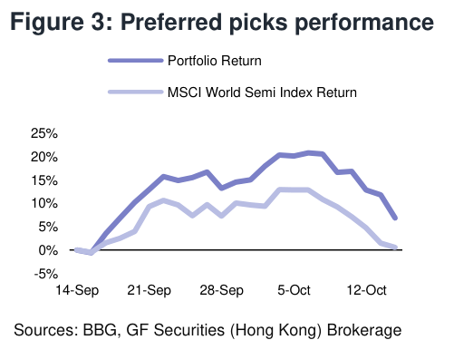

### 解讀摘要

組合在 9 月 14 日至 10 月 12 日約一個月間達到 ~20% 峰值回報，顯著超越 MSCI World Semi Index 的 ~15%。10 月初起出現回調，差距縮小，反映市場情緒轉向保守。GFHK 的 AI barbell 組合在上漲期取得 ~5ppt alpha，說明選股邏輯有效。

---

## Figure 5｜Taiwan Upstream Tech Monthly Sales

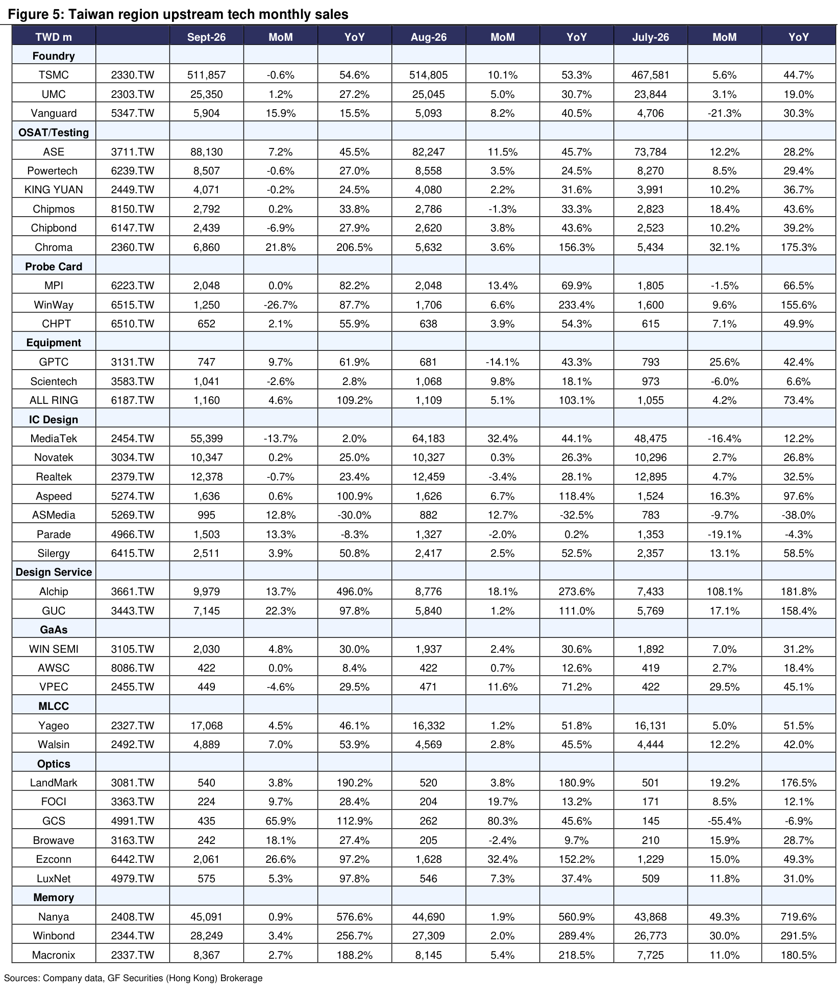

### 解讀摘要

9 月台灣上游科技月營收：TSMC +54.6% YoY（全年最強速度之一）、Alchip +97.8% YoY（T3 量產驅動）、GUC +22.4% MoM（Axion 2 CPU）、Unimicron +65% YoY、ZDT +36% YoY、Aspeed +101% YoY（BMC 晶片，AI 機架指標）。反觀 ASMedia -30% YoY（消費連接器），AI vs. 消費端差距達到歷史最大幅度。

> **洞察一**：Aspeed 連兩個月 YoY 超 100% 是 AI 機架滲透率最直接的代理指標——每台 AI 伺服器均需 BMC 晶片，Aspeed +101% YoY 意味著 AI 機架出貨在過去一年幾乎翻倍，與 GFHK 預估的 NVL72 出貨量（75k racks 2026E）方向吻合。

---

## Figure 6｜Taiwan Downstream Tech Monthly Sales

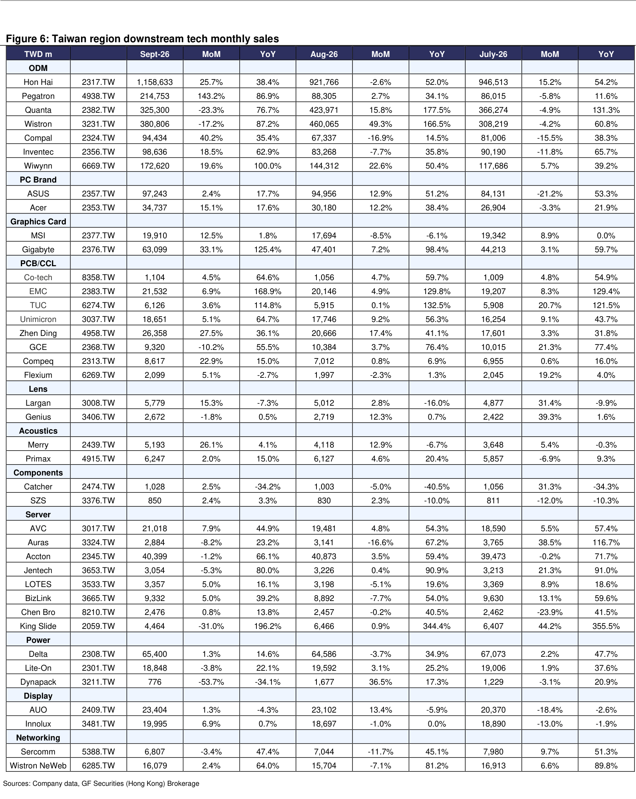

### 解讀摘要

下游科技清單：9 月 NB ODM 合計 9.7mn（YoY -20%），確認 PC 下行。Hon Hai +38% YoY 由 iPhone 貢獻，Quanta -23%/Wistron -17% 反映 AI 機架出貨時間差，Pegatron +143.2% MoM 是最大亮點——GB300 初始出貨至 Lambda/Together AI 等 neocloud 客戶，確認 NVL72 訂單強度。

> **洞察一**：Pegatron 的 +143% MoM 是「AI 機架替換傳統 NB 組裝」轉型的縮影——同一家 ODM 消費性業務平淡、AI 機架爆發，說明 AI 組裝轉型能力對落後者是威脅、對先行者是超額利潤來源。

---

## Figure 7｜SOX vs S&P500

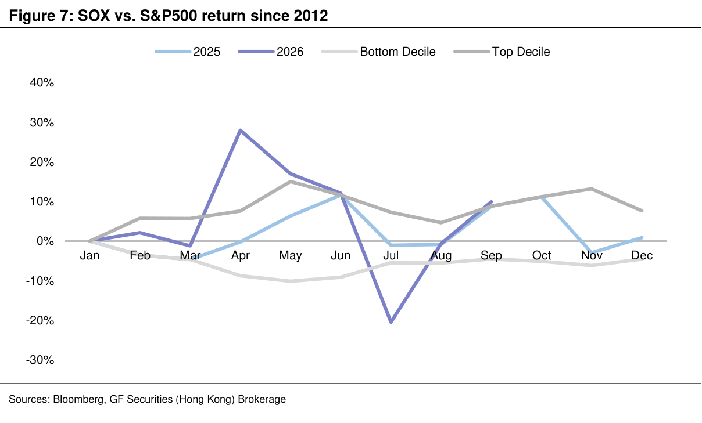

### 解讀摘要

SOX 近期相對 S&P500 出現差距修正，走勢略顯落後，與報告封面「半導體股受高債息壓抑、定位從高峰回落」的描述一致。但 SOX 相對 S&P500 的長期超額收益趨勢仍維持。

---

## Figure 8｜SOX P/E、P/B

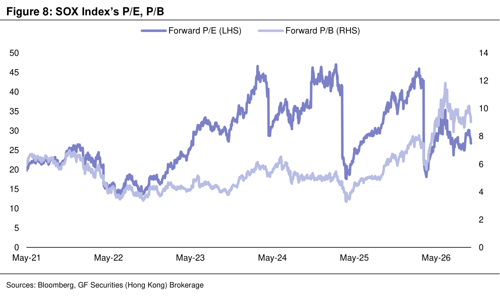

### 解讀摘要

SOX P/E 和 P/B 目前均處於長期平均附近，表明整體半導體估值未過分偏貴，為 GFHK「逢低買進」策略提供估值支撐，避免了「在峰值追高」的風險。

---

## Figure 9｜MSCI World Tech Hardware P/E

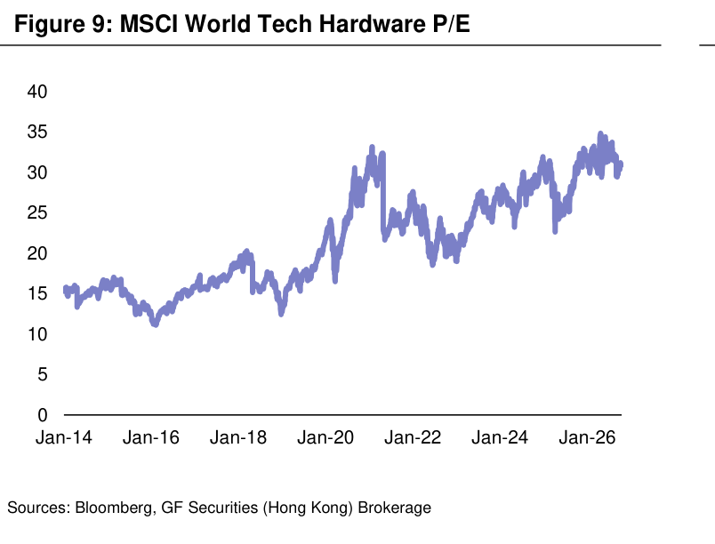

### 解讀摘要

MSCI 全球科技硬體 P/E 目前約 30x，高於歷史均值但未達 2021 年高點，顯示市場對硬體族群仍給予較高估值溢價，呼應 AI 基建持續擴張的預期。

---

## Figure 10｜MSCI World Semi P/E

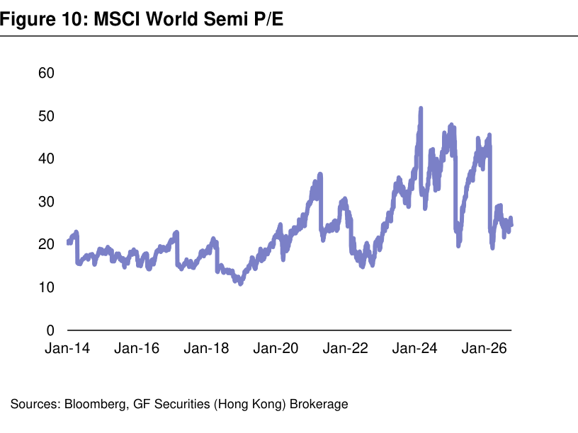

### 解讀摘要

MSCI 全球半導體 P/E 目前約 25x，從 2024 年 1 月峰值 ~50x 大幅修正至接近 2019-2020 年水位，說明「AI 過熱溢價」已相當程度消化，為 GFHK 的買進立場提供估值支撐。

> **洞察一**：從 ~50x → ~25x 的估值砍半，伴隨的是 AI 加速器市場 2024→2026E 的 3 倍成長（\$117bn → \$357bn）——「估值壓縮但業績持續成長」的組合，正是 GFHK 「預期重設而非 AI 衰退」論述的最佳體現。

---

## Figure 11｜MSCI World Semi P/B

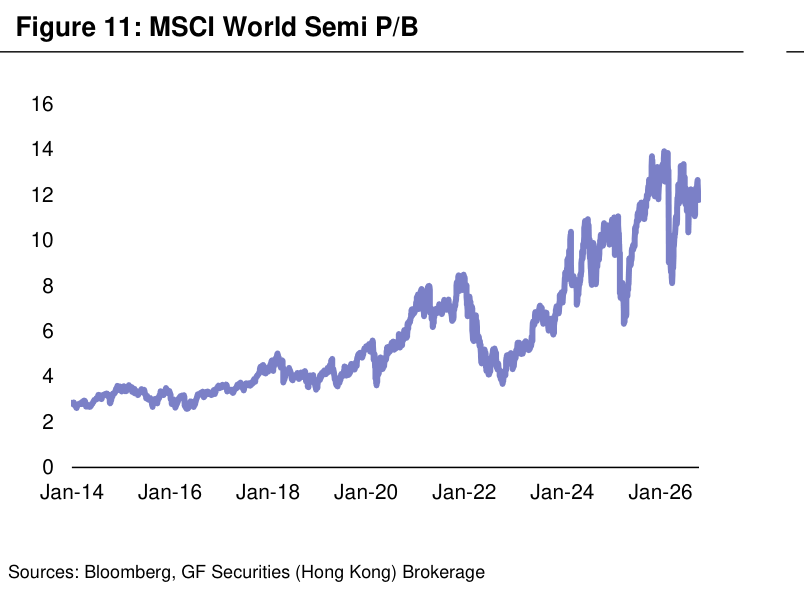

### 解讀摘要

MSCI 全球半導體 P/B 目前約 12x，從 2022 年低點大幅上升，但相較 P/E 修正更溫和，顯示帳面價值（資本密集投入）持續擴張。P/B 高位反映半導體業的高 ROIC 預期依然成立。

---

## Figure 12｜MSCI China IT P/E

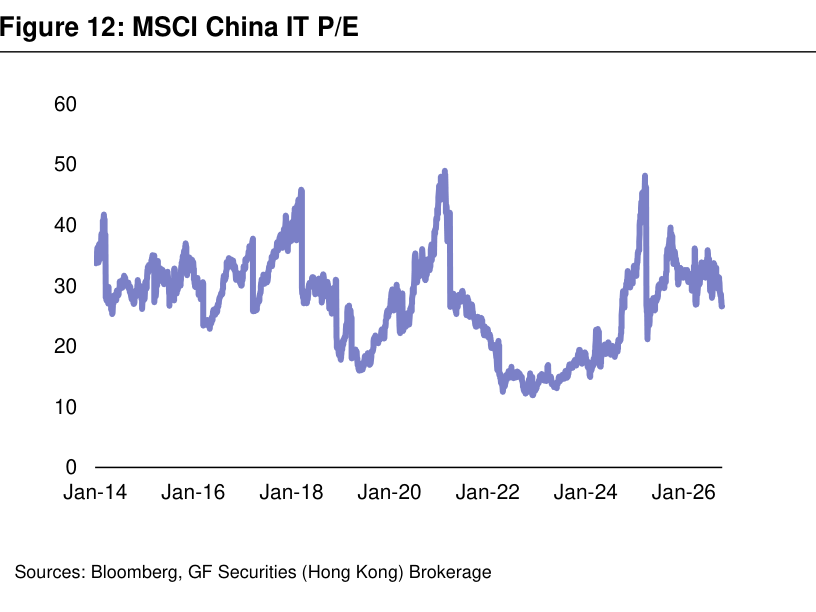

### 解讀摘要

MSCI 中國 IT P/E 目前約 30x，與全球科技硬體相當，高於全球半導體的 25x，反映中國 AI 模型（DeepSeek、Qwen 等）帶動的本地需求預期，與 Figure 23 中中國模型 Token 消費快速增長互相呼應。

---

## Figure 13｜MSCI US IT P/E

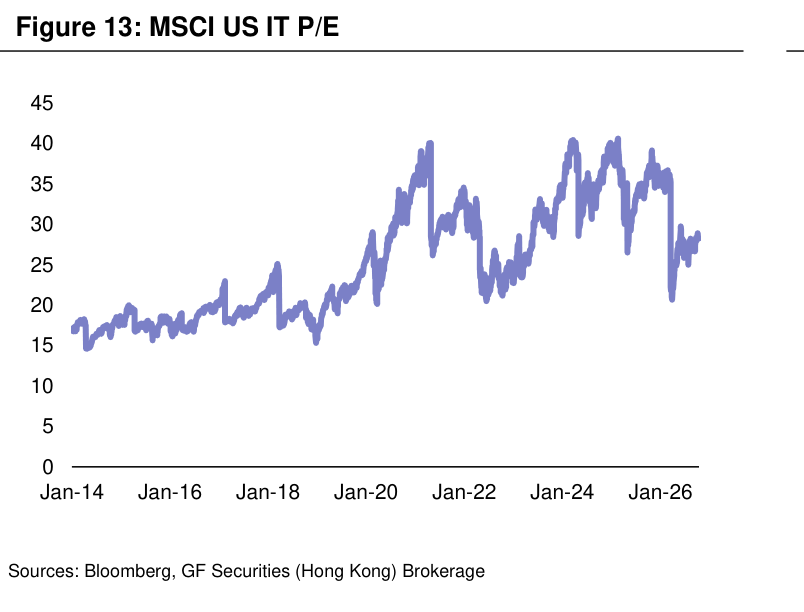

### 解讀摘要

MSCI 美國 IT P/E 目前約 28x，是主要地區中最穩定者，反映 MSFT/Google/Meta 等超大型 CSP 的持續高 capex 業務確定性對估值的錨定效果。

---

## Figure 14｜MSCI Taiwan IT P/E

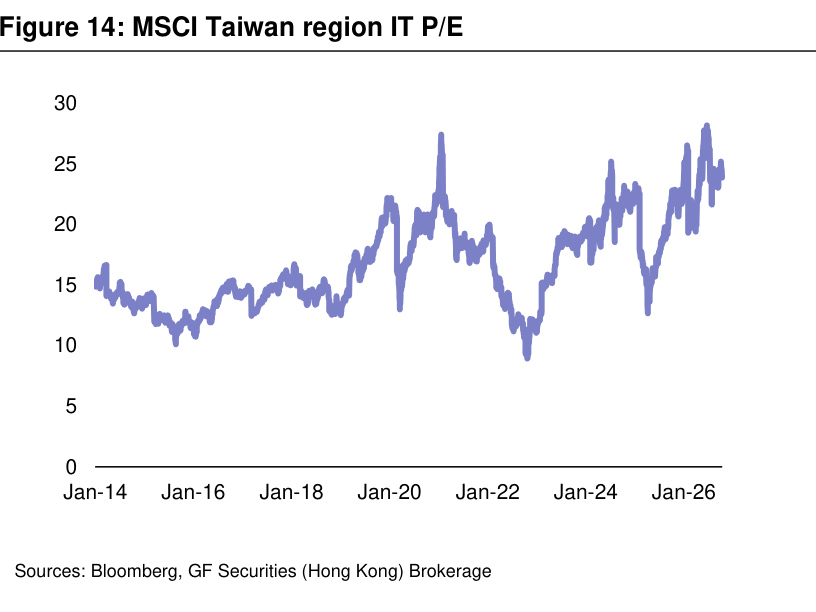

### 解讀摘要

MSCI 台灣 IT P/E 目前約 25x，從 2022 年底低點（~9x）大幅反彈，主要由台積電 AI 業務爆發及 CoWoS 受益鏈帶動。相較美國 IT 28x 仍有折讓，但折讓幅度已從 2022-23 年大幅收窄。

---

## Figure 15｜MSCI Korea IT Forward P/E

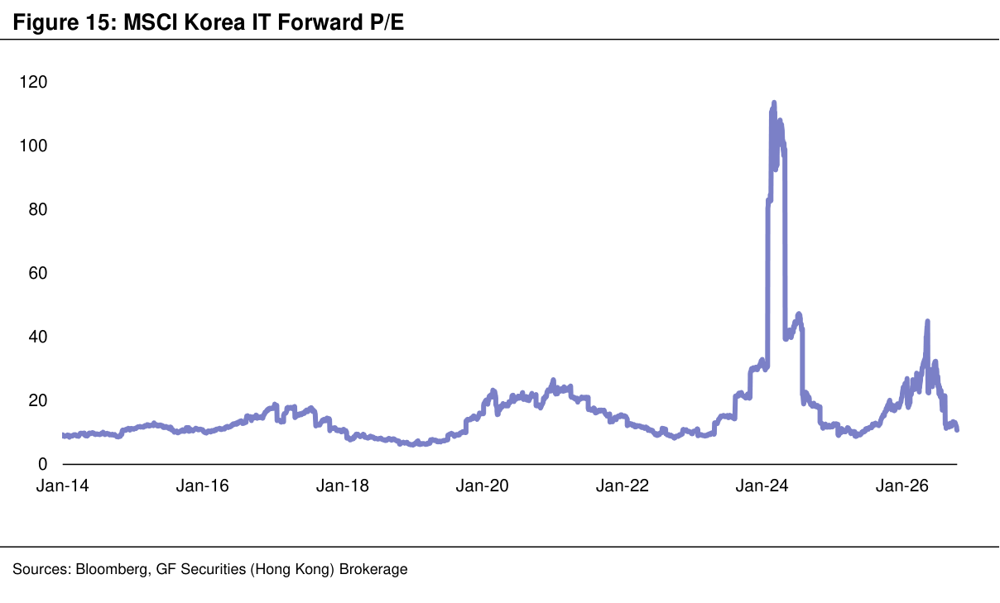

### 解讀摘要

MSCI 韓國 IT Forward P/E 目前約 12x，從 2024 年 1 月峰值 ~115x 崩跌，反映三星/SK Hynix HBM 的市場期望從極高位大幅修正。12x 接近歷史低點，顯示韓國記憶體股已在極度悲觀中定價，而 GFHK 對 HBM 仍維持正向。

> **洞察一**：韓國 IT 從 115x → 12x（-90%）vs. 台灣 IT 從 ~32x → ~25x（-22%），兩者差異揭示市場對「AI 基建供應商」（台積電 CoWoS）與「記憶體週期股」（三星 HBM）的定價邏輯根本不同——前者享結構性溢價，後者仍被視為週期品，形成 GFHK 在記憶體（MU）偏好美系而非韓系的隱含邏輯。

---

## Figure 16｜Global Smartphone Shipment

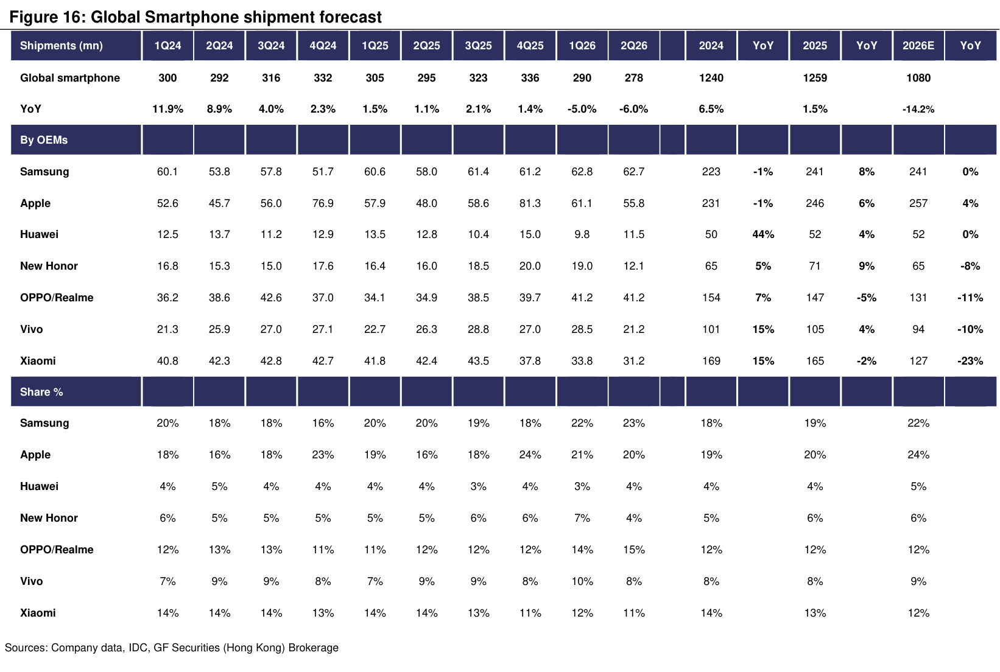

### 解讀摘要

2026E 全球智慧型手機出貨量約 1,080mn，YoY -14.2%，Samsung 22%、Apple 24% 為前兩大品牌。下行主因是後 COVID 拉貨後的消化期疊加宏觀消費疲弱，GFHK 對 Android 中期指標維持 ↘（Figure 1）。

### 表格

| 年份 | 出貨量（mn） | YoY |
|---|---|---|
| 2025E | ~1,260（推算） | — |
| 2026E | 1,080 | -14.2% |

---

## Figure 17｜Apple iPhone Build Plan

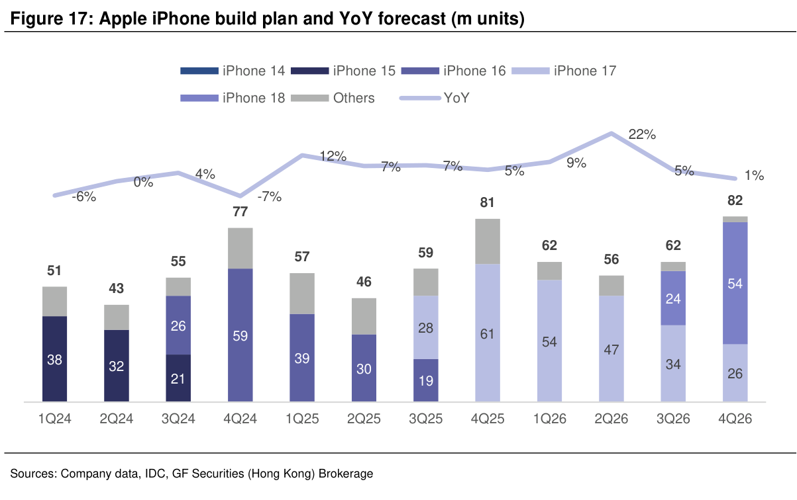

### 解讀摘要

4Q26E iPhone 組裝計畫 82mn，YoY +1%，在整體手機市場下滑中維持微幅正成長。iPhone 18 已於 Sep-26 開始正式量產拉貨，圖表顯示明顯的季節性 ramp 型態，4Q 為傳統高峰季。

### 表格

| 季度 | 組裝計畫（mn） | YoY |
|---|---|---|
| 4Q26E | 82 | +1% |

---

## Figure 18｜iPhone 18 Series Spec

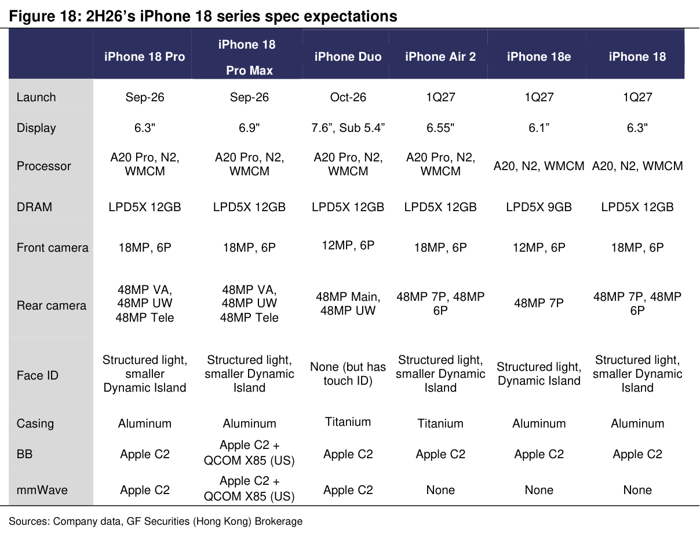

### 解讀摘要

iPhone 18 系列共 6 款機型，全數採用 A20 SoC（N2 製程）+ WMCM 先進封裝。iPhone 18 Pro / Pro Max 已於 Sep-26 上市，其餘 4 款（Duo、Air 2、18e、18）預計 1Q27 推出。全系列 WMCM 導入代表 TSMC WMCM 容量的消費性需求基礎大幅擴大，亦是 CoWoS/WMCM 的持續擴產動力之一。

### 表格

| 型號 | 上市時間 | SoC | 封裝 |
|---|---|---|---|
| iPhone 18 Pro Max | Sep-26 | A20 (N2) | WMCM |
| iPhone 18 Pro | Sep-26 | A20 (N2) | WMCM |
| iPhone 18 Duo | 1Q27 | A20 (N2) | WMCM |
| iPhone 18 Air 2 | 1Q27 | A20 (N2) | WMCM |
| iPhone 18e | 1Q27 | A20 (N2) | WMCM |
| iPhone 18 | 1Q27 | A20 (N2) | WMCM |

> **洞察一（配合 Figure 30）**：TSMC 4Q28E WMCM 130 kwpm，佔 CoWoS+WMCM 合計 350 kwpm 的 37%。iPhone 全系列 WMCM 化意味著 Apple 對 WMCM 產能的年需求可能是 TSMC WMCM 產能的最大單一消費者——AI GPU 與消費 WMCM 的產能競爭是長期排程風險。

---

## Figure 19｜Global PC Shipment

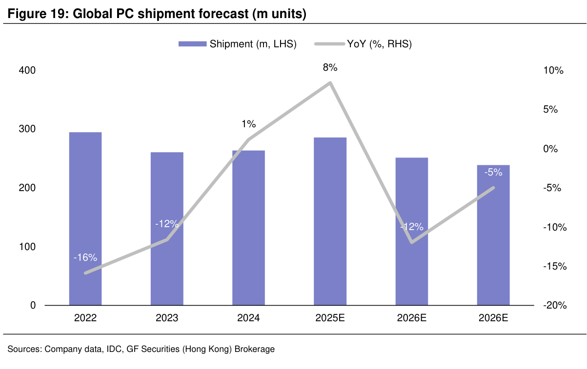

### 解讀摘要

2026E 全球 PC 出貨約 255mn，YoY -12%（2025E 285mn +8%，主因上半年拉貨效應帶來高基期）。GFHK 進一步預估 2027E 再 -5% YoY，意味著 AI PC 在 2026-27 年仍不足以抵消宏觀消費下行。

### 表格

| 年份 | 出貨量（mn） | YoY |
|---|---|---|
| 2025E | 285 | +8% |
| 2026E | ~255 | -12% |
| 2027E | ~240（推估） | -5% |

---

## Figure 20｜PC Shipment YoY%

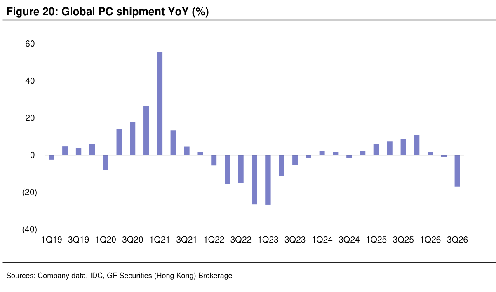

### 解讀摘要

3Q26 PC 出貨 YoY 約 -20%，是近年最差季度，下滑在上半年高基期後急劇加速。比年度平均 -12% 更悲觀，說明下半年的下行速度超過全年均值——4Q26 能否縮窄跌幅將是判斷 2027 能見度的關鍵觀察點。

---

## Figure 21｜Global PC Market Share by Brands

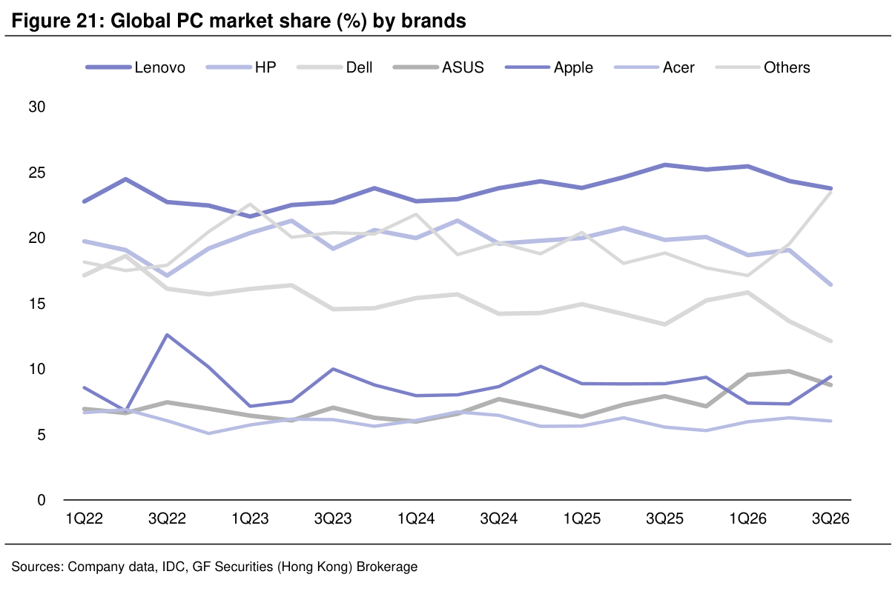

### 解讀摘要

3Q26 PC 品牌份額：Lenovo ~24% 最大，Apple ~9-10%（升至歷史新高），HP ~16%，Dell ~14%，ASUS ~7%，Acer ~6%。Apple 在整體市場下滑中持續吃份額，是消費電子少數具結構性增量的亮點。

> **洞察一**：Apple MacBook 市占從 ~7% 升至 ~10%，成長幅度遠超市場，強化其 WMCM 封裝產能的議價能力，也意味著台積電 A20（N2）及 WMCM 的 Apple 收入貢獻比市場預期更穩定。

---

## Figure 22｜Monthly Notebook PC ODM Shipment

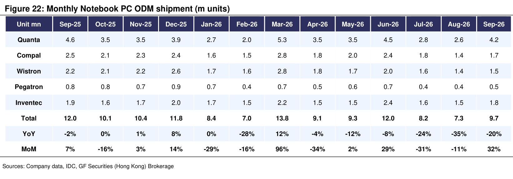

### 解讀摘要

Sep-26 NB ODM 合計出貨 9.7mn，YoY -20%，MoM +32%（季節性備貨，非需求回升）。Quanta 4.2mn 居首，Inventec 1.8mn 表現略優於預期。YoY -20% 才是反映真實需求的結構性指標。

### 表格

| 廠商 | Sep-26（mn） | MoM | YoY |
|---|---|---|---|
| Quanta | 4.2 | — | — |
| Compal | 1.7 | — | — |
| Wistron | 1.5 | — | — |
| Pegatron | 0.5 | — | — |
| Inventec | 1.8 | — | — |
| **Total** | **9.7** | **+32%** | **-20%** |

---

## Figure 23｜Global Token Consumption

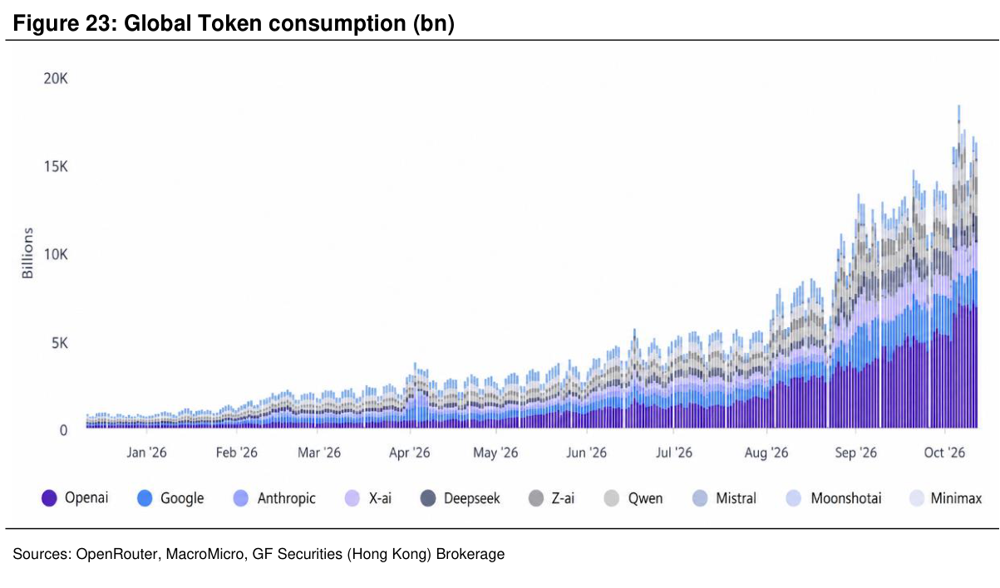

### 解讀摘要

OpenRouter 追蹤的全球 AI Token 消費量在 Oct-26 初激增至約 17,000bn（17 兆），是 Jan-26 ~1,000bn 的 17 倍。成長結構由 OpenAI（深藍底層）主導，但 Sep-26 起 Google、Anthropic、xAI、中國模型（Qwen、Minimax、Moonshotai）快速擴大份額，AI 採用已從 OpenAI 主導走向多極化。

> **洞察一（配合 Figure 24）**：Token 消費 +17x YoY 同期 Anthropic ARR 達 \$70bn、OpenAI \$50bn——ARR/Token 比值未崩跌，說明 AI API 單價維持甚至上升，AI 商業化不只是量的增長，也有質的提升。這直接反駁了「AI 收費無法持續」的悲觀論點。

---

## Figure 24｜AI ARR

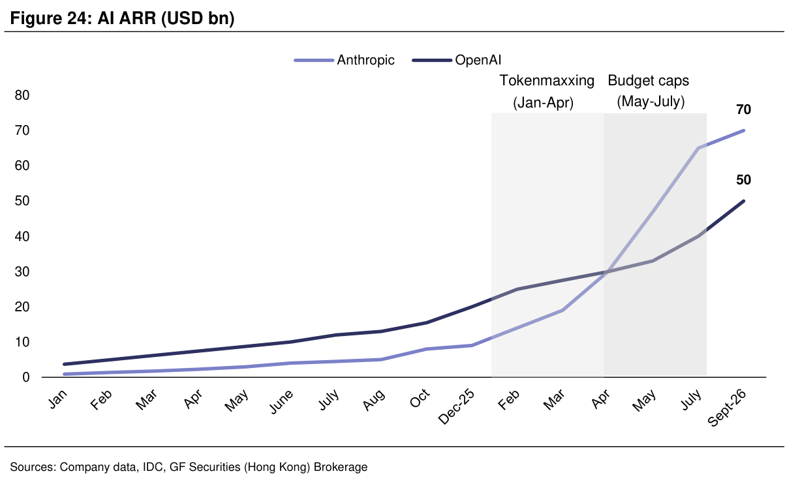

### 解讀摘要

Anthropic ARR 在 Sep-26 達 \$70bn，OpenAI \$50bn。圖表清晰標示「tokenmaxxing」（Jan-Apr：Token 用量爆炸 → ARR 急升）和「budget caps」（May-Jul：企業設支出上限 → ARR 成長短暫放緩）兩個階段，8 月後再次加速至新高。這是 GFHK 所稱「AI monetization 下降是暫時性」的核心論據。

> **洞察一**：Anthropic 以 \$70bn 超越 OpenAI \$50bn，但在 Figure 23 中 Anthropic 的 Token 份額仍明顯小於 OpenAI——說明 Anthropic 的 API 單價顯著更高，或企業/高付費客戶比例更大，兩者均是 Anthropic 商業模式護城河的體現。

---

## Figure 25｜U.S. Top-5 CSP Capex

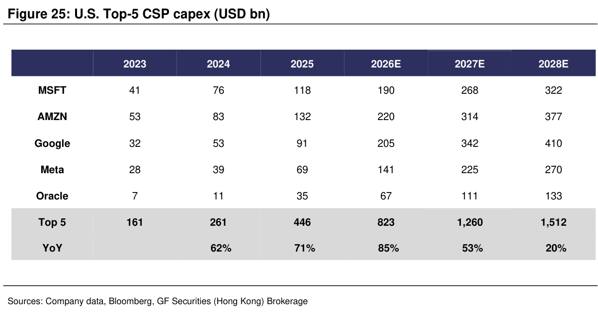

### 解讀摘要

Top 5 CSP（MSFT/AMZN/Google/Meta/Oracle）合計 Capex：2026E \$823bn（+85% YoY）→ 2027E \$1,260bn（+53%）→ 2028E \$1,512bn（+20%），成長斜率放緩但絕對金額持續擴張。Google 2027E \$342bn 是單家最大，AMZN 2026E \$220bn 暫時最高。

### 表格

| 公司 | 2024 | 2025 | 2026E | 2027E | 2028E |
|---|---|---|---|---|---|
| MSFT | 76 | 118 | 190 | 268 | 322 |
| AMZN | 83 | 132 | 220 | 314 | 377 |
| Google | 53 | 91 | 205 | 342 | 410 |
| Meta | 39 | 69 | 141 | 225 | 270 |
| Oracle | 11 | 35 | 67 | 111 | 133 |
| **Top 5** | **261** | **446** | **823** | **1,260** | **1,512** |
| YoY | — | +71% | +85% | +53% | +20% |

> **洞察一（配合 Figure 26）**：Top 5 CSP 2026E \$823bn + Neocloud Top 5 \$212bn = 合計 \$1,035bn，首次突破 \$1 兆門檻——這個量級足以支撐 AI 半導體、光學、封測多年的訂單能見度，是所有 AI 供應鏈投資的最終需求基礎。

---

## Figure 26｜Major Neoclouds Capex

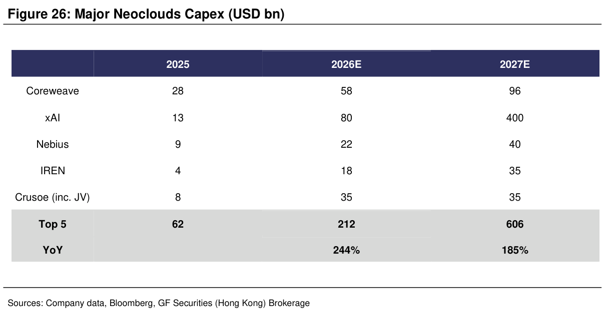

### 解讀摘要

Neocloud Top 5 合計：2026E \$212bn（+244% YoY），2027E \$606bn（+185%）。xAI 2027E \$400bn 為最大的單一假設，遠超 Coreweave（\$96bn）。若 xAI 假設偏高，整體數字將大幅下修。

### 表格

| 公司 | 2025 | 2026E | 2027E |
|---|---|---|---|
| Coreweave | 28 | 58 | 96 |
| xAI | 13 | 80 | 400 |
| Nebius | 9 | 22 | 40 |
| IREN | 4 | 18 | 35 |
| Crusoe (inc. JV) | 8 | 35 | 35 |
| **Top 5** | **62** | **212** | **606** |
| YoY | — | +244% | +185% |

> **值得驗證**：xAI 2027E \$400bn 若削減 50% 至 \$200bn，Neocloud 合計從 \$606bn → \$406bn（-33%），是此報告最大的單一假設風險。

---

## Figure 27｜U.S. Top-5 CSP Operating Cash Flow and Capex

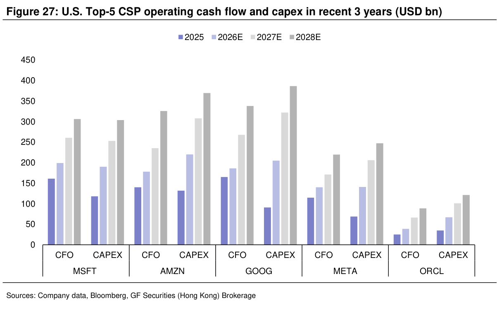

### 解讀摘要

2026E 起，AMZN/Google/Meta/Oracle 的 Capex 逼近或超越 CFO，MSFT 亦快速接近。到 2028E，多家 CSP 的 Capex/CFO 比接近 100%，幾乎所有自由現金流都投入 AI 基建，部分須靠債務融資（GFHK 預估 2026E CSP 債券發行 \$257bn，佔 Capex 31%）。

---

## Figure 28｜Server CPU TAM Forecast

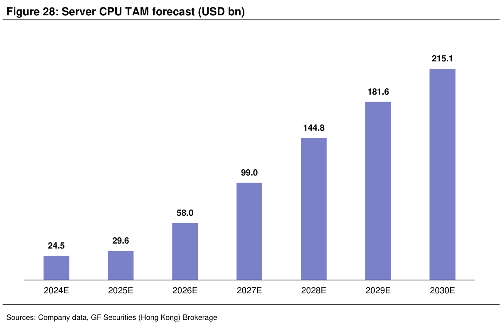

### 解讀摘要

Server CPU TAM 從 2025E \$29.6bn 跳升至 2026E \$58bn（+96%），並以 49% CAGR 成長至 2030E \$215.1bn。核心假設：Agentic AI 使推論場景下 GPU:CPU 比從訓練的 8:1 收斂至 4:1，最終到 2030 年趨近 1:1.2，加上高密度 CPU 伺服器升級節省空間與電力，共同驅動結構性 TAM 擴張。

### 表格

| 年份 | TAM（\$bn） | YoY |
|---|---|---|
| 2024E | 24.5 | — |
| 2025E | 29.6 | +21% |
| 2026E | 58.0 | +96% |
| 2027E | 99.0 | +71% |
| 2028E | 144.8 | +46% |
| 2029E | 181.6 | +25% |
| 2030E | 215.1 | +18% |

> **洞察一（配合 Figure 29）**：Server CPU TAM 2026E \$58bn vs. AI 加速器市場 \$357bn，CPU 佔 AI 基建 16%。但 CPU 成長率（+96%）高於 AI 加速器整體（+78%），代表市場對 CPU 的定價可能仍滯後於需求轉型速度，這是 INTC 在偏好清單的底層估值邏輯。

---

## Figure 29｜Global AI Accelerator Market Forecast

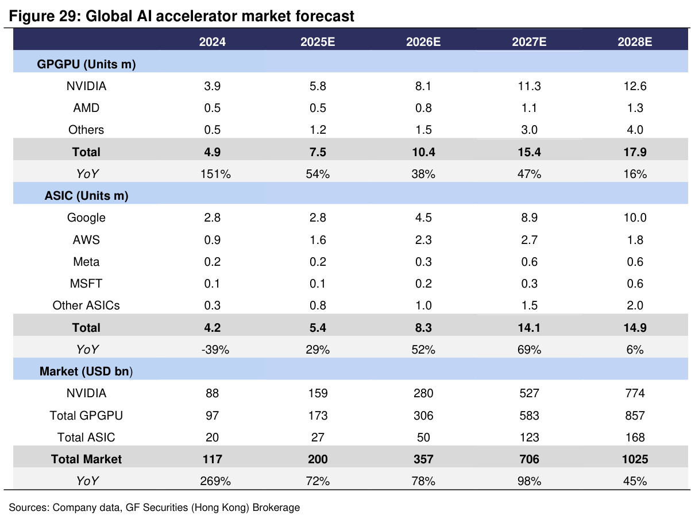

### 解讀摘要

AI 加速器市場（GPGPU + ASIC）：2026E 總量 \$357bn（+78% YoY），2028E 達 \$1,025bn。NVDA 主導 GPGPU，2026E \$280bn（市占 ~78%）。ASIC 方面，Google TPU 2026E 4.5mn 最大；2027E 是 ASIC 爆發年（ASIC +69% YoY，GPGPU 僅 +47%）。

### 表格

**GPGPU（mn units）**

| 廠商 | 2024 | 2025E | 2026E | 2027E | 2028E |
|---|---|---|---|---|---|
| NVIDIA | 3.9 | 5.8 | 8.1 | 11.3 | 12.6 |
| AMD | 0.5 | 0.5 | 0.8 | 1.1 | 1.3 |
| Others | 0.5 | 1.2 | 1.5 | 3.0 | 4.0 |
| **Total** | **4.9** | **7.5** | **10.4** | **15.4** | **17.9** |
| YoY | +151% | +54% | +38% | +47% | +16% |

**ASIC（mn units）**

| 廠商 | 2024 | 2025E | 2026E | 2027E | 2028E |
|---|---|---|---|---|---|
| Google | 2.8 | 2.8 | 4.5 | 8.9 | 10.0 |
| AWS | 0.9 | 1.6 | 2.3 | 2.7 | 1.8 |
| Meta | 0.2 | 0.2 | 0.3 | 0.6 | 0.6 |
| MSFT | 0.1 | 0.1 | 0.2 | 0.3 | 0.6 |
| Other ASICs | 0.3 | 0.8 | 1.0 | 1.5 | 2.0 |
| **Total** | **4.2** | **5.4** | **8.3** | **14.1** | **14.9** |
| YoY | -39% | +29% | +52% | +69% | +6% |

**Market（\$bn）**

| 指標 | 2024 | 2025E | 2026E | 2027E | 2028E |
|---|---|---|---|---|---|
| NVIDIA | 88 | 159 | 280 | 527 | 774 |
| Total GPGPU | 97 | 173 | 306 | 583 | 857 |
| Total ASIC | 20 | 27 | 50 | 123 | 168 |
| **Total Market** | **117** | **200** | **357** | **706** | **1,025** |
| YoY | +269% | +72% | +78% | +98% | +45% |

> **洞察一**：ASIC 市場 2027E \$123bn（+146% YoY）成長率是 GPGPU 的 3 倍——2027 年是 Google TPU v10 + AWS Trainium 4 + 其他 CSP ASIC 全面開花的關鍵年，ASIC 設計夥伴（MRVL 主導）的訂單能見度因此比 GPGPU 供應鏈更長、更確定。

---

## Figure 30｜TSMC CoWoS + WMCM Capacity Trend

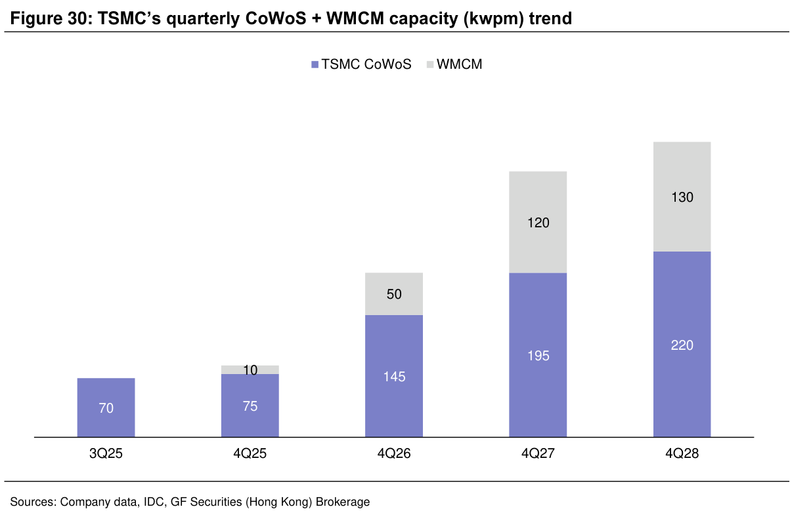

### 解讀摘要

TSMC CoWoS 從 3Q25 70 kwpm 快速擴張至 4Q26E 145 kwpm（+107%），加上 WMCM 50 kwpm，合計 195 kwpm。4Q28E 達 350 kwpm（CoWoS 220 + WMCM 130），是現在的 1.8 倍，支撐 2028E AI 加速器 \$1,025bn 市場的封裝需求。

### 表格

| 時間點 | TSMC CoWoS (kwpm) | WMCM (kwpm) | 合計 |
|---|---|---|---|
| 3Q25 | 70 | — | 70 |
| 4Q25 | 75 | 10 | 85 |
| 4Q26E | 145 | 50 | 195 |
| 4Q27E | 195 | 120 | 315 |
| 4Q28E | 220 | 130 | 350 |

> **洞察一（配合 Figure 31）**：TSMC 4Q28E CoWoS 220 kwpm + OSAT（ASE+Amkor）合計 110 kwpm = 總市場 ~330 kwpm，TSMC 市占 ~67%，OSAT 33%。OSAT CoWoS 比例從 2025 ~20% 升至 2028 33%，說明 AI 封裝的邊際增量正在往 OSAT 轉移——ASE（3711 TT）偏好清單的 CoWoS 佔比成長對估值重估最關鍵。

---

## Figure 31｜Amkor and ASE CoWoS Forecast

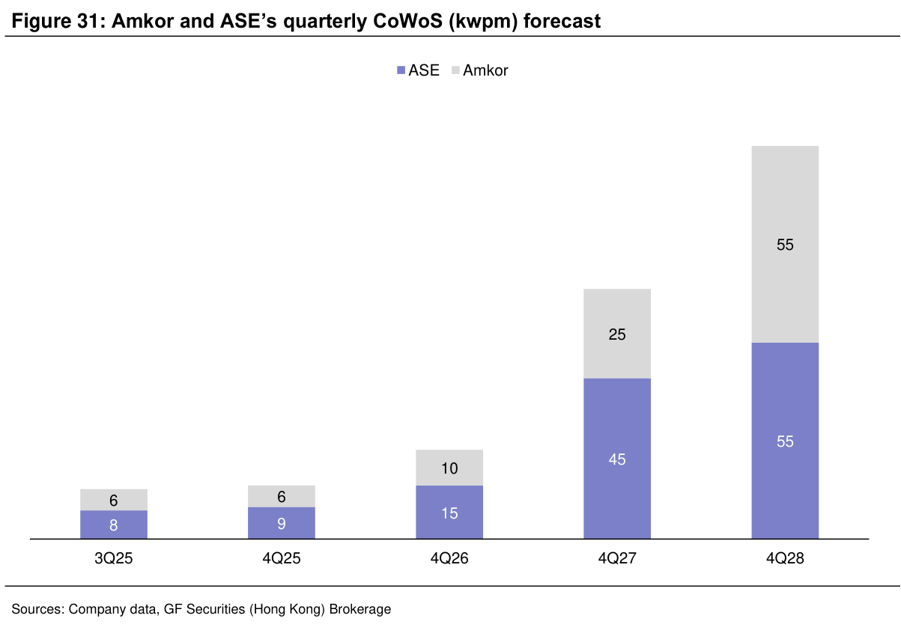

### 解讀摘要

ASE 4Q26E 15 kwpm → 4Q28E 55 kwpm（+267%），Amkor 4Q26E 10 kwpm → 4Q28E 55 kwpm（+450%）。兩家合計 4Q28E 110 kwpm，Amkor 追趕速度更快。ASE（3711 TT）是 GFHK 偏好清單中唯一的封測標的。

### 表格

| 時間點 | ASE (kwpm) | Amkor (kwpm) | 合計 |
|---|---|---|---|
| 3Q25 | 8 | 6 | 14 |
| 4Q25 | 9 | 6 | 15 |
| 4Q26E | 15 | 10 | 25 |
| 4Q27E | 45 | 25 | 70 |
| 4Q28E | 55 | 55 | 110 |

---

## Figure 32｜Top-15 Fabless Days of Inventory

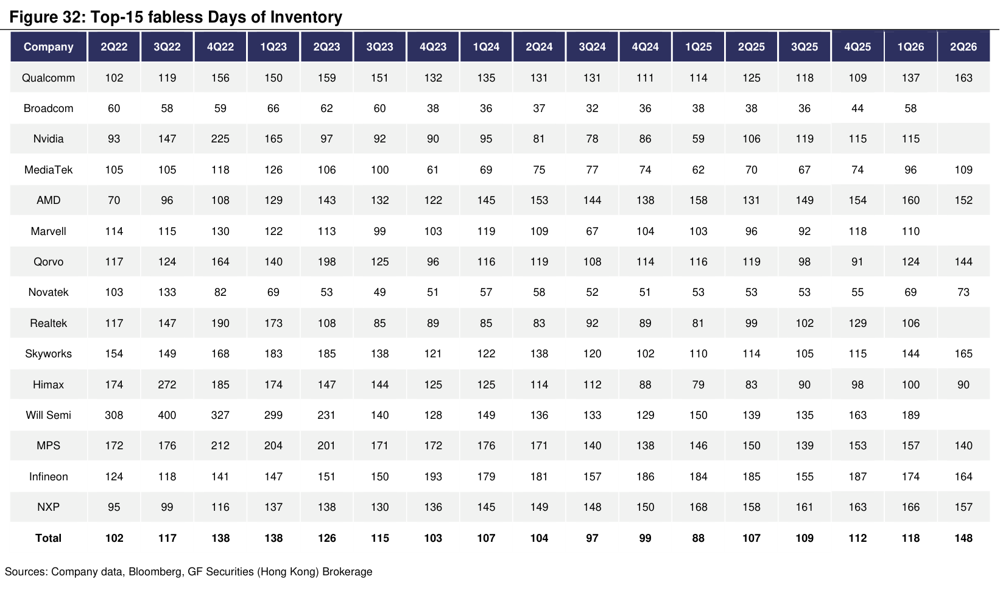

### 解讀摘要

2Q26 Top 15 fabless 合計庫存天數 148 天，較 1Q26 的 118 天大增 30 天，是近年新高。分類來看：AI 晶片廠（NVDA 115、Broadcom 58）庫存低且穩定；消費型 IC 廠（AMD 152、Qualcomm 163、Skyworks 165）庫存偏高，消費端去化進度緩慢。

> **洞察一**：AMD 2Q26 庫存天數 152 天（近 4 年高位），同期 NVDA 僅 115 天——同為 GPU 廠，AI 強者庫存健康、AI 薄弱者庫存積壓，說明 AI GPU 市場高度集中且強者恆強。AMD 的 \$700 目標價已反映較高的 AI GPU 份額期待，庫存偏高是近期估值的下行風險。

---

## Figure 33｜800G/1.6T Optical Module Demand Forecast by Customer

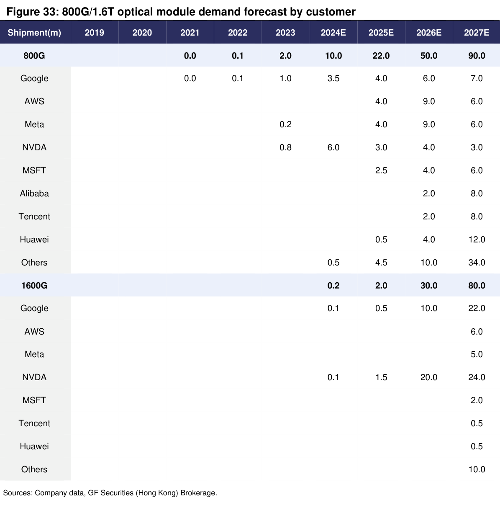

### 解讀摘要

800G 2026E 50mn（+127% YoY），2027E 90mn（+80%）；1.6T 2026E 30mn（急速起量），2027E 80mn（+167%）。合計 2027E 170mn。Nvidia（scale-out + scale-up）、Google（scale-up 全面光化）、Huawei（2027E 12mn 800G）是三大增量。1.6T 由 Google（22mn）和 NVDA（24mn）主導 2027E 的 80mn 總量。

### 表格

**800G（mn）**

| 客戶 | 2024E | 2025E | 2026E | 2027E |
|---|---|---|---|---|
| Google | 3.5 | 4.0 | 6.0 | 7.0 |
| AWS | — | 4.0 | 9.0 | 6.0 |
| Meta | — | 4.0 | 9.0 | 6.0 |
| NVDA | 6.0 | 3.0 | 4.0 | 3.0 |
| MSFT | — | 2.5 | 4.0 | 6.0 |
| Alibaba | — | — | 2.0 | 8.0 |
| Tencent | — | — | 2.0 | 8.0 |
| Huawei | — | 0.5 | 4.0 | 12.0 |
| Others | 0.5 | 4.5 | 10.0 | 34.0 |
| **Total** | **10.0** | **22.0** | **50.0** | **90.0** |

**1.6T（mn）**

| 客戶 | 2024E | 2025E | 2026E | 2027E |
|---|---|---|---|---|
| Google | 0.1 | 0.5 | 10.0 | 22.0 |
| NVDA | 0.1 | 1.5 | 20.0 | 24.0 |
| AWS | — | — | — | 6.0 |
| Meta | — | — | — | 5.0 |
| Others | — | — | — | 10.0 |
| **Total** | **0.2** | **2.0** | **30.0** | **80.0** |

> **洞察一**：Huawei 2027E 800G 需求（12mn）超過 NVDA（3mn）——中國禁令下 NVDA 替代方案的 AI 軍備競賽在光學端最先數字化，Huawei 的 AI 基建需求是純增量（不競爭 NVDA 的份額，而是新增需求），對 800G 光模組供應鏈（LITE、COHR 等）是明確正面訊號。

---

## Figure 34｜NPO OE Shipments Forecast

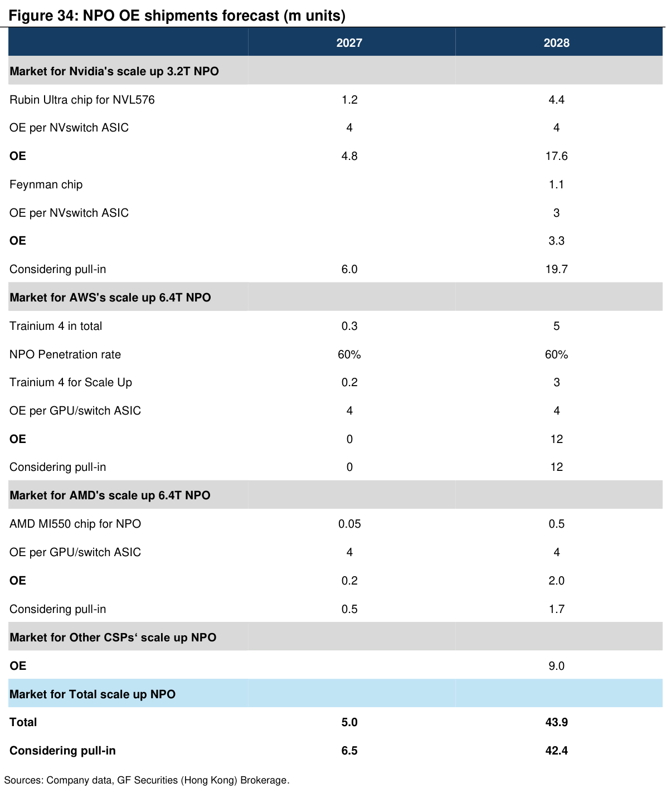

### 解讀摘要

NPO 光引擎（OE）出貨：2027E 5.0mn（含 pull-in 6.5mn），2028E 43.9mn（含 pull-in 42.4mn）。NVDA NVL576（Rubin Ultra）在 2027 年是主力驅動（6.0mn），2028 年加入 Feynman（3.3mn）使 NVDA 合計貢獻 19.7mn；AWS Trainium 4 2028E 12mn；其他 CSP 2028E 9.0mn。TIA/Driver 每個 3.2T OE 含數十美元晶片，MRVL 為首選受益、SMTC 次選。

### 表格

| 平台 | 2027E（mn） | 2028E（mn） |
|---|---|---|
| **NVDA 3.2T NPO** | | |
| 　Rubin Ultra × OE | 4.8 | — |
| 　Feynman × OE | — | 3.3 |
| 　考慮 pull-in | **6.0** | **19.7** |
| **AWS 6.4T NPO（Trainium 4）** | 0 | **12** |
| **AMD 6.4T NPO（MI550）** | 0.5 | **1.7** |
| **其他 CSP** | — | **9.0** |
| **Total（含 pull-in）** | **6.5** | **42.4** |

> **洞察一**：2027E → 2028E NPO OE 從 5mn 跳升至 43.9mn（+780% YoY）——這是產業歷史上少見的單一年度需求躍遷。其中 NVDA 貢獻從 6.0mn 到 19.7mn，AWS 從 0 到 12mn，意味著 2028 的量取決於至少兩個客戶同步量產，任一延誤對整體出貨影響高達 28-43%。

---

## 相關個股清單

| 類別 | 公司 | Ticker | 評等 | 備註 |
|---|---|---|---|---|
| GPU | Nvidia | NVDA US | Buy | 偏好清單 #1，AI 加速器 2026E 市場 78% 份額 |
| CPU | Intel | INTC US | Buy | CPU TAM 2026E +96%，OCP AMD CPU 佐證結構性需求 |
| Ethernet IC | Credo | CRDO US | Buy | AI scale-out 受益 |
| 先進封測 | ASE | 3711 TT | Buy | CoWoS 4Q28E 55 kwpm，GFHK 唯一封測偏好 |
| ABF Substrate | ZDT (Zeng Ding) | 4958 TT | Buy | iPhone 1.6T mSAP + Rubin HDI |
| 晶圓代工 | UMC | 2303 TT | Buy | 非台積電代工，CY26 P/E 18.7x 最低估值 |
| 記憶體 | Micron | MU US | Buy | HBM 受益，CY27 P/E 4.8x |
| 伺服器 ODM | Lenovo | 00992 HK | Buy | AI 伺服器端受益，CY26 P/E 11.9x |
| ASIC/光互連 IC | Marvell | MRVL US | Buy | NPO TIA/Driver 首選，ASIC 設計夥伴 |
| 光互連 IC | Semtech | SMTC US | Buy | NPO TIA/Driver 次選，2027E NPO revenue \$315mn |
| EMS | Celestica | CLS US | Hold | Rubin 組裝新增量（本月新進偏好清單） |
| 晶圓代工 | TSMC | 2330 TT | Hold | TP NT\$2,960；GFHK 上調 2026E/27E EPS +2%/+8% |
| 光學元件 | Lumentum | LITE US | — | CW laser，CPO/NPO 雙線受益 |
| 光學元件 | Coherent | COHR US | — | CW laser 受益 |
| 矽光子/晶圓代工 | Tower Semiconductor | TSEM US | Buy | CSP 偏好 NPO，TSEM 受益 |
| 光互連 | Browave | 3163 TT | — | CPO shuffle box ~55% 市占，\$5-6k ASP，2H26 量產 |
| 光纖連接 | Corning | GLW US | — | shuffle box 第二供應商 + MMC connector/fiber |
