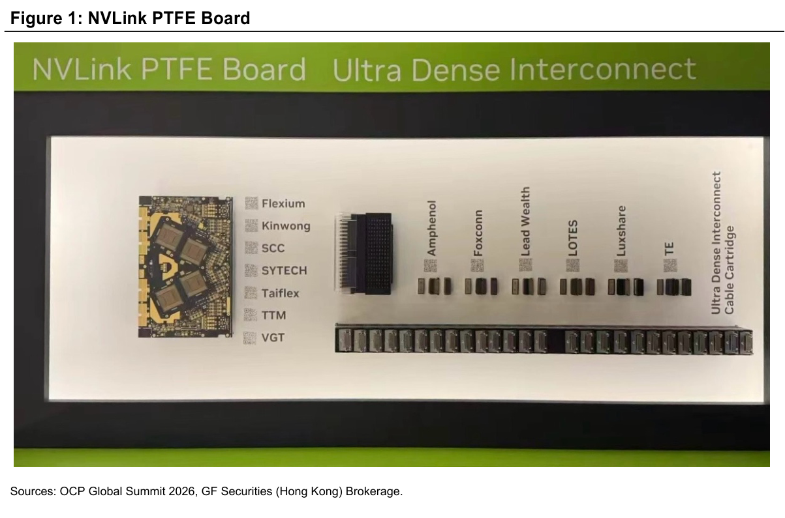

# GFHK｜PTFE Adoption: Reshape the High-End Materials Landscape

**券商**：GF Securities (Hong Kong)  
**分析師**：Michelle Jing、Jeff Pu, CFA  
**日期**：2026-10-15  
**主題**：PTFE 材料採用趨勢——OCP 2026 首次展示 NVLink PTFE Board  
**評級**：Positive（隱含，報告對 PTFE 相關供應商持正面態度）  
<a href="https://layx.uk/dl?g=產業&b=GFHK&d=20261015&h=PTFE-Adoption">📎 下載 PDF</a>

---

## 報告總結

Nvidia 在 2026 OCP Global Summit 首次公開展示 NVLink PTFE Board 實物，並點名 7 家 PCB 供應商（Flexium、Kinwong、SCC、SYTECH、Taiflex、TTM、VGT）——這是 PTFE 材料從概念進入供應鏈確認的明確訊號。GFHK 認為 PTFE hybrid（8-12/32 層採用 PTFE）是 VR300 NVL576 switch board 目前最可行的方案，純 PTFE 長遠替代 PPO/HC resin 的風險則需中期追蹤。

受益排序：台廠中偏好 Taiflex（CCL）與 Flexium（PCB）；中國端則偏好名稱未揭露的 leading Chinese PTFE PCB 及 CCL 供應商。PPO/HC resin 傳統供應商須監控份額侵蝕風險。

---

## GFHK 完整投資邏輯鏈

| 論點層次 | 內容 |
|---|---|
| 催化劑 | Nvidia OCP 2026 首展 NVLink PTFE Board，供應鏈 7 家點名確認 |
| 材料需求 | VR300 NVL576 switch board 32 層中 8-12 層採 PTFE，佔 CCL resin 內容值 <50% |
| 技術可行性 | PTFE hybrid（PTFE 訊號層 + M9 非訊號層）在量產良率上取得突破 |
| 長期擴張 | PTFE 應用從 switch board 延伸至 compute board（測試中），替代範疇擴大 |
| 替代風險 | 長期純 PTFE 取代 hybrid 設計，PPO/HC resin 將承壓；近期影響有限 |
| **結論** | **台廠 Taiflex + Flexium 直接受益；中國 PTFE PCB/CCL 供應商亦看好；傳統 resin 供應商列風險觀察** |

> **報告最大邏輯缺口**：「leading Chinese CCL supplier」及「leading Chinese PTFE PCB supplier」未具名（圖中 VGT 是否即 CCL 供應商不確定）；PTFE 採用層數 8-12/32 是 current design 或 ramp target 亦未說明。

---

## 報告核心觀點

| 主題 | GFHK 觀點 | 市場共識 | 是否 Contra-Consensus |
|---|---|---|---|
| PTFE hybrid vs. 純 PTFE | Hybrid 是當前最可行方案；純 PTFE 長遠目標 | 普遍認知 PTFE 難量產 | 否——但 hybrid 可行性確認比預期早 |
| PTFE 替代傳統 resin | 近期 <50% CCL resin 影響；長遠替代風險上升 | 替代時程模糊 | 部分是——給出了具體層數比例 |
| 供應鏈格局 | 7 家 PCB 供應商並存，Taiflex/Flexium 台廠 + 中國廠 | 普遍低估中國廠商進入速度 | 部分是——中國廠同步出現在 Nvidia 展台 |
| PTFE 應用擴散 | 從 switch board 到 compute board（測試中） | 聚焦 switch board | 是——應用範疇比市場想像廣 |

**偏好排序**：Taiflex（8039 TT） > Flexium（6269 TT） > leading Chinese PTFE PCB > leading Chinese CCL  
**需監控風險**：PPO/HC resin 供應商（未具名）市場份額侵蝕風險

---

## Figure 1｜NVLink PTFE Board

### 解讀摘要

這張照片是 OCP Global Summit 2026 展台實拍，展示 Nvidia NVLink PTFE Board 完整供應鏈陣容。左側是 PTFE PCB 板（帶 3 顆晶片），並列 7 家 PCB 供應商；右側是 Ultra Dense Interconnect 連接器，涵蓋 6 家連接器廠商。Nvidia 透過實物展示而非 PPT，代表量產交樣已達到可對外展示的成熟度，這是從「概念確認」升級到「供應鏈公開綁定」的關鍵訊號。

> **原文補充**：報告說 7 家供應商：Taiflex、Flexium、TTM 為文字點名，「3 家 leading Chinese PCB + 1 家 leading Chinese CCL」未具名。從圖片可看出另外 4 家為 Kinwong、SCC、SYTECH、VGT——其中 VGT 可能是 CCL 供應商（其餘 Kinwong/SCC/SYTECH 偏向 PCB 廠定位）。連接器端（圖右）Amphenol、Foxconn、Lead Wealth、LOTES、Luxshare、TE 6 家為報告未提及的增量資訊。

### 表格

| 品類 | 供應商 | 市場別 | 備註 |
|---|---|---|---|
| **PTFE PCB** | | | |
| 　Flexium | 6269 TT | 台灣 | 文字點名 |
| 　Kinwong | — | 中國 | 圖片增量 |
| 　SCC | — | 中國 | 圖片增量（疑為深南電路？） |
| 　SYTECH | — | 中國 | 圖片增量 |
| 　Taiflex | 8039 TT | 台灣 | 文字點名（CCL 廠跨入 PCB） |
| 　TTM Technologies | TTMI US | 美國 | 文字點名 |
| 　VGT | — | 不確定 | 圖片增量（可能為 CCL 供應商） |
| **Ultra Dense Interconnect 連接器** | | | |
| 　Amphenol | APH US | 美國 | 圖片增量 |
| 　Foxconn | 2317 TW | 台灣 | 圖片增量 |
| 　Lead Wealth | — | — | 圖片增量 |
| 　LOTES | 3533 TW | 台灣 | 圖片增量 |
| 　Luxshare | 002475 SZ | 中國 | 圖片增量 |
| 　TE Connectivity | TEL US | 美國 | 圖片增量 |

> **洞察一**：文字僅點名 7 家 PCB 供應商，但圖片額外揭露連接器端 6 家供應商——Amphenol、LOTES、Luxshare 均是台股/美股可投資標的，這是報告原文未提及但投資上值得追蹤的增量資訊。

> **洞察二**：Taiflex 本業是 CCL/軟板材料（FCCL），出現在 PCB 供應商列表意味其已具備 PTFE PCB 量產能力，業務範疇超出純 CCL 供應商定位；或「CCL supplier」與「PCB supplier」分類本身即有重疊（PTFE CCL 廠同時提供 PTFE laminate-to-PCB 的整合服務）。

> **值得驗證**：圖片中 VGT 究竟屬於 PCB 還是 CCL 分類？若 VGT = 中國 leading CCL supplier（如巨石、生益科技），則 CCL 端中國廠能力確認比預期強；若 VGT 是 PCB 廠，則「1 Chinese CCL」身份仍不明。

---

## 相關個股清單

| 類別 | 公司 | Ticker | 評等 | 備註 |
|---|---|---|---|---|
| CCL/PTFE 材料 | Taiflex | 8039 TT | 正面 | GFHK 明確偏好，CCL + PTFE 雙重受益 |
| PCB | Flexium | 6269 TT | 正面（隱含） | Nvidia 點名，軟硬板整合廠 |
| PCB | TTM Technologies | TTMI US | 中性（未評） | Nvidia 點名，美系 PCB 廠 |
| 連接器 | LOTES | 3533 TW | — | 圖片揭露，高速連接器 |
| 連接器 | Luxshare | 002475 SZ | — | 圖片揭露，中國連接器 |
