# Goldman Sachs｜BT Substrates Industry Update：S/D 結構轉變，上調 ZDT/Kinsus/NYPCB/Unimicron 目標價

**券商**：Goldman Sachs  
**分析師**：Chao Wang、Allen Chang、Al Wang  
**日期**：2026-10-15  
**主題**：BT 基板產業更新：S/D 缺口擴大，記憶體驅動定價上行  
**評級**：Asia Technology
<a href="https://layx.uk/dl?g=產業&b=GS&d=20261015&h=BT-Substrate">📎 下載 PDF</a>

---

## 報告總結

GS 更新 2026-28E BT 基板產業模型（上次更新為 2021 年），核心結論是供需缺口將在 2027/28E 分別擴大至 11%/14%，驅動力源自記憶體基板需求 CAGR 41%（佔 BT TAM 比重由 56% 升至 77%）加上主力亞洲供應商持續將產能從 BT 轉往 ABF、整體供給 CAGR 僅 6%。定價方面，GS 預估 2026 年 BT 均價已升 10% YTD，並預測 2027E 再漲 15-20%、2028E 再漲 10-15%，帶動台系 BT 廠毛利率從 2Q26 的 15-27% 提升至 2027/28E 的 18-34%/19-36%。此外，光模組 mSAP 需求（87% 2026-28E CAGR）正成為新增量，GS 視 ZDT 為市佔率領先者。

上調 ZDT/Kinsus/NYPCB 目標價（各 NT\$1,025/1,515/2,700），維持三者 Buy（NYPCB 在 Conviction List），Unimicron 微調至 NT\$1,270 維持 Neutral（因公司持續將 BT 產能轉往 ABF）。BT 基板景氣循環開始體現在定價與獲利改善，GS 視此為結構性而非週期性的 S/D 轉變。

---

## Goldman Sachs 完整投資邏輯鏈

| 論點層次 | Exhibit | 內容 |
|---|---|---|
| 瓶頸確認 | Exhibit 3 | BT S/D 缺口從 2026E 1% 擴大至 2027E 11%、2028E 14% |
| 需求結構 | Exhibit 1/2/5 | BT TAM 32% CAGR；記憶體佔比從 56% 升至 77%（一般伺服器主導） |
| 供給上限 | Exhibit 23/24 | 台廠產能 CAGR -1%（Unimicron 退出），韓廠 +3%，整體僅 6% |
| 新增 TAM | Exhibit 28/29 | 光模組 mSAP：87% 2026-28E CAGR，供需缺口 2028E 達 38% |
| 受益排序 | Exhibit 31/30 | ZDT（mSAP+BT 擴產）> NYPCB（記憶體曝險最高）> Kinsus（BT 佔比最高）> Unimicron（退出中） |
| **結論** | 封面 | **上調 ZDT/Kinsus/NYPCB TP；BT 定價結構性上行，2027/28E GM 顯著改善** |

> **報告最大邏輯缺口**：GS 預測 ZDT 在光模組 mSAP 市佔達 31%/34%（2027/28E），但 ZDT 過去 mSAP 業務極小，5x 產能擴張能否如期完成與達到 90%+ 良率是核心假設，未有詳細驗證。

---

## 報告核心觀點

| 主題 | GS 觀點 | 市場共識 | 是否 Contra-Consensus |
|---|---|---|---|
| BT 定價前景 | 2027/28E 漲價 15-20%/10-15%，結構性緊缺 | 市場多關注 ABF，BT 被低估 | 偏積極（Contra） |
| 記憶體 BT 需求 | 佔 TAM 77%（2028E），一般伺服器主導 | 市場聚焦 AI 伺服器 ABF | In-line（方向一致但 BT 角度較新） |
| 供給增速 | 6% CAGR，遠低於需求 32% CAGR | 市場預期台廠主動減產 | In-line |
| 光模組 mSAP | ZDT 成市佔領袖，87% CAGR 至 2028E | 多數人以 Compeq/Unimicron 為主 | Contra（強調 ZDT） |
| Unimicron | 持續退出 BT，ABF 轉型中 | 同樣是共識 | In-line |

**偏好排序**：ZDT（BT 擴產 + mSAP 新業務）> NYPCB（記憶體 BT 定價上行最大受益）> Kinsus（BT 佔收入比最高）> Unimicron（Neutral）

---

## Exhibit 1｜BT Market Demand by End Application（絕對值，US$mn）

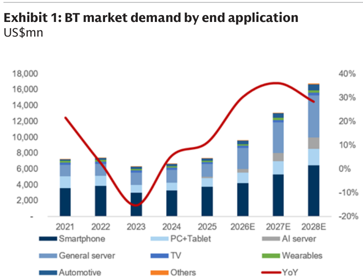

### 解讀摘要
BT TAM 從 2025 年 US\$7.4bn 成長至 2028E US\$16.8bn（32% 2026-28E CAGR）。2025 年智慧型手機佔 51%，但 2028E 降至 39%；一般伺服器從 21% 升至 32%、AI 伺服器從 2% 升至 9%。整體 YoY 在 2026E 約 30%+ 高峰後逐漸正常化，但絕對額仍持續創高。

### 表格

| 年份 | 2021 | 2022 | 2023 | 2024 | 2025 | 2026E | 2027E | 2028E |
|---|---|---|---|---|---|---|---|---|
| BT TAM（US$mn） | ~7,000 | ~7,000 | ~3,000 | ~6,000 | ~7,400 | ~9,800 | ~13,000 | ~16,800 |
| YoY | +25%↑ | 0% | -55% | +100% | +23% | ~+32% | ~+33% | ~+30% |

（視覺估算，交叉驗證通過：與 Exhibit 5 絕對量一致）

---

## Exhibit 2｜BT Market Demand Mix（% by End Application）

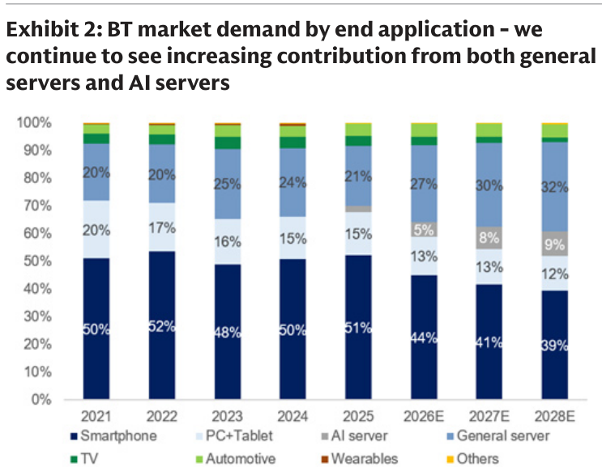

### 解讀摘要
佔比結構反映 BT 需求重心轉移：智慧型手機從 50%（2021）降至 39%（2028E），一般伺服器從 20%（2021）升至 32%（2028E），AI 伺服器則從幾乎 0 升至 9%（2028E）。2026E 開始 AI 伺服器（5%）首次在圖中顯著可見，對 BT TAM 的意義是：整體需求來源正從消費電子轉向資料中心計算與儲存，讓需求更具週期性支撐。

### 表格

| 終端應用 | 2021 | 2025 | 2026E | 2027E | 2028E |
|---|---|---|---|---|---|
| 智慧型手機 | 50% | 51% | 44% | 41% | 39% |
| PC + Tablet | 20% | 15% | 13% | 8% | 9% |
| AI 伺服器 | — | 2% | 5% | 8% | 9% |
| 一般伺服器 | 20% | 21% | 27% | 30% | 32% |
| TV | — | — | — | — | — |
| 車用 | — | — | — | — | — |
| Others | 10% | 11% | 11% | 13% | 11% |

---

## Exhibit 3｜BT Substrate S/D Gap（Supply Shortage Ratio）

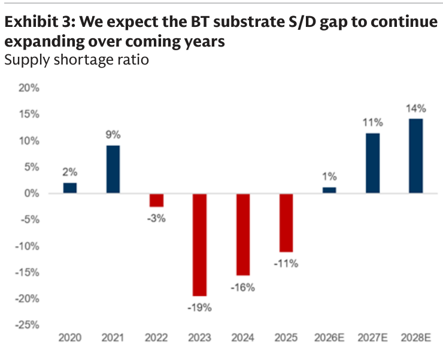

### 解讀摘要
供需缺口走勢圖是本報告最核心的一張圖。2022-25 年 BT 基板過剩（缺口 -3% 至 -19%），2026E 首次轉供需平衡（+1%），2027/28E 進一步擴大至 +11%/+14%。過去缺口為負時 BT 定價持續受壓，現在翻正意味定價權回歸供應商。GS 模型顯示缺口擴大主因是需求 CAGR（32%）遠超供給 CAGR（6%），不是一次性衝擊。

### 表格

| 年份 | 2020 | 2021 | 2022 | 2023 | 2024 | 2025 | 2026E | 2027E | 2028E |
|---|---|---|---|---|---|---|---|---|---|
| S/D 缺口 | +2% | +9% | -3% | -19% | -16% | -11% | +1% | +11% | +14% |

> **洞察一**：S/D 缺口從 -11%（2025）轉 +14%（2028E）幅度達 25ppt，這不是需求小幅改善，而是供給端主動退出（Unimicron 減產、SEMCO 轉向 ABF）疊加需求爆發的雙重效果。定價彈性應比上一個 2020-22 週期更大，因彼時供給增長 9% 而此次僅 6%。

---

## Exhibit 4｜BT Pricing Index（Rebased 1Q25 = 1）

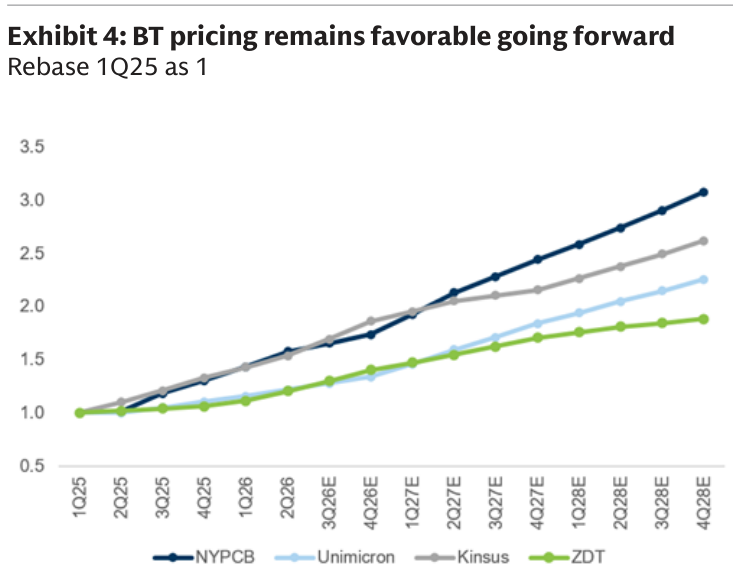

### 解讀摘要
四家台系 BT 廠的定價指數（以 1Q25 為基準=1）均持續上升至 4Q28E，NYPCB 漲幅最大（~3.1x），Kinsus 次之（~2.6x），Unimicron 最小（~1.9x）。NYPCB 漲幅最大直接對應記憶體 BT 基板（WBCSP）供給更緊張、議價能力最強的業務結構（記憶體佔 NYPCB BT 收入 70%）。

### 表格

| 公司 | 1Q25 | 4Q25 | 4Q26E | 4Q27E | 4Q28E |
|---|---|---|---|---|---|
| NYPCB | 1.0 | ~1.1 | ~1.6 | ~2.5 | ~3.1 |
| Kinsus | 1.0 | ~1.1 | ~1.5 | ~2.1 | ~2.6 |
| Unimicron | 1.0 | ~1.0 | ~1.3 | ~1.6 | ~1.9 |
| ZDT | 1.0 | ~1.0 | ~1.3 | ~1.6 | ~1.9 |

（視覺估算）

> **洞察一**：NYPCB vs ZDT 的定價指數差距（3.1x vs 1.9x）反映客戶結構差異：NYPCB 70% 記憶體用 WBCSP（供給更緊、更難被替代），ZDT 50% 是智慧型手機（競爭相對激烈）。同樣是 Buy，NYPCB 的 BT 定價上行幅度將顯著更大。

---

## Exhibit 5｜Global BT Market Revenue 長期史（2004-2028E）

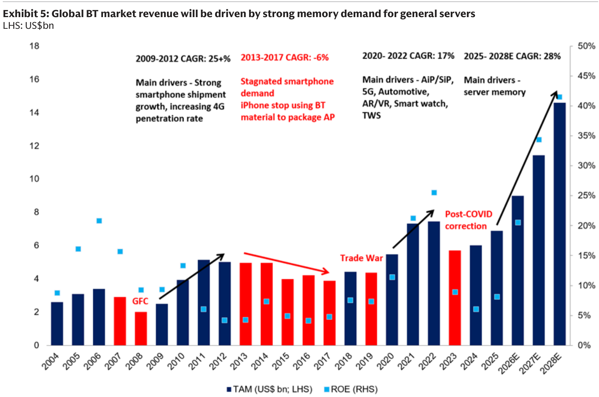

### 解讀摘要
這張圖將 BT 市場放入 20 年歷史脈絡，標示四個成長期與對應驅動力：①2009-12 CAGR 25%+（4G 智慧型手機）→ ②2013-17 CAGR -6%（iPhone 停用 BT 封裝 AP）→ ③2020-22 CAGR 17%（SiP/AiP、5G、Automotive）→ ④2025-28E CAGR 28%（伺服器記憶體）。ROE 在 2026-27E 應重回 35-40%+ 高點（等同 2020-22 週期頂部水準），支持估值重新定價。

> **原文補充**：2013-17 年 BT 下行的主因是 Apple 轉用 ABF 材質封裝 iPhone AP，而非整體半導體需求走弱——此次驅動源（記憶體）與該風險完全分開，不存在類似的設計層面顛覆可能性。

---

## Exhibit 8｜General Server BT TAM（US$mn）

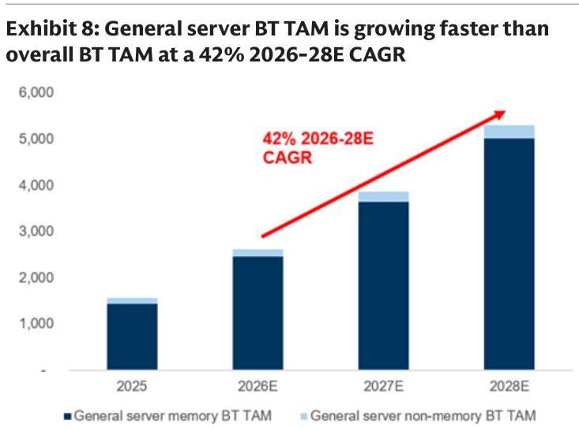

### 解讀摘要
一般伺服器 BT TAM 從 2025 年 US\$1.6bn 成長至 2028E US\$5.3bn（42% CAGR），其中記憶體 BT TAM 達 US\$5.0bn（43% CAGR），非記憶體 BT 僅佔小比例。一般伺服器是本次 BT 上行週期的核心驅動引擎——不是 AI 伺服器（雖然 AI 伺服器 CAGR 更高，但基數小），是每台一般伺服器搭載的 DRAM 數量/容量持續增加。

### 表格

| 年份 | 2025 | 2026E | 2027E | 2028E |
|---|---|---|---|---|
| 記憶體 BT TAM（US$mn） | ~1,400 | ~2,500 | ~3,750 | ~5,000 |
| 非記憶體 BT TAM（US$mn） | ~200 | ~200 | ~150 | ~300 |
| 合計（US$mn） | ~1,600 | ~2,500 | ~3,800 | ~5,300 |
| CAGR（26-28E） | — | — | — | 42% |

---

## Exhibit 9｜General Server 出貨量 vs ASP YoY

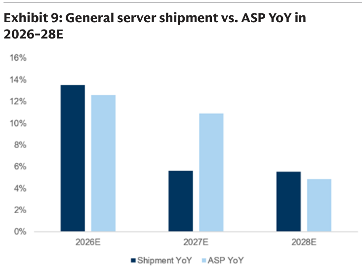

### 解讀摘要
2026E 出貨量 YoY +14%、ASP YoY +13%——量價齊升的組合對 BT 需求是加成關係（BT TAM = 出貨量 × 每台 BT content）。2027E 出貨量 YoY 放緩至 +6%，但 ASP 仍 +11%，顯示 ASP 上升（升級至更高規格 CPU/更多記憶體）才是 BT TAM 持續擴張的長期核心。2028E 量與價均和緩，CAGR 仍為正向。

### 表格

| | 2026E | 2027E | 2028E |
|---|---|---|---|
| 出貨量 YoY | +14% | +6% | +6% |
| ASP YoY | +13% | +11% | +5% |

---

## Exhibit 10｜DRAM Content per Server（GB）

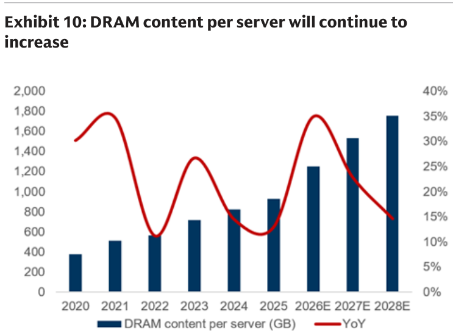

### 解讀摘要
每台伺服器搭載 DRAM 容量從 2020 年 ~370GB 成長至 2028E ~1,740GB（約 4.7x），每台增加的 DRAM slots 直接帶動 BT 基板需求（每個 DRAM 模組需要 BT 基板封裝）。關鍵轉折點在 2026E（~1,230GB，+35% YoY）——這對應 AMD Venice 平台（支援更高 DRAM 容量）開始大量出貨，GS 估計 Venice 帶動每台伺服器 DRAM BT 含量增加 30%+。

### 表格

| 年份 | 2020 | 2021 | 2022 | 2023 | 2024 | 2025 | 2026E | 2027E | 2028E |
|---|---|---|---|---|---|---|---|---|---|
| DRAM/Server（GB） | ~370 | ~510 | ~580 | ~720 | ~815 | ~950 | ~1,230 | ~1,510 | ~1,740 |
| YoY | — | +38% | +14% | +24% | +13% | +17% | +30%+ | +23% | +15% |

（視覺估算）

---

## Exhibit 11｜Intel & AMD General Server CPU 出貨量

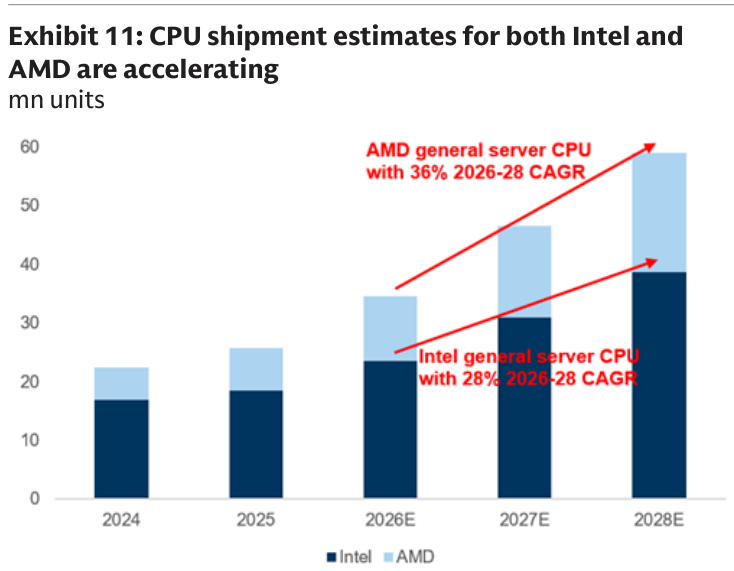

### 解讀摘要
Intel 一般伺服器 CPU 26-28E CAGR 28%、AMD 36% CAGR，2028E 合計 59mn units（vs 2025 年 26mn），AMD 搶到越來越高的佔比（對 BT 有直接意義，因為 AMD Venice 帶來更高記憶體容量要求，每台 BT 含量更高）。

### 表格

| 年份 | 2024 | 2025 | 2026E | 2027E | 2028E |
|---|---|---|---|---|---|
| Intel（mn units） | ~17 | ~19 | ~24 | ~31 | ~39 |
| AMD（mn units） | ~6 | ~7 | ~11 | ~15 | ~20 |
| 合計（mn units） | ~23 | ~26 | ~35 | ~46 | ~59 |

（視覺估算）

---

## Exhibit 12｜DRAM 出貨量（mn chips, 1Gb equiv.）

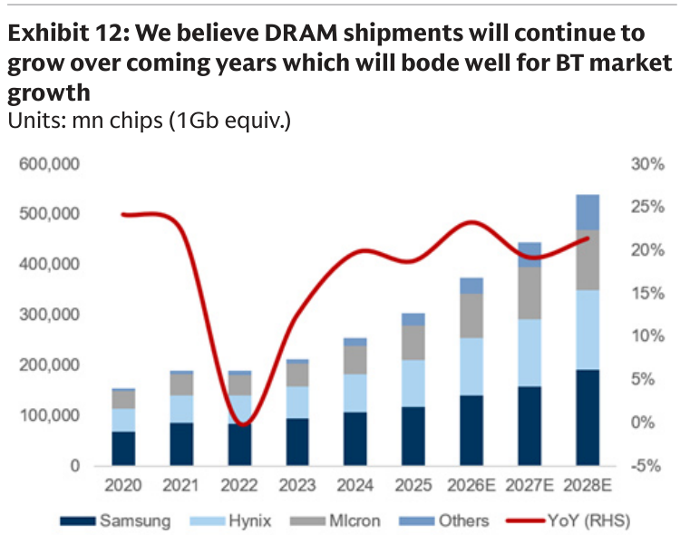

### 解讀摘要
DRAM 出貨量從 2022 年低點恢復，2026E 達 ~390,000mn chips（+25% YoY），2028E 達 ~540,000mn chips（2026-28E CAGR ~18%）。Samsung 持續為最大供應商，Hynix/Micron 佔比約各 20%+。出貨量持續增長對 BT 需求具乘數效果——每張 DRAM chip 需要對應 BT 基板封裝。

---

## Exhibit 13｜NAND 出貨量（mn chips, 1Gb equiv.）

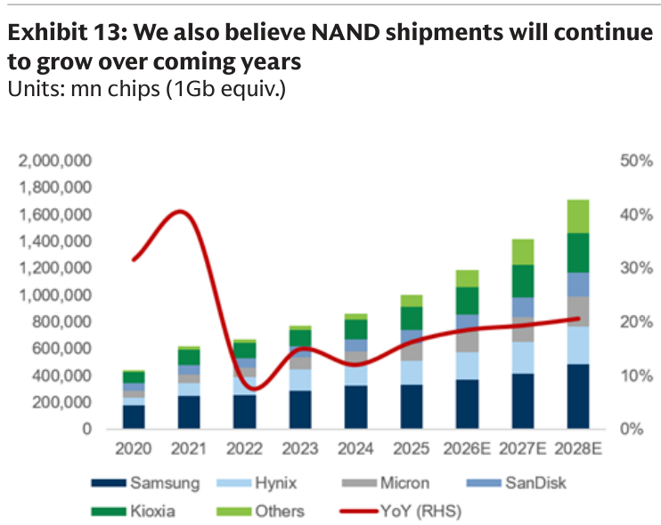

### 解讀摘要
NAND 出貨量 2028E 達 ~1,700,000mn chips，2026-28E CAGR ~20%。Samsung 佔比約 25-30%，Hynix、Micron、SanDisk、Kioxia 各佔 10-20%。NAND 對 BT 需求的帶動相對較小（NAND 以 eMMC/UFS 封裝為主，BT 含量低於 DRAM），但仍是需求端基礎支撐。

---

## Exhibit 14｜AI Server BT TAM（73% CAGR）

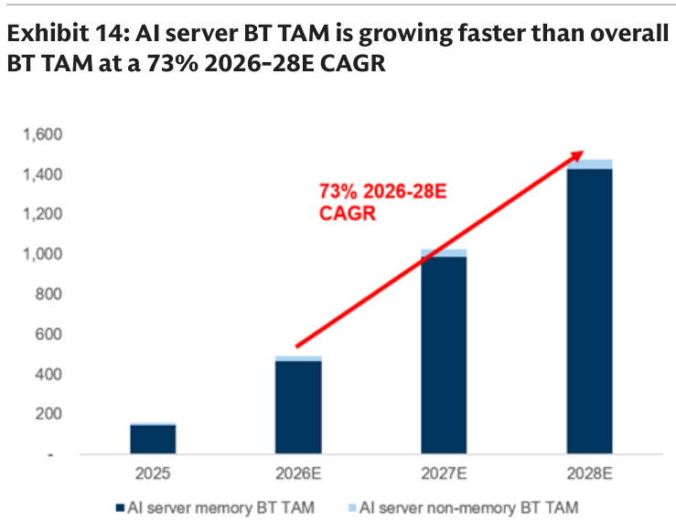

### 解讀摘要
AI 伺服器 BT TAM 從 2025 年 US\$160mn 成長至 2028E US\$1,476mn（73% CAGR）——CAGR 最高，但 2026E 基數仍小（US\$485mn），佔全 BT TAM 僅 5%。AI 伺服器的 BT 需求主要來自 CPU BT 基板（非 GPU），每台 AI 伺服器配備更多 CPU 且記憶體容量更高。GS 估計 Nvidia VR200 帶動記憶體 BT 含量較 GB200/GB300 增加 100%，Vera CPU rack 更帶來 8x 記憶體 BT 含量增加（對應 2028E 的突破性成長）。

### 表格

| 年份 | 2025 | 2026E | 2027E | 2028E |
|---|---|---|---|---|
| AI 伺服器記憶體 BT TAM（US$mn） | ~145 | ~460 | ~985 | ~1,428 |
| AI 伺服器非記憶體 BT TAM | ~15 | ~25 | ~15 | ~48 |
| 合計（US$mn） | ~160 | ~485 | ~1,000 | ~1,476 |
| CAGR（26-28E） | — | — | — | 73% |

---

## Exhibit 15｜每台 AI 伺服器機架 BT Content（k units, RHS = BT/rack）

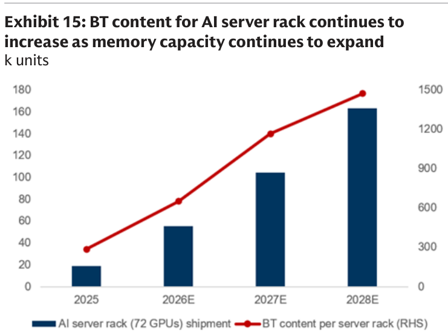

### 解讀摘要
72-GPU AI 伺服器機架出貨量（LHS）從 2025 年 ~20k 成長至 2028E ~165k（71% CAGR），同時每架 BT content（RHS）從 ~300 units 升至 ~1,500 units（50% CAGR）——量與單架含量雙重提升。VR200 的 DRAM 記憶體 BT 含量比 GB200 高 100% 是關鍵催化劑，對應 2027-28E 的大幅跳升。

---

## Exhibit 16｜Smartphone BT Content per Device（USD, LHS）

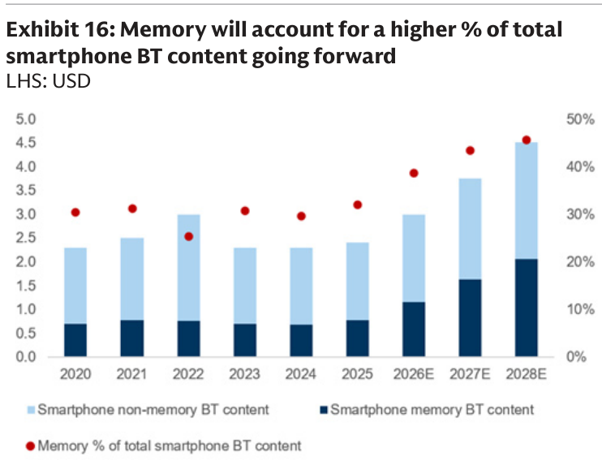

### 解讀摘要
智慧型手機每台 BT 總 content 從 2020 年 ~US\$2.2 升至 2028E ~US\$4.5，但增量主要來自記憶體 BT（從 US\$0.7 升至 US\$2.1）而非非記憶體 BT（相對平穩）。記憶體 BT 佔比從 32%（2025）升至 46%（2028E）。智慧型手機 BT 成長比伺服器慢，但每台記憶體升級（DRAM 容量增加）仍帶來穩定增量。

---

## Exhibit 17｜Smartphone mmWave 滲透率

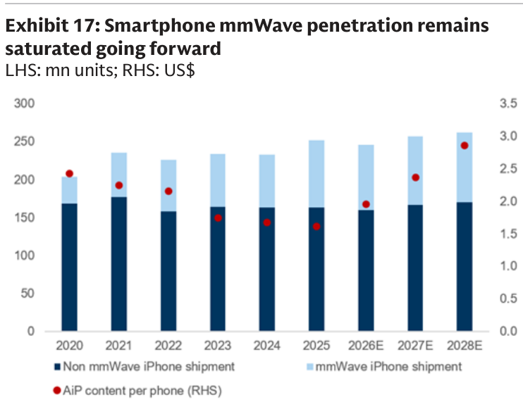

### 解讀摘要
非 mmWave iPhone 出貨量約 165-170mn 穩定，mmWave iPhone 約 75-85mn（佔約 30-35%，主要限於美國市場）；AiP content per phone（RHS）在 2024-25 低點後 2027E 回升至 ~US\$2.5。mmWave 對 BT 的增量主要來自 AiP（Antenna in Package，封裝在 BT 基板上），但成長性偏平緩——GS 預期 2026-28E mmWave 滲透率 25/26/28%，增量有限。

---

## Exhibit 18｜Automotive BT Market（US$mn）

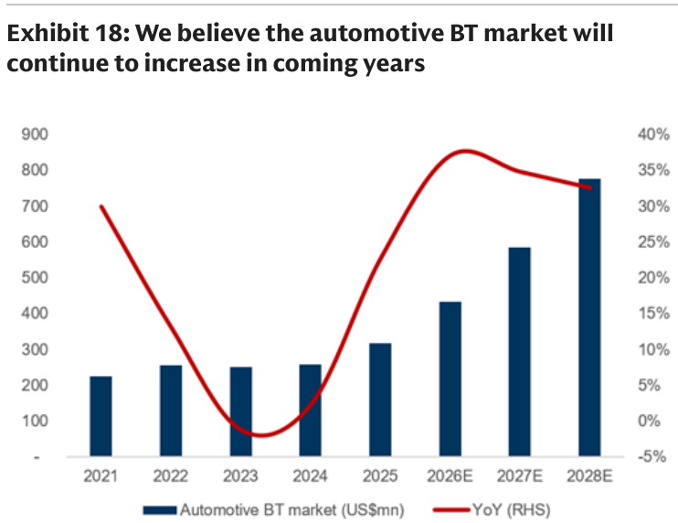

### 解讀摘要
汽車 BT TAM 從 2025 年 US\$317mn 成長至 2028E US\$777mn（34% CAGR），佔總 BT TAM 比重維持 ~4-5%。YoY 在 2026E 衝高（+38%）再緩和，由 EV 滲透率提升（EV 需要更多電控元件）與每輛車電子含量增加雙重驅動。此為 BT 需求的長期結構性增量，對供需平衡計算有邊際貢獻。

---

## Exhibit 19｜EV 滲透率趨勢

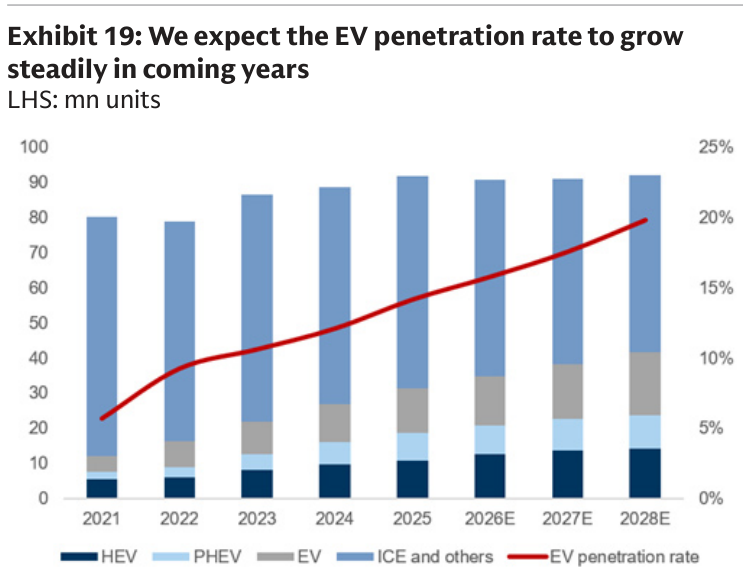

### 解讀摘要
全球汽車出貨量約 90mn 輛/年維持穩定，但 EV（純電）滲透率從 2025 年 14% 升至 2028E 20%（日本汽車研究團隊預估），同時 PHEV/HEV 比例也在提升。整體電動化趨勢帶動每輛車的電子元件需求（BDA、ADAS 感測器等），每個電控模組使用 BT 基板封裝。

---

## Exhibit 20｜BT Market Revenue vs Customers' Total Revenue（BT 佔比 <1%）

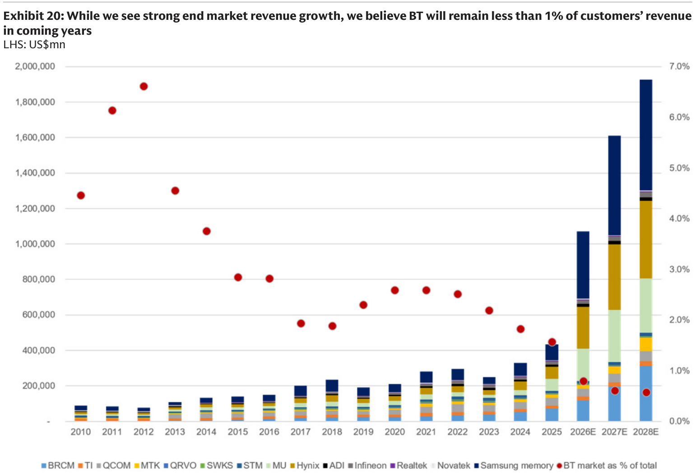

### 解讀摘要
這是本報告最反直覺、最重要的一張圖：客戶（Samsung、Hynix、Micron 等）的總收入規模達 US\$400,000-1,900,000mn，而 BT 市場規模僅 US\$6,000-16,000mn（<1% 佔比）。這個比例在 2026-28E 還因客戶收入更快增長而下降至 <1%（低於 2020-22 的 2-3%），意味著對客戶而言 BT 漲價完全可吸收——BT 供應商的議價能力空間極大。

> **洞察一**：BT 佔客戶收入 <1% 是系統性護城河。對比 ABF 基板（佔 GPU 成本比例更高），BT 供應商漲價引起客戶反彈的機率遠低得多。這支撐 GS 「定價結構性上行」的核心論點——不只是週期性供需緊張。

---

## Exhibit 21｜BT vs ABF 市場集中度比較（2026E 市佔圓餅）

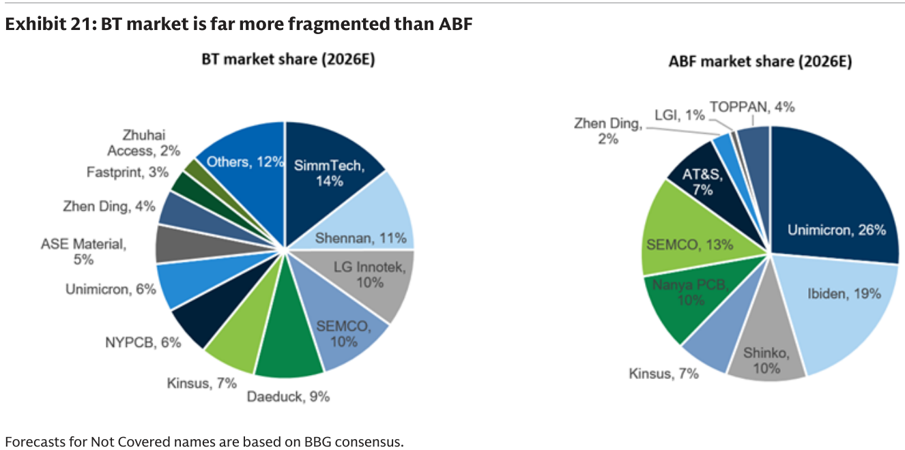

### 解讀摘要
BT 市場高度分散：最大供應商 SimmTech 14%，前五大合計 ~53%；相較 ABF 市場 Unimicron 26%、Ibiden 19%、前三大 >55%。BT 分散格局意味：① 沒有寡頭壟斷，定價由供需決定而非少數廠商控制；② 台廠（ZDT/Kinsus/NYPCB/Unimicron 合計 ~25%）有市佔成長空間；③ GS 偏好能在分散市場中提升份額的公司（ZDT 因 mSAP 能力突出）。

### 表格（BT 市場 2026E 市佔）

| 公司 | 市佔 | 國籍 |
|---|---|---|
| SimmTech | 14% | 韓國 |
| Shennan | 11% | 中國 |
| LG Innotek | 10% | 韓國 |
| SEMCO | 10% | 韓國 |
| Daeduck | 9% | 韓國 |
| Kinsus | 7% | 台灣 |
| ASE Material | 5% | 台灣 |
| Unimicron | 6% | 台灣 |
| NYPCB | 6% | 台灣 |
| Zhen Ding | 4% | 台灣 |
| Fastprint | 3% | 中國 |
| Zhuhai Access | 2% | 中國 |
| Others | 12% | — |

---

## Exhibit 22｜韓系供應商 BT 產能擴張計畫（時程表）

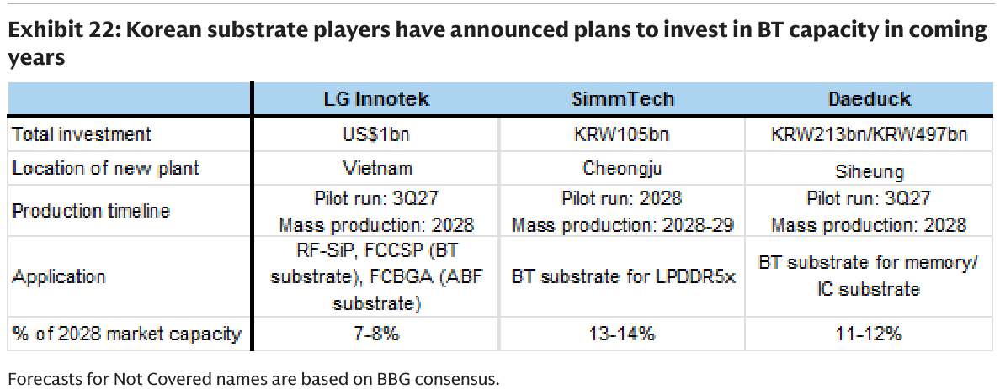

### 解讀摘要
三家韓系供應商（LG Innotek、SimmTech、Daeduck）均宣布 BT 擴產，但 pilot run 最早 3Q27、量產最早 2028，意味著 2026-27 年供給仍以現有產能為主。韓系新產能合計約佔 2028 年市場容量 31-34%，但分散在多家廠商，且主要目標是記憶體 BT（LPDDR5x 與 memory/IC substrate），不直接挑戰台廠的既有業務。

### 表格

| 公司 | 投資額 | 地點 | Pilot run | 量產 | 應用 | 佔 2028 市場容量 |
|---|---|---|---|---|---|---|
| LG Innotek | US\$1bn | 越南 | 3Q27 | 2028 | RF-SiP、FCCSP（BT）、FCBGA（ABF） | 7-8% |
| SimmTech | KRW105bn | 清州 | 2028 | 2028-29 | LPDDR5x BT | 13-14% |
| Daeduck | KRW213bn/497bn | 始興 | 3Q27 | 2028 | 記憶體/IC BT | 11-12% |

> **洞察一**：韓系新產能最早 2028 年量產，而 GS 模型預測 2027E 就已出現 11% 缺口——新產能緩解時間點落後需求上行曲線 1-2 年，代表 2027-28E 定價高峰不會被新供給提早削平。

---

## Exhibit 23｜BT 主要廠商市佔率走勢（2021-2028E）

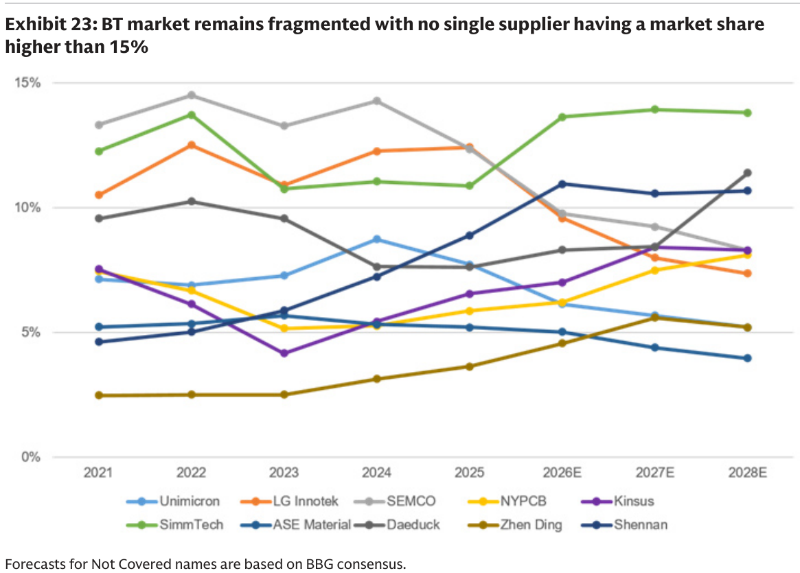

### 解讀摘要
市佔結構轉移明顯：SimmTech（綠線）從 2026E 大幅上升至 13%+ 領先；ZDT（橄欖色）持續從 2% 爬升至 2028E 11%+；Unimicron（藍線）從 2024 年高峰後下滑至 4%（退出 BT）；韓系的 LG Innotek、SEMCO 相對平穩。對 GS 看好 ZDT 的論點形成支撐——ZDT 是少數在分散市場中主動擴產、持續搶佔份額的廠商。

---

## Exhibit 24｜台幣計 BT 市場規模 + 產能利用率（Industry UTR）

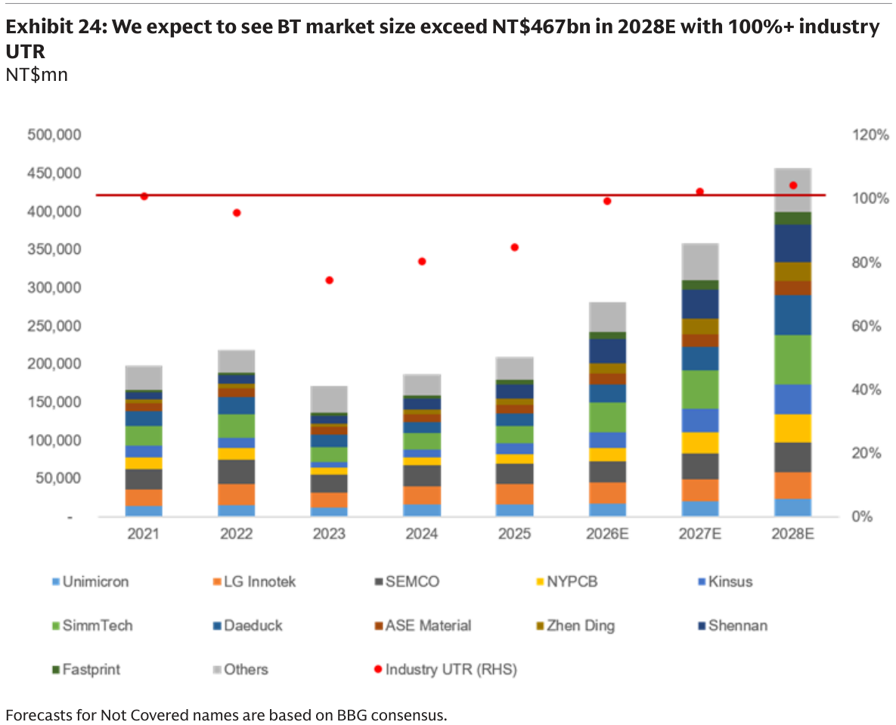

### 解讀摘要
NT$ 計 BT 市場規模（包含台廠、韓廠、中國廠商各自堆疊）預計 2028E 超過 NT\$467bn。Industry UTR（紅點）是本圖核心：2022-25 年 UTR 低於 100%（過剩），2026E 約 100%，2027/28E 超過 100%（設備過載），意味著供應商屆時無法完全滿足需求，議價能力最強。

> **洞察一（配合 Exhibit 3）**：UTR 突破 100% 的時點（2027E）恰好對應 S/D 缺口擴大至 11% 的時點，兩個維度互相印證。

---

## Exhibit 26｜BT COGS 結構（ABF vs BT 對比）

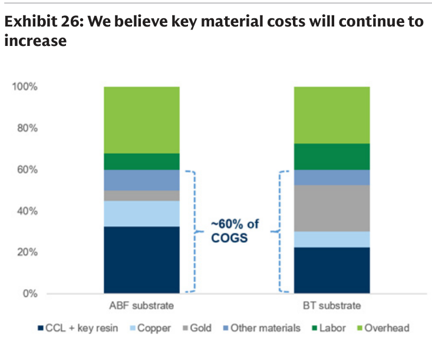

### 解讀摘要
BT 基板 COGS 中，CCL+關鍵樹脂（約 25%）、銅箔（~15%）、黃金（~20%）合計約 60%——原材料成本佔大宗。ABF 基板結構類似，CCL+樹脂比例更高（約 33%）。GS 指出銅箔、黃金、CCL 等材料成本持續上升，構成 BT 漲價的一部分基礎——但 GS 強調未來定價上行主要驅動因素是供需緊缺，而非成本轉嫁。

> **洞察一**：BT 基板材料成本佔 60% COGS，意味著在需求端推動定價上行的同時，毛利率擴張的上限取決於能否讓 ASP 漲幅超過材料成本漲幅。GS 預估 2027/28E GM 達 30-36%（vs 2026E 的 20-27%），隱含 ASP 上行顯著超越成本。

---

## Exhibit 27｜BT 廠商 OPM 歷史走勢（2005-2028E）

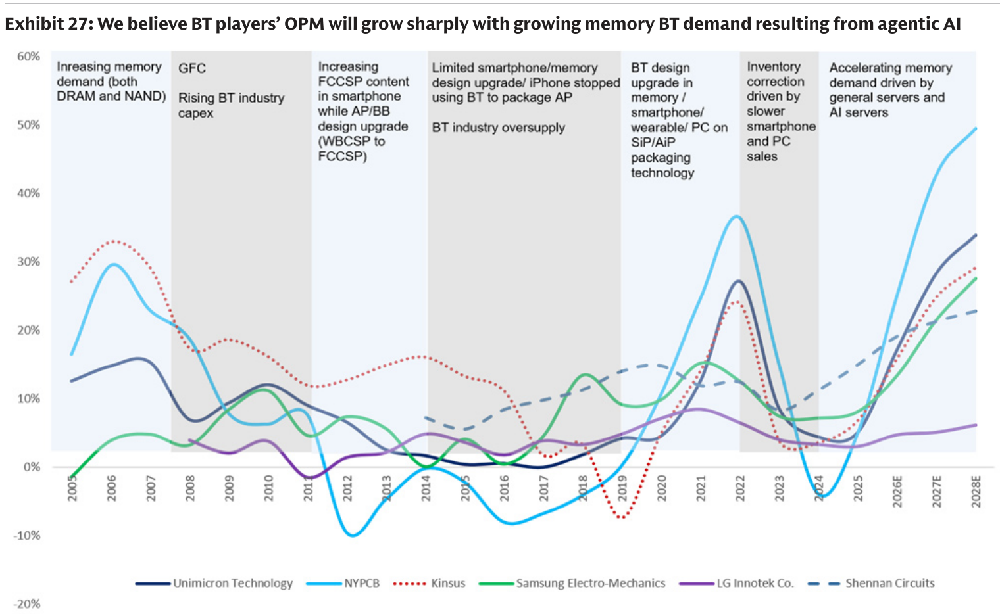

### 解讀摘要
20 年 OPM 歷史顯示 BT 廠商的獲利循環與 Exhibit 5 的需求史高度一致：NYPCB 和 Kinsus 在 2020-22 上行週期 OPM 曾達 25-37%，2023-25 修正至接近 0%，2025-28E 重新上行。GS 的 2028E 預測（NYPCB 接近 50%、Kinsus 約 27%）已超過前一波高峰——這反映更高 ASP 疊加更低供給成長（資本性支出紀律）帶來的結構性 margin 改善。

> **原文補充**：Exhibit 27 上方六個灰色區段分別標注驅動 OPM 起伏的關鍵事件（GFC、FCCSP 升級、iPhone 停用 BT、設計升級、庫存修正、AI 驅動記憶體），幫助投資人理解每次循環的根本原因——此次上行週期（agentic AI 驅動記憶體需求）在本質上更接近於「設計層面的內容升級」而非純粹的景氣週期，下行風險較小。

---

## Exhibit 28｜光模組 mSAP TAM（87% 2026-28E CAGR，US$mn）

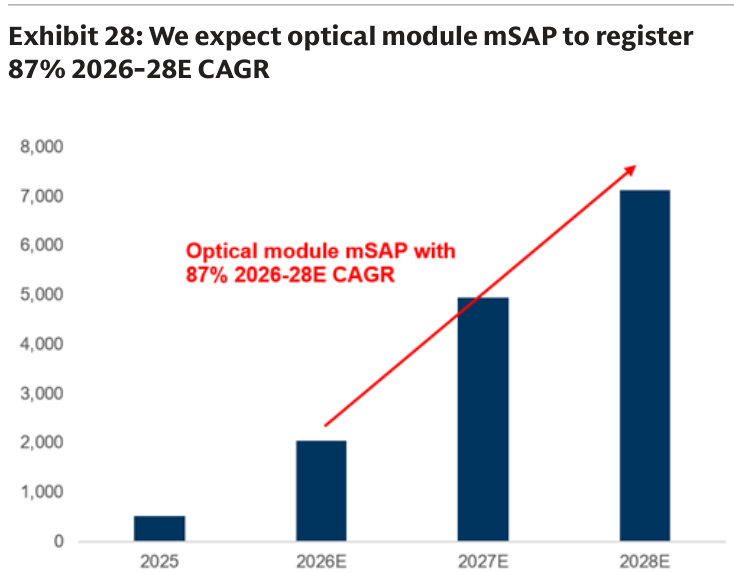

### 解讀摘要
800G+ 光模組 mSAP TAM 從 2025 年 US\$0.5bn 成長至 2028E US\$7.1bn（87% CAGR），到 2026E 已達 US\$2.0bn（4x YoY）。mSAP 是光模組內的連接 PCB 技術（非 BT 基板本身），但由於製程與 BT 基板高度重疊，既有 BT 廠商（ZDT、Compeq）能直接轉換產能切入，形成 BT 廠商的新增量 TAM。

### 表格

| 年份 | 2025 | 2026E | 2027E | 2028E |
|---|---|---|---|---|
| 光模組 mSAP TAM（US$mn） | ~500 | ~2,000 | ~5,000 | ~7,100 |
| CAGR（26-28E） | — | — | — | 87% |

> **洞察一**：mSAP TAM（2028E US\$7.1bn）規模接近 BT TAM（US\$16.8bn）的 42%，不是邊際業務——對 ZDT 而言若能拿下 30%+ 市佔，mSAP 單一業務的 2028E 收入（約 US\$2.1bn = ~NT\$65bn）已等同 ZDT 目前整體 BT 收入的數倍。

---

## Exhibit 29｜光模組 mSAP S/D 缺口

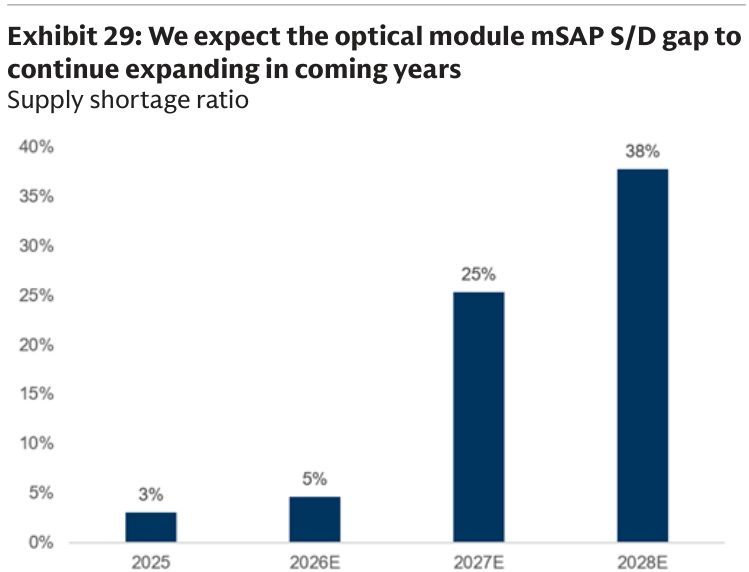

### 解讀摘要
mSAP 供需缺口從 2025 年 +3% → 2026E +5% → 2027E +25% → 2028E +38%，擴張速度比 BT 基板還快。GS 指出 mSAP 是 1.6T 光模組供應鏈中供給最緊缺的元件，定價已較年初上漲 20-30% YTD，GS 預估未來 12 個月還要再漲 10-20%。

### 表格

| 年份 | 2025 | 2026E | 2027E | 2028E |
|---|---|---|---|---|
| mSAP S/D 缺口 | +3% | +5% | +25% | +38% |

---

## Exhibit 30｜ZDT 在光模組 mSAP 的市佔率領先（31%/34% in 2027/28E）

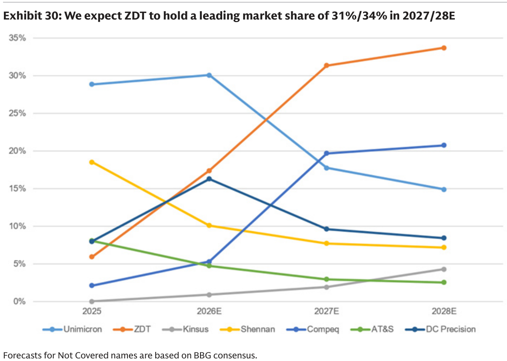

### 解讀摘要
mSAP 市佔格局正在快速重組：2025 年 Unimicron 以 29% 領先（藍線），但 2026-27E ZDT（橙線）超越至 31%，2028E 進一步至 34%。Compeq（深藍）也從幾乎 0 升至 20%。Unimicron 主動放棄 mSAP 市佔轉向 ABF 後，ZDT 成為最大受益者——GS 的產業檢查確認 ZDT 的 mSAP 良率達 90%+（業界領先），支撐此市佔預測。

> **原文補充**：Compeq 目標 2027 年底 mSAP 月收入達 NT\$3bn（vs 2Q26 <NT\$100mn），這個擴張速度雖快，但仍落後於 ZDT 的 5x 產能擴張計畫。

---

## Exhibit 31｜台系主要廠商 BT 收入與獲利比較表

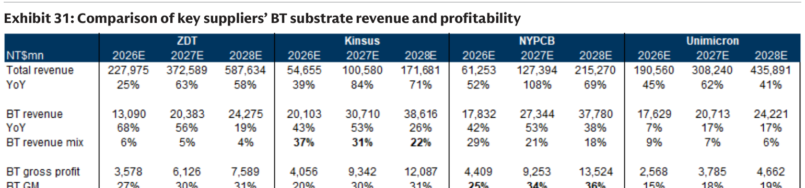

### 解讀摘要
四家台廠中 Kinsus BT 收入佔比最高（2026E 37%）、最受 BT 漲價影響；NYPCB 記憶體 BT 曝險最高（70%），故定價上行最大。ZDT 的 BT 佔比僅 6%，但 mSAP 提供額外增量。Unimicron BT 佔比低且持續下降（9→7→6%）——其 BT 獲利改善最小。

### 表格

| 項目 | ZDT 2026E | 2027E | 2028E | Kinsus 2026E | 2027E | 2028E | NYPCB 2026E | 2027E | 2028E | Unimicron 2026E | 2027E | 2028E |
|---|---|---|---|---|---|---|---|---|---|---|---|---|
| Total revenue（NT\$mn） | 227,975 | 372,589 | 587,634 | 54,655 | 100,580 | 171,681 | 61,253 | 127,394 | 215,270 | 190,560 | 308,240 | 435,891 |
| YoY | +25% | +63% | +58% | +39% | +84% | +71% | +52% | +108% | +69% | +45% | +62% | +41% |
| BT revenue（NT\$mn） | 13,090 | 20,383 | 24,275 | 20,103 | 30,710 | 38,616 | 17,832 | 27,344 | 37,780 | 17,629 | 20,713 | 24,221 |
| BT YoY | +68% | +56% | +19% | +43% | +53% | +26% | +42% | +53% | +38% | +7% | +17% | +17% |
| BT 收入佔比 | 6% | 5% | 4% | **37%** | **31%** | **22%** | 29% | 21% | 18% | 9% | 7% | 6% |
| BT gross profit（NT\$mn） | 3,578 | 6,126 | 7,589 | 4,056 | 9,342 | 12,087 | 4,409 | 9,253 | 13,524 | 2,568 | 3,785 | 4,662 |
| BT GM | 27% | 30% | 31% | 20% | 30% | 31% | **25%** | **34%** | **36%** | 15% | 18% | 19% |
| BT 定價漲幅 YoY | +22% | +26% | +15% | +40% | +41% | +26% | +39% | +38% | +28% | 未揭露 | — | — |

> **洞察一（配合 Exhibit 4）**：NYPCB BT GM 在 2028E 達 36%，是四家中最高，且 BT 獲利 CAGR（2026-28E）75% 為最快——結合 Exhibit 4 的 NYPCB 定價指數最高（3.1x），原因在於其記憶體 BT（WBCSP）供需最緊、替代難度最大。Kinsus 雖 BT 收入佔比最高，但 2028E GM 31% 與 ZDT 相同，因 Kinsus 的智慧型手機 BT 佔比（29%）拖低整體。

---

## Exhibit 32｜ZDT BT Revenue（NT$mn）

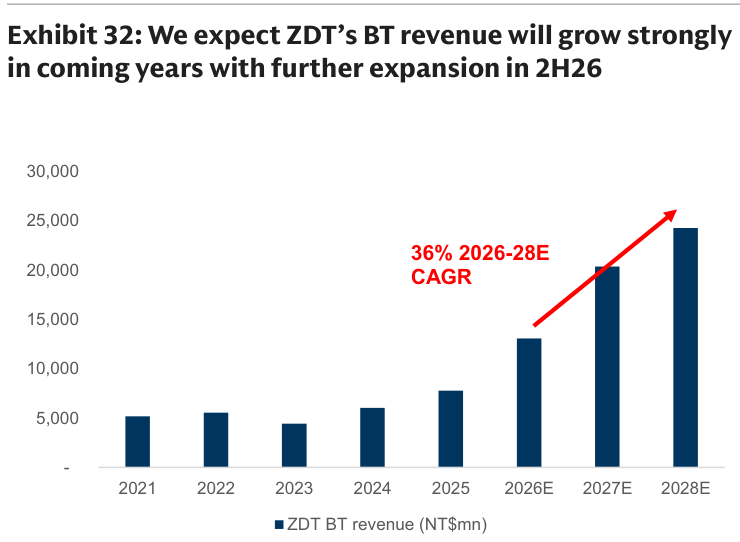

### 解讀摘要
ZDT BT 收入從 2025 年 ~NT\$7,500mn 加速至 2028E ~NT\$24,275mn（36% 2026-28E CAGR），但絕對量仍是四家中最小。ZDT BT 的亮點在於 2H26 起額外擴產 20%，是唯一主動增加 BT 產能的台廠，支撐其在分散市場中持續搶佔份額的能力。

---

## Exhibit 33｜ZDT BT Revenue Mix（2026E）

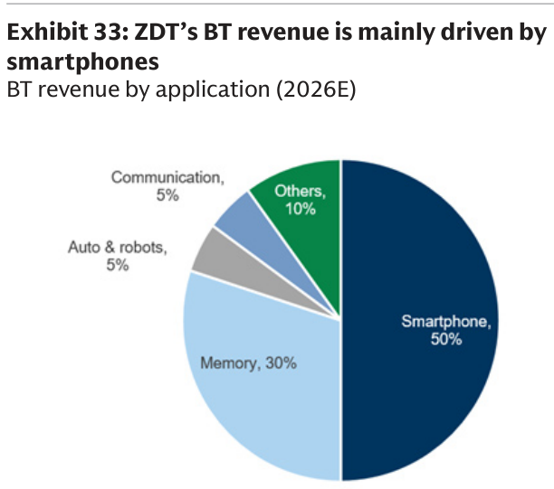

### 解讀摘要
ZDT 2026E BT 收入：智慧型手機 50%、記憶體 30%、通信 5%、車用/機器人 5%、其他 10%。智慧型手機是主要客戶，記憶體佔比低於 Kinsus（50%）和 NYPCB（70%）——代表 ZDT 在 BT 定價上行中受益幅度低於 NYPCB，但 mSAP 新業務彌補此差距。

---

## Exhibit 34｜Kinsus BT Revenue（NT$mn）

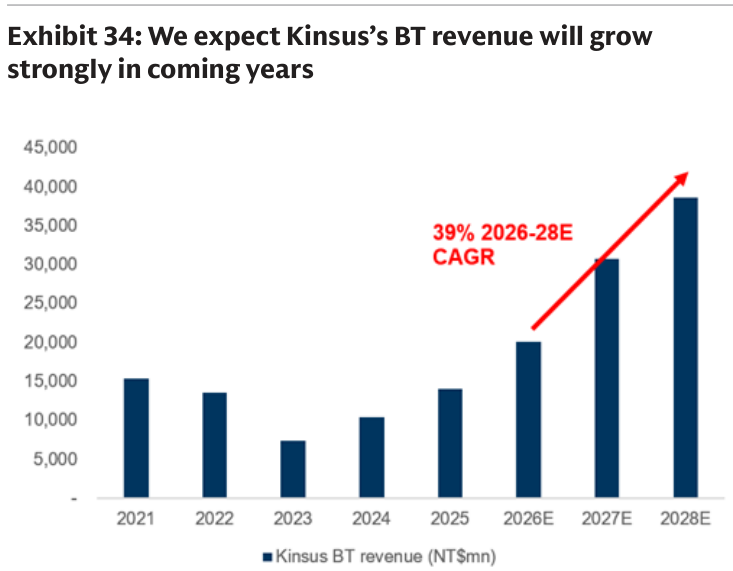

### 解讀摘要
Kinsus BT 收入從 2025 年 ~NT\$14,000mn 成長至 2028E ~NT\$38,600mn（39% 2026-28E CAGR），是四家中收入增速第二快（僅次於 NYPCB 的 46%）。Kinsus BT 佔公司總收入 37%（2026E）是台廠中最高，使其每一個 BT 定價的 1ppt 漲幅對公司整體的 EPS 影響最直接。

---

## Exhibit 35｜Kinsus BT Revenue Mix（2026E）

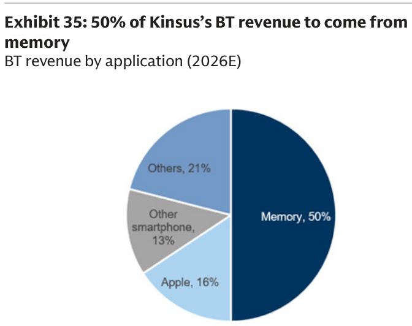

### 解讀摘要
Kinsus 2026E BT 收入：記憶體 50%、Apple 相關 16%、其他智慧型手機 13%、其他 21%。記憶體佔比達 50%（高於 ZDT 的 30%，低於 NYPCB 的 70%），Apple 曝險帶來消費電子波動風險。Kinsus 的業務結構是「記憶體主導但仍有消費電子尾巴」，比 NYPCB 多樣，但 BT 定價上行幅度也略低於 NYPCB。

---

## Exhibit 36｜NYPCB BT Revenue（NT$mn）

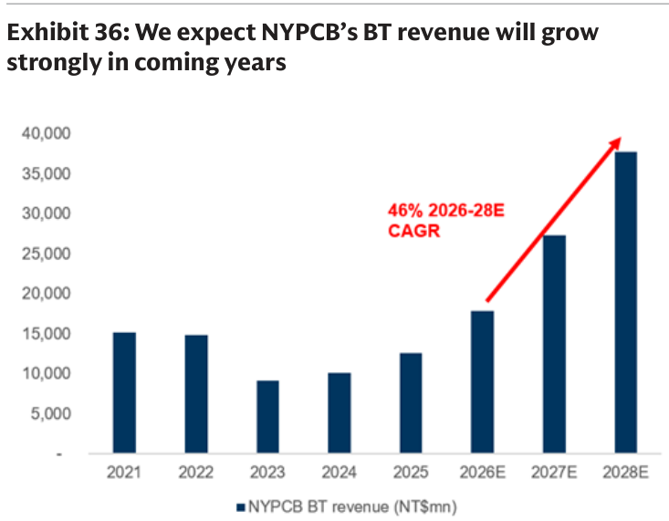

### 解讀摘要
NYPCB BT 收入從 2025 年 ~NT\$13,000mn 成長至 2028E ~NT\$37,780mn（46% 2026-28E CAGR），四家中增速最快。NYPCB BT 收入在 2028E 與 Kinsus 幾乎持平，但 GM 更高（36% vs 31%），帶動獲利角度的差距更大（BT gross profit NT\$13,524mn vs NT\$12,087mn）。

---

## Exhibit 37｜NYPCB BT Revenue Mix（2026E）

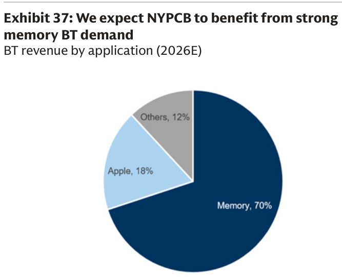

### 解讀摘要
NYPCB 2026E BT 收入：記憶體 70%、Apple 相關 18%、其他 12%。記憶體佔比 70% 是四家中最高，幾乎不依賴消費電子週期——業務結構最純粹地受益於伺服器記憶體 BT 基板漲價浪潮。這也是 GS 對 NYPCB 列入 Conviction List 的主要理由。

---

## 跨 Exhibit 彙整表

### 彙整一｜四家台廠 BT 定價與 GM 比較（來源：Exhibit 4 + Exhibit 31）

| 廠商 | 記憶體 BT 佔比 | BT 定價漲幅（27/28E） | BT GM（2026/27/28E） | BT 利潤 CAGR（26-28E） |
|---|---|---|---|---|
| NYPCB | 70% | +38%/+28% | 25%/34%/36% | 75% |
| Kinsus | 50% | +41%/+26% | 20%/30%/31% | 73% |
| ZDT | 30% | +26%/+15% | 27%/30%/31% | 46% |
| Unimicron | 低（退出中） | 未揭露 | 15%/18%/19% | 35% |

> 記憶體 BT 佔比是 BT 定價上行幅度的最佳預測指標：WBCSP 供需最緊（記憶體 BT 無法與 FCCSP 互換），議價空間最大 → NYPCB 定價上行最強 → GM 擴張最大。Kinsus 次之，ZDT 受智慧型手機拖累但 mSAP 彌補，Unimicron 幾乎不受惠。

---

## 相關個股清單

| 類別 | 公司 | Ticker | 評等 | 目標價（NT\$） | 備註 |
|---|---|---|---|---|---|
| 台灣 BT/PCB（核心受益） | 南亞電路板 NYPCB | 8046 | Buy（CL） | 2,700（↑2,500） | 記憶體 BT 70%，定價漲幅最大；Conviction List |
| 台灣 BT/PCB（核心受益） | 景碩科技 Kinsus | 3189 | Buy | 1,515（↑1,125） | BT 佔收入最高（37%），記憶體 50% |
| 台灣 BT/PCB + mSAP | 臻鼎科技 ZDT | 4958 | Buy | 1,025（↑925） | BT 擴產 20% + mSAP 市佔領先；中國 ABF 額外驅動 |
| 台灣 ABF 轉型（BT 退出） | 欣興電子 Unimicron | 3037 | Neutral | 1,270（↑1,220） | 持續將 BT 產能轉向 ABF，BT 受益有限 |
| 韓國 BT（Not Covered） | LG Innotek | 011070.KS | Neutral（NC） | — | 計畫投資 US\$1bn BT 產能（2027Q3 pilot） |
| 韓國 BT（Not Covered） | SimmTech | 222800.KQ | — | — | 2026E 市佔 14%，LPDDR5x 記憶體 BT |
| 韓國 BT（Not Covered） | Daeduck | 353200.KS | — | — | KRW710bn 擴產，2028 量產 |
| 中國 BT（Not Covered） | Shennan Circuits | 002916.SZ | Buy（NC，Ting Song覆蓋） | — | 廣州廠 Phase 2 將於 4Q26 量產 |
| mSAP 競爭對手 | 楠梓電子 Compeq | — | — | — | 目標 2027 底 mSAP 月收入 NT\$3bn |
