# GS｜Global Server TAM Update

**券商**：Goldman Sachs  
**分析師**：Allen Chang、Verena Jeng、James Schneider、Michael Ng、Katherine Murphy、Ronald Keung、Gabriela Borges、Giuni Lee、Anmol Makkar、Daiki Takayama、Ting Song、Selina Zhang  
**日期**：2026-10-18  
**主題**：Global Server: Raising both AI and General servers; better mix and higher memory costs drive CSP spending  
<a href="https://layx.uk/dl?g=產業&b=GS&d=20261018&h=Global-Server">📎 下載 PDF</a>

---

## 報告總結

GS 大幅上調 2027/28E 全球伺服器 TAM +31%/+45%，AI 伺服器（NVL72 機架 + 8-GPU ASIC）與一般伺服器雙線齊漲。驅動力為 US/中國 CSP capex 持續加速（US 2026E +84%，中國 2026E +105%）以及記憶體等零件規格升級帶動 ASP。本次是 Jun 2026 更新後的又一次大型 TAM 調升，時機與 OCP 峰會（2026/10）及台灣 AI 供應鏈 9 月月營收公布吻合。

主要受益供應鏈排序：Hon Hai/FII（ODM，NVL72 主導者）、Wiwynn/Wistron、Innolight/Eoptolink（光模組）、Shengyi Tech/EMC（CCL）、Victory Giant/GCE（PCB）、AVC/Fositek/Auras（液冷）；ASIC 滲透率預估 2028E 全球 \~60%，是市場過去低估的核心論點。

---

## GS 完整投資邏輯鏈

| 論點層次 | Exhibit | 內容 |
|---|---|---|
| 需求信號明確 | 13、14 | US CSP capex 2026E +84%、中國 +105%；複合增速遠高於過去任何週期 |
| AI server TAM 爆發 | 1、9 | 全球 AI server TAM CAGR：NVL72 163%、8-GPU 38%；一般伺服器亦 22% CAGR（2025-28E） |
| ASIC 滲透率超市場預期 | 2、10 | 2028E ASIC 佔全球 AI 晶片 \~60%（全球 tier-1 \~50%），中國 92%；逐年穩定上升 |
| 供應鏈格局整合 | 6、7、17 | NVL72 Hon Hai/FII 為壓倒性主導；1Q26 ODM Direct 份額短暫降至 49%（vs 2025 58%），Dell 快速拉升至 17% |
| 台灣 AI 供應鏈差異化 | 18、19、20 | Higher-AI 台灣 ODM 12M YoY +38%（vs Lower-AI +15%）；9 月 MoM 個體分化明顯 |
| **結論** | 封面 | **供應鏈優先：Hon Hai/FII、Wiwynn、Wistron（ODM）＋ 光模組/CCL/液冷；一般伺服器 ASP 上漲提供緩衝** |

> **報告最大邏輯缺口**：ASIC 佔比 60% 的假設主要靠中國 CSP（ASIC pen 92%）拉動。若中國 AI 地緣風險導致 capex 延遲，全球 ASIC 滲透率預估下修風險非線性（中國基數已大）。

---

## 報告核心觀點

| 主題 | GS 觀點 | 市場共識 | 是否 Contra-Consensus |
|---|---|---|---|
| 全球伺服器 TAM 2027/28E | 大幅上調 +31%/+45% | Jun 26 前版本低 | ✅ 大幅上調 |
| ASIC 全球滲透率 2028E | \~60%（全球）/ \~50%（tier-1） | 市場多以 40-45% 為基礎案例 | ✅ 更高 |
| 中國 CSP capex 2026E | +105% YoY | 市場未完整建模中國 ASIC 需求規模 | ✅ Contra |
| NVL72 機架 2027E | 110k racks | 先前版本 104.7k | 微上調 |
| 一般伺服器 2026E value YoY | +47%（量+價雙升） | 普遍認為 AI 時代傳統伺服器 flat | ✅ 正面意外 |
| 1Q26 ODM Direct 份額 | 49%（短期波動，年度仍回升趨勢） | 部分市場誤解為結構轉變 | 解讀差異 |

**偏好排序**：Hon Hai/FII > Wiwynn ≈ Wistron > Innolight/Eoptolink（光模組）> Shengyi Tech/EMC（CCL）> AVC/Fositek/Auras（液冷）  
**零件偏好**：NVL72 供應鏈零件（光模組、CCL、液冷、PCB）明顯優於一般伺服器供應鏈；Aspeed BMC 為長期 AI server 受益

---

## Exhibit 1｜全球伺服器價值 TAM 上調幅度（2025-28E）

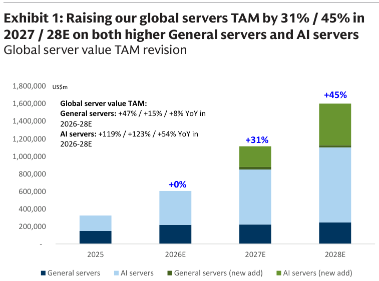

### 解讀摘要
GS 將 2027/28E 全球伺服器 TAM 分別上調 +31%/+45%，這不是微調——從 2025A 約 US\$300bn 成長至 2028E 約 US\$1.6tn（5 倍以上），上調幅度分別來自一般伺服器（+17%/+11%）與 AI 伺服器（NVL72 + 8-GPU 兩線齊升）的複合貢獻。驅動因子是記憶體規格升級帶動 ASP，以及 CSP capex 持續加速（見 Exhibit 13/14）。整體 TAM 的結構性轉變已不可逆，2028E 的 US\$1.6tn 是全球最大單一科技品類之一。

### 表格

**全球伺服器 value TAM（估算，US\$m）：**

| 年度 | 合計（估） | YoY |
|---|---|---|
| 2025A | \~300,000 | 基準 |
| 2026E | \~650,000 | +117% |
| 2027E | \~1,050,000 | +62%（上調 +31%） |
| 2028E | \~1,600,000 | +52%（上調 +45%） |

**分拆成長率：**

| 年度 | General servers YoY | AI servers YoY |
|---|---|---|
| 2026E | +47% | +119% |
| 2027E | +15% | +123% |
| 2028E | +8% | +54% |

> **洞察一**：AI 伺服器 2027E YoY +123% 在機架數量僅 +75% 的情況下達成，意味著每機架 ASP 在 2027E 仍顯著提升（NVL72 規格升級：更多 HBM、更高連接規格），不只是量的驅動。

---

## Exhibit 2｜AI 伺服器出貨預測與 ASIC 滲透率（2026-28E）

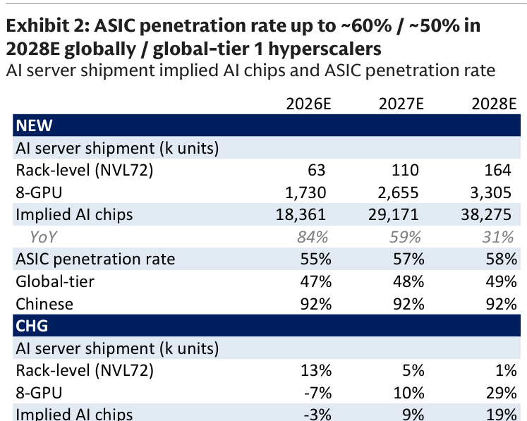

### 解讀摘要
本報告最關鍵的量化表：NVL72 機架 63/110/164k units（2026-28E），8-GPU 伺服器 1,730/2,655/3,305k units，合計隱含 AI 晶片需求 18,361/29,171/38,275k（+84%/+59%/+31% YoY）。ASIC 滲透率——全球 55%/57%/58%（2026-28E），全球 tier-1（non-Chinese）47%/48%/49%，中國 CSP 92% 全程維持。中國 ASIC 高滲透帶動全球平均，是對市場認知差最大的假設。

### 表格

| 指標 | 2026E | 2027E | 2028E |
|---|---|---|---|
| NVL72 機架（k） | 63 | 110 | 164 |
| 8-GPU 伺服器（k） | 1,730 | 2,655 | 3,305 |
| AI 晶片需求合計（k） | 18,361 | 29,171 | 38,275 |
| YoY | +84% | +59% | +31% |
| ASIC 滲透率（全球） | 55% | 57% | 58% |
| ASIC 滲透率（全球 tier-1） | 47% | 48% | 49% |
| ASIC 滲透率（中國 CSP） | 92% | 92% | 92% |

> **洞察一**：扣除中國 CSP（92% ASIC pen），全球 tier-1 ASIC 滲透率仍達 47-49%——遠高於市場曾預期的 30-40%，說明 Google TPU、Amazon Trainium 等在非中國市場的擴張也在大幅加速，不只是中國現象。  
> **值得驗證**：中國 92% ASIC 假設是全表最不確定的數字。若美國擴大出口制裁導致 Huawei/寒武紀等受限，實際滲透率可能有 ±20ppt 誤差，影響全球合計 AI 晶片需求數字 10-15%。

---

## Exhibit 3｜全球伺服器 TAM 上調幅度：品牌 vs ODM 領導廠

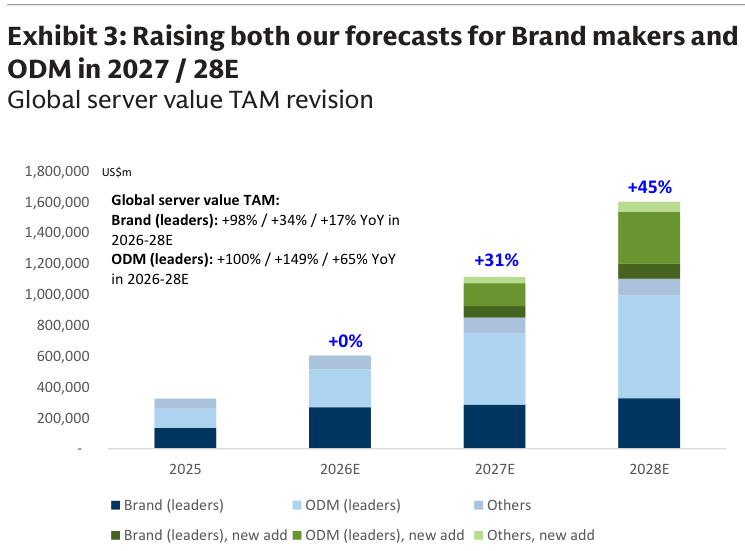

### 解讀摘要
TAM 上調的供應商視角：GS 對全球品牌廠（Brand leaders）的 2026-28E YoY 估計為 +98%/+34%/+17%，ODM 領導廠（ODM leaders）則更高：+100%/+149%/+65%。ODM 2027E +149% vs 品牌廠 +34% 的差距，反映 AI 伺服器中 ODM Direct 模式（CSP 直接繞過品牌廠向 ODM 採購）的持續滲透，是本報告的核心結構論點。

### 表格

| 類型 | 2026E YoY | 2027E YoY | 2028E YoY |
|---|---|---|---|
| Brand leaders | +98% | +34% | +17% |
| ODM leaders | +100% | +149% | +65% |

> **洞察一**：ODM 2027E 149% vs Brand 34% 的差距是「ODM Direct 持續滲透」的直接量化。即使 1Q26 ODM 份額短暫下滑（Exhibit 16），GS 的年度預測隱含 ODM 將在全年層面顯著奪回並超越 2025 水準。

---

## Exhibit 4｜AI 伺服器生態系統地圖：各公司對各晶片平台的營收曝險

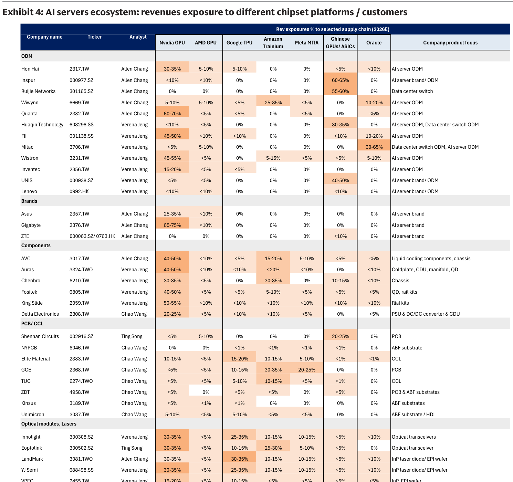

### 解讀摘要
本報告最具實用性的一張圖：列出 30+ 家公司，按 Nvidia/AMD/Google/Amazon/Meta/Chinese CSP/Oracle 各平台標示其 AI server 營收曝險比例。對台灣 AI 供應鏈投資者而言，這張表可快速判斷「哪家公司對哪個晶片生態最深度依賴」，評估 ASIC 替代對個別公司的衝擊或受益。供應鏈多平台分散者風險低、高度集中單一客戶者波動性高但潛在報酬大。

> **原文補充**：GS 特別強調此表的目的是讓投資人評估晶片轉換的「勝者/敗者」——未登上多個 ASIC 供應鏈（Google TPU、Amazon Trainium、Meta MTIA）的公司長期面臨競爭格局收窄風險。

---

## Exhibit 5｜AI 機架出貨量按晶片平台分拆（2026-28E）

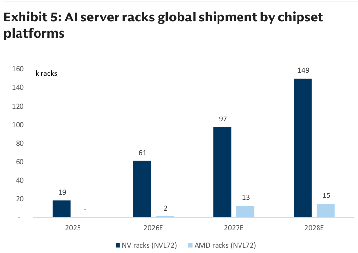

### 解讀摘要
Nvidia NV racks 61/97/149k（2026-28E），AMD racks 2/13/15k——AMD 2027E 從 2k 跳增至 13k（+550%），但絕對量仍不及 Nvidia 的 14%。AMD 在高效能 AI 訓練市場持續難以突圍，主要靠推論市場（較低規格需求）取量。兩者合計 63/110/164k 對應 Exhibit 6 的 ODM 出貨預估。

### 表格

| 平台 | 2026E（k racks） | 2027E（k racks） | 2028E（k racks） |
|---|---|---|---|
| Nvidia | 61 | 97 | 149 |
| AMD | 2 | 13 | 15 |
| **合計** | **63** | **110** | **164** |

> **洞察一**：AMD 到 2028E 機架數量（15k）仍不及 Nvidia 10%，ASIC（Google/Amazon/Meta）的高速滲透是比 AMD 更大的 Nvidia 晶片份額威脅——但 Nvidia 絕對出貨仍快速成長，兩者並非零和。

---

## Exhibit 6｜AI 機架出貨量按 ODM/OEM 廠商分拆（2026-28E）

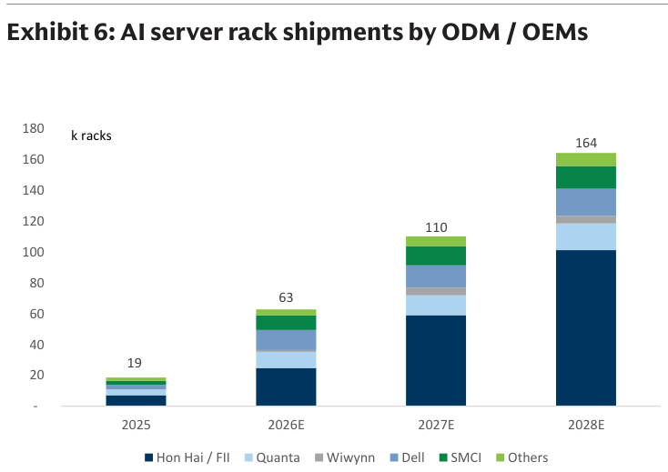

### 解讀摘要
Hon Hai/FII 是壓倒性主導者，2028E 約持有 164k 機架中的 \~60% 份額（約 100k）；Wiwynn、Wistron 為次要 ODM；Dell 為主要全球品牌廠。Hon Hai 的 NVL72 垂直整合（電源、機箱、組裝全線）使其難以被替代，且隨著機架數從 110k→164k 擴張，增量絕大部分流向 Hon Hai。

> **原文補充**：GS 指出 Hon Hai 的競爭優勢不只是現有份額，更在於其進行中的 AI server 產能擴建（2H26 起新增產線），使 2027-28E 份額進一步鞏固。

---

## Exhibit 7｜AI 機架市場份額（2027E vs 2028E）

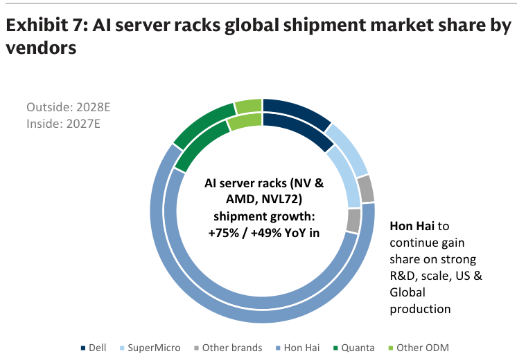

### 解讀摘要
甜甜圈圖對比 2027E/2028E：NVL72 機架 +75%/+49% YoY 增長中，Hon Hai 份額持續擴大，其他廠份額被稀釋。市場份額高度集中意味著 Hon Hai 是所有 AI 機架上游零件（光模組、CCL、PCB、液冷）的最大受益傳導渠道——Hon Hai 的排程即決定這些零件廠的訂單可見度。

---

## Exhibit 8｜72-GPU vs 8-GPU 機架 GPU 用量與滲透率趨勢

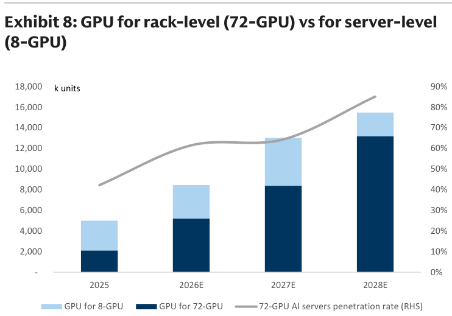

### 解讀摘要
72-GPU 機架（NVL72）的 GPU 用量佔比相對 8-GPU 伺服器的趨勢：2026-28E 72-GPU 滲透率從不到 50% 攀升至 \~85%。「高功率密度、全機架整合」是 AI 訓練部署的主流；8-GPU 伺服器的增長主要靠 ASIC 填補（Google TPU、Amazon Trainium 以 8-GPU 形態部署），並非傳統 GPU 伺服器。兩種形態各有其 CSP 部署邏輯，不是替代關係。

---

## Exhibit 9｜全球伺服器 TAM 按細分市場 CAGR（2025-28E）

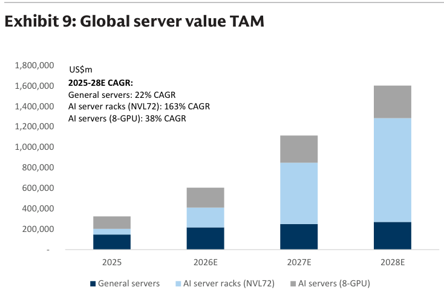

### 解讀摘要
三段式成長：一般伺服器 22% CAGR——超過多數市場預期，反映記憶體規格升級帶動 ASP re-rating；NVL72 機架 163% CAGR（每年接近翻倍）；8-GPU（ASIC+GPU）38% CAGR。重點不只是 AI 的高速成長，而是一般伺服器 22% CAGR 正式推翻「傳統伺服器 flat/小跌」的市場認知——AI infrastructure 擴張帶來的是整體 IT 支出增量，而非存量預算重分配。

### 表格

| 細分市場 | 2025-28E CAGR | 主要驅動力 |
|---|---|---|
| 一般伺服器 | 22% | 規格升級（DRAM DDR5、更大容量）+ 企業 AI 基建 |
| AI server（NVL72） | 163% | 機架出貨 63→164k（+160%）× ASP 提升 |
| AI server（8-GPU） | 38% | ASIC 滲透 + 8-GPU 伺服器 shipment +91% |
| **合計 TAM** | **\~60%** | **2028E 約 US\$1.6tn** |

> **洞察一**：一般伺服器 22% CAGR 的估值意涵——Dell、HPE 等傳統伺服器廠將直接受益，一般伺服器 ASP 因 DRAM（DDR5 + 容量）升級拉高，與 AI 伺服器的記憶體規格向上平行，非競爭關係。

---

## Exhibit 10｜AI 晶片總需求：ASIC vs GPU 拆解（2026-28E）

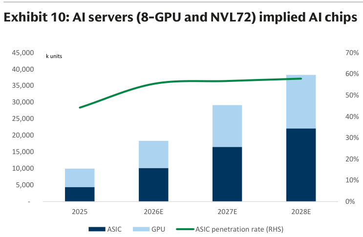

### 解讀摘要
從 AI 晶片需求總量看 ASIC/GPU 拆解：ASIC 滲透率從 2025A 約 47% 攀升至 2028E 約 60%（Exhibit 2 的全球數字）。Bar chart 顯示 ASIC 出貨量絕對增量每年都顯著大於 GPU；疊加曲線（ASIC pen rate）單調上升。投資含義：Nvidia GPU 出貨絕對量仍快速成長，ASIC 增速更快——對 TSMC N3/N2 先進製程、CoWoS、HBM 的需求兩者皆有，不存在零和問題。

---

## Exhibit 11｜一般伺服器出貨量 YoY vs ASP YoY（2026-28E）

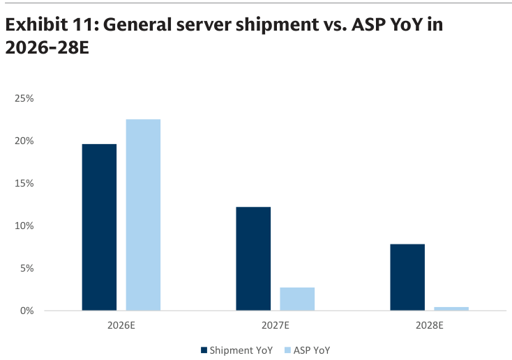

### 解讀摘要
2026E：出貨量 YoY +20%，ASP YoY +23%——量+價雙升，合計貢獻 value TAM +47% YoY（見 Exhibit 1）。2027E 後出貨量 +12%、ASP +3%，2028E +8%/\~+0.5%——ASP 漲勢收斂（DRAM 升級效應在 2026E 最大）。2026E 是一般伺服器「量+價」最佳年度，2027-28E 成長主要靠量。

### 表格

| 年度 | 出貨量 YoY | ASP YoY | Value YoY |
|---|---|---|---|
| 2026E | +20% | +23% | +47% |
| 2027E | +12% | +3% | +15% |
| 2028E | +8% | \~+0.5% | +8% |

---

## Exhibit 12｜x86 伺服器歷史出貨量 vs ASP YoY（2021-1Q26）

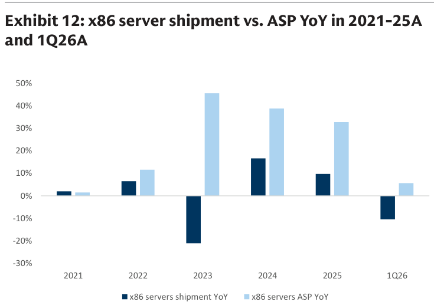

### 解讀摘要
歷史視角：2023 年是明顯低谷——出貨量 YoY 約 -20%，但 ASP YoY 逆勢升至 +5%（DDR5 升級 + AI server 拉動高端規格）。2024-25 年量的復甦，1Q26 出貨量 YoY 約 -10%（季節性）、ASP +5%。歷史模式支持 GS 對 2026E 量+價雙升的預測——過去週期顯示 ASP 在量調整期也能保持韌性，2026E +23% ASP 是週期高點但有基本面支撐。

---

## Exhibit 13｜美國 CSP Capex 趨勢（2026-28E）

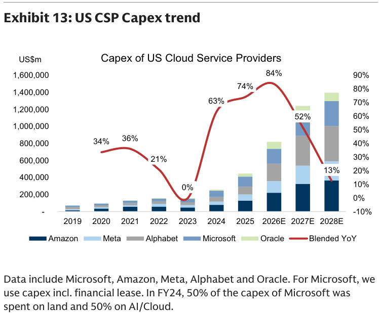

### 解讀摘要
美國主要 CSP（Amazon、Meta、Alphabet、Microsoft、Oracle）合計 capex：2026E +84% YoY，2027E +52%，2028E +13%。增速逐年放緩但絕對量仍大幅擴張，2026-27E 兩年 capex 增量約相當於 2023-25 年三年總和的 2.5 倍。2026E 的 84% 增速是近 10 年最高，直接驗證 AI infrastructure upcycle 強度。Oracle 是 2025-26 年增速最快的 CSP（雖基數小），重塑美國 hyperscaler 格局。

### 表格

| 年度 | 美國 CSP 合計 YoY |
|---|---|
| 2026E | +84% |
| 2027E | +52% |
| 2028E | +13% |

> **洞察一**：2028E 降速至 +13% 是「成熟期」放緩，不是衰退信號——絕對 capex 金額仍遠超 2025 年水準，基礎建設有慣性，不存在斷崖風險。

---

## Exhibit 14｜中國 CSP Capex 趨勢（2026-28E）

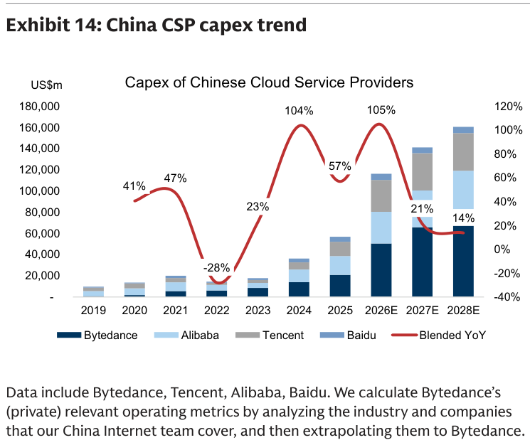

### 解讀摘要
中國主要 CSP（Bytedance、Alibaba、Tencent、Baidu）合計 capex：2026E +105% YoY——甚至超過美國（84%），反映中國 AI 競賽的爆發性投入，且此數字幾乎不含 Huawei。中國 CSP 是 GS 估計 ASIC 滲透率全球拉高的主要來源（92% ASIC pen，見 Exhibit 2），其 capex 的真實性直接影響全球 TAM 可信度。

### 表格

| 年度 | 中國 CSP 合計 YoY |
|---|---|
| 2026E | +105% |
| 2027E | +21% |
| 2028E | +14% |

> **洞察一（配合 Exhibit 2）**：中國 2026E capex +105% × ASIC pen 92%，是全球 AI 晶片需求增量中增速最快的子集合。若中國 AI 管制加強或美國擴大出口制裁，這條線的下行風險最高，對 GS 全球 TAM 的影響非線性（中國基數已大且 ASIC 假設最激進）。

---

## Exhibit 15｜全球伺服器 x86 vs non-x86 季度序列

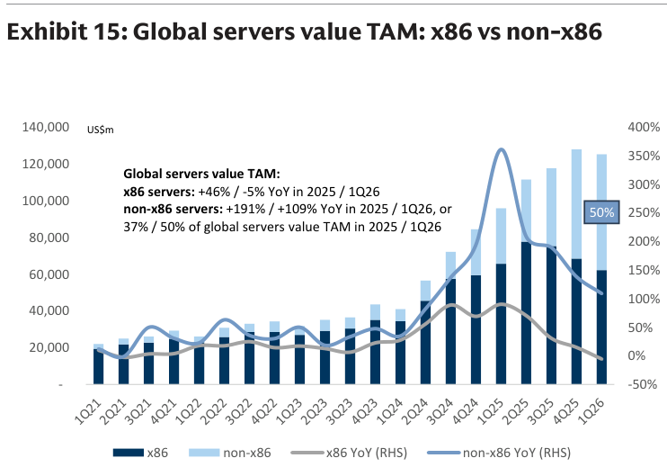

### 解讀摘要
non-x86 伺服器（AI 伺服器主體）在 1Q26 已達全球 TAM 約 50%（YoY +109%）——一個里程碑式的結構轉變點。過去 x86 是伺服器產業代名詞，2025 年 non-x86 已追平 x86，2026-28E 差距將持續拉開。這個數字同時正面驗證了 x86（一般伺服器）自身在 2026E 的回升（見 Exhibit 11/12）——整體 TAM 是擴張的，不是結構替換。

---

## Exhibit 16｜全球伺服器 TAM 按銷售模式分拆（季度序列）

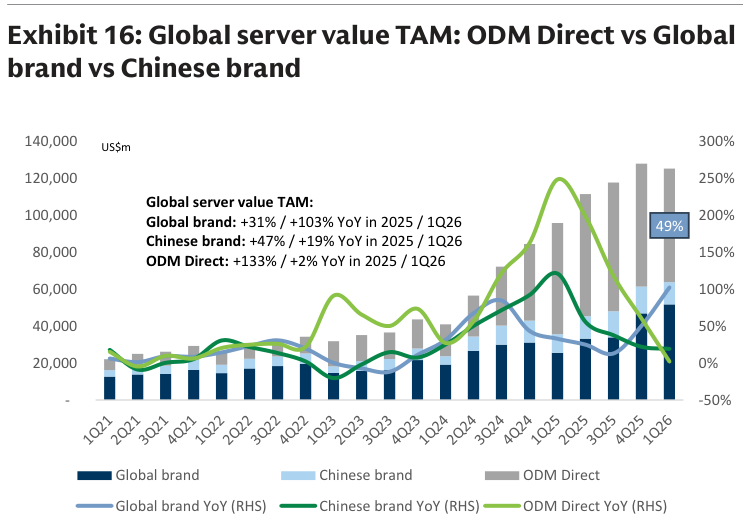

### 解讀摘要
三大銷售模式：ODM Direct（CSP 直購 ODM）、Global Brand（Dell/HPE 等）、Chinese Brand（浪潮等）。1Q26 ODM Direct 份額跌至 49%（vs 2025 全年 58%），Global Brand 份額回升（Dell 快速拉升至 17%，見 Exhibit 17）。GS 解讀此為短期波動——1Q26 是傳統季節性淡季加上部分 NVL72 交期推移，ODM Direct 年度份額仍在回升趨勢中。

---

## Exhibit 17｜全球伺服器市佔前六名（2025 vs 1Q26）

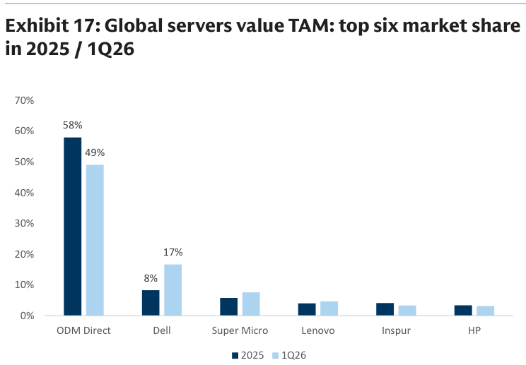

### 解讀摘要
最值得注意的動態：Dell 從 2025 年 8% 跳升至 1Q26 的 17%——單季幾乎翻倍。ODM Direct（Hon Hai/FII 等合計）58%→49% 短期回落；SMCI 約 5%→8% 微升。這個快速份額移轉發生在 AI server 出貨激增期間，意味著 Dell 正在重新成為 AI server 的重要整合渠道，尤其是企業客戶（非 hyperscaler）市場。

### 表格

| 廠商 | 2025 份額 | 1Q26 份額 |
|---|---|---|
| ODM Direct（Hon Hai/FII 等） | 58% | 49% |
| Dell | 8% | 17% |
| SMCI | \~5% | \~8% |
| Lenovo | \~4% | \~5% |
| 其他 | 25% | 21% |

> **洞察一**：Dell 1Q26 佔 17%，若延伸至全年則 Dell 已成為 Nvidia 系 AI server 最大「品牌整合商」（非 ODM Direct）。SMCI 法務風波後的訂單外溢可能是 Dell 快速拉升的部分原因。

---

## Exhibit 18｜台灣 ODM/品牌廠 AI 曝險度 YoY 表現（12M）

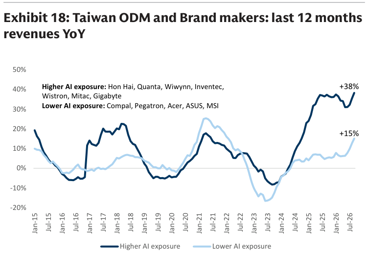

### 解讀摘要
GS 將台灣 ODM/品牌廠分成「Higher AI exposure」（鴻海、緯穎、緯創等）與「Lower AI exposure」（廣達、仁寶等）兩組，12M YoY：Higher AI +38%，Lower AI +15%。差距 23ppt 非常顯著——在同一個「台灣 ODM」框架下，AI 曝險度差異直接反映在年度成長率上，驗證 AI server 訂單的集中效應與投資組合分層的必要性。

---

## Exhibit 19｜台灣 ODM/品牌廠 MoM（2026 年 8 月 vs 9 月）

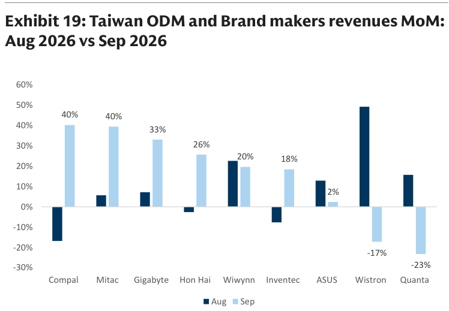

### 解讀摘要
9 月 MoM 個體差異顯著：正面方向，Compal +40%、Mitac +40%、Gigabyte +33%、鴻海 +26%、Wiwynn +20%、英業達 +18%；負面方向，緯創 -17%、廣達 -23%。廣達 -23% MoM 與 GS 廣達個股報告（9 月 NT\$xxx mn，miss GS 估 -6%）一致，屬出貨準備期的季節調整而非需求轉弱。Compal/Mitac +40% MoM 最值得追蹤——AI server 訂單能見度是否正在拉升？

---

## Exhibit 20｜台灣 AI 零組件廠商 MoM（2026 年 8 月 vs 9 月）

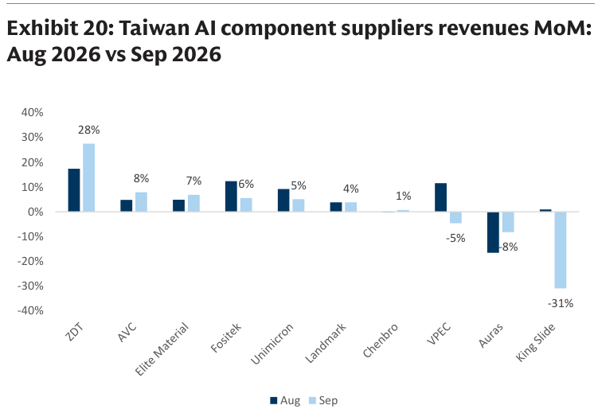

### 解讀摘要
台灣 AI 零組件 9 月 MoM：ZDT（致茂） +28%、AVC（奇鋐） +8%、Elite Material（台光電） +7%、Fositek（廣運） +6%、Unimicron（欣興） +5%；King Slide（川湖） -31%、Auras（雙鴻） -8%。King Slide -31% 是本批最大負面意外——川湖為 AI rack 導軌 rail kit 主要供應商，如此大幅下滑若非庫存調整就是交期推移，需持續追蹤。AVC +8% 與奇鋐個股 9 月月營收方向一致（GS 個股報告季度表現強勁）。

---

## 跨 Exhibit 彙整表

### 彙整 1｜CSP Capex vs AI 晶片需求驗證（來源：Exhibit 2、13、14）

| 地區 | 2026E Capex YoY | 2026E AI 晶片需求（k，GS 估） | ASIC 滲透率 |
|---|---|---|---|
| 美國 CSP | +84% | \~8,000（視覺估算） | \~47% |
| 中國 CSP | +105% | \~6,000（視覺估算） | 92% |
| 其他 | — | \~4,000（視覺估算） | \~40% |
| **全球合計 2026E** | — | **18,361** | **55%** |

> CSP capex 加速（US +84%、CN +105%）與 AI 晶片需求 18,361k（+84% YoY）量級上高度吻合，GS 的 TAM 預估從需求端（capex）與供應端（晶片出貨）雙向交叉驗證，不是單一假設。

### 彙整 2｜全球伺服器 TAM 三段成長全景（來源：Exhibit 1、9、11）

| 細分 | 2025A（US\$bn） | 2026E | 2027E | 2028E | CAGR |
|---|---|---|---|---|---|
| 一般伺服器 | \~150 | +47% | +15% | +8% | 22% |
| AI server（NVL72） | 小 | +119% | +123% | +54% | 163% |
| AI server（8-GPU） | 小 | 高速 | 高速 | 高速 | 38% |
| **合計** | **\~300** | **\~650** | **\~1,050** | **\~1,600** | **\~60%** |

> 三段並行成長的核心洞察：傳統「AI 吃掉一般伺服器預算」的觀念被數據否定——一般伺服器 22% CAGR 說明 AI infrastructure 擴張帶來的是整體 IT 支出增量，而非存量預算的重分配。供應鏈影響：一般伺服器回升對 DDR5 DRAM、企業 PCB、x86 CPU 是額外利多，在追蹤 AI 供應鏈時不應遺漏。

---

## 相關個股清單

| 類別 | 公司 | Ticker | GS 評等 | 備註 |
|---|---|---|---|---|
| ODM（AI server） | 鴻海 | 2317.TW | Buy | NVL72 最大 ODM，\~60% 機架份額 |
| ODM（AI server） | 富智康 FII | 601138.SS | Buy | 鴻海大陸子公司 |
| ODM | 緯穎 Wiwynn | 6669.TW | Buy | 第二大 AI ODM |
| ODM | 緯創 Wistron | 3231.TW | Buy | — |
| 光模組 | Innolight | — | Buy | AI server 800G/1.6T 光模組 |
| 光模組 | Eoptolink | — | Buy | — |
| FAU | FOCI | — | Buy | 光纖陣列單元 |
| FAU/光學 | Largan | 3008.TW | Buy | — |
| 矽光子 | LandMark | — | Buy | — |
| 矽光子 | VPEC | — | Buy | — |
| CCL | Shengyi Technology | 600183.SS | Buy | AI server 高階 CCL |
| CCL | 台光電 EMC | 2383.TW | Buy | — |
| PCB | Victory Giant | — | Buy | — |
| PCB | 景碩 GCE | — | Buy | — |
| 散熱/液冷 | 奇鋐 AVC | 3017.TW | Buy | 液冷 |
| 散熱/液冷 | 廣運 Fositek | — | Buy | 液冷 |
| 散熱/液冷 | 雙鴻 Auras | 3324.TW | Buy | 液冷；9 月 MoM -8% 注意 |
| 機構/導軌 | 川湖 King Slide | 2059.TW | — | Rail kits；9 月 MoM -31% 需追蹤 |
| 晶圓代工 | 台積電 TSMC | 2330.TW | Buy | AI chip foundry |
| 探針卡 | 旺矽 MPI | 6223.TW | Buy | — |
| IC 設計 | 信驊 Aspeed | 5274.TW | Buy | BMC 晶片（fabless） |
| 測試介面 | 萬潤 WinWay | — | Buy | Sockets |
| 測試設備 | 翔名 Hon Precision | — | Buy | FT handler |
