# MS｜2026 OCP Global Summit Takeaways

**券商**：Morgan Stanley  
**分析師**：Derrick Yang、Vivi Huang（台灣）、Andy Meng CFA（香港）  
**日期**：2026-10-18  
**主題**：2026 OCP Global Summit Takeaways  
**評級**：In-Line（Greater China Technology Hardware）  
<a href="https://layx.uk/dl?g=產業&b=MS&d=20261018&h=OCP-Takeaways">📎 下載 PDF</a>

---

## 報告總結

MS 直擊 2026 OCP Global Summit，歸納三大主題：①網路端——1.6T 交換器（CPO/NPO）與 micro-VCSEL 光纜（Credo ALC、ALAB）並進，銅纜（448G CPC/NPC）為中短距離填補方案，各技術將長期共存；②電力端——800VDC HVDC 正式進入 Nvidia 參考設計（660kW 電源機架支援兩台 VR NVL72），Delta 量化 2-ppt 效率提升可帶來每 10GW campus \~US\$160M/yr 節電；③固態變壓器（SST）首次出現在 Nvidia MGX 生態系統板，技術仍早期但路線圖清晰（2030 年初步量產）。

股票推薦：Bizlink（3665.TW）受益 micro-VCSEL 組裝、Chroma（2360.TW）受益電源測試 + 光學測試工具、Delta（2308.TW）和 Lite-On（2301.TW）受益 HVDC 電源密度提升。

---

## MS 完整投資邏輯鏈

| 論點層次 | Exhibit | 內容 |
|---|---|---|
| 信號：AI 機架密度逼近光網路與電力雙瓶頸 | 1-5 | 1.6T 交換器量產、AEC/CPC 多方案並行，CPO 良率瓶頸仍存 |
| 網路：4 種技術共存，各有適用場景 | 6-17 | CPO/NPO（低功耗、高成本）、CPC（<1m 機箱內）、micro-VCSEL（50-100m、1-2pJ/bit） |
| 電力：800VDC 從參考設計走向部署 | 18-21 | Nvidia + Delta 聯合 keynote；Q3 2026 Power Rack 已可部署 |
| 電力：液冷電源架打開機架空間 | 22-23 | Megmeet 2U 110kW 液冷（fanless）vs 3U 氣冷；設施 CAPEX 降至 \~10% |
| SST：生態系統初步成形，2030 量產 | 24-27 | MGX 生態系統板首次列入 SST；SST \~40x 輕、\~14x 小 vs 傳統變壓器 |
| **股票結論** | 封面 | **Bizlink（micro-VCSEL 組裝）、Chroma（測試）、Delta/Lite-On（電源）** |

> **報告最大邏輯缺口**：HVDC adoption「late 2026 small scale, into 2027」的量化規模未明確——Delta/Lite-On 多少比例的 AI server 電源業務會遷移至 HVDC 並不清楚，影響財測上調幅度的可信度。

---

## 報告核心觀點

| 主題 | MS 觀點 | 市場共識 | 是否 Contra-Consensus |
|---|---|---|---|
| CPO vs NPO 競爭 | NPO 因技術成熟度較高、供應鏈較完善，短中期可能優先落地 | CPO 是最終目標，市場多聚焦 CPO | 微 Contra：NPO > CPO（近期） |
| micro-VCSEL 技術 | 可替代 AEC（50-100m），長期可整合進 CPO；Bizlink 是組裝核心 | 市場對 micro-VCSEL 認識仍淺 | ✅ Contra |
| 800VDC HVDC 採用時程 | late 2026 小規模開始、into 2027；VR Ultra 為下一個重要節點 | 市場多預期 2027 才開始 | 時程微提前 |
| 液冷電源架 | 液冷電源架縮減 1U 空間，利於 Vera Rubin Ultra 部署 | 多數分析師未建模液冷電源架的空間效益 | ✅ 增量觀點 |
| SST 採用時程 | 初步採用 2030 年（仍早期） | — | 給出明確時程節點 |

**偏好排序**：Bizlink（3665.TW）> Chroma（2360.TW）> Delta（2308.TW）≈ Lite-On（2301.TW）  
**零件偏好**：micro-VCSEL 光纜 + FAU 製造商；800VDC 配件（高壓連接器、匯流排、電源轉換）；電源測試工具

---

## Exhibit 1｜Edgecore 1.6T 液冷網路交換器

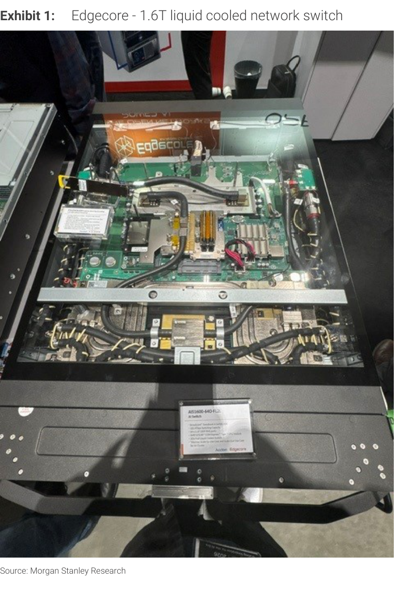

### 解讀摘要
Edgecore 在 OCP 展示基於 Broadcom Tomahawk 6（102.4Tbps，64×1.6T OSFP RHS ports）的 1.6T 液冷網路交換器，同時展出 CPO 版本——代表從主流插拔式光模組向 CPO 架構的過渡已有商品化展示。Edgecore 同時展出自有 LCOS 技術的 OCS（光路交換器）展示，說明該廠具備服務多種光架構客戶需求的能力。

---

## Exhibit 2｜Edgecore 1.6T 液冷交換器規格

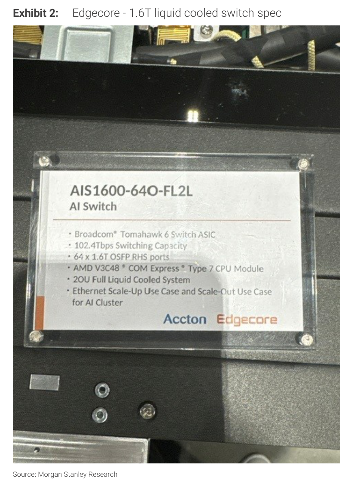

### 解讀摘要
規格牌顯示：型號 AIS1600-640-FL2L，Broadcom Tomahawk 6，102.4Tbps 總頻寬，64×1.6T OSFP RHS 端口，AMD V3C48 COM Express Type 7 CPU，2OU 全液冷系統。交換器本身改用液冷強調與高功率 AI 機架共存的熱管理需求——1.6T 交換器的功耗本身也在飆升，不只是伺服器端問題。

---

## Exhibit 3｜Credo 1.6T AEC

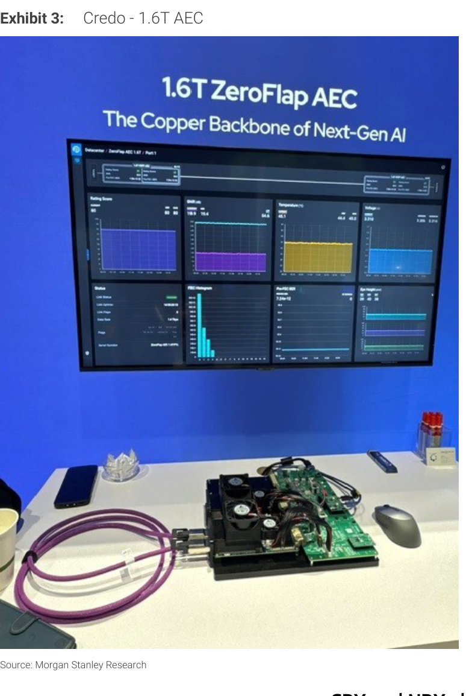

### 解讀摘要
Credo 展出 1.6T ZeroFlap AEC（Active Electrical Cable），為機架間（inter-tray）短距傳輸方案。MS 指出 Credo 未公布 3.2T AEC 路線圖，業界人士反映 3.2T AEC 技術挑戰極大，雖仍有開發努力。這意味著 1.6T AEC 將有較長的生命週期，對 Bizlink（Credo 組裝合作夥伴）的訂單能見度有利。

---

## Exhibit 4｜Credo PCIe Gen 6 AEC

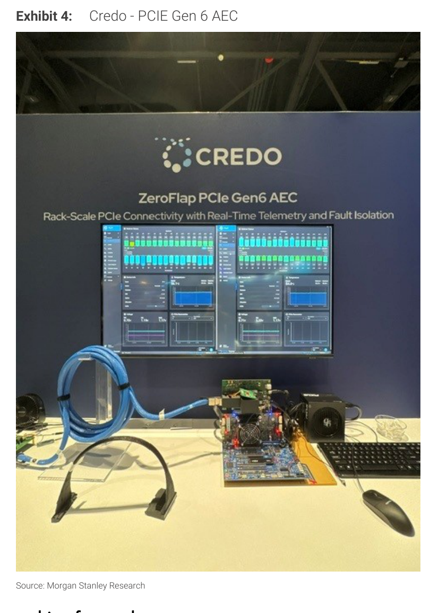

### 解讀摘要
Credo 展出 PCIe Gen 6 AEC，用於機架內（intra-rack）GPU-to-switch PCIe 傳輸。PCIe Gen 6（64GT/s）的 AEC 是因應 GB200 NVLink4/5 以外的 PCIe fabric 需求，代表 Credo 在 AEC 產品線的橫向延伸——不只是乙太網路傳輸，也覆蓋 CPU-GPU / GPU-switch 的短距高速連接。

---

## Exhibit 5｜CPO 優缺點分析（Nvidia 投影片）

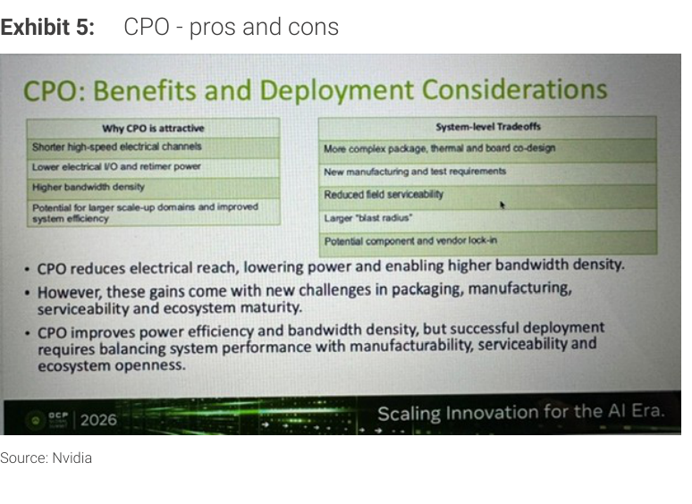

### 解讀摘要
Nvidia 投影片明確列出 CPO 的優點（功耗最低、最高集成度）與缺點（良率挑戰、服務性差、標準化不足）。這說明 Nvidia 自身也承認 CPO 的短期落地障礙——CPO 雖是「聖杯」但不是 2026 年的量產方案，近中期的需求將由 NPO/NPC/micro-VCSEL 等替代方案填補，支持 MS 的「多技術共存」觀點。

---

## Exhibit 6｜NPO 優勢（Huawei 投影片）

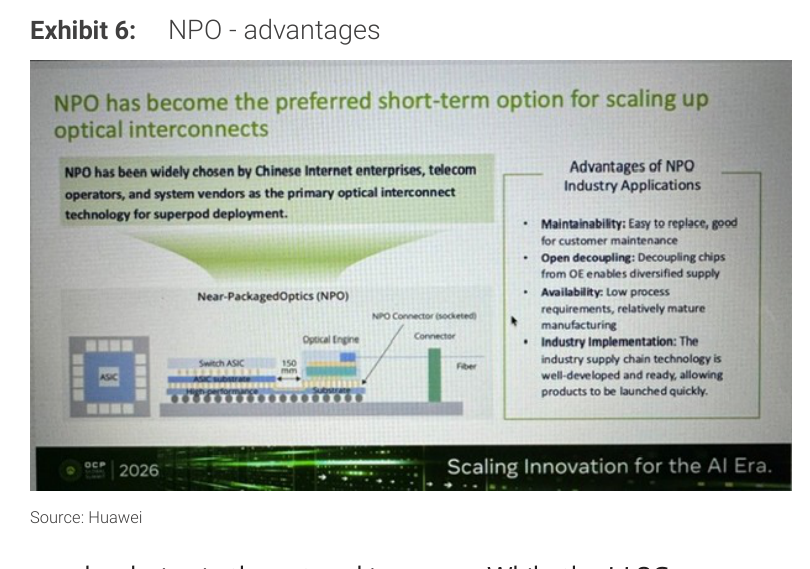

### 解讀摘要
Huawei 展出 NPO（Near-Packaged Optics）架構優勢：相比 CPO，NPO 在服務性、開放解耦、可維護性、可用性等方面表現更佳，同時保有接近 CPO 的功耗優勢。NPO 犧牲部分功耗（相比 CPO 略高），但換來更寬鬆的對準要求和更好的服務性，供應鏈也較 CPO 成熟——這是 MS 認為 NPO 近期落地前景優於 CPO 的核心依據。

---

## Exhibit 7｜Molex 448G CPC

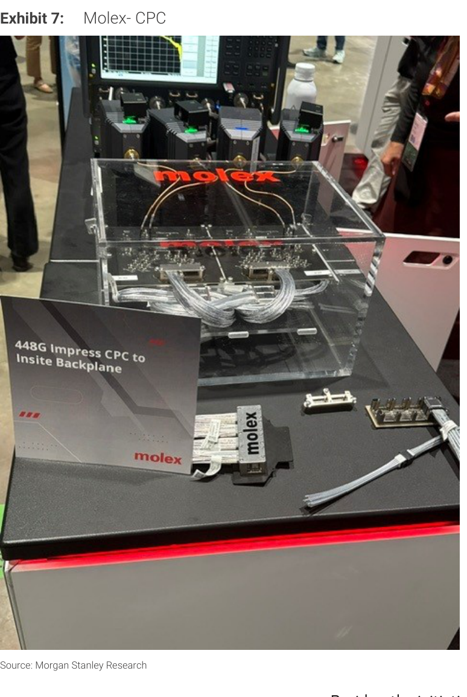

### 解讀摘要
Molex 展出 448G CPC（Co-Packaged Copper）方案，用於機箱內（intra-tray）前面板到晶片的短距連接（<1m）。448G 銅纜 lane 雖然距離受限，但在 intra-tray 場景完全夠用，且成本遠低於光纜。CPC 作為最低成本方案填補最短距離需求，與 CPO/NPO（最短距離）、AEC（inter-tray）和光模組（機架間）形成層次化的互補架構。

---

## Exhibit 8｜TE Connectivity 448G CPC

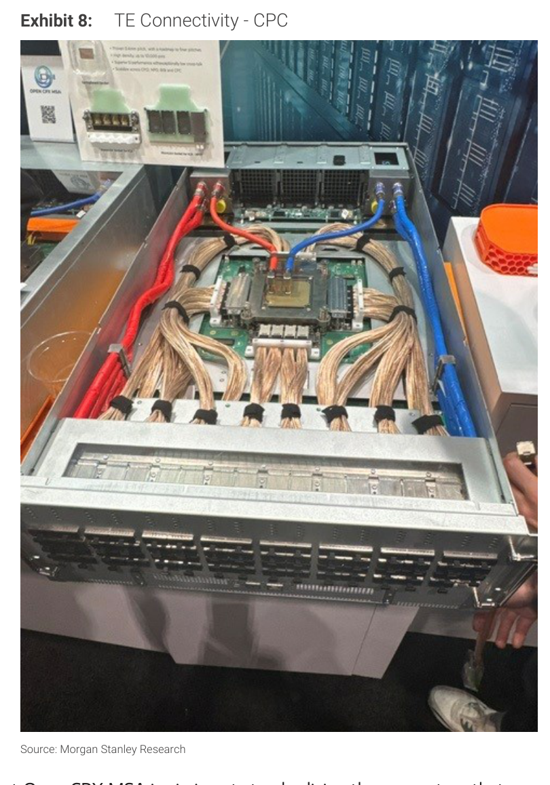

### 解讀摘要
TE Connectivity 展出 448G CPC 方案，同樣針對 intra-tray 應用。多家供應商（Molex、TE、Amphenol 等）同時推出 448G CPC 說明此技術需求有足夠規模——這是真實的市場機會，而非單一廠商試水，對整個 CPC 連接器供應商是正面信號。

---

## Exhibit 9｜Samtec SI-FLY CPX

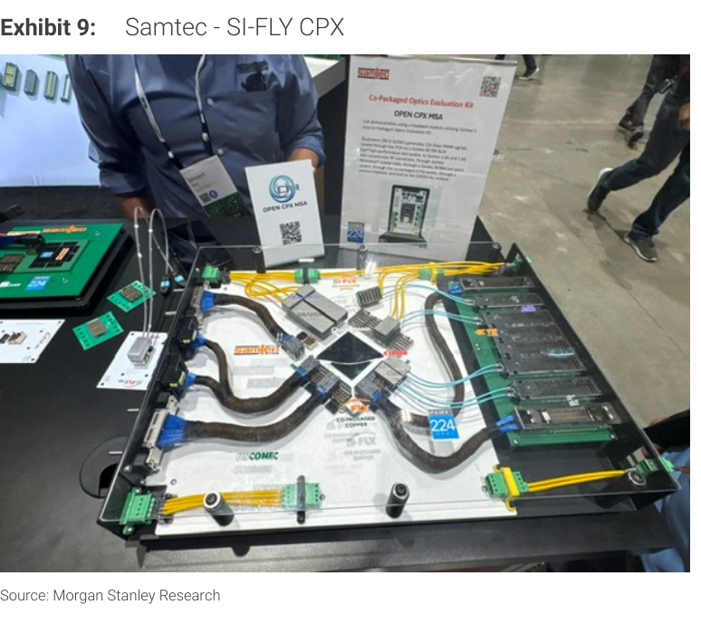

### 解讀摘要
Samtec 展出基於 Open CPX MSA 規格的 SI-FLY 連接器，旨在標準化 CPO/CPC 的插拔架構。CPX 標準化的意義：讓光引擎（optical engine）以可插拔方式整合至交換器 / 伺服器，降低 CPO 的服務性障礙，是推動 NPO 落地的關鍵基礎設施（CPX 連接器 = NPO 的「SFP 標準」類比）。

---

## Exhibit 10｜Ciena Vesta CPX

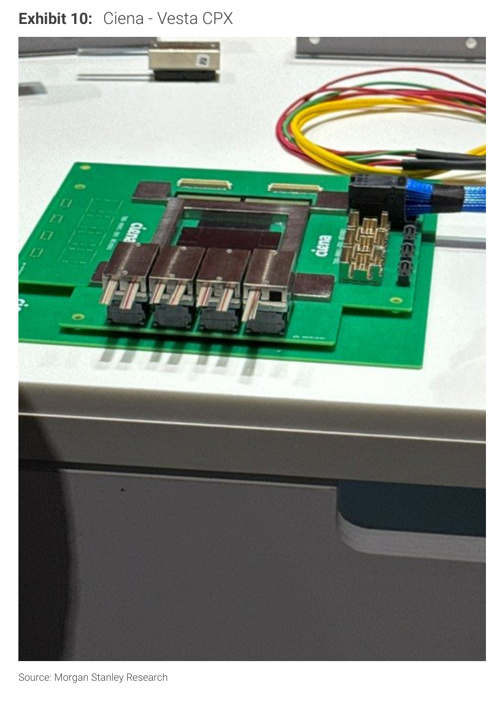

### 解讀摘要
Ciena 展出 Vesta CPX 光引擎，同樣基於 Open CPX MSA 規格，作為可插拔光學模組用於交換器 CPO 方案。Ciena 作為光網路設備領導廠參與 CPX 生態，加速 CPX 標準的合法性——這不只是新創公司的技術實驗，而是有成熟光學廠商背書的標準。

---

## Exhibit 11｜Alpha Networks CPX 網路交換器

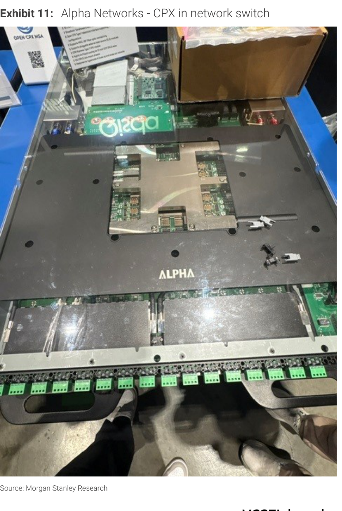

### 解讀摘要
Alpha Networks 展出基於 CPX 可插拔光學模組的網路交換器，是 CPX MSA 標準在實際產品中的落地案例。這說明台灣 ODM 廠商（Alpha Networks）已快速跟進 CPX 標準，有能力支援 CPO/NPO 架構的客戶需求，進一步驗證 CPX 的生態系統廣度。

---

## Exhibit 12｜ALAB PCIe over VCSEL NPO（展示台）

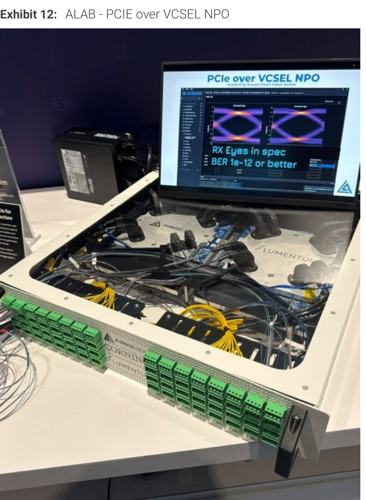

### 解讀摘要
Astera Labs（ALAB）展出 PCIe over VCSEL NPO 解決方案，使用 Scorpio Smart Fabric Switch，透過 VCSEL 光纖進行 PCIe 訊號傳輸。展示台標示「RX Eyes in spec, BER 1e-12 or better」說明訊號完整性已達商用水準——PCIe over VCSEL 是讓 GPU cluster 以光纖方式進行 scale-up 的關鍵技術，避免傳統 NVLink 的距離限制。

---

## Exhibit 13｜ALAB PCIe over VCSEL NPO（系統整合）

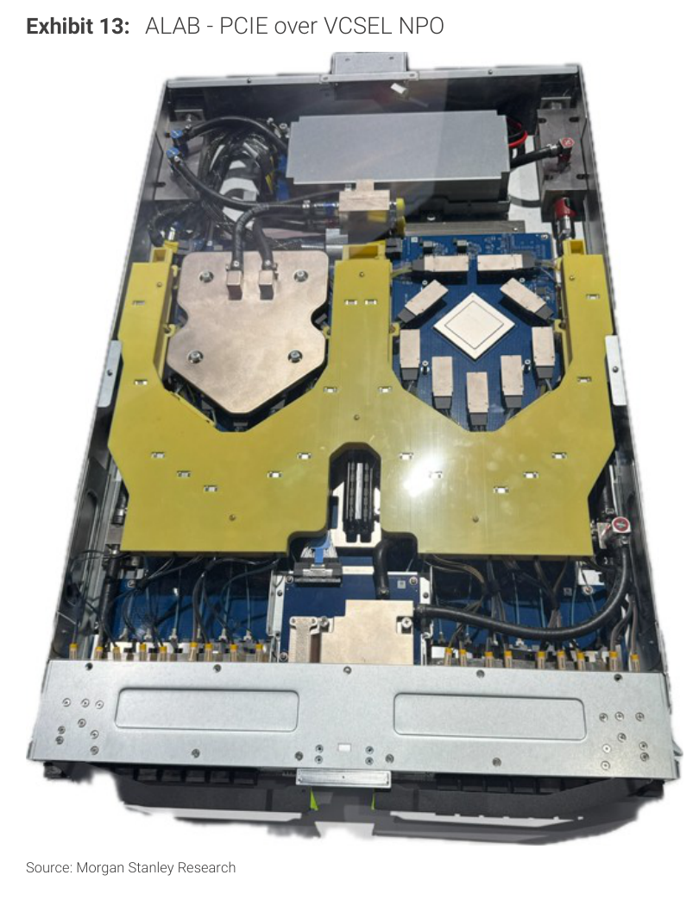

### 解讀摘要
ALAB 展示 PCIe over VCSEL NPO 在完整 AI server chassis 中的整合——從上方視角可見兩組金色液冷銅板覆蓋 GPU 晶片，側面和底部有大量黃色纖維連接器（VCSEL 光纜）密集插入。這張照片說明 PCIe over VCSEL 已不只是晶片或模組級展示，而是整台伺服器系統層面的整合，是 Exhibit 12 的互補視角。

---

## Exhibit 14｜Credo ALC 光纜

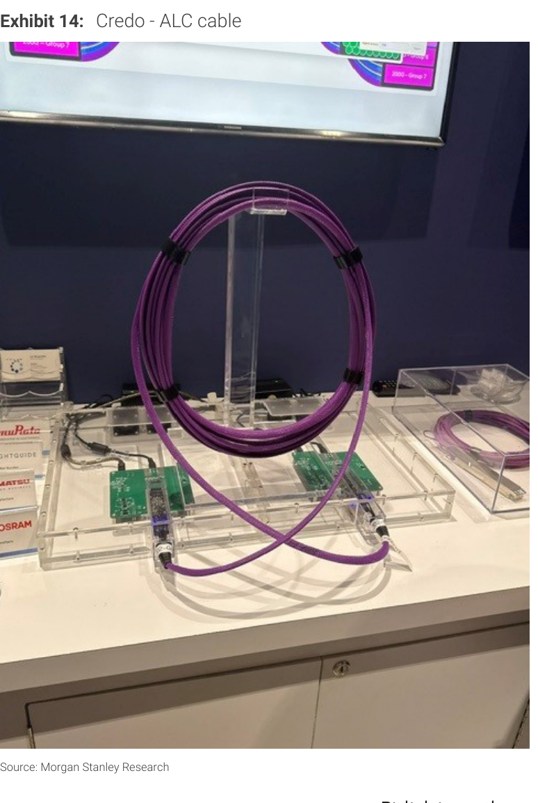

### 解讀摘要
Credo 展出 1.6T ZeroFlap ALC（Active Laser Cable）——基於 micro-VCSEL 的光學傳輸纜線，功耗 12W/end，傳輸距離 50m，可靠度等同銅纜（100M hours MTBF/MTBI）。ALC 是對 AEC 的光學替代方案：當銅纜因物理限制到達距離上限時（預計中期），ALC 可接手 50-100m 傳輸場景，Bizlink 為 Credo 的 AEC 組裝夥伴、預期也將是 ALC 組裝夥伴。

### 表格

| 規格 | Credo 1.6T ZeroFlap ALC |
|---|---|
| 技術 | Micro-VCSEL 主動光纜 |
| 速率 | 1.6T（每端） |
| 功耗 | 12W/end |
| 傳輸距離 | 50m |
| 可靠度 | 100M hours MTBF/MTBI（等同銅纜） |
| 目標場景 | Inter-tray 傳輸（替代 AEC） |

---

## Exhibit 15｜Credo ALC NPO 配置整合

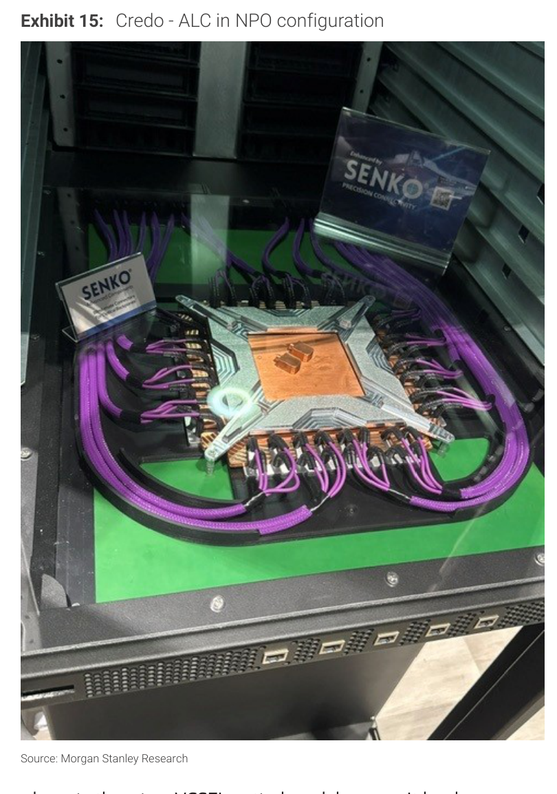

### 解讀摘要
展示 Credo ALC 在 NPO 配置下的實際整合——VCSEL 光纜（紫色，Senko 連接器）密集連接到 GPU 封裝旁的光引擎。這是 NPO 架構的實體展示：光引擎緊鄰晶片（Near-Packaged），用 ALC/光纜連接至外部，比傳統插拔式光模組功耗低，比 CPO 更容易服務和更換。

---

## Exhibit 16｜Bizlink Shuffle Box

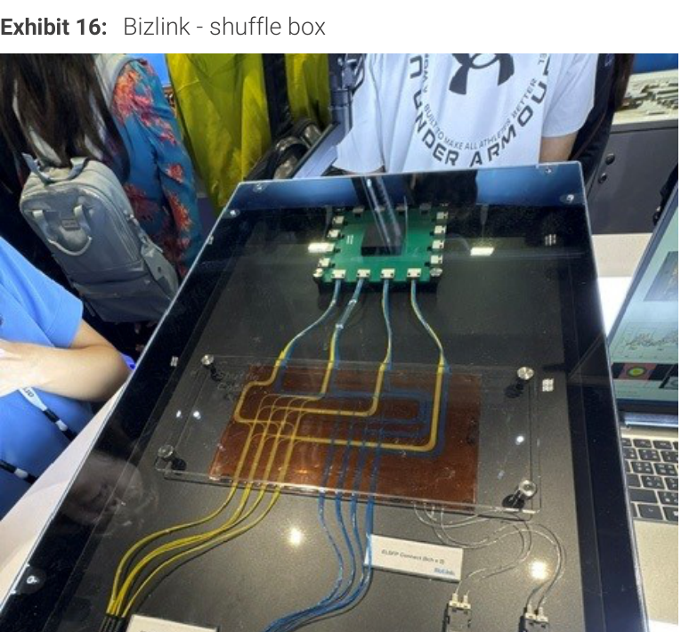

### 解讀摘要
Bizlink 展出 Shuffle Box——一個重新排列光纖路由的光學互連模組（ELMP Connector 8ch × 18，Bizlink 標注）。Shuffle Box 是 FAU（Fiber Array Unit）組裝生態系統的核心元件，負責將複數光纖按照特定順序重排後連接至光引擎或交換器，是 CPO/NPO 光纖互連系統中的關鍵基礎結構件。MS 指出 Bizlink 的長期策略是透過這些光學元件（Shuffle Box + FAU 對準/驗證）將資料互連業務從銅纜（AEC）擴展至光纜。

---

## Exhibit 17｜Bizlink FAU 對準與驗證能力

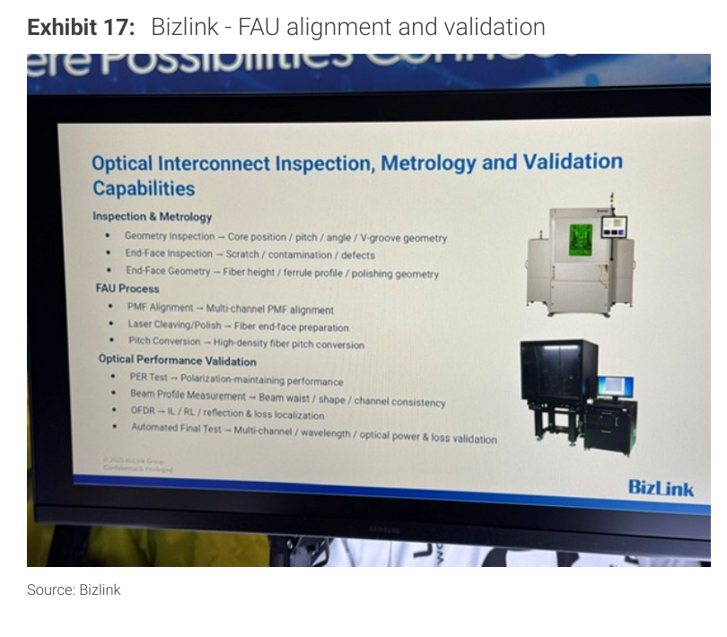

### 解讀摘要
Bizlink 展示其「光學互連檢測、量測與驗證能力」投影片，涵蓋幾何量測（纖芯位置/pitch/V-groove）、端面檢測、FAU 製程（PMF 對準、雷射切割拋光）、光學性能驗證（PER、光束輪廓、OFDR、最終多通道自動化測試）。這說明 Bizlink 不只是組裝代工，而是建立了完整的 FAU 品質管控與測試生態，形成護城河——FAU 對準精度直接決定 CPO/NPO 系統的良率，是 Bizlink 在光纜組裝中差異化的核心能力。

> **原文補充**：MS 指出 Bizlink 在 2026 年 9 月底已宣布與 ams-OSRAM 合作推出 micro-VCSEL 光學模組，Shuffle Box 和 FAU 對準是其進入光學互連的戰略基礎建設。Bizlink 的 AEC 組裝合作已與 Credo 持續多年，預期 ALC 也將延續合作。

---

## Exhibit 18｜800VDC 架構的功率效率優勢（Delta）

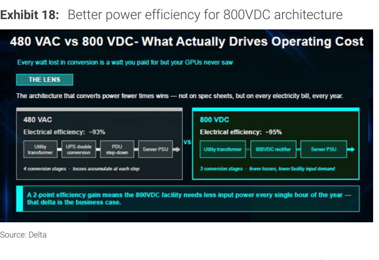

### 解讀摘要
Delta 投影片「480 VAC vs 800 VDC — What Actually Drives Operating Cost」：480VAC 有 4 個轉換級（效率 \~93%），800VDC 有 3 個轉換級（效率 \~95%）。每少一個轉換級 = 減少一次損耗累積——**少的那 2ppt 效率就是 800VDC 的商業案例**。Delta 和 Nvidia 的聯合 keynote 是 HVDC 採用的標誌性事件，說明這不只是技術討論而是主要設備商的商業承諾。

### 表格

| 架構 | 轉換級數 | 電氣效率 | 轉換路徑 |
|---|---|---|---|
| 480 VAC | 4 | \~93% | Utility transformer → UPS double conversion → PDU step-down → Server PSU |
| 800 VDC | 3 | \~95% | Utility transformer → 800VDC rectifier → Server PSU |
| **效率差** | **-1 級** | **+2ppt** | — |

---

## Exhibit 19｜800VDC 效率提升的成本節省換算（Delta）

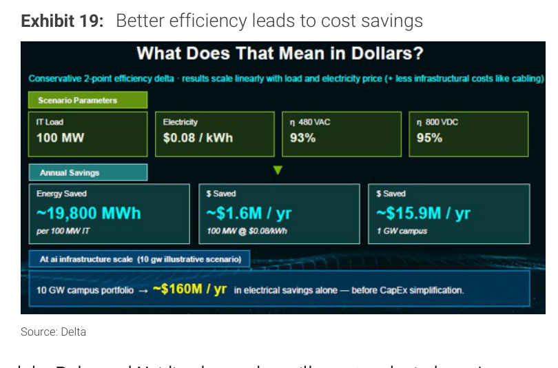

### 解讀摘要
Delta 量化 800VDC 的成本節省：IT Load 100 MW @ \$0.08/kWh，2ppt 效率差異 → 節省 \~19,800 MWh/yr → \~\$1.6M/yr（per 100 MW）、\~\$15.9M/yr（per 1 GW campus）。放大至 AI infrastructure scale（10 GW illustrative）→ \~\$160M/yr，且這只是電費節省，不含 CapEx 簡化的效益（更少 PDU、更少纜線等）。

### 表格

| 規模 | 年節電量 | 年省電費 |
|---|---|---|
| 100 MW IT campus | \~19,800 MWh | \~\$1.6M |
| 1 GW campus | \~198,000 MWh | \~\$15.9M |
| 10 GW（illustrative） | — | \~\$160M |

> **洞察一**：\$160M/yr（10 GW）聽起來大，但對 Amazon/Meta 等 2026E capex 達數百億美元的 CSP 而言，這個節省量在投資決策中仍屬邊際，HVDC 的採用驅動力更多是功率密度（物理必要性）而非純 ROI 計算。

---

## Exhibit 20｜800VDC 設備就緒路線圖（Delta）

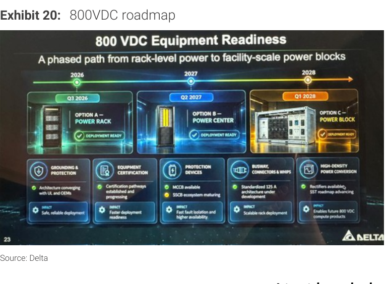

### 解讀摘要
Delta「800 VDC Equipment Readiness」路線圖：三個部署選項——Option A（Power Rack，Q3 2026，已可部署）、Option B（Power Center，Q2 2027，已可部署）、Option C（Power Block，Q1 2028，已可部署）。從機架到設施級的分階段路徑明確，且前兩個選項已在 2026 年內完成。MS 指出 800VDC 採用「late 2026 小規模、into 2027 擴展」與此路線圖吻合。

### 表格

| 部署選項 | 時程 | 就緒狀態 |
|---|---|---|
| Option A — Power Rack | Q3 2026 | ✅ Deployment Ready |
| Option B — Power Center | Q2 2027 | ✅ Deployment Ready |
| Option C — Power Block | Q1 2028 | ✅ Deployment Ready |

---

## Exhibit 21｜Vera Rubin 800VDC 參考設計（Delta）

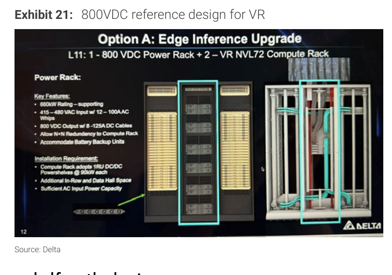

### 解讀摘要
Nvidia+Delta 參考設計「Option A: Edge Inference Upgrade」：1 台 660kW 800VDC Power Rack 支援 2 台 VR NVL72 Compute Rack（L11 配置）。電源機架關鍵規格：660kW 評定、415-480VAC 輸入（12×100A AC Whips）、800VDC 輸出（8×125A DC 纜線）、N+N 冗餘、支援 BBU。MS 認為此方案實際採用率可能偏低——因為 VR NVL72 本身已有機架內電源架（in-rack power shelf）設計，兩套設計並存，客戶會依場地空間/冗餘要求選擇。

---

## Exhibit 22｜液冷電源架（Megmeet）

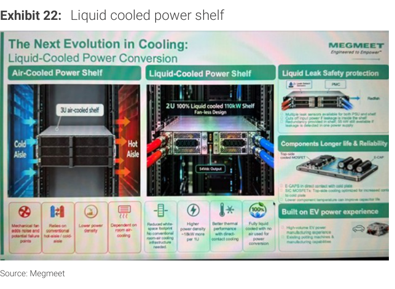

### 解讀摘要
Megmeet「The Next Evolution in Cooling: Liquid-Cooled Power Conversion」：傳統氣冷 3U 電源架 vs 液冷 2U 100% fanless 電源架（110kW，54Vdc 輸出）。液冷版縮小 1U 空間（3U→2U），功率密度提升（\>18kW per 1U），不需機房冷熱通道設計。元件方面：SiC MOSFET（頂面冷板冷卻）、E-CAP（直接接觸冷板）——液冷不只是機架熱管理，也提升元件壽命。

### 表格

| 項目 | 氣冷電源架 | 液冷電源架 |
|---|---|---|
| 高度 | 3U | 2U |
| 輸出功率 | — | 110kW |
| 冷卻方式 | 風扇 + 冷熱通道 | 100% 液冷，fanless |
| 功率密度 | — | \>18kW/1U |
| 機房基礎建設 | 需冷熱通道 | 無需冷熱通道 |

> **洞察一**：液冷電源架縮短 1U 對 Vera Rubin Ultra 代的意義——Rubin Ultra 因功耗升高需要更多 inter-rack scale-up 網路硬體佔用機架空間，液冷電源架釋放的 1U 是緩解機架空間壓力的關鍵槓桿。

---

## Exhibit 23｜液冷電源架在機架中的配置（Megmeet）

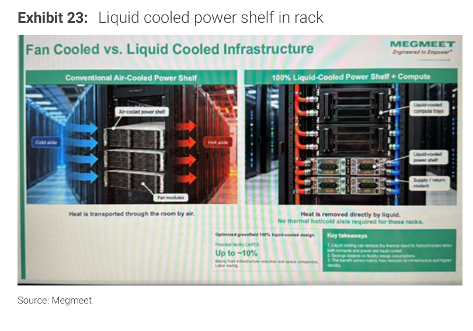

### 解讀摘要
Megmeet「Fan Cooled vs. Liquid Cooled Infrastructure」對比：氣冷方案需要冷熱通道（熱靠空氣通過機房散逸），液冷方案熱靠液體直接帶走（無需熱通道）。液冷設施 CAPEX 降至 \~10%（潛在節省：更少機房基礎建設、空間壓縮、人力節省）。Key takeaways：液冷可消除熱通道/冷通道需求；節省效益依設施設計假設而定；效益主要來自設施密度提升。

---

## Exhibit 24｜Nvidia MGX 800VDC 生態系統板（SST 廠商）

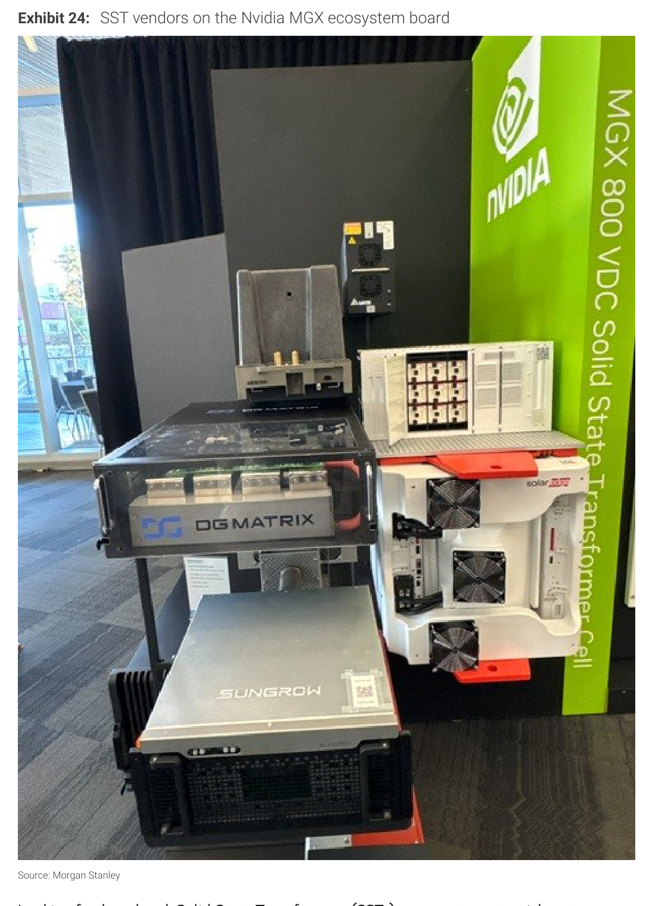

### 解讀摘要
OCP 現場，Nvidia MGX 800VDC Solid State Transformer Cell 展示板上，首次列出 SST 廠商：OGMatrix、Sungrow、SolarEdge（可見），以及 Delta、Heron、Megmeet、Luxshare（原文補充）。這是 SST 首次進入 Nvidia 正式推薦/生態系統廠商清單——象徵意義大於實際銷售，但 Nvidia 的官方認可能加速 CSP 與 SST 廠商的技術探討週期。

> **原文補充**：MS 指出此次 MGX 生態系統板的 SST 廠商包含 Delta、Heron、DG Matrix、Sungrow、SolarEdge、Megmeet、Luxshare 等。Delta 同時出現在 HVDC 電源機架和 SST 兩個類別，顯示其在電力架構轉型中的多點佈局。

---

## Exhibit 25｜SST 實現更高效電力輸送架構（Infineon）

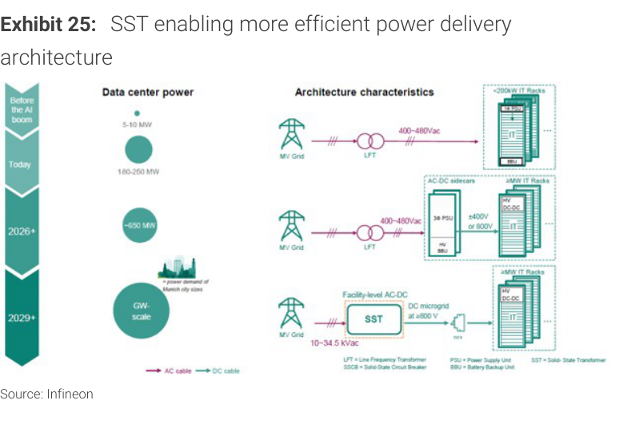

### 解讀摘要
Infineon 投影片展示 DC power 電力架構從小規模到 GW 級的演進：AI 前 5-10MW（LFT→400-480VAC）→ 今日 180-250MW（LFT→PSU/BBU at 400V 或 800V）→ 2026+ \~650MW（附加 AC-DC sidecars）→ 2029+ GW 級（SST 實現設施級 AC-DC microgrid at ≥800V）。SST 是從傳統 LFT+多級轉換跳到更高效的直流微電網的關鍵技術節點。

> **洞察一**：今日（180-250MW）到 2026+（\~650MW）的跳升是 AI capex 爆發直接反映，而 2029+（GW 級）的 SST 應用是 GW 級資料中心才需要的基礎建設——目前最大單體 DC 仍在幾百 MW 量級，SST 的大規模採用需要配套電力法規（高壓 DC 微電網）和施工認證，不只是技術問題。

---

## Exhibit 26｜SST 效率與空間/重量優勢

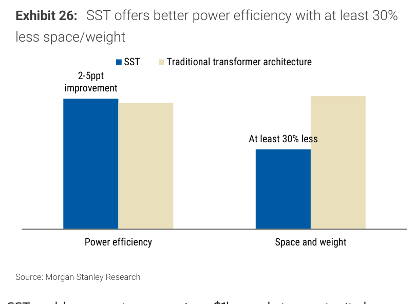

### 解讀摘要
SST vs 傳統變壓器的比較 bar chart：功率效率 +2-5ppt 改善，空間/重量至少減少 30%。這兩個指標都有量化依據（見 Exhibit 27 的 \~40x 輕、\~14x 小），說明 SST 的優勢不只在效率而是系統整合優勢——GW 級設施中變壓器是最笨重的設施元件，30%+ 的空間/重量節省直接影響建設工程量。

---

## Exhibit 27｜SST 2030 年初步採用（Infineon）

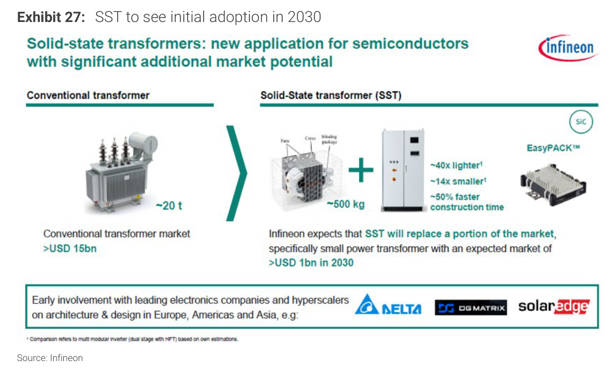

### 解讀摘要
Infineon 的 SST 市場化路線圖：傳統變壓器市場 >USD 15bn，SST 預期 2030 年替代部分（主要是小功率變壓器），市場規模 >USD 1bn。技術優勢：SST \~40x 輕（500kg vs 20t）、\~14x 小、\~50% 更快的施工時間。早期採用者已有 Delta、OGMatrix、SolarEdge 在 Nvidia MGX 生態系統中。SiC MOSFET（Infineon EasyPACK）為 SST 的核心功率器件。

### 表格

| 指標 | 傳統變壓器 | SST |
|---|---|---|
| 重量 | \~20t | \~500kg（\~40x 輕） |
| 尺寸 | — | \~14x 小 |
| 施工時間 | — | \~50% 更快 |
| 2030 市場規模 | >USD 15bn（整體） | >USD 1bn（SST 可觸及） |

> **洞察一**：SST >USD 1bn 的 2030 市場預估僅是 >USD 15bn 傳統變壓器市場的 \~6.7%——這是典型的「顛覆性技術初期斜率」，不需要大規模替代即可形成顯著新市場。SiC 是 SST 的關鍵受益材料，對功率半導體廠（Infineon、ON Semi 等）是長期增量應用。

---

## 相關個股清單

| 類別 | 公司 | Ticker | MS 評等 | 備註 |
|---|---|---|---|---|
| 線纜組裝 | 信邦 Bizlink | 3665.TW | — | Credo ALC/micro-VCSEL 組裝合作夥伴；Shuffle Box 生產 |
| 測試設備 | 致茂 Chroma | 2360.TW | — | 電源測試 + CPU/GPU/TPU SLT/FT + 光學測試（插拔/CPO） |
| 電源設備 | 台達電 Delta | 2308.TW | — | 800VDC 電源機架；液冷電源架；SST 生態系 |
| 電源設備 | 光寶科技 Lite-On | 2301.TW | — | AI cluster 電源受益者；HVDC 是上行催化劑 |
| 光模組（Credo 客戶） | Innolight、Eoptolink 等 | — | — | ALC 使用的 micro-VCSEL 供應鏈受益 |
| 連接器 | Molex、TE Connectivity | — | — | 448G CPC/NPC 受益 |
| CPX 光引擎 | Ciena（Vesta CPX） | CIEN.US | — | CPX MSA 參考廠商 |
| 交換器 | Edgecore Networks | 私有 | — | CPO/液冷 1.6T 交換器展示 |
| 功率半導體 | Infineon | IFX.DE | — | SST SiC EasyPACK 受益者 |
