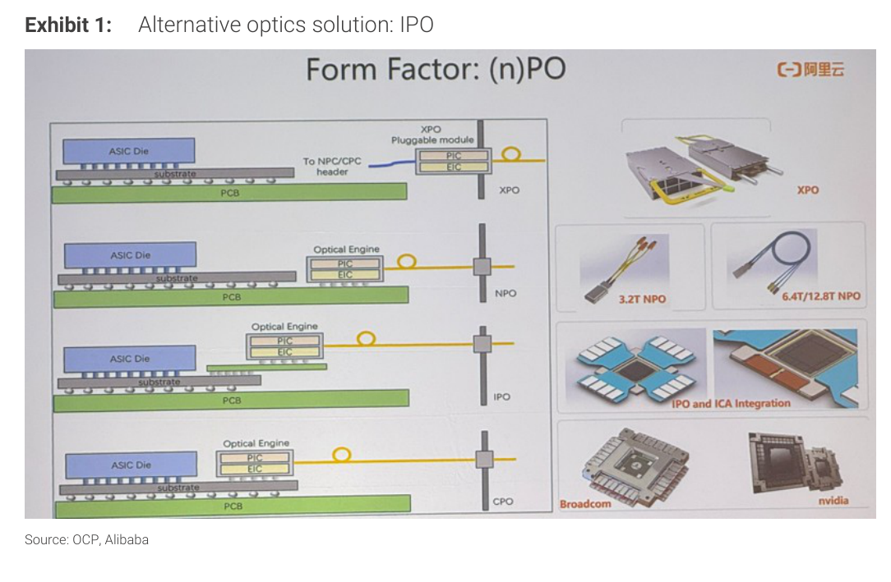
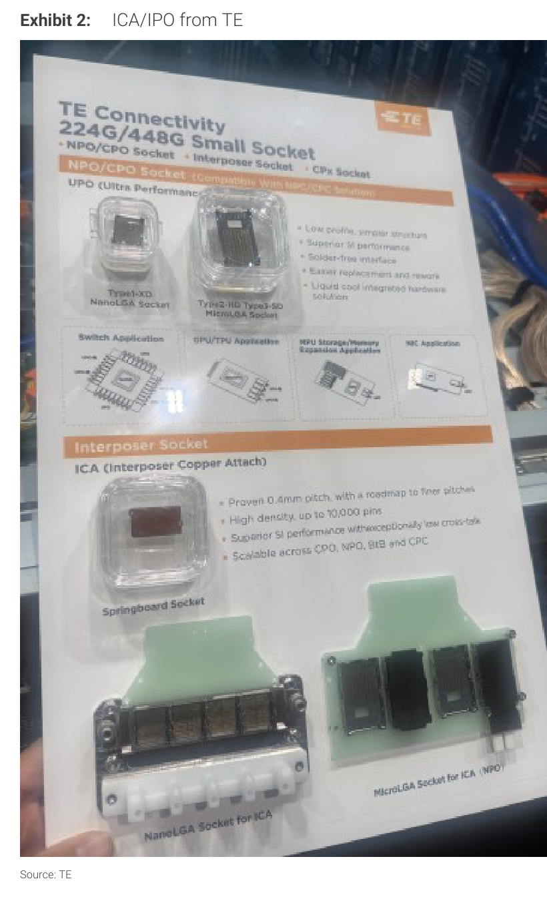
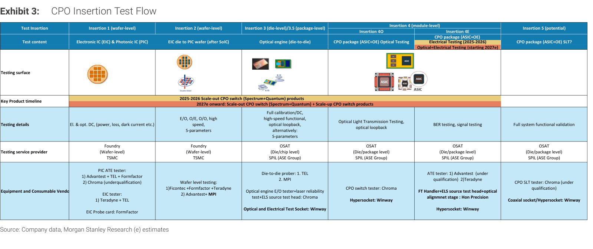

# Morgan Stanley｜OCP Wrap-up: Rising Optics and AI Infrastructure Alternatives

**券商**：Morgan Stanley  
**分析師**：Daniel Yen CFA、Charlie Chan、Daisy Dai CFA、Lucas Wang、Henry Zhao、Ethan Jia  
**日期**：2026-10-18  
**主題**：OCP Global Summit 2026 台美行程重點：ICA/IPO 進展、Marvell IMC vs Aspeed BMC、eMemory Caliptra/PUF、CXL+冷卻+運算加速  
**評級**：Attractive（Greater China Semiconductors）  
<a href="https://layx.uk/dl?g=產業&b=MS&d=20261018&h=OCP-Wrap-up">📎 下載 PDF</a>

---

## 報告總結

MS 分析師赴美參加 OCP Global Summit 後發布的三頁精簡概要，聚焦四大觀察：（1）ICA/IPO 光互連進展快速，TE Connectivity 的 0.4mm pitch ICA socket（最高 10,000 pin）確認量產路徑可行，2027 年有望大量生產；（2）Marvell IMC 定位在機架/集群層級遙測，不取代 Aspeed AST2700 節點層安全功能，消除市場對 AST2700 被替代的疑慮；（3）Caliptra 開放框架擴大 eMemory PUFsecurity 的矽層安全 IP 授權機會；（4）CXL 記憶體池化、散熱技術與 ASIC/CPU ramp 維持進度，Muse 有望推升儲存伺服器需求。受益排序：CPO 測試設備（Chroma、MPI、WinWay、翔名）直接受益最明確，Aspeed 競爭擔憂消除次之，eMemory 授權機會依賴 design win 時程。

---

## Morgan Stanley 完整投資邏輯鏈

| 論點層次 | Exhibit | 內容 |
|---|---|---|
| 光互連需求確認 | Exhibit 1 | Alibaba CPO 路徑圖：XPO→NPO→IPO→CPO，ICA 整合架構明確 |
| 供應鏈可行性 | Exhibit 2 | TE 224G/448G socket：0.4mm pitch、10,000 pin、三大介面標準已具象化 |
| 測試生態初步成形 | Exhibit 3 | CPO 五段 Insertion 測試：TSMC/SPIL 服務、Chroma/MPI/WinWay/翔名設備進入認證或量產 |
| 競爭格局釐清 | 報告封面 | Marvell IMC ≠ AST2700 替代；爭點移至 TPU/Axion 市占 |
| 安全 IP 擴張 | 報告封面 | Caliptra 框架確認 eMemory PUFsecurity 定位，授權機會增加 |
| **結論** | 報告封面 | **ICA/IPO 測試設備受益最直接；AST2700 競爭擔憂過度；eMemory 授權機會加速但有時程不確定性** |

> **報告最大邏輯缺口**：Muse 推升儲存需求的量級未有具體數字；eMemory 的授權收入高度依賴客戶 design win，無明確時間點。

---

## 報告核心觀點

| 主題 | Morgan Stanley 觀點 | 市場共識 | 是否 Contra-Consensus |
|---|---|---|---|
| ICA/IPO 時程 | 2027 年有望量產，TE socket 確認工程可行性 | 市場對 CPO/IPO 落地時程仍有疑慮 | 是，MS 偏樂觀 |
| Marvell IMC vs AST2700 | 互補而非替代，Aspeed 無生產問題 | 部分市場擔心 IMC 搶 AST2700 市場 | 是，消除擔憂 |
| eMemory Caliptra | PUFsecurity 受益 Caliptra 框架擴散 | 安全 IP 授權規模被低估 | 中性偏樂觀 |
| CPO 測試供應鏈 | Chroma/MPI/WinWay/翔名設備進入認證/量產 | 台灣測試設備廠受益被低估 | 是 |

**零件/個股偏好**：Chroma 致茂（2360.TW）、MPI 旺矽（6223.TW）、WinWay 萬潤、Hon Precision 翔名 > Aspeed 信驊（5274.TW）> eMemory 記憶科技（3529.TW）

---

## Exhibit 1｜Alternative optics solution: IPO

### 解讀摘要

Alibaba Cloud 在 OCP 展示的光互連技術路線圖，以 Form Factor 為維度排列五層架構：XPO（傳統可插拔）→ NPO（近端可插拔）→ IPO（互連器光學）→ CPO（共封裝光學），並附各層代表產品照片（3.2T NPO、6.4/12.8T NPO、IPO+ICA Integration、Broadcom/Nvidia CPO）。此圖的投資含義在於：中國最大 CSP 已將 IPO+ICA 正式納入光連接架構規劃，確認 ICA（銅互連接觸）整合路徑不是假設而是工程開發階段。每個新的形態層次都對應一套新的 insertion 測試需求，直接支撐 Exhibit 3 的測試設備受益邏輯。

> **原文補充**：MS 指出 ICA/IPO 的「成本仍是障礙」——相較 NPO，IPO+ICA 組裝複雜度及 socket 成本顯著更高；能否於規模量產後壓低成本至部署門檻是 2027 量產的關鍵不確定因素。MS 同時提示可參考其近期 CPO 報告（本文未列出報告名稱）取得更多細節。

---

## Exhibit 2｜ICA/IPO from TE

### 解讀摘要

TE Connectivity 展示的 224G/448G NPO/CPO socket 及 ICA socket 技術海報，揭示三個關鍵量化指標：0.4mm pitch（業界最密）、10,000 pins（高密度訊號整合）、支援 Springboard／NanoLGA／MicroLGA 三種標準介面。應用覆蓋 Switch（NPO/CPO）、GPU/TPU（HBM 接觸）、HPU Storage/Memory（NPC）。對投資人的意義在於：TE 的 ICA socket 規格已具象化到可規劃驗證流程，代表 ICA 從概念轉為工程開發品；台灣測試 socket 廠（如 WinWay）若能取得相容認證，將直接受益。

> **原文補充**：MS 原文強調 TE 解決方案的兩大賣點：低串擾（low crosstalk）與改善的可返工性（improved reworkability）。後者是模組級維修場景的關鍵優勢，也是 ICA 相較傳統 CPO 焊接方式的核心差異化——模組損壞可拆換而非整批報廢，降低系統層維修成本。

---

## Exhibit 3｜CPO Insertion Test Flow

### 解讀摘要

MS 整理的 CPO 五段 Insertion 測試流程表，完整呈現從晶圓到系統驗證的服務分工與設備清單。Insertion 1-2 為 TSMC 晶圓層（EIC + PIC die）；Insertion 3 為 SPIL OSAT 晶粒/封裝層；Insertion 4O/4E 為模組層（光學+電性分開，4O 從 2027 年才開始）；Insertion 5 為系統功能驗證（potential）。四家台灣設備廠覆蓋主要環節：Chroma 橫跨 Insertion 1/3/5、MPI 涵蓋 Insertion 2-3 晶圓/晶粒探針、WinWay 在 3/4O/4E 提供測試 socket 及 Hypersocket、翔名負責 4E FT Handler+ELS+光學對準。

### 表格

| Insertion | 層級 | 測試內容 | 服務商 | 台灣設備廠 |
|---|---|---|---|---|
| 1 | 晶圓（EIC & PIC） | El. & opt. DC（power, loss, dark current） | TSMC（foundry） | Chroma PIC ATE（認證中）；Advantest+TEL+FormFactor（EIC） |
| 2 | 晶圓（EIC die→PIC wafer, after SoIC） | E/O, O/E, O/O, high-speed, S-parameters | TSMC（foundry） | MPI（wafer-level 探針）；Ficontec+FormFactor+Teradyne |
| 3 | 晶粒/封裝（optical engine die-to-die） | Full calibration/DC, high-speed functional, optical loopback | SPIL（ASE Group, OSAT） | MPI（die-to-die prober）；WinWay（test sockets） |
| 4O | 模組（光學測試，starting 2027e） | Optical Light Transmission Testing, optical loopback | SPIL（ASE Group, OSAT） | WinWay（Optical+Electrical test socket, Hypersocket） |
| 4E | 模組（電性測試，2025-2026） | BER testing, signal testing | SPIL（ASE Group, OSAT） | 翔名 Hon Precision（FT Handler + ELS + optical alignment）；WinWay（socket） |
| 5 | 系統（potential） | Full system functional validation | SPIL（ASE Group, OSAT） | Chroma（CPO switch tester） |

### 洞察

> **洞察一**：Insertion 4O（光學模組測試）預計從 2027 年才開始，2025-2026 量產出貨以 4E（電性）為主，光學測試市場尚未打開。WinWay 和 Chroma 在光學測試的收入貢獻將呈現明顯時序：2026 財務貢獻主要來自 4E，2027 才有光學段增量。

> **洞察二**：Chroma 橫跨 Insertion 1（PIC ATE，認證中）、Insertion 3 光引擎 E/O tester、Insertion 5 CPO switch tester，是五段中覆蓋最廣的單一設備廠。若 Insertion 1 認證通過，Chroma 同時吃到晶圓層、光引擎層、系統層三段需求，潛在 TAM 遠大於只覆蓋單一 Insertion 的競爭者。

> **洞察三（配合 Exhibit 2）**：TE 的 ICA socket 支援 Insertion 3/4 的互連器接觸，WinWay 的 Hypersocket 是同層的競爭/互補方案。若 WinWay 與 TE ICA 規格取得相容，則在 Insertion 3-4 可同時供應雙方需求，集中度風險低於單一設備廠。

---

## 相關個股清單

| 類別 | 公司 | Ticker | 評等 | 備註 |
|---|---|---|---|---|
| BMC 晶片 | Aspeed 信驊 | 5274.TW | — | AST2700 無生產問題；競爭爭點移至 TPU/Axion 市占 |
| 安全 IP | eMemory 記憶科技 | 3529.TW | — | PUFsecurity/PUFrt 受益 Caliptra 框架；授權依賴 design win 時程 |
| CPO 測試設備 | Chroma 致茂 | 2360.TW | — | Insertion 1 PIC ATE（認證中）、光引擎 E/O tester、CPO switch tester |
| CPO 測試設備 | MPI 旺矽 | 6223.TW | — | Insertion 2 wafer-level + Insertion 3 die-to-die prober |
| CPO 測試 socket | WinWay 萬潤 | — | — | Insertion 3/4O/4E 光電測試 socket + Hypersocket；Key timeline 2025-2027e |
| CPO 測試設備 | Hon Precision 翔名 | — | — | Insertion 4E：FT Handler + ELS + optical alignment stage |
