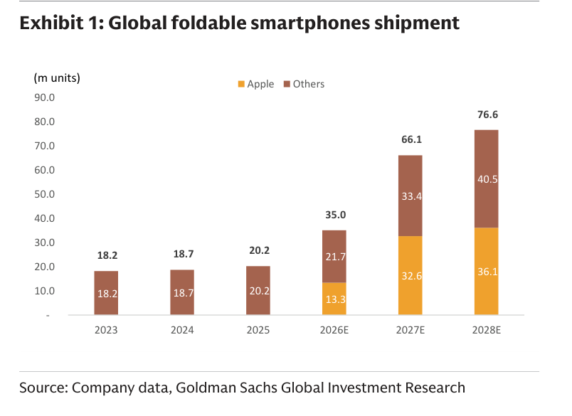
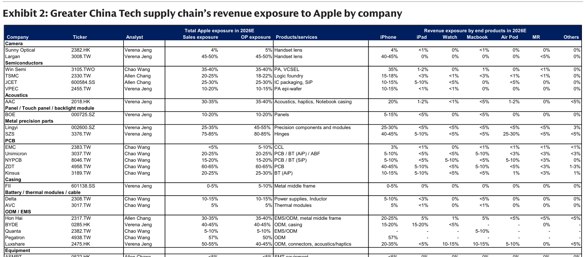

# Goldman Sachs｜GC Tech: iPhone Duo 折疊機強勁預購；新形態／高階機型吸引消費升級

**券商**：Goldman Sachs  
**分析師**：Allen Chang、Verena Jeng、Michael Ng CFA、Chao Wang  
**日期**：2026-10-19  
**主題**：iPhone Duo（Apple 首款折疊 iPhone）強勁預購驗證折疊機正向看法；Apple 大中華科技供應鏈受益梳理  
**評級**：Buy on supply chain（Hon Hai on CL, SZS, AVC, Lingyi, Luxshare, VPEC, FII, Largan, NYPCB on CL, EMC, ZDT, Kinsus, Delta, TSMC）  
<a href="https://layx.uk/dl?g=產業&b=GS&d=20261019&h=iPhone-Duo">📎 下載 PDF</a>

---

## 報告總結

iPhone Duo 於 2026 年 9 月正式發布，10 月 16 日開放預購後數分鐘內交期已推遲至明年，JD.com 和 Tmall 上線一分鐘即售罄。GS 認為這驗證了三個長期論點：（1）新形態創造新使用情境，5.4"/7.6" 折疊/展開尺寸適合單手持握和放入口袋，是史上最薄 iPhone，並支援 Apple Pencil；（2）消費持續向高階集中，全球折疊機均價從 US\$1,228（LTM 1Q25）升至 US\$1,392（LTM 2Q26），Huawei 佔 50% 市場且均價 US\$1,600；（3）領先品牌更能穿越景氣，iPhone 3Q26 出貨 +3% QoQ 逆市（市場 -8% QoQ）。GS 維持 2026/27E 折疊 iPhone 13m/33m 基本預測，藍天情境可達 35m/66m。供應鏈受益排序：SZS 鉸鏈曝險最高（Apple 佔銷售 75-85%），Lingyi 精密組件（45-55% OP 曝險），Luxshare/Hon Hai（ODM），Largan（鏡頭）。

---

## Goldman Sachs 完整投資邏輯鏈

| 論點層次 | Exhibit | 內容 |
|---|---|---|
| 需求驗證 | 報告封面 | 預購開放數分鐘即售罄，交期推遲至明年；JD/Tmall 一分鐘搶完 |
| 市場成長確認 | Exhibit 1 | 全球折疊機從 2025 年 20.2m 躍升至 2027E 66.1m（+3.3×），Apple 拿下 32.6m（49%） |
| 產品差異化 | 報告封面 | 100+ 精密鉸鏈零件、螢幕下相機、次世代 Vapor Chamber；起售 US\$1,999（低於三星 US\$2,099）|
| 供應鏈受益 | Exhibit 2 | SZS 鉸鏈 75-85%、Lingyi 精密 25-35%、ZDT PCB 60-65%、Pegatron ODM 57% Apple 收入曝險 |
| **結論** | 報告封面 | **Buy on CL：SZS（鉸鏈）、NYPCB（PCB on CL）、Hon Hai（ODM on CL）；Largan、Luxshare、Lingyi、AVC、Delta、TSMC** |

> **報告最大邏輯缺口**：藍天情境（35m/66m）的觸發條件未有明確量化定義（只說「up to」），基本預測（13m/33m）與藍天情境差距極大（2026E 差 2.7×），如何判斷何時往藍天靠攏不清楚。

---

## 報告核心觀點

| 主題 | Goldman Sachs 觀點 | 市場共識 | 是否 Contra-Consensus |
|---|---|---|---|
| iPhone Duo 出貨量 | 2026E 13m（基本），35m（藍天）；2027E 33m（基本），66m（藍天） | 市場已部分預期，但 13m vs 35m 差距反映不確定性仍高 | 中性 |
| 折疊機全球市場 | 2027E 66.1m，Apple 拿下 32.6m = 49% | Huawei 目前 50% 份額 → Apple 進場後市場整體擴大 | 是，Apple 進場擴大整體市場而非只搶 Huawei 份額 |
| SZS 鉸鏈曝險 | Apple 佔 SZS 銷售 75-85%，鉸鏈產品 iPhone 佔 40-45% + Watch 25-30% | SZS 最高受益者，市場已知 | 中性，但數字量化強調程度高 |
| 消費升級趨勢 | 折疊機 ASP US\$1,392（↑ from US\$1,228），帶動毛利優先 | 符合方向，幅度新資訊 | 中性 |

**受益排序（Apple 總曝險 Sales/OP）**：Pegatron 57%/50% > SZS 75-85%/80-85% > ZDT 60-65%/60-65% > Luxshare 50-55%/40-45% > BYDE 40-45%/40-45% > Win Semi 35-40%/35-40% > Hon Hai 30-35%/35-40% > Lingyi 25-35%/45-55%（OP 高！）> Largan 45-50%/45-50%

**GS 偏好（有評等且在 Buy 清單）**：Hon Hai（on CL）、SZS、AVC、Lingyi、Luxshare、VPEC、FII、Largan、NYPCB（on CL）、EMC、ZDT、Kinsus、Delta、TSMC

---

## Exhibit 1｜Global foldable smartphones shipment

### 解讀摘要

全球折疊手機出貨量在 Apple 進場前（2023-2025）年複合成長率僅約 5%（18.2m→20.2m），但 Apple 在 2026 年進場後市場呈現爆發式成長：2026E 35m（+73% YoY），2027E 66.1m（+89% YoY），2028E 76.6m（+16% YoY）。Apple 的進場不只是搶現有市場份額，而是帶動整體市場規模擴大——Apple 2026E 貢獻 13.3m 增量，但市場總量增加 14.8m，顯示 Apple 進場使其他品牌出貨也小幅成長（Others 從 20.2m 升至 21.7m）。2027E Apple 貢獻 32.6m（+19.3m YoY），Others 成長 11.7m → Apple 帶動市場擴張的乘數效應在 2027 年更加明顯。

### 表格

| 年份 | 市場總量（m units） | Apple | Others | Apple 市場份額 | YoY 成長 |
|---|---|---|---|---|---|
| 2023 | 18.2 | 0 | 18.2 | 0% | — |
| 2024 | 18.7 | 0 | 18.7 | 0% | +3% |
| 2025 | 20.2 | 0 | 20.2 | 0% | +8% |
| 2026E | 35.0 | 13.3 | 21.7 | 38% | +73% |
| 2027E | 66.1 | 32.6 | 33.4 | 49% | +89% |
| 2028E | 76.6 | 36.1 | 40.5 | 47% | +16% |

> **洞察一**：Apple 進場後 2026-27 的市場跳升幅度（+73%、+89%）遠超 GS 的 13m/33m 預測能解釋的增量——Others 也在同步成長，代表 GS 的論點「新形態創造新用例、帶動消費升級」已開始體現在非 Apple 品牌的出貨中。對供應鏈而言，這意味著 SZS（鉸鏈）等核心組件廠商的受益不只來自 iPhone Duo，也來自整個折疊機生態系的成長。

> **洞察二（值得驗證）**：GS 的基本預測（2026E 13m）vs 藍天情境（35m）相差 2.7×。報告未給出從基本到藍天的觸發條件。如果市場最終落在中間值（~24m），對供應鏈的量化影響截然不同。SZS 等高曝險廠商的估值應以情境加權看，而非預設某個點估計。

---

## Exhibit 2｜Greater China Tech supply chain's revenue exposure to Apple by company

### 解讀摘要

GS 整理的大中華科技供應鏈對 Apple 的收入曝險表，按產品線分拆（iPhone/iPad/Watch/Macbook/AirPod/MR/Others）。折疊 iPhone 相關度最高的廠商是：（1）SZS 新鉅科（鉸鏈）：總 Apple 收入 75-85%，其中 iPhone 40-45%、Watch 25-30%，Watch 的高曝險也顯示 SZS 在 Apple 精密鉸鏈的壟斷地位；（2）ZDT 臻鼎（PCB）：iPhone 佔總銷售 60-65%，其中 iPhone 40-45%，直接受益 Duo 折疊 PCB 複雜度提升；（3）Pegatron 和仁：iPhone ODM 57% 高度集中，若獲 Duo 組裝份額，受益直接。Lingyi 靈亦的 OP 曝險（45-55%）高於 Sales 曝險（25-35%），顯示 Apple 精密組件業務的毛利率高於公司其他業務。

### 表格（節錄高曝險廠商）

| 類別 | 公司 | Ticker | Apple Sales 曝險 | Apple OP 曝險 | 主要產品 | iPhone 曝險 |
|---|---|---|---|---|---|---|
| 精密機構件 | SZS 新鉅科 | 3376.TW | 75-85% | 80-85% | 鉸鏈 | 40-45% |
| 精密機構件 | Lingyi 靈亦 | 002600.SZ | 25-35% | **45-55%** | 精密組件和模組 | 25-30% |
| PCB | ZDT 臻鼎 | 4958.TW | 60-65% | 60-65% | PCB | 40-45% |
| ODM/EMS | Pegatron 和仁 | 4938.TW | 57% | 50% | ODM | 57% |
| ODM/EMS | Luxshare 立訊 | 2475.HK | 50-55% | 40-45% | ODM, 連接器, 聲學 | 20-35% |
| ODM/EMS | Hon Hai 鴻海 | 2317.TW | 30-35% | 35-40% | EMS/ODM, 金屬中框 | 20-25% |
| 光學鏡頭 | Largan 大立光 | 3008.TW | 45-50% | 45-50% | 鏡頭 | 40-45% |
| 半導體 | Win Semi 穩懋 | 3105.TWO | 35-40% | 35-40% | PA, VCSEL | 35% |
| 半導體 | TSMC 台積電 | 2330.TW | 20-25% | 18-22% | 晶圓代工 | 15-18% |
| PCB | Kinsus 景碩 | 3189.TW | 20-25% | 25-30% | BT (AiP) | 10-15% |

> **洞察三**：Lingyi 是表中 OP 曝險（45-55%）顯著高於 Sales 曝險（25-35%）的唯一廠商，差距達 20ppt。這表示 Apple 精密組件業務的毛利率顯著高於 Lingyi 的整體業務平均，市場若只看 Sales 曝險會低估 Apple 業績週期對 Lingyi 盈利彈性的影響。

> **洞察四（配合 Exhibit 1）**：SZS 的 Watch 曝險（25-30%）提供了折疊 iPhone 受益之外的第二層緩衝——即使 Duo 出貨不如預期，Apple Watch 仍持續貢獻鉸鏈需求。這使 SZS 的盈利波動性低於「純折疊機押注」，是供應鏈中風險報酬較平衡的選擇。

---

## 相關個股清單

| 類別 | 公司 | Ticker | GS 評等 | Apple 曝險 | 備註 |
|---|---|---|---|---|---|
| 鉸鏈（折疊機關鍵） | SZS 新鉅科 | 3376.TW | Buy | 75-85% | iPhone 40-45%+Watch 25-30%；折疊機最直接受益 |
| 精密機構件 | Lingyi 靈亦 | 002600.SZ | Buy | 25-35% sales / 45-55% OP | OP 曝險遠高於 Sales，高毛利率業務 |
| PCB | ZDT 臻鼎 | 4958.TW | Buy | 60-65% | iPhone PCB 40-45%，折疊機 PCB 複雜度提升 |
| PCB | NYPCB 南亞電路板 | 8046.TW | Buy（on CL） | 15-20% | BT (SiP) |
| PCB | Kinsus 景碩 | 3189.TW | Buy | 20-25% | BT (AiP) |
| ODM/EMS | Hon Hai 鴻海 | 2317.TW | Buy（on CL） | 30-35% | EMS/ODM + 金屬中框；Maia 300 ODM 潛在受益 |
| ODM/EMS | Luxshare 立訊 | 2475.HK | Buy | 50-55% | ODM + 連接器 + 聲學 |
| ODM/EMS | Pegatron 和仁 | 4938.TW | — | 57% | iPhone 57%；若取得 Duo 份額受益直接 |
| 光學鏡頭 | Largan 大立光 | 3008.TW | Buy | 45-50% | 折疊機鏡頭 |
| 散熱（Vapor Chamber） | AVC 奇鋐 | 3017.TW | Buy | 5% | Thermal modules；折疊機次世代 Vapor Chamber |
| CCL | EMC 台光電 | 2383.TW | Buy | <5% | CCL；Apple 曝險低但在 Buy 清單 |
| PA/VCSEL | VPEC 宏捷科 | 2455.TW | Buy | 10-20% | PA epi-wafer |
| 電源/感應 | Delta 台達電 | 2308.TW | Buy | 10-15% | Power supplies, Inductor |
| 晶圓代工 | TSMC 台積電 | 2330.TW | Buy | 20-25% | iPhone 15-18%；Apple Logic foundry |
