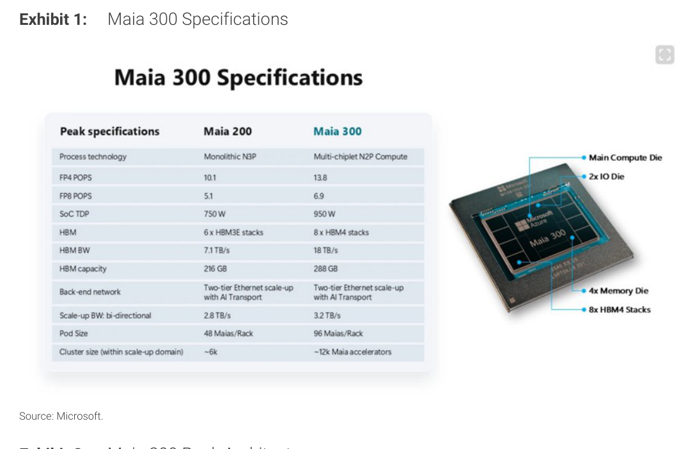
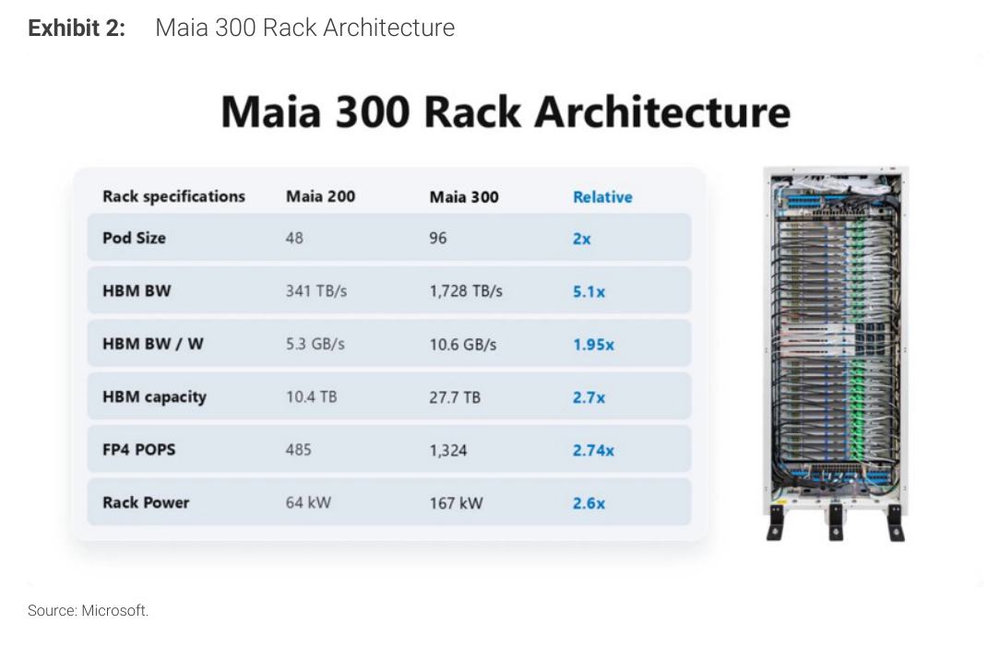
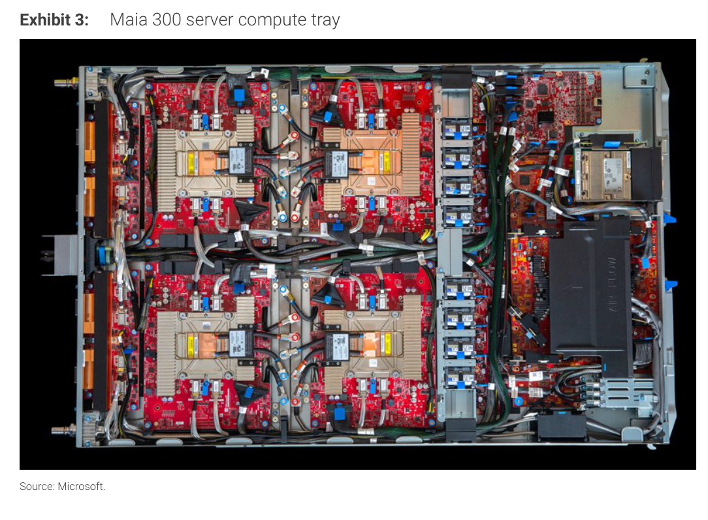
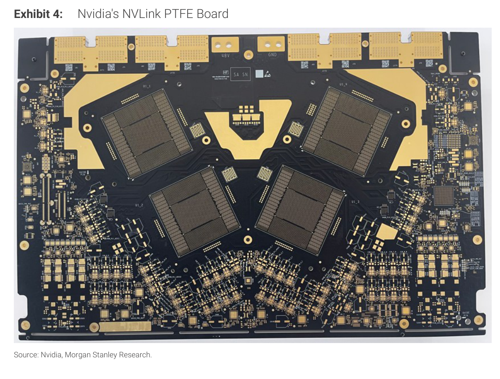
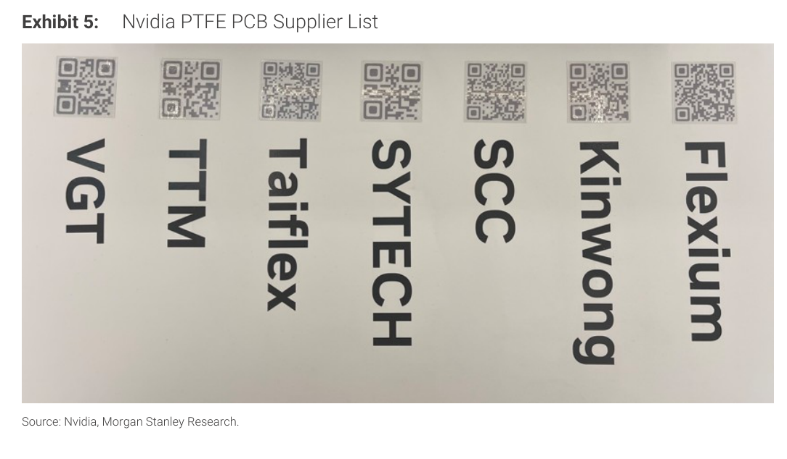
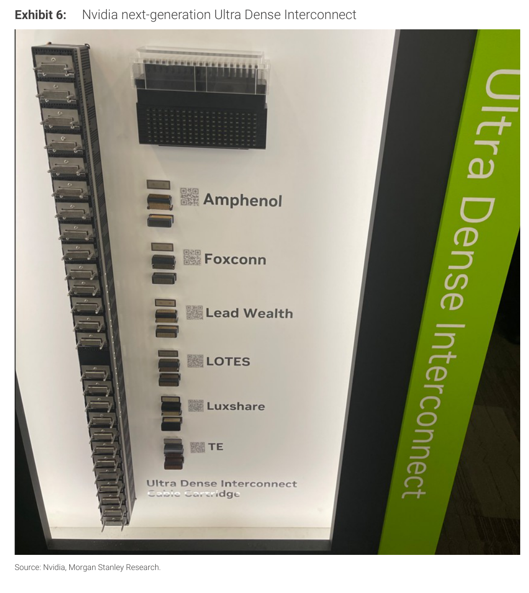
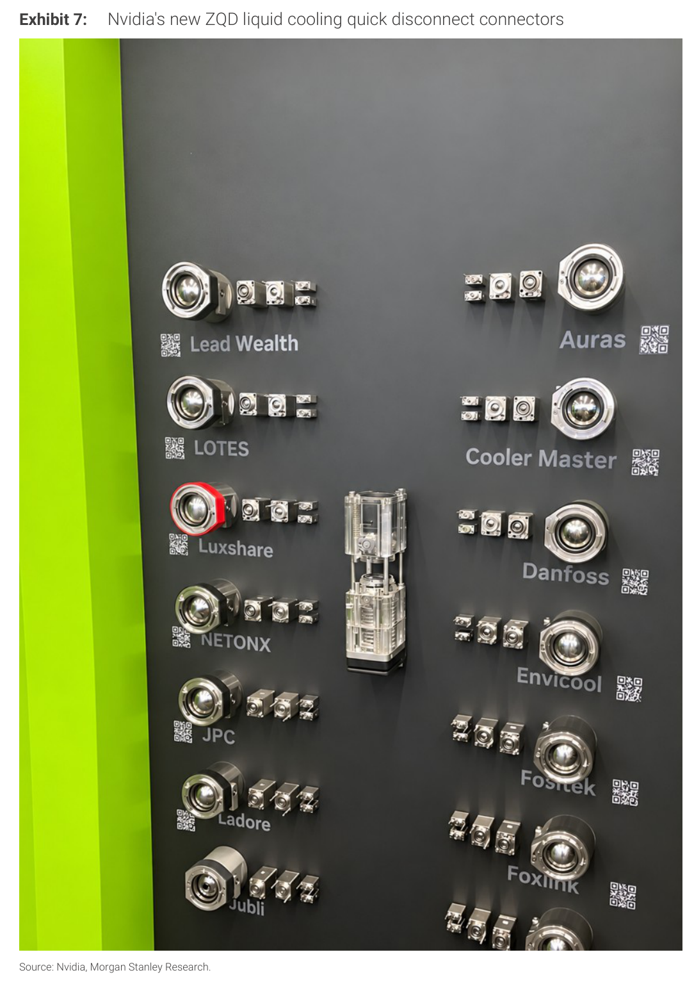

# Morgan Stanley｜OCP 2026 Summit – MGX Upgrades Take Shape; Maia 300 on Display

**券商**：Morgan Stanley  
**分析師**：Howard Kao、Irene Yen、Andy Meng CFA  
**日期**：2026-10-19  
**主題**：OCP Global Summit 2026 供應鏈觀察：Maia 300 首次亮相、Nvidia MGX 組件更新（PTFE PCB、Ultra Dense Interconnect、ZQD 液冷）、AMD Helios 供應商確認  
**評級**：In-Line（Greater China Technology Hardware）  
<a href="https://layx.uk/dl?g=產業&b=MS&d=20261019&h=OCP-MGX">📎 下載 PDF</a>

---

## 報告總結

MS 分析師現場參觀 OCP Global Summit 2026 後發布的供應鏈觀察筆記，聚焦四大主題：（1）Microsoft Maia 300 AI 加速器系統首次公開展示，96 加速器/機架、167 kW，2027 年量產，MS 確認 ISU Petasys（PCB）、AVC（風扇）、Fositek+Staubli（QD 連接器）為試生產供應商，Hon Hai 與 Wiwynn 為潛在 ODM；（2）Nvidia PTFE 材料評估：NVLink PTFE PCB 展示 7 家供應商，但 WUS PCB 與 Unimicron 未在展示名單中、Flexium 僅承接少數製程步驟，採用時程仍不確定；（3）Ultra Dense Interconnect（下一代 Kyber 中背板連接器）：6 家供應商，FIT 是 Kyber「Voronoi」板對板連接器的關鍵設計合作夥伴，量產仍約兩年；（4）ZQD 液冷 QD：14 家供應商，ASP 高於現行 QD（US\$20-30），設計複雜度維持定價優勢。整體硬體亮相與六月 Computex 差距不大，重點在供應商格局確認而非平台新意。

---

## Morgan Stanley 完整投資邏輯鏈

| 論點層次 | Exhibit | 內容 |
|---|---|---|
| 需求確認 | Exhibit 1-2 | Maia 300 規格大幅升級（HBM BW 5.1×、FP4 POPS 2.74×），微軟承諾 2027 多 GW 部署 |
| 供應鏈浮現 | Exhibit 3 | 試生產觀察確認 ISU Petasys（PCB）、AVC（風扇）、Fositek+Staubli（QD）為 Maia 300 供應商 |
| PTFE 材料競爭 | Exhibit 4-5 | 7 家公開供應商，但 Shennan/WUS/VGT 良率領先；WUS+Unimicron 未在公開名單 |
| 次世代連接器進度 | Exhibit 6 | Ultra Dense Interconnect 6 家展示；FIT 為 Kyber Voronoi 設計夥伴，量產仍約 2 年 |
| 液冷 QD 格局 | Exhibit 7 | ZQD 14 家供應商（含 Fositek、Auras），ASP 高於現行 QD，設計複雜度維持溢價 |
| **結論** | 報告封面 | **Maia 300 供應鏈受益最直接（ISU Petasys、AVC）；PTFE 採用不確定但 Shennan/WUS/VGT 領先；FIT 長線受益 Ultra Dense；ZQD 競爭較分散** |

> **報告最大邏輯缺口**：Maia 300 供應商為「觀察」而非確認，MS 無法排除正式量產時供應商改變的可能；PTFE 採用時程完全不確定（Rubin Ultra on Oberon 原本計畫的 Kyber 架構已延遲），報告對此明確給出「uncertain」。

---

## 報告核心觀點

| 主題 | Morgan Stanley 觀點 | 市場共識 | 是否 Contra-Consensus |
|---|---|---|---|
| Maia 300 部署規模 | 每 GW 部署約 5-5.5K 機架（167 kW/rack，PUE 1.1-1.2），2027 年量產 | 市場對 Maia 300 規格已有初步認知 | 中性，數字量化是新資訊 |
| PTFE 供應商揭露 | WUS PCB 與 Unimicron 未在 Nvidia 公開名單，Flexium 僅做少數步驟 | 部分市場認為 7 家展示 = 7 家均等受益 | 是，MS 指出公開名單不完整且內部良率差異大 |
| Ultra Dense Interconnect | FIT 是 Kyber Voronoi 設計夥伴，但量產仍 ~2 年；ASP 目標 <US\$100，目前 pogo pin 為瓶頸 | 市場知道 FIT 有次代連接器機會，但時程不確定 | 中性，FIT 地位再確認 |
| ZQD 競爭格局 | 14 家供應商，較預期分散；Fositek、Auras 均在列 | Fositek 為 QD 主要供應商地位不動搖 | 是，ZQD 比 QD 競爭更分散 |
| AMD Helios PCB | Shennan Circuits 為 MI455 Helios EAM PCB 試生產供應商 | 未見廣泛揭露 | 是，新資訊 |

**供應鏈受益排序**：ISU Petasys（Maia 300 加速器 PCB，試建確認）> AVC（Maia 300 風扇，試建確認）> FIT（Voronoi 設計夥伴，長線）> Shennan Circuits（PTFE PCB 良率領先 + Helios EAM PCB）≈ Fositek（Maia 300 QD + ZQD 供應商）> Auras（ZQD 供應商）

---

## Exhibit 1｜Maia 300 Specifications

### 解讀摘要

Maia 300 相較 Maia 200 在所有關鍵指標均有大幅提升，其中 HBM BW 從 7.1 TB/s 升至 18 TB/s（+2.5×），HBM 採用 HBM4（8 stacks × 288 GB 總容量），SoC TDP 增至 950 W（+200W），製程從 TSMC N3P 整塊晶片改為 N2P 多晶粒設計（1 主計算晶粒 + 2 IO Die + 4 Memory Die）。Pod Size 從每機架 48 Maia 加速器倍增至 96，意味著相同機架能容納兩倍計算密度，這對資料中心機架成本攤提有直接意義。Scale-up 叢集規模從 ~6k 擴展至 ~12k 加速器，配合 Two-tier Ethernet + AI Transport 後端網絡，顯示微軟繼續沿用自研網路架構而非 NVLink。

### 表格

| 指標 | Maia 200 | Maia 300 |
|---|---|---|
| 製程技術 | Monolithic N3P | Multi-chiplet N2P Compute |
| FP4 POPS | 10.1 | 13.8 |
| FP8 POPS | 5.1 | 6.9 |
| SoC TDP | 750 W | 950 W |
| HBM | 6× HBM3E stacks | 8× HBM4 stacks |
| HBM BW | 7.1 TB/s | 18 TB/s |
| HBM 容量 | 216 GB | 288 GB |
| 後端網路 | Two-tier Ethernet + AI Transport | Two-tier Ethernet + AI Transport |
| Scale-up BW（雙向） | 2.8 TB/s | 3.2 TB/s |
| Pod Size（加速器/機架） | 48 | 96 |
| Cluster size（scale-up 域） | ~6k | ~12k 加速器 |

> **洞察一**：N2P 多晶粒設計（1 主計算晶粒 + 2 IO Die + 4 Memory Die）是 Maia 300 突破 Maia 200 良率限制的關鍵——整塊晶片的 N3P 設計受限於晶粒尺寸良率，而多晶粒設計可獨立測試各子晶粒後再組裝，這也解釋了為何每機架加速器數量能直接翻倍（48→96）而非受良率壓縮。

---

## Exhibit 2｜Maia 300 Rack Architecture

### 解讀摘要

機架層級的規格比較揭示 Maia 300 比 Maia 200 的 HBM BW 提升最明顯（5.1×），遠超計算能力提升（FP4 POPS 2.74×），這反映 Maia 300 的設計重心是記憶體頻寬密集型的推論工作負載（長上下文、對話 AI、多步驟 Agentic）。機架功耗從 64 kW 升至 167 kW（2.6×），高於加速器數量增加比例（2×），反映每顆加速器 TDP 更高（950 W vs 750 W）加上機架散熱基礎設施（液冷）的功耗增量。

### 表格

| 指標 | Maia 200 機架 | Maia 300 機架 | 倍數 |
|---|---|---|---|
| Pod Size（加速器數） | 48 | 96 | 2× |
| HBM BW | 341 TB/s | 1,728 TB/s | 5.1× |
| HBM BW / W | 5.3 GB/s | 10.6 GB/s | 1.95× |
| HBM 容量 | 10.4 TB | 27.7 TB | 2.7× |
| FP4 POPS | 485 | 1,324 | 2.74× |
| 機架功耗 | 64 kW | 167 kW | 2.6× |

> **洞察二**：HBM BW/W（每瓦記憶體頻寬）提升 1.95×，代表記憶體存取效率大幅進步，與微軟宣稱「比主流 GPU 系統多 40% tokens/MW」呼應——HBM4 的更低存取延遲與更高頻寬效率是核心競爭力來源，而非純粹靠 POPS 堆疊。

> **洞察三（配合 Exhibit 1）**：每 GW 部署量（文中提及）= 167 kW/rack × PUE 1.1-1.2 → 每 GW 約 5,000-5,500 機架。相比 Maia 200（64 kW/rack），同等部署規模下所需機架數減少 2.6×，代表機架設計本身就是降低資料中心 capex 的槓桿之一。

---

## Exhibit 3｜Maia 300 server compute tray

### 解讀摘要

Maia 300 計算托盤的實物照片，顯示每個托盤承載 4 顆加速器，配備 8 個風扇（AVC 為 MS 觀察到的試生產風扇供應商）。機架共 24 個計算托盤（96 加速器 ÷ 4 加速器/托盤），另有 3 個液冷交換器托盤（6 個高基數交換 ASIC）。照片可見高密度紅色 PCB、大型散熱板（加速器位置）、多個液冷管路，以及右側推測為交換器托盤的模組。

> **原文補充**：微軟聲稱 Maia 300 機架層級 token 吞吐量為 Maia 200 的 7×，但 MS 指出這個比較包含了加速器數量增加（2×）的因素，純效率提升實際上低於 7×。此外，液冷設計移除超過 80% 的機架熱量，顯示高密度 AI 系統的液冷覆蓋率已成為架構規格而非選配。

> **洞察四**：每托盤 8 個風扇、24 個計算托盤 = 全機架 192 個風扇位置，AVC 若能成為主供應商，Maia 300 每機架的風扇內容量估計顯著高於一般雲端伺服器。加上 MS 提到微軟計畫 multi-GW 部署，5,000-5,500 racks/GW × 192 fans = 約 96-106 萬顆風扇/GW，對 AVC 量級而言是可觀的增量需求。

---

## Exhibit 4｜Nvidia's NVLink PTFE Board

### 解讀摘要

Nvidia 在 OCP 展示的 NVLink PTFE PCB 實體板，高層數設計（多個 GPU 座位、複雜走線），用於 Rubin Ultra on Oberon 中背板。PTFE 的主要技術優勢是最低的介電常數（Dk）和損耗因數（Df）、電氣特性跨頻率/溫度穩定、吸濕率低，對高層數、高速互連（NVLink）的插入損耗控制至關重要。然而 PTFE 的加工難度（柔軟、不易鑽孔、銅附著需特殊活化步驟）和成本是商業化障礙。

> **原文補充**：MS 明確指出 Nvidia 原計畫在 Kyber 架構使用 PTFE，但 Kyber 延遲後，PTFE 評估重心轉移至 Rubin Ultra on Oberon。這意味著 PTFE 的商業採用時程取決於 Rubin Ultra 最終採用哪種 CCL 方案，而 MS 的供應鏈調查顯示「adoption remains uncertain」。PTFE 同時也降低對 Q glass（供應緊張的高頻 CCL 添加物）的依賴，是一個額外的供應鏈安全性賣點。

---

## Exhibit 5｜Nvidia PTFE PCB Supplier List

### 解讀摘要

Nvidia 的公開 PTFE PCB 展示名單：VGT、TTM、Taiflex（Exhibit 中顯示為「Taiflex」）、SYTECH、SCC（Shennan Circuits）、Kinwong、Flexium，共 7 家。然而這份公開名單不等於真實的供應商競爭格局：MS 調查顯示 WUS PCB 和 Unimicron 也在參與開發但未列入公開展示；Flexium 在列但 MS 認為其僅協助少數製程步驟（而非主力製板商）；Shennan Circuits、WUS PCB、VGT 是良率相對領先的三家。市場若把公開展示的 7 家視為均等受益，將高估 Flexium、Taiflex、Kinwong 的曝險。

### 表格

| 公開展示名單 | MS 調查補充 | 良率評估 |
|---|---|---|
| VGT | 在列 | 領先 |
| TTM | 在列 | — |
| Taiflex | 在列 | — |
| SYTECH | 在列 | — |
| SCC（Shennan Circuits）| 在列 | 領先 |
| Kinwong | 在列 | — |
| Flexium | 在列，但僅做少數製程步驟 | — |
| WUS PCB | **未在公開名單** | 領先 |
| Unimicron | **未在公開名單** | — |

> **洞察五（Contra-Consensus）**：公開展示名單的最大資訊不對稱在於「不在名單的也是重要玩家」：WUS PCB 和 Unimicron 未在 Nvidia 展位公開露出，但 MS 的供應鏈調查確認兩者都在開發中，WUS PCB 甚至良率領先。Flexium 在名單中但 MS 降格為「部分製程供應商」，投資人若以名單定義受益範圍將誤讀競爭格局。

---

## Exhibit 6｜Nvidia next-generation Ultra Dense Interconnect

### 解讀摘要

Nvidia 展示的下一代「Ultra Dense Interconnect」連接器，用於替代目前 VR200 NVL72 中背板和 Cable Cartridge 所使用的 Amphenol Paladin HD2 連接器。6 家公開供應商：Amphenol、Foxconn、Lead Wealth、LOTES、Luxshare、TE Connectivity。MS 此次為首次親眼見到實物。關鍵約束：（1）pogo pin 供應是目前瓶頸，（2）ASP 目標需壓低至 US\$100 以下，（3）量產仍約兩年（~2028 年）。FIT 雖未在此公開名單，但 MS 的調查確認 FIT 是 Kyber「Voronoi」板對板連接器的關鍵設計合作夥伴，供應份額前景看好。

### 表格

| 展示供應商 | FIT 地位 |
|---|---|
| Amphenol（現 HD2 供應商）| 設計合作夥伴（Voronoi），未在公開名單 |
| Foxconn | — |
| Lead Wealth | — |
| LOTES | — |
| Luxshare | — |
| TE Connectivity | — |

> **洞察六**：FIT 在 Ultra Dense Interconnect / Voronoi 的「design partner」地位重要性在於：競爭格局初期設計合作夥伴通常具備先行者優勢，決定最終規格的廠商在量產時較易取得較高份額。2 年後時程雖長，但投資人若等到量產確認才佈局，可能已錯過估值重新定價的窗口。目前 HD2 ASP 約 US\$70-90+/set，Ultra Dense 若維持在 US\$100 以下，內容量與 HD2 差距不大。

---

## Exhibit 7｜Nvidia's new ZQD liquid cooling quick disconnect connectors

### 解讀摘要

Nvidia 展示的 ZQD（Zero-leak Quick Disconnect）新款液冷快拆連接器，目標是在相同面積達到更高流量密度（higher flow rates per unit area），對應 AI 機架功耗持續提升後的散熱需求。14 家公開供應商，包括 Lead Wealth、LOTES、Luxshare、NETONX、JPC、Ladore、Jubli（左欄）及 Auras、Cooler Master、Danfoss、Envicool、Fositek、Foxlink 和另外一家（右欄）。台灣廠商在列：Auras（3324.TWO）、Fositek（6805.TW）。MS 預期 ZQD 的 ASP 將高於現行 QD（US\$20-30），因設計複雜度更高；但 14 家供應商的數量顯示競爭格局比現行 QD 市場更為分散。

### 表格

| 供應商 | 市場 | 備註 |
|---|---|---|
| Lead Wealth | — | — |
| LOTES | 台灣 | 3533.TW |
| Luxshare | 中國 | — |
| NETONX | — | — |
| JPC | — | — |
| Ladore | — | — |
| Jubli | — | — |
| Auras（台灣奧斯達）| 台灣 | 3324.TWO |
| Cooler Master | — | — |
| Danfoss | 丹麥 | 工業液冷大廠 |
| Envicool | 中國 | — |
| Fositek | 台灣 | 6805.TW |
| Foxlink | 台灣 | — |
| （第 14 家未識別）| — | 圖片右下切邊 |

> **洞察七**：14 家 ZQD 供應商 vs 現行 QD 市場 Fositek 的龍頭地位，顯示 Nvidia 刻意在次世代規格引入更多競爭，避免對單一供應商的依賴。這對 Fositek 的長期 ZQD 份額構成溫和下行風險，但短期內其製程成熟度（已是現行 QD 主供應商）仍賦予認證速度優勢。Auras 在 ZQD 的出現是對其液冷佈局擴張的確認信號，但份額仍有待確認。

---

## 相關個股清單

| 類別 | 公司 | Ticker | 備註 |
|---|---|---|---|
| Maia 300 ODM | Hon Hai 鴻海 | 2317.TW | MS 推測，未正式確認 |
| Maia 300 ODM | Wiwynn 緯穎 | 6669.TW | MS 推測，未正式確認 |
| Maia 300 PCB | ISU Petasys 燿華 | — | 加速器 PCB 試生產供應商（MS 觀察） |
| Maia 300 風扇 | AVC 奇鋐 | 3017.TW | 計算托盤風扇試生產供應商（MS 觀察） |
| Maia 300 液冷 QD | Fositek 飛旋 | 6805.TW | MQD03 試生產供應商（MS 觀察） |
| Maia 300 液冷 QD | Staubli | — | MQD03 試生產供應商（MS 觀察） |
| PTFE PCB（良率領先）| Shennan Circuits 深南電路 | 002916.SZ | PTFE 良率領先；同時為 Helios EAM PCB |
| PTFE PCB（良率領先）| WUS PCB | — | PTFE 良率領先；未在公開展示名單 |
| PTFE PCB（良率領先）| VGT | — | PTFE 良率領先 |
| PTFE PCB | Unimicron 欣興 | 3037.TW | 未在公開名單，但 MS 調查確認參與 |
| Ultra Dense 連接器 | FIT Hon Teng 正崴精密 | 6088.HK | Kyber Voronoi 板對板連接器設計合作夥伴 |
| ZQD 液冷 QD | Fositek 飛旋 | 6805.TW | ZQD 14 家供應商之一 |
| ZQD 液冷 QD | Auras 台灣奧斯達 | 3324.TWO | ZQD 14 家供應商之一 |
| AMD Helios EAM PCB | Shennan Circuits 深南電路 | 002916.SZ | MS OCP 觀察確認試生產 PCB |
| AMD Helios QD | Fositek 飛旋 | 6805.TW | MQD02 試生產供應商 |
| AMD Helios QD | Parker Hannifin | PH.US | UQD04 試生產供應商 |
| AMD Helios Switch Tray | Celestica | CLS.US | MS 推測另一家 Helios switch tray 供應商 |
