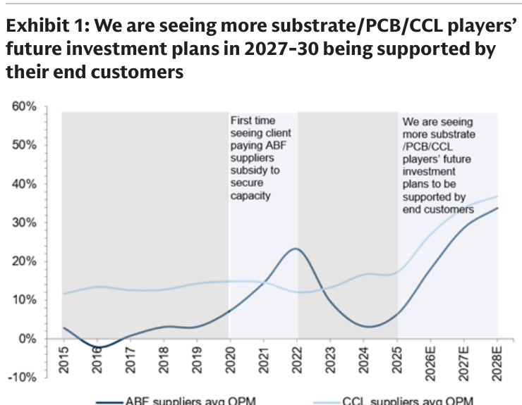
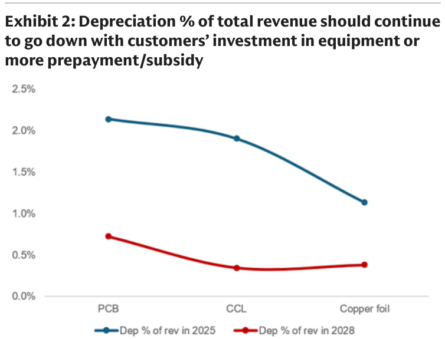
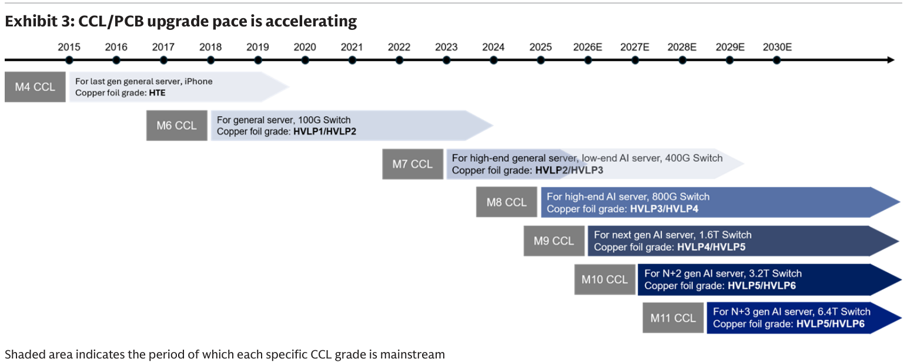
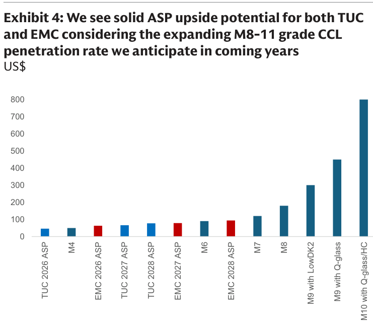
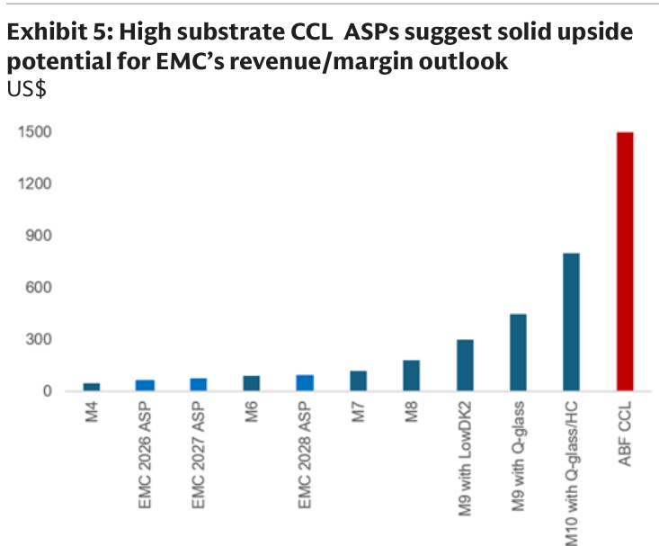
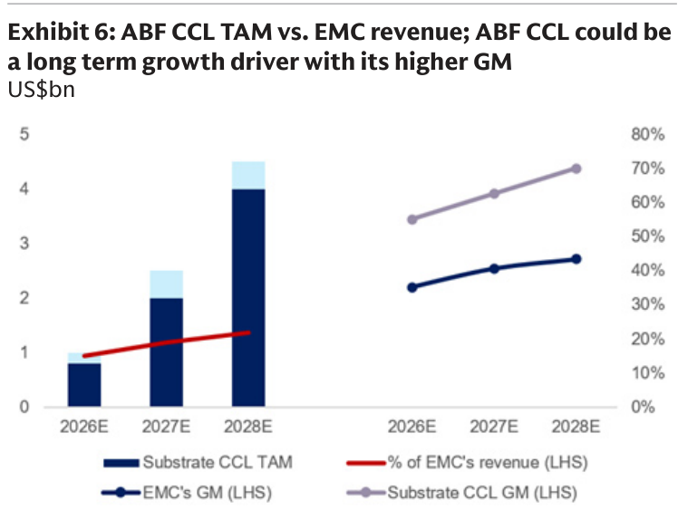
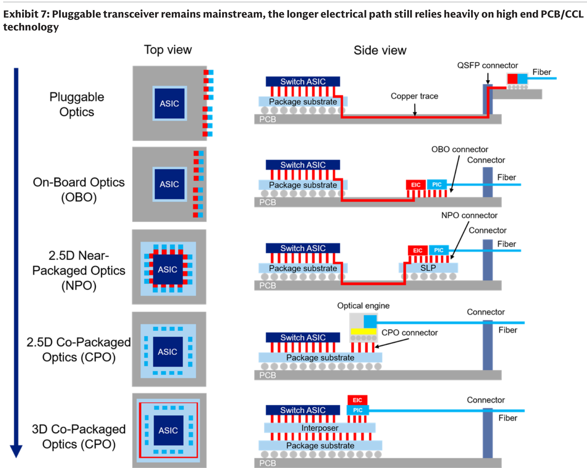
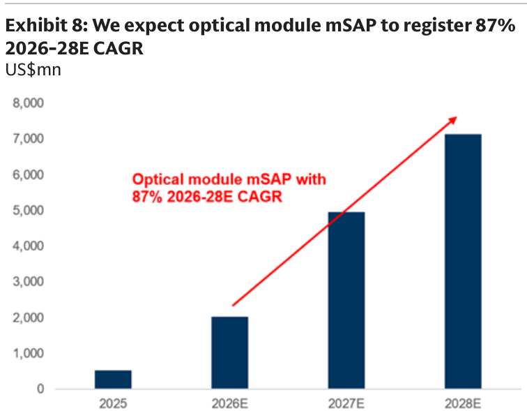

# Goldman Sachs｜台灣 PCB/CCL tour 2026 重點：升級加速、ABF 高 ASP/獲利機會擴大

**券商**：Goldman Sachs  
**分析師**：Chao Wang、Allen Chang、Al Wang  
**日期**：2026-10-27（封面標示 25 Oct 2026，系統日期以檔名為準）  
**主題**：2026 TPCA 展後 PCB/CCL/基板供應鏈參訪（會晤 4 家、走訪逾 10 家）  
**評級**：建設性／正面（覆蓋之 EMC、TUC、Co-Tech、ZDT 皆 Buy）  
<a href="https://layx.uk/dl?g=產業&b=GS&d=20261027&h=PCB-CCL">📎 下載 PDF</a>

---

## 報告總結

GS 在 2026 TPCA 展期間參訪台灣 PCB/CCL/基板供應鏈，核心結論是駁斥「AI 硬體投資放緩、技術升級停滯」的市場疑慮：高階 PCB/CCL/基板需求上行趨勢完好，且首度出現終端客戶以 LTA、產能補貼、預付款「出資綁定」供應商 2027-30 的新產能（EMC、ZDT、Co-Tech 等皆被客戶要求專屬產能），意味著未來數年供給更為吃緊、獲利能見度更高。CCL 規格升級（M7→M8→M9→M10/M11）持續驅動高階 CCL ASP 年增 25-50%，是產業最關鍵的營收/獲利引擎。

投資意涵上，GS 看到兩條結構性機會：一是台廠切入長期由日廠壟斷（95%+）的高 ASP/高毛利 ABF 基板 CCL（TAM 2026→28E 由 ~US\$1bn 增至 US\$4-4.5bn、GM 70%+），EMC 最受惠；二是光模組 mSAP（2026-28E CAGR 87%）與 CPO 風險有限（pluggable 仍主流、極端情境對 28E CCL TAM 衝擊 <10%），ZDT 卡位佳。四檔覆蓋股 EMC／TUC／Co-Tech／ZDT 皆為 Buy，具評價 re-rating 空間。

---

## Goldman Sachs 完整投資邏輯鏈

| 論點層次 | Exhibit | 內容 |
|---|---|---|
| **需求趨勢確認** | 3 | CCL 規格升級加速（M7→M8→M9→M10/M11），高階 CCL ASP 年增 25-50% |
| **定價槓桿** | 4、5 | 等級升級推升 blended ASP：M10 CCL ASP ~US\$800 vs 現行 EMC/TUC ~US\$63/46 |
| **新增 TAM** | 6 | ABF 基板 CCL TAM 2026→28E 由 ~US\$1bn 增至 US\$4-4.5bn，GM 近 70% |
| **供給綁定** | 1、2 | 客戶以 LTA/補貼/預付綁定 2027-30 產能，折舊率下降、獲利結構改善 |
| **下行風險可控** | 7 | Pluggable 仍主流，長電氣路徑續靠高階 PCB/CCL；CPO 2030 前難商用 |
| **新成長引擎** | 8 | 光模組 mSAP TAM 2026-28E CAGR 87% |
| **結論** | 報告封面 | 供不應求延續多年、供應鏈結構性改變支撐評價 re-rating；四檔皆 Buy |

> **報告最大邏輯缺口**：ABF 基板 CCL 與 M10 的 ASP 上行（$800-1,500 vs 現行 $46-63）為論點核心，但台廠量產時點（EMC M10 2Q27-3Q27、TUC M10 2028）與良率仍在客戶驗證中；PTFE 路線良率僅 10-15%，GS 假設 Rubin Ultra switch tray 改採 M9/M10＋Q-glass/HC，若判斷錯誤將影響台廠份額估計。

---

## 報告核心觀點

| 主題 | GS 觀點 | 市場共識 | 是否 Contra-Consensus |
|---|---|---|---|
| AI 硬體供應鏈投資 | 高階 PCB/CCL 需求上行完好，客戶 LTA/補貼投資 2027-30 新產能 | 部分投資人憂 AI 硬體供應鏈投資放緩 | 是 |
| 技術升級節奏 | M7→M8→M9 連續 ramp、ASP 年增 25-50% 且加速 | 部分投資人憂技術遷移放緩拖累 CCL 成長 | 是 |
| CPO 對 PCB/CCL 威脅 | 近期風險有限，2028 才從 switch tray 起，極端情境衝擊 <10% 28E TAM | 市場憂 CPO 取代高階 PCB | 是 |
| ABF 基板國產替代 | 日廠擴產慢、需求每 1-2 年翻倍，台/中廠自 1H26 加速認證、長期搶份額 | 日廠 95%+ 壟斷難撼動 | 部分 |

**偏好排序**：EMC（ABF 基板 CCL 新機會最大）＞ TUC ＞ Co-Tech ＞ ZDT，四檔皆 Buy。
**零件/個股偏好**：高階 CCL（EMC、TUC）、HVLP 銅箔（Co-Tech）、光模組 mSAP／ABF 一站式（ZDT）。

---

## Exhibit 1｜ABF/PCB/CCL 業者未來投資計畫首度由終端客戶出資支持

### 解讀摘要
圖為 ABF 供應商與 CCL 供應商平均 OPM（2015-2028E）。機制上，兩條獲利曲線在 2026E 後同步陡升（ABF 由 2024 谷底 ~3% 升至 2028E ~34%、CCL 由 ~15% 升至 ~37%），關鍵不是景氣循環而是「客戶出資綁定產能」這個結構性新現象——2020-21 首見客戶付 ABF 供應商補貼鎖定產能，2025 起更擴及 PCB/CCL 全供應鏈。意義是供應商的擴產風險被客戶承擔，獲利能見度與可持續性提升，支撐評價 re-rating。

> **原文補充**：GS 稱過去從未觀察到此現象；EMC、ZDT、Co-Tech 等高階 CCL 業者被客戶要求以 LTA/補貼提供專屬產能/廠房，但「並非所有業者都接受」。未簽 LTA 者（如 ABF 現貨型業者）則享更佳現貨報價與選客戶彈性。

---

## Exhibit 2｜折舊佔營收比將因客戶出資設備/預付補貼而下降

### 解讀摘要
2025 vs 2028 折舊佔營收比全面下滑，顯示客戶出資（設備投資/預付/補貼）直接改善供應商成本結構。CCL 降幅最大（1.9%→0.35%），PCB（2.15%→0.73%）、銅箔（1.15%→0.39%）亦明顯。意義是毛利率擴張除了 ASP 升級外，還有一塊來自折舊減輕＋補貼入帳的「結構性」挹注。

### 表格
| 項目 | Dep % of rev 2025 | Dep % of rev 2028 |
|---|---|---|
| PCB | 2.15% | 0.73% |
| CCL | 1.9% | 0.35% |
| Copper foil | 1.15% | 0.39% |

---

## Exhibit 3｜CCL/PCB 升級節奏正在加速（M4→M11）

### 解讀摘要
時程表顯示 CCL 等級升級週期縮短：M7（2024 ramp）、M8（2025）、M9（2026）每年一代，M10（驗證中，2H27 起出貨）、M11（最晚 2030）接棒。每升一級對應更高速交換器（400G→800G→1.6T→3.2T→6.4T）與更高階銅箔（HVLP），直接推升 ASP。這是全報告的需求根基——規格升級是「量＋價」雙漲、非單純週期。

> **原文補充**：EMC、TUC 於 TPCA 展同步發表 M10/M11 方案並與客戶洽次世代 AI R&D；兩家 M10/M11 均含 Q-glass、仍在客戶驗證中。PTFE 基 CCL 良率僅 10-15%（vs M9＋Q-glass 80-90%），量產最快 2H28 後，故 GS 認為 Rubin Ultra switch tray（2H27 起）高機率改採 M9/M10＋Q-glass/HC。

### 表格
| CCL 等級 | 應用 | 銅箔等級 | 主流期間 |
|---|---|---|---|
| M4 | 上代一般伺服器、iPhone | HTE | ~2015-2019 |
| M6 | 一般伺服器、100G Switch | HVLP1/HVLP2 | ~2017-2022 |
| M7 | 高階一般伺服器、低階 AI 伺服器、400G Switch | HVLP2/HVLP3 | ~2021-2025 |
| M8 | 高階 AI 伺服器、800G Switch | HVLP3/HVLP4 | ~2023-2027 |
| M9 | 次世代 AI 伺服器、1.6T Switch | HVLP4/HVLP5 | ~2024-2028 |
| M10 | N+2 世代 AI 伺服器、3.2T Switch | HVLP5/HVLP6 | ~2027-2030 |
| M11 | N+3 世代 AI 伺服器、6.4T Switch | HVLP5/HVLP6 | ~2028-2030 |

---

## Exhibit 4｜M8-11 滲透率提升帶動 TUC/EMC 的 ASP 上行空間

### 解讀摘要
圖以 US\$ 並列現行 blended ASP（TUC/EMC 2026-28 ASP）與各等級 CCL 單價，凸顯升級的定價槓桿：TUC/EMC 2026 混合 ASP 僅 ~US\$46/63，但 M9（Q-glass ~$450）、M10（Q-glass/HC ~$800）單價是其數倍至逾 10 倍。意義是只要高階等級滲透率緩步提升，blended ASP 就有結構性上行，而非靠漲價。

### 表格
| 項目 | ASP（US\$，約略） |
|---|---|
| TUC 2026 ASP | ~46 |
| EMC 2026 ASP | ~63 |
| TUC 2027 ASP | ~63 |
| TUC 2028 ASP / EMC 2027 ASP | ~75 |
| EMC 2028 ASP | ~95 |
| M7 | ~120（原文 130） |
| M8 | ~180 |
| M9 with LowDK2 | ~300 |
| M9 with Q-glass | ~450 |
| M10 with Q-glass/HC | ~800 |

> **洞察一**：M10 ASP ~US\$800 是 EMC 現行 blended ASP（~$63）的約 13 倍。即使 M10 只佔少量出貨組合，對 blended ASP 的拉抬也極顯著——升級滲透率是比「漲價」更可靠的 ASP 成長來源。

---

## Exhibit 5｜高階基板 CCL ASP 暗示 EMC 營收/毛利上行空間

### 解讀摘要
延續 Ex4 並加入最高階的 ABF 基板 CCL（~US\$1,500/full sheet），為各等級中最高、約 M7/8（$130/180）的 8-11 倍。意義是 EMC 切入 ABF 基板 CCL 不只是新營收來源，更是「單價＋毛利」雙躍升的槓桿——ABF 基板 CCL GM 現逾 50%、長期上看業界平均 70%+，遠高於 EMC 整體 GM（2026/27/28E 35.2%/40.7%/43.4%）。

> **洞察二（配合 Fig. 6）**：ABF 基板 CCL ASP（$1,500）＋GM（70%+）同時高於 EMC 現況，故即使營收佔比僅 15-22%，對 EMC 整體毛利率的邊際拉抬將不成比例地大。

---

## Exhibit 6｜ABF CCL TAM vs. EMC 營收：高毛利長線成長引擎

### 解讀摘要
左軸長出 ABF 基板 CCL TAM（US\$bn）由 2026E ~1.0 倍增至 2028E ~4.5，佔 EMC 營收比 ~15%→19%→22%；同時 EMC 整體 GM（35%→43%）與 ABF 基板 CCL GM（55%→70%）皆上行。機制是日廠（95%+ 壟斷）擴產慢、而 ABF 用量每 1-2 年翻倍（基板尺寸/層數增、良率降），逼使終端客戶自 1H26 加速認證台/中廠，EMC 自 2H26 起搶份額。

### 表格
| 年度 | 基板 CCL TAM（US\$bn） | 佔 EMC 營收 | EMC GM | 基板 CCL GM |
|---|---|---|---|---|
| 2026E | ~1.0（0.8-1.2） | ~15% | ~35% | ~55% |
| 2027E | ~2.5（2.0-2.5） | ~19% | ~41% | ~63% |
| 2028E | ~4.5（4.0-4.5） | ~22% | ~43% | ~70% |

> **值得驗證**：GS 預期 EMC 取得 ABF 基板 CCL 20-30% 份額（2028E）、2027 底產能達全球 50%（1.5mn sheets/月）。此份額假設若偏低，EMC 營收/毛利上行空間更大；若日廠加速反擊或良率不如預期，則 TAM 轉化率打折。另一變數：每 quarter sheet 可產高階 ABF 基板數由現行 6-8 片降至 2028 的 2-3 片，放大單位用量需求。

---

## Exhibit 7｜Pluggable 仍主流，較長電氣路徑續重度倚賴高階 PCB/CCL

### 解讀摘要
示意圖比較五種光互連架構（Pluggable→OBO→NPO→2.5D CPO→3D CPO）的電氣路徑長度。重點是越靠 pluggable，Switch ASIC 到光模組的 copper trace 路徑越長，越需高階 PCB/CCL；CPO 雖縮短路徑但技術複雜。GS 判斷 pluggable 於可見未來仍主流，故 CPO 對高階 PCB/CCL 的替代威脅被高估。

> **原文補充**：ZDT 於 TPCA 展出 30 層 HDI switch board，並認為 scale-out 以光收發器為主流將續推升 switch board 層數/複雜度；scale-up 採 CPO 時點未定，GS 估 2030E 前難商用。極端情境（所有 switch board 降級至 M4/M7）對 2028E CCL TAM（US\$48bn，switch board 佔 14%）衝擊 <10%、可控。

---

## Exhibit 8｜光模組 mSAP TAM：2026-28E CAGR 87%

### 解讀摘要
光模組 mSAP TAM（US\$mn）由 2025 ~500 跳升至 2026E ~2,000、2027E ~4,950、2028E ~7,100，2026-28E CAGR 87%。機制是只要光收發器維持 scale-out 主流（見 Fig.7），其所需高階 mSAP 需求即高速成長。ZDT 卡位佳——mSAP 產能兩年擴 5x、良率逾 90%（業界領先），mSAP GM 現 40-45%、漲價＋良率改善後上看 50%+（vs ZDT 整體 GM 2026/27/28E 僅 24.7%/27.6%/31.4%）。

### 表格
| 年度 | 光模組 mSAP TAM（US\$mn） |
|---|---|
| 2025 | ~500 |
| 2026E | ~2,000 |
| 2027E | ~4,950 |
| 2028E | ~7,100 |

> **洞察三**：mSAP GM（40-45%，上看 50%+）遠高於 ZDT 整體 GM（~25-31%），故此業務放量將顯著拉抬 ZDT 混合毛利率——與 EMC 的 ABF 基板 CCL 為同一類「高毛利新業務改善整體獲利結構」的邏輯。

---

## 相關個股清單

| 類別 | 公司 | Ticker | 評等 | 備註 |
|---|---|---|---|---|
| CCL／ABF 基板 | 台光電（EMC） | 2383 | Buy | 12m TP NT\$10,200（27x 2H27-1H28E P/E）；ABF 基板 CCL 新進者，份額上看 20-30%（28E） |
| CCL | 台燿（TUC） | 6274 | Buy | 12m TP NT\$3,010（22x 2027E P/E）；M10 2028 出貨、產能 2026-30 擴 2.5x+ 且已被客戶訂滿 |
| 銅箔 | 金居（Co-Tech） | 8358 | Buy | 12m TP NT\$940（22x 2028E P/E）；HVLP3+ 產能擴張（馬來西亞 Plant 4），客戶 LTA 綁定、2027 起認列補貼 |
| PCB／mSAP／ABF | 臻鼎-KY（ZDT） | 4958 | Buy | 12m TP NT\$1,025（SOTP）；光模組 mSAP 份額領先、ABF/BT/HDI/HLC/mSAP 一站式；中國 ABF 份額 2027E >40% |
