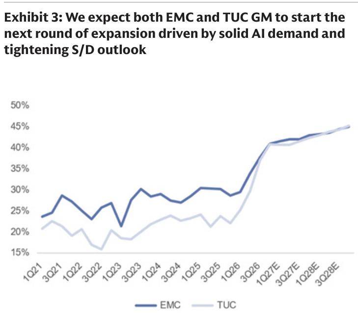
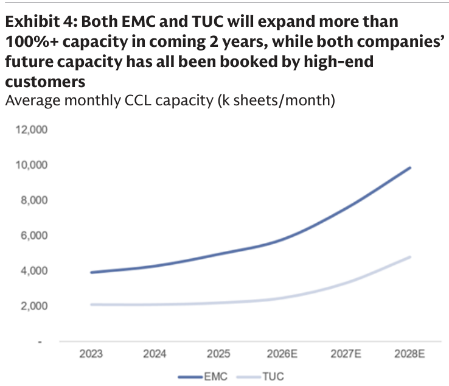

# Goldman Sachs｜Taiwan CCL：毛利率擴張延續 12 個月以上，CCL 供需缺口擴大；EMC、TUC 皆 Buy

**券商**：Goldman Sachs  
**分析師**：Chao Wang、Allen Chang、Al Wang  
**日期**：2026-10-29（封面標示 2026-10-28，系統日期以檔名為準）  
**主題**：EMC（2383）、TUC（6274）3Q26 財報後更新與 CCL 供需展望  
**評級**：EMC、TUC 皆 Buy（TP NT\$11,700／NT\$3,460）  
<a href="https://layx.uk/dl?g=產業&b=GS&d=20261029&h=CCL-EMC-TUC">📎 下載 PDF</a>

---

## 報告總結

EMC、TUC 3Q26 核心獲利分別高於共識 15%、25%，主因 M9 CCL 開始出貨（ASP 為公司平均 3-4 倍）、M8.5 需求放大、漲價落地與泰國廠加速放量。GS 預期 4Q26 高階 CCL 再漲價 5-20%，EMC、TUC 毛利率分別升至 40.9%、40.8%，且供需缺口將持續擴大。

關鍵新資訊是 EMC 董事會核准擴產至 2030 年，年底產能由現行 5.85mn 增至 15.25mn 片／月，但公司表示仍不足以滿足已簽 LTA 的需求。GS 認為市場共識 2027 年毛利率（EMC 38%／TUC 34%）偏低，EPS 有 10-25% 上修空間，建議逢低買進，目標價分別上調至 NT\$11,700、NT\$3,460。

---

## Goldman Sachs 完整投資邏輯鏈

| 論點層次 | Exhibit | 內容 |
|---|---|---|
| **獲利驗證** | 3 | 3Q26 毛利率優於共識，4Q26 預估首度突破 40% |
| **價格動能** | 3 | 4Q26 高階 CCL 漲價 5-20%，M7+ 同口徑價格 2027/28 年各 +10-40% |
| **產品組合** | 報告正文 | M9 於 2026 開始出貨，2027 年多項新專案導入 |
| **供給上限** | 4 | 平均月產能 2 年內大增，但新增產能已被高階客戶預訂 |
| **供需缺口** | 報告正文 | EMC 擴產至 15.25mn 片／月仍不足以滿足 LTA 需求 |
| **結論** | 報告封面 | **共識毛利率偏低，EPS 有上修空間；兩檔皆 Buy** |

> **報告最大邏輯缺口**：GS 的 2027 毛利率 40-42%+ 預期建立在 M7+ 同口徑漲價 10-40% 與 M9/M10 導入時程；M10 僅單一客戶 GPU 專案、2H27 才出貨，報告未提供價格漲幅落在區間低端或 M9 專案延後時的敏感度。

---

## 報告核心觀點

| 主題 | GS 觀點 | 市場共識 | 是否 Contra-Consensus |
|---|---|---|---|
| **3Q26 獲利** | EMC 核心獲利高於 GSe 6%（Street 最高）、高於 BBG 共識 15%；TUC 高於 GSe 16%、高於共識 25%；TUC 營業利益率 31.0% 首度超越 EMC（30.7%） | BBG 共識較低 | 是 |
| **4Q26 展望** | EMC 營收 QoQ +20%、毛利率 40.9%；TUC 營收 QoQ +18%、毛利率 40.8%（+3.9ppt QoQ），平均漲價 15-20%（QoQ） | — | 否 |
| **2027 毛利率** | EMC、TUC 皆可達 40-42%+，EPS 有 10-25% 上修空間 | BBG 共識 EMC 38%／TUC 34% | 是 |
| **EMC 擴產** | 年底產能 2027/28/29/30E 為 8.70/10.45/11.95/15.25mn 片／月（2026-30E CAGR 27%）；擴產仍不足以滿足 LTA（需求涵蓋至少未來 3 年） | — | 否 |
| **新世代規格** | EMC M10 CCL 2H27 起出貨（限單一客戶 AI GPU 專案）；M9 2026 僅 HGX R200 UBB、VR200 LPU 採用，2027 年多項新專案導入 | — | 否 |
| **評價** | EMC、TUC 僅 15x／12x GS 樂觀情境 2027 EPS，遠低於過去 3 年 20-30x 區間 | — | 是 |

**偏好排序**：未明確排序，兩檔皆 Buy、逢低買進  
**個股偏好**：EMC（TP NT\$11,700，27x 2H27-1H28E P/E）、TUC（TP NT\$3,460，22x 2H27-1H28E P/E）

---

## Exhibit 3｜EMC 與 TUC 毛利率預期進入下一輪擴張

### 解讀摘要

兩家毛利率在 2025 年前長期在約 15-30% 區間震盪（視覺估算），2026 年起快速攀升，GS 預估 4Q26 EMC 達 40.9%（首度突破 40%）、TUC 達 40.8%，之後 2027-28 年緩步上揚至 45% 左右。驅動力是漲價與高階產品組合（M8.5/M9）：EMC 3Q26 毛利率單季 +3.8ppt，TUC 因中低階 CCL 漲價（非低損耗與電源產品 3Q 漲 30-40%，占營收 34%）與泰國廠毛利轉正，單季躍升更大。

> **原文補充**：EMC 3Q26 研發費用 QoQ +44%（投入基板用 CCL 與 M10/11 新世代材料），營業利益率仍達 30.7%；TUC 3Q26 營業利益率 31.0%，為首度超越 EMC，主因營運效率改善。

### 表格

| 項目 | EMC | TUC |
|---|---|---|
| 3Q26 毛利率 | 37.7% | 36.9% |
| 3Q26 毛利率較 BBG 共識 | +1.9ppt | +5.1ppt |
| 3Q26 營業利益率 | 30.7% | 31.0% |
| 4Q26E 毛利率 | 40.9% | 40.8% |
| 2027 毛利率（BBG 共識） | 38% | 34% |
| 2027 毛利率（GS 預期） | 40-42%+ | 40-42%+ |

3Q26 毛利率實際值與 TUC 營業利益率引自同日 MS、Citi 及 GS 報告正文；其餘為 GS 報告正文數字。

> **洞察一**：兩家毛利率差距大幅收斂。圖中 2022 年 EMC 約 27%、TUC 約 16%（視覺估算，差距約 11ppt）；4Q26E 兩者為 40.9% 與 40.8%，差距僅 0.1ppt。TUC 的中低階 CCL 漲價彈性與泰國廠規模效益，使其毛利率追上 EMC。  
> **值得驗證**：GS 2027 毛利率 40-42%+ 的假設高於共識 EMC 2-4ppt（40-42 vs 38）、TUC 6-8ppt（40-42 vs 34）。若 M7+ 同口徑漲價落在 10-40% 區間低端，或 M9/M10 導入延後，毛利率可能回到共識區間，GS 所稱 10-25% 的 EPS 上修空間將縮小。

---

## Exhibit 4｜EMC 與 TUC 平均月產能 2 年內大幅擴張，新增產能已被預訂

### 解讀摘要

兩家 2023-25 年平均月產能成長溫和（EMC 約 3.9→4.9mn、TUC 約 2.1→2.2mn 片／月），2026 年起加速：EMC 由 2026E 約 5.8mn 增至 2028E 約 9.8mn（+69%），TUC 由約 2.4mn 增至約 4.8mn（+100%）。GS 強調新增產能已被高階客戶預訂；EMC 表示即使 2027-30 年積極擴產，仍不足以滿足已簽 LTA 的需求，等於供需缺口在擴產後仍然存在。

> **原文補充**：EMC 董事會核准的新計畫延伸至 2029/30E，這是公司首次公布 2028 上半年之後的擴產規劃；EMC 稱 LTA 由客戶鎖量、公司並未主動發起談判。昆山廠新增 1.2mn 片／月（約現有產能 21%）最早 2026 年 12 月起逐月開出至 2027 年 5 月（原規劃 1Q27、3Q27 各 600K 兩階段），加速的昆山放量抵銷觀音廠 300K 片／月擴產由 4Q26 延至 2H27（台灣工程人力短缺、設備交期長、勞安法規嚴格；GS 僅見台灣延遲，其餘計畫符合或早於預期）。

### 表格

視覺估算，與年底產能（EMC 5.85/8.70/10.45mn）交叉驗證通過。

| 平均月產能（mn 片／月） | 2023 | 2024 | 2025 | 2026E | 2027E | 2028E |
|---|---|---|---|---|---|---|
| EMC | 3.9 | 4.3 | 4.9 | 5.8 | 7.6 | 9.8 |
| TUC | 2.1 | 2.1 | 2.2 | 2.4 | 3.3 | 4.8 |

EMC 年底產能計畫（原文）：

| 年底產能（mn 片／月） | 2026 | 2027E | 2028E | 2029E | 2030E |
|---|---|---|---|---|---|
| EMC | 5.85 | 8.70 | 10.45 | 11.95 | 15.25 |
| 年增 | — | +49% | +20% | +14% | +28% |

> **洞察二**：EMC 2026-30E 年底產能 CAGR = (15.25 / 5.85)^(1/4) − 1 ≈ 27%，與報告一致；2030 年為 2026 年的 2.6 倍（15.25 / 5.85）。  
> **洞察三（配合 Exhibit 3）**：產能倍增並未使毛利率轉弱，GS 仍預期毛利率逐季上升且 2027-28 年達 40-45%，邏輯是新增產能已被 LTA 訂滿，供給放量不會形成價格壓力。  
> **洞察四（與同日 MS、Citi 報告交叉比對，屬外部資料）**：EMC 2028 年底產能 10.45mn 三家一致；2027 年底 GS 為 8.70mn、Citi 引用公司計畫（+49%）與 GS 相符，但 MS 同日 Exhibit 3 為 9.00mn，高於公司計畫。引用 EMC 2027 年產能時應以 8.70mn 為準，MS 的數字可能偏高。  
> **值得驗證**：標題稱「2 年內擴產 100%+」，但圖中 EMC 由 2026E 至 2028E 僅約 +69%，需以 2025 年為基期（4.9→9.8mn）才達 +100%；TUC 由 2026E 起算則約 +100%。

---

## 相關個股清單

| 類別 | 公司 | Ticker | 評等 | 備註 |
|---|---|---|---|---|
| CCL | 台光電（EMC） | 2383.TW | Buy | TP NT\$11,700（舊 NT\$10,200），27x 2H27-1H28E P/E；2026/27/28E 淨利上修 +13%/+22%/+22% |
| CCL | 台燿（TUC） | 6274.TWO | Buy | TP NT\$3,460（舊 NT\$3,010），22x 2H27-1H28E P/E；2026/27/28E 淨利上修 +12%/+20%/+27% |
