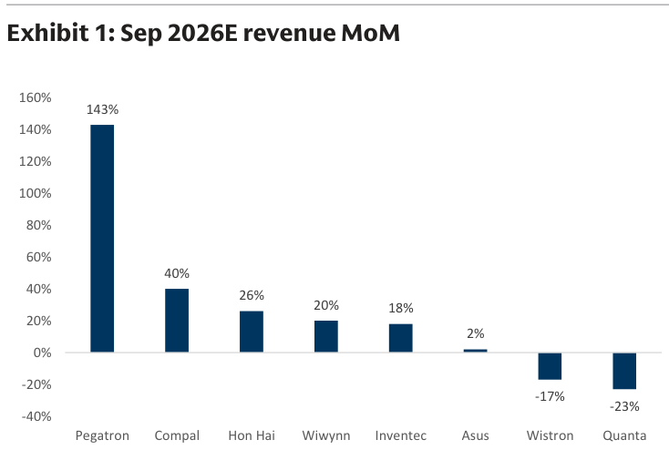
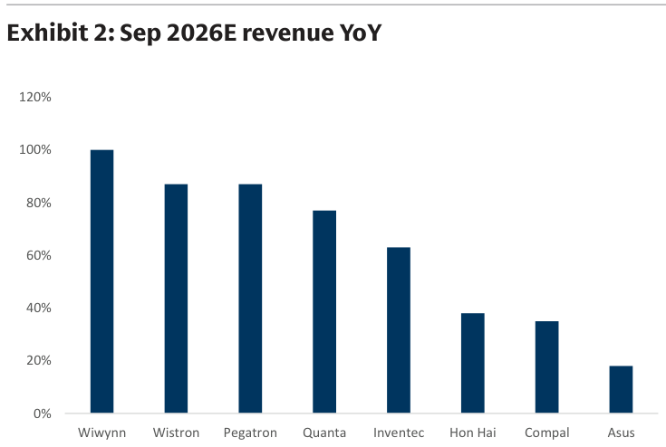
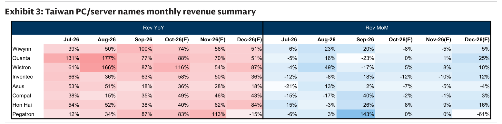
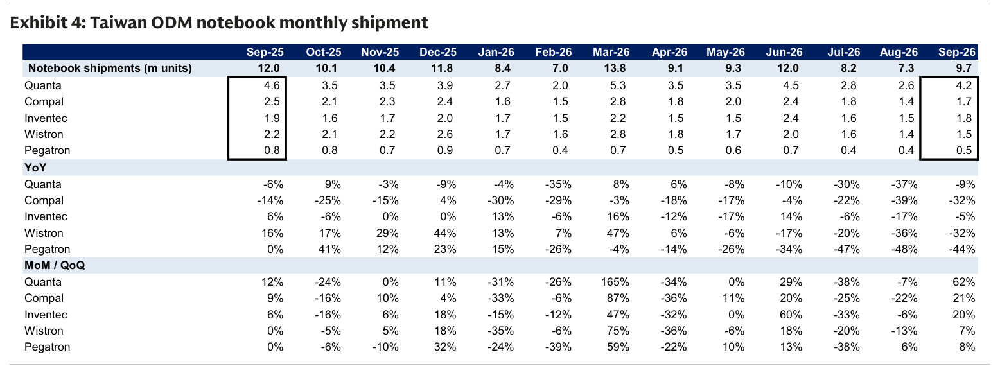

# Goldman Sachs｜Taiwan ODM/Brands：3 個月營收預覽（Oct-Dec 2026）

**券商**：Goldman Sachs  
**分析師**：Allen Chang、Verena Jeng、Chao Wang、Al Wang  
**日期**：2026-10-29（封面標示 2026-10-28，系統日期以檔名為準）  
**主題**：8 家 AI 伺服器／PC 供應鏈公司 3 個月營收預覽；新 AI 伺服器機櫃與新款智慧型手機驅動後續成長；更新華碩、仁寶、英業達、和碩預估  
**評級**：Buy：鴻海(2317)、緯穎(6669)、緯創(3231)；Neutral：廣達(2382)、英業達(2356)、仁寶(2324)、華碩(2357)；Sell：和碩(4938)  
<a href="https://layx.uk/dl?g=產業&b=GS&d=20261029&h=TW-ODM">📎 下載 PDF</a>

---

## 報告總結

GS 預覽 8 家公司 10-12 月營收：MoM 平均 -2%/0%/+1%，營收大致持平，主因 AI 伺服器機種轉換，加上高記憶體成本與消費拉貨壓抑消費性電子需求；YoY 平均 +68%/+60%/+44%，由 AI 伺服器持續放量、PC 產品組合升級、新款手機及記憶體漲價推升售價帶動。

GS 正面看待三大主題：蘋果供應鏈（2026 年折疊手機、2027 年 iPhone 20）、AI 伺服器零組件規格升級、ASIC AI 伺服器滲透率上升。鴻海最早出貨新世代機櫃，4Q26E 營收 QoQ +39%；和碩 9 月營收 MoM +143%（高於 GS 預估 64%）但 GS 維持 Sell。

---

## Goldman Sachs 完整投資邏輯鏈

| 論點層次 | Exhibit | 內容 |
|---|---|---|
| **需求動能** | 2、3 | 8 家 10 月營收平均 YoY +68%，AI 伺服器持續放量 |
| **短期整理** | 3 | 10-12 月 MoM 平均 -2%/0%/+1%，機種轉換期 |
| **個股分化** | 1、3 | 9 月 MoM 由和碩 +143% 至廣達 -23% |
| **PC 疲弱** | 4 | 5 家 ODM 9 月筆電出貨 9.7mn，YoY -19% |
| **受益排序** | 報告正文 | 鴻海最早出貨新世代機櫃，AI 布局深者佔優 |
| **結論** | 報告封面 | **Buy 鴻海、緯穎、緯創；Sell 和碩** |

> **報告最大邏輯缺口**：營收預覽依賴月度出貨時點，而 GS 自家預估與實際多次大幅落差（9 月實際營收高於 GS 預估：和碩 +64%、廣達 +20%、英業達 +20%、緯穎 +19%、鴻海 +15%；低於預估：緯創 -18%）；報告未說明 AI 機櫃出貨時點波動對 10-12 月預估的敏感度。

---

## 報告核心觀點

| 主題 | GS 觀點 | 市場共識 | 是否 Contra-Consensus |
|---|---|---|---|
| **10-12 月營收動能** | MoM 平均 -2%/0%/+1%；YoY +68%/+60%/+44% | — | 否 |
| **鴻海 4Q26E** | 營收 NT\$4.2tn（+61% YoY/+39% QoQ）；3Q26 營收 +47% YoY，高於 GS／BBG 共識 5%／7% | 3Q26 優於共識 | 是 |
| **AI 伺服器 TAM** | AI 伺服器機櫃全球價值 TAM 2025-28E CAGR 163%，達 US\$1tn，占 2028E 伺服器 TAM 63% | — | 否 |
| **美系 CSP capex** | 2026-28E 上修 4%/17%/22% 至 2028E US\$1,397bn；YoY +84%/+52%/+13% | — | 否 |
| **全球智慧型手機** | 2026-28E 出貨 1.1bn/1.2bn/1.2bn（-10%/+2%/+2% YoY），記憶體成本偏高 | — | 否 |
| **PC 需求** | 記憶體成本偏高、1H26 拉貨後需求疲弱；9 月和碩、緯創、仁寶筆電出貨 YoY -44%/-32%/-32% | — | 否 |

**偏好排序**：鴻海、緯穎、緯創（Buy）> 廣達、英業達、仁寶、華碩（Neutral）> 和碩（Sell）  
**個股偏好**：鴻海（TP NT\$400，17.9x 2027E P/E）、緯穎（TP NT\$4,000，20.3x）、緯創（TP NT\$291，12.6x）

---

## Exhibit 1｜Sep 2026E Revenue MoM

### 解讀摘要

9 月營收 MoM 分化極大：和碩 +143% 居首，仁寶 +40%、鴻海 +26%，廣達 -23%、緯創 -17% 墊底。分化來自 AI 伺服器出貨時點與機種轉換：和碩 9 月 AI 伺服器出貨放量（基期低），廣達則因 AI 伺服器機種切換月營收下滑（同時 PC 出貨 MoM +62%）。8 家平均 MoM 為 +26%，但剔除和碩後僅 +9.4%（66 / 7），和碩一家把平均拉高 16.7ppt（26.1% - 9.4%）。

### 表格

| 公司 | 9 月營收 MoM |
|---|---|
| Pegatron（和碩） | 143% |
| Compal（仁寶） | 40% |
| Hon Hai（鴻海） | 26% |
| Wiwynn（緯穎） | 20% |
| Inventec（英業達） | 18% |
| Asus（華碩） | 2% |
| Wistron（緯創） | -17% |
| Quanta（廣達） | -23% |

> **洞察一**：8 家平均 +26%（209 / 8）由和碩一家拉高；剔除和碩後為 +9.4%（66 / 7），判讀「族群 9 月動能」時需先扣除單一公司的低基期效應。

---

## Exhibit 2｜Sep 2026E Revenue YoY

### 解讀摘要

9 月營收 YoY 以緯穎 +100% 居首，緯創與和碩 +87%、廣達 +77%、英業達 +63%，華碩 +18% 最低。YoY 排序大致與 AI 伺服器比重相符（推論，報告未逐家拆解 9 月 YoY 原因）：AI 伺服器比重高的緯穎、緯創、和碩、廣達 YoY 較高，以 PC 與消費性電子為主的華碩（+18%）、仁寶（+35%）較低。

### 表格

| 公司 | 9 月營收 YoY |
|---|---|
| Wiwynn（緯穎） | 100% |
| Wistron（緯創） | 87% |
| Pegatron（和碩） | 87% |
| Quanta（廣達） | 77% |
| Inventec（英業達） | 63% |
| Hon Hai（鴻海） | 38% |
| Compal（仁寶） | 35% |
| Asus（華碩） | 18% |

> **洞察二（配合 Exhibit 3）**：和碩 YoY 由 8 月 +34% 跳升至 9 月 +87%，同時 MoM +143%，是單月 AI 伺服器出貨集中放量；屬出貨時點效應，不宜外推到後續月份。

---

## Exhibit 3｜Taiwan PC/Server Names Monthly Revenue Summary

### 解讀摘要

10-12 月預估 YoY 仍高：緯創 10 月 +116%、緯穎 +74%、和碩 +83%、廣達 +88%；鴻海則逐月加速，由 10 月 +40% 升至 12 月 +84%（新世代 AI 機櫃與 LPU 機櫃接棒）。MoM 方面多數公司 10-11 月持平或小幅下滑（機種轉換），12 月才回升；唯和碩 12 月 MoM -61%、YoY -15%，反映 9-11 月 AI 伺服器出貨集中後的急降。

### 表格

**Rev YoY**

| 公司 | Jul-26 | Aug-26 | Sep-26 | Oct-26(E) | Nov-26(E) | Dec-26(E) |
|---|---|---|---|---|---|---|
| Wiwynn | 39% | 50% | 100% | 74% | 56% | 51% |
| Quanta | 131% | 177% | 77% | 88% | 70% | 51% |
| Wistron | 61% | 166% | 87% | 116% | 54% | 87% |
| Inventec | 66% | 36% | 63% | 58% | 50% | 36% |
| Asus | 53% | 51% | 18% | 36% | 28% | 18% |
| Compal | 38% | 15% | 35% | 49% | 46% | 43% |
| Hon Hai | 54% | 52% | 38% | 40% | 62% | 84% |
| Pegatron | 12% | 34% | 87% | 83% | 113% | -15% |

**Rev MoM**

| 公司 | Jul-26 | Aug-26 | Sep-26 | Oct-26(E) | Nov-26(E) | Dec-26(E) |
|---|---|---|---|---|---|---|
| Wiwynn | 6% | 23% | 20% | -8% | -5% | 5% |
| Quanta | -5% | 16% | -23% | 0% | 1% | 25% |
| Wistron | -4% | 49% | -17% | 5% | 8% | 10% |
| Inventec | -12% | -8% | 18% | -12% | -10% | 12% |
| Asus | -21% | 13% | 2% | -7% | -5% | -4% |
| Compal | -15% | -17% | 40% | -2% | -1% | 3% |
| Hon Hai | 15% | -3% | 26% | 8% | 9% | 16% |
| Pegatron | -6% | 3% | 143% | 0% | 0% | -61% |

> **洞察三**：8 家平均與報告文字一致——YoY：10 月 +68%（544 / 8）、11 月 +60%（479 / 8）、12 月 +44%（355 / 8）；MoM：10 月 -2%（-16 / 8）、11 月約 0%（-3 / 8）、12 月 +1%（6 / 8）。12 月平均 YoY 掉到 +44% 與和碩 -15% 有關，剔除和碩後 12 月平均為 +53%（370 / 7）。  
> **洞察四**：鴻海是唯一 10-12 月 MoM 逐月加速（+8%/+9%/+16%）的公司，YoY 由 40% 升至 84%，與 GS 所述「領先同業 2-3 個月出貨新世代機櫃、12 月起 LPU 機櫃加入」相符，是 4Q26E 營收 +39% QoQ 的來源。  
> **值得驗證**：和碩 Oct/Nov MoM 均為 0%、Dec -61%，GS 預估隱含 9 月高出貨量延續兩個月後急降；此為預估而非實績，若 AI 伺服器出貨時點延後，12 月與 4Q26E（+62% YoY）將有上修空間。

---

## Exhibit 4｜Taiwan ODM Notebook Monthly Shipment

### 解讀摘要

5 家 ODM 9 月筆電出貨合計 9.7mn，較 8 月 +33%（9.7 / 7.3）、較去年同期 -19%（9.7 / 12.0）。個別廠商 YoY 分化：和碩 -44%、緯創 -32%、仁寶 -32% 跌幅最深，廣達 -9%、英業達 -5% 相對溫和。3Q26 合計 25.2mn（8.2 + 7.3 + 9.7），較 2Q26 的 30.4mn（9.1 + 9.3 + 12.0）減少 17%，反映高記憶體成本與 1H26 拉貨後的需求疲弱。

### 表格

**出貨量（mn 台）**

| 項目 | Sep-25 | Oct-25 | Nov-25 | Dec-25 | Jan-26 | Feb-26 | Mar-26 | Apr-26 | May-26 | Jun-26 | Jul-26 | Aug-26 | Sep-26 |
|---|---|---|---|---|---|---|---|---|---|---|---|---|---|
| **合計** | 12.0 | 10.1 | 10.4 | 11.8 | 8.4 | 7.0 | 13.8 | 9.1 | 9.3 | 12.0 | 8.2 | 7.3 | 9.7 |
| Quanta | 4.6 | 3.5 | 3.5 | 3.9 | 2.7 | 2.0 | 5.3 | 3.5 | 3.5 | 4.5 | 2.8 | 2.6 | 4.2 |
| Compal | 2.5 | 2.1 | 2.3 | 2.4 | 1.6 | 1.5 | 2.8 | 1.8 | 2.0 | 2.4 | 1.8 | 1.4 | 1.7 |
| Inventec | 1.9 | 1.6 | 1.7 | 2.0 | 1.7 | 1.5 | 2.2 | 1.5 | 1.5 | 2.4 | 1.6 | 1.5 | 1.8 |
| Wistron | 2.2 | 2.1 | 2.2 | 2.6 | 1.7 | 1.6 | 2.8 | 1.8 | 1.7 | 2.0 | 1.6 | 1.4 | 1.5 |
| Pegatron | 0.8 | 0.8 | 0.7 | 0.9 | 0.7 | 0.4 | 0.7 | 0.5 | 0.6 | 0.7 | 0.4 | 0.4 | 0.5 |

**YoY**

| 公司 | Sep-25 | Oct-25 | Nov-25 | Dec-25 | Jan-26 | Feb-26 | Mar-26 | Apr-26 | May-26 | Jun-26 | Jul-26 | Aug-26 | Sep-26 |
|---|---|---|---|---|---|---|---|---|---|---|---|---|---|
| Quanta | -6% | 9% | -3% | -9% | -4% | -35% | 8% | 6% | -8% | -10% | -30% | -37% | -9% |
| Compal | -14% | -25% | -15% | 4% | -30% | -29% | -3% | -18% | -17% | -4% | -22% | -39% | -32% |
| Inventec | 6% | -6% | 0% | 0% | 13% | -6% | 16% | -12% | -17% | 14% | -6% | -17% | -5% |
| Wistron | 16% | 17% | 29% | 44% | 13% | 7% | 47% | 6% | -6% | -17% | -20% | -36% | -32% |
| Pegatron | 0% | 41% | 12% | 23% | 15% | -26% | -4% | -14% | -26% | -34% | -47% | -48% | -44% |

**MoM / QoQ**

| 公司 | Sep-25 | Oct-25 | Nov-25 | Dec-25 | Jan-26 | Feb-26 | Mar-26 | Apr-26 | May-26 | Jun-26 | Jul-26 | Aug-26 | Sep-26 |
|---|---|---|---|---|---|---|---|---|---|---|---|---|---|
| Quanta | 12% | -24% | 0% | 11% | -31% | -26% | 165% | -34% | 0% | 29% | -38% | -7% | 62% |
| Compal | 9% | -16% | 10% | 4% | -33% | -6% | 87% | -36% | 11% | 20% | -25% | -22% | 21% |
| Inventec | 6% | -16% | 6% | 18% | -15% | -12% | 47% | -32% | 0% | 60% | -33% | -6% | 20% |
| Wistron | 0% | -5% | 5% | 18% | -35% | -6% | 75% | -36% | -6% | 18% | -20% | -13% | 7% |
| Pegatron | 0% | -6% | -10% | 32% | -24% | -39% | 59% | -22% | 10% | 13% | -38% | 6% | 8% |

> **洞察五（配合 Exhibit 3）**：筆電出貨衰退並未拖累營收。緯創 9 月筆電 YoY -32%，營收卻 +87% YoY；和碩筆電 YoY -44%，營收 +87% YoY；仁寶筆電 -32%，營收 +35%。營收成長幾乎全來自 AI 伺服器，筆電對這幾家的營收貢獻已不是主要變數。  
> **洞察六**：筆電合計 3Q26 較 2Q26 減少 17%（25.2 / 30.4 - 1），而 Exhibit 3 的 3Q26 營收仍多為正成長，與 GS 所述「PC 產品組合升級與記憶體漲價推升售價」一致，出貨減少部分被 ASP 上升抵銷。

---

## 個股 3 個月預覽（報告正文）

| 公司 | 評等／TP | 重點 |
|---|---|---|
| 鴻海（2317） | Buy（on CL）／NT\$400（17.9x 2027E） | 4Q26E 營收 NT\$4.2tn（+61% YoY/+39% QoQ）；10 月預估 NT\$1,251bn（+40% YoY/+8% MoM）；新世代 AI 機櫃與 CPO 交換機領先同業 2-3 個月出貨，12 月起 LPU 機櫃加入 |
| 廣達（2382） | Neutral／NT\$300（10.7x） | 9 月營收 MoM -23%（AI 伺服器機種轉換），4Q26E 營收 -4% QoQ 至 NT\$1,065.75bn；全球 NVIDIA/AMD AI 伺服器機櫃出貨 2026E-28E 為 63k/110k/164k |
| 緯穎（6669） | Buy／NT\$4,000（20.3x） | 9 月營收高於 GS 預估 19%；4Q26E +60% YoY/+8% QoQ；ASIC 滲透率 2028E 達 58% |
| 緯創（3231） | Buy／NT\$291（12.6x） | 9 月營收 NT\$381bn（+87% YoY），低於 GS 預估 18%（高 ASP 產品出貨時點波動）；預期 2H26 營收 +41% HoH |
| 華碩（2357） | Neutral／NT\$1,115（14.8x） | 4Q26E 營收 -6% QoQ、+27% YoY；10 月預估 NT\$90bn（+36% YoY/-7% MoM）；發行 US\$0.5bn 可轉債與 US\$1bn 交換債支持 AI 伺服器擴產 |
| 仁寶（2324） | Neutral／NT\$46.1（14.7x） | 9 月營收 NT\$94bn（+35% YoY/+40% MoM，高於 GS 預估 3%）；4Q26E +46% YoY/+15% QoQ；FY26E 淨利下修 3%（研發費用增加） |
| 英業達（2356） | Neutral／NT\$61（14.2x，前 15.3x） | 9 月營收 +63% YoY/+18% MoM，高於 GS 預估 20%；4Q26E +47% YoY；2026-28E 淨利上修 9%/6%/14% |
| 和碩（4938） | Sell／NT\$73.3（9.7x，TP 前 NT\$76.9） | 9 月營收 NT\$215bn（+87% YoY/+143% MoM，高於 GS 預估 64%）；4Q26E +62% YoY；2026-28E 營收上修 16%/28%/27%，淨利上修 4%/6%/4%（AI 伺服器機櫃毛利較低） |

> **圖表處理**：本報告 37 張 Exhibit 中，Exhibit 5-37 為單一公司月營收走勢、營收預覽、財測修正、P/E 與損益表，依跳過規則未收錄；其數字已併入上表「個股 3 個月預覽」。

---

## 相關個股清單

| 類別 | 公司 | Ticker | 評等 | 備註 |
|---|---|---|---|---|
| ODM／EMS | 鴻海 | 2317.TW | Buy（on CL） | TP NT\$400，17.9x 2027E P/E |
| ODM／EMS | 緯穎 | 6669.TW | Buy | TP NT\$4,000，20.3x 2027E P/E |
| ODM／EMS | 緯創 | 3231.TW | Buy | TP NT\$291，12.6x 2027E P/E |
| ODM／EMS | 廣達 | 2382.TW | Neutral | TP NT\$300，10.7x 2027E P/E |
| ODM／EMS | 英業達 | 2356.TW | Neutral | TP NT\$61，14.2x 2027E P/E |
| ODM／EMS | 仁寶 | 2324.TW | Neutral | TP NT\$46.1，14.7x 2027E P/E |
| 品牌 | 華碩 | 2357.TW | Neutral | TP NT\$1,115，14.8x 2027E P/E |
| ODM／EMS | 和碩 | 4938.TW | Sell | TP NT\$73.3（前 NT\$76.9），9.7x 2027E P/E |
