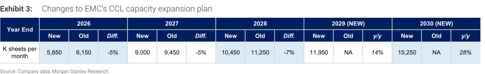

# Morgan Stanley｜CCL：3Q26 毛利率優於預期，維持 OW

**券商**：Morgan Stanley  
**分析師**：Irene Yen、Howard Kao、Andy Meng, CFA  
**日期**：2026-10-29（封面標示 2026-10-28，系統日期以檔名為準）  
**主題**：EMC（2383）、TUC（6274）3Q26 財報後更新  
**評級**：Industry View In-Line；EMC、TUC 皆 Overweight  
<a href="https://layx.uk/dl?g=產業&b=MS&d=20261029&h=TW-CCL">📎 下載 PDF</a>

---

## 報告總結

EMC、TUC 公布 3Q26 財報後，MS 更新 CCL 看法：兩家毛利率皆優於預期（EMC 37.7%、TUC 36.9%，QoQ 分別 +380bps、+720bps），主因漲價（含 2Q 延遲反映）與產品組合改善，4Q 價格調整仍持續。MS 維持兩檔 OW，EMC 目標價上調至 NT\$8,800、TUC 下調至 NT\$2,550（稅率高於預期使 2027-28 EPS 下修）。

偏好順序為 TUC > EMC，因 TUC 中低階 CCL 比重較高、未來 12 個月漲價彈性較大，兩者評價皆有吸引力（CY28e P/E：EMC 11x、TUC 9x）。供給端，EMC 下修 2026-28 產能 5%/5%/7%（台灣廠擴建延後），但新增 2029-30 擴產計畫；客戶 LTA 趨勢鎖量不鎖價。

---

## Morgan Stanley 完整投資邏輯鏈

| 論點層次 | Exhibit | 內容 |
|---|---|---|
| **瓶頸確認** | 報告正文 | HVLP4 銅箔、E-glass、LDK2 玻纖布為 2027 年最缺原料 |
| **價格傳導** | 報告正文 | 3Q GM 同步優於預期，TUC M7/8 新價自 11 月起生效 |
| **供給上限** | 3 | EMC 2026-28 產能下修 5-7%，新增 2029-30 計畫 |
| **需求綁定** | 報告正文 | 客戶 LTA 平均 3 年以上，鎖量不鎖價、不需預付 |
| **受益排序** | 報告正文 | TUC 因中低階 CCL 占比高、漲價彈性優於 EMC |
| **結論** | 報告封面 | **維持 OW；EMC PT NT\$8,800、TUC PT NT\$2,550** |

> **報告最大邏輯缺口**：MS 假設供給吃緊延續至 2027 年，但 EMC 同時規劃 2029 年 11.95mn、2030 年 15.25mn SPM 的大幅擴產，報告未說明 2029 年後的供需平衡與漲價是否可持續；PT 以殘值收益模型（EMC 中期成長率 12%、永續成長 3%）推算，對長期供給假設敏感。

---

## 報告核心觀點

| 主題 | MS 觀點 | 市場共識 | 是否 Contra-Consensus |
|---|---|---|---|
| **3Q26 獲利** | EMC GM 37.7% 高於 Street 1.6ppt、營業利益 NT\$18.7bn 高於 Street 13%；TUC GM 36.9% 高於 Street 4.4ppt、營業利益高於 Street 20% | Street 預期 EMC GM 36.1%、TUC GM 32.5% | 是（兩家皆優於共識與買方預期） |
| **價格趨勢** | 4Q 續漲；TUC M7/8 新價自 11 月起；M6 以下依原料成本轉嫁，趨勢延續至 2027 | — | 否 |
| **TUC 份額疑慮** | 市場對 TUC 在某 ASIC 客戶「share loss」的擔憂過度；高階 CCL 供給吃緊下，CSP 多源採購屬正常，且 TUC 已向其他 CSP 送樣 M8+ | 市場擔憂 TUC 流失 ASIC 客戶份額 | 是 |
| **LTA 趨勢** | 客戶要求平均 3 年以上 LTA，鎖量不鎖價、無預付款，但未履約拉貨仍受懲罰 | — | 否 |
| **EMC 基板用 CCL** | 現有 300K SPM，2H27 新增 900K SPM，2027 年底達 1.2M SPM；首位關鍵客戶預期為美系 hyperscaler 第 8 代 ASIC | — | 否 |

**偏好排序**：TUC > EMC（未來 12 個月漲價彈性）  
**個股偏好**：EMC（OW，PT NT\$8,800，上行 75%）、TUC（OW，PT NT\$2,550，上行 85%）

---

## Exhibit 3｜EMC CCL 產能擴張計畫調整

### 解讀摘要

MS 將 EMC 2026-28 年底產能預估各下修 5%/5%/7%（分別 -300K、-450K、-800K SPM），主因台灣廠房擴建延後；但公司新增 2029、2030 年計畫，使 2030 年產能達 15.25mn SPM，為 2026 年底 5.85mn 的 2.6 倍。短期（2026-28）供給放量比原先慢，對價格有利；長期擴產仍積極，2029 年後的供給壓力是需追蹤的變數。

> **原文補充**：EMC 基板用 CCL 產能目前 300K SPM，預計 2H27 再增 900K SPM，2027 年底達 1.2M SPM（約占當年底總產能 9,000K 的 13%）；供應鏈查證顯示美系 hyperscaler 將是其 ABF 基板 CCL 於第 8 代 ASIC 的首位關鍵客戶。

### 表格

| 年底產能（K sheets／月） | 新 | 舊 | 差異 |
|---|---|---|---|
| 2026 | 5,850 | 6,150 | -5% |
| 2027 | 9,000 | 9,450 | -5% |
| 2028 | 10,450 | 11,250 | -7% |
| 2029（新增） | 11,950 | NA | y/y +14% |
| 2030（新增） | 15,250 | NA | y/y +28% |

> **洞察一**：2026-28 累計下修幅度逐年擴大（-300K、-450K、-800K SPM），2028 年底下修量為 2026 年的 2.7 倍（800 / 300）。供給放量比預期更慢，方向與 MS 預期 4Q 價格調整續行、EMC 2027 EPS 上修 10% 一致。  
> **洞察二（配合封面 4Q 預估）**：MS 預估 EMC 4Q26 營收 QoQ +19% 至 NT\$72.4bn，但同時指出 4Q 產能增幅有限，代表 4Q 成長主要來自調價與產品組合，而非出貨量。  
> **值得驗證**：2029-30 年 +14%、+28% 的擴產沒有舊預估可比（Old = NA），完全仰賴公司新公布的計畫與 LTA 約定量。若客戶實際拉貨低於 LTA，2029 年後利用率與價格壓力將集中浮現。

---

## 相關個股清單

| 類別 | 公司 | Ticker | 評等 | 備註 |
|---|---|---|---|---|
| CCL | 台光電（EMC） | 2383.TW | OW | PT NT\$8,800（舊 NT\$8,400），股價 NT\$5,025；2026-28E EPS 調整 +12%/+10%/+6% |
| CCL | 台燿（TUC） | 6274.TWO | OW | PT NT\$2,550（舊 NT\$2,700），股價 NT\$1,375；2026-28E EPS 調整 +3%/-5%/-6% |
