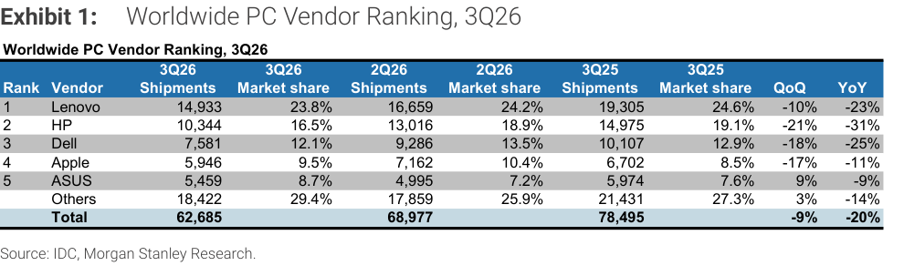
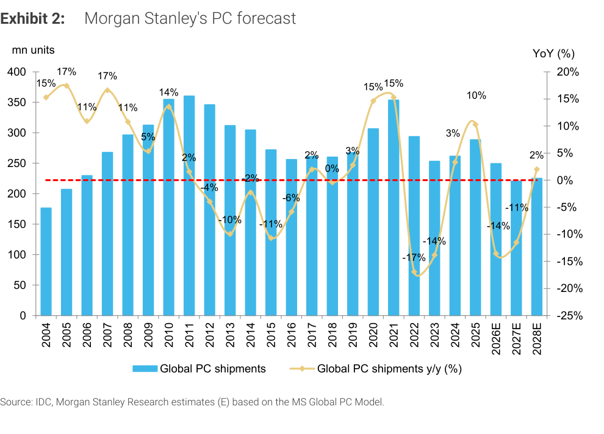

# MS｜美系 CPU 大廠 3Q26 法說：對台灣硬體涵蓋標的的意涵

**券商**：Morgan Stanley  
**分析師**：Howard Kao、Irene Yen、Andy Meng, CFA  
**日期**：2026-11-02  
**主題**：Intel 3Q26 法說會重點（PC 庫存調整、伺服器 CPU 需求、ABF 載板供給）與對台灣 OEM／ODM 及載板廠的影響  
**評級**：Industry View In-Line  
<a href="https://layx.uk/dl?g=產業&b=MS&d=20261102&h=CPU-3Q26-Earnings">📎 下載 PDF</a>

---

## 報告總結

Intel 3Q26 法說會後，MS 整理出三個對台灣供應鏈的影響：PC 端，Intel 預期 2H26 出貨年減 20% 以上，與 MS 約 -25% 的預估一致，對低階消費型 OEM／ODM 偏負面；伺服器端，Intel 指引 2026、2027 年伺服器 CPU 出貨各成長 30% 以上；載板端，約 40% 的擴產多落在 2H27，供給更緊有利價格。MS 預估 2026E 全球 PC 出貨 -14%、2027E -11%。

---

## MS 完整投資邏輯鏈

| 論點層次 | Exhibit | 內容 |
|---|---|---|
| 需求信號 | 1 | 3Q26 全球 PC 出貨 62.7mn，-20% YoY |
| 庫存調整 | 封面 | Intel 預期 2H26 PC 出貨年減 20% 以上，通路砍庫存近兩個月加速 |
| 預估對照 | 2 | MS 預估 2026E 全球 PC 出貨 -14% |
| 伺服器需求 | 封面 | Intel 指引 2026、2027 年伺服器 CPU 出貨各 +30% 以上 |
| 供給限制 | 封面 | ABF 載板約 40% 擴產多在 2H27 到位 |
| **結論** | 封面 | **PC 偏空、伺服器 CPU 與載板偏多，低階消費型 OEM／ODM 風險最大** |

> **報告最大邏輯缺口**：報告沒有提供 2H26 PC 出貨的季度預估，也沒有量化伺服器 CPU +30% 對緯穎、聯想、嘉澤營收的貢獻；Intel 的 TAM（伺服器 CPU 由 US\$40bn 到五年後逾 US\$200bn，主要來自 AI agent）屬公司說法，MS 未提供自己的驗證。

---

## 報告核心觀點

| 主題 | MS 觀點 | 市場共識 | 是否 Contra-Consensus |
|---|---|---|---|
| 2H26 PC 出貨 | Intel 預期年減 20% 以上，與 MS 約 -25% 的預估一致 | — | — |
| 伺服器 CPU | Intel 指引 2026、2027 出貨各 +30% 以上，若晶圓／載板供給改善還有上行空間 | — | — |
| ABF 載板 | 約 40% 擴產多在 2H27；Intel 優先確保載板產能並提升 EMIB-T 良率，複雜設計增加良率風險，可能降低有效產出、加劇缺料並支撐價格 | — | — |
| 標的影響 | 負面訊息對宏碁、仁寶等低階消費型 OEM／ODM 更不利；CPU 出貨強勁利好緯穎、聯想、嘉澤；載板吃緊利好欣興、南電的營收與毛利率 | — | — |

**偏好排序**：報告未排序。
**零件／個股偏好**：正面——緯穎、聯想、嘉澤、欣興、南電；負面——宏碁、仁寶。

---

## Exhibit 1｜Worldwide PC Vendor Ranking, 3Q26

### 解讀摘要

3Q26 全球 PC 出貨 62,685K 台，QoQ -9%、YoY -20%。減量集中在前四大品牌：HP -2,672K（QoQ -21%）、Lenovo -1,726K（-10%）、Dell -1,705K（-18%）、Apple -1,216K（-17%），合計 -7,319K，超過總減幅 -6,292K；只有華碩（+464K，+9%）與 Others（+563K，+3%）逆勢增加，抵銷了 1,027K。

> **原文補充**：Intel（由 Joseph Moore 覆蓋）預期 2H26 PC 出貨年減 20% 以上，原因是 OEM 在終端銷售轉弱下積極降庫存，且調整過去兩個月明顯加速；MS 自己對 2H26 的預估約為 -25% YoY（報告附連結）。

### 表格

（單位：千台；資料來源 IDC）

| 排名 | 廠商 | 3Q26 出貨 | 3Q26 市占 | 2Q26 出貨 | 2Q26 市占 | 3Q25 出貨 | 3Q25 市占 | QoQ | YoY |
|---|---|---|---|---|---|---|---|---|---|
| 1 | Lenovo | 14,933 | 23.8% | 16,659 | 24.2% | 19,305 | 24.6% | -10% | -23% |
| 2 | HP | 10,344 | 16.5% | 13,016 | 18.9% | 14,975 | 19.1% | -21% | -31% |
| 3 | Dell | 7,581 | 12.1% | 9,286 | 13.5% | 10,107 | 12.9% | -18% | -25% |
| 4 | Apple | 5,946 | 9.5% | 7,162 | 10.4% | 6,702 | 8.5% | -17% | -11% |
| 5 | ASUS | 5,459 | 8.7% | 4,995 | 7.2% | 5,974 | 7.6% | 9% | -9% |
| | Others | 18,422 | 29.4% | 17,859 | 25.9% | 21,431 | 27.3% | 3% | -14% |
| | **Total** | **62,685** | | **68,977** | | **78,495** | | **-9%** | **-20%** |

### 增量貢獻拆解（3Q26 vs 2Q26 出貨變化）

| 成長來源 | 貢獻（千台） | 佔總變化 |
|---|---|---|
| HP（10,344 − 13,016） | -2,672 | 42.5% |
| Lenovo（14,933 − 16,659） | -1,726 | 27.4% |
| Dell（7,581 − 9,286） | -1,705 | 27.1% |
| Apple（5,946 − 7,162） | -1,216 | 19.3% |
| ASUS（5,459 − 4,995） | +464 | -7.4% |
| Others（18,422 − 17,859） | +563 | -8.9% |
| **淨變化（62,685 − 68,977）** | **-6,292** | **100%** |

> 計算：佔比 = 各項 ÷ 總變化 -6,292，例如 HP = 2,672 ÷ 6,292 = 42.5%；六項加總 42.5 + 27.4 + 27.1 + 19.3 − 7.4 − 8.9 = 100%。

> **洞察一**：前五大品牌合計市占由 2Q26 的 74.1% 降到 3Q26 的 70.6%（2Q26：51,118K ÷ 68,977K；3Q26：44,263K ÷ 62,685K），降幅 3.5ppt，與 Others 市占 +3.5ppt（25.9% → 29.4%）一致。品牌集中度在下降；跌幅最深的是 HP（QoQ -21%）與 Dell（-18%），方向與 Intel 所說的 OEM 積極降庫存一致，但報告沒有拆解各品牌的原因。
> **值得驗證**：報告沒有說明 Others 與華碩逆勢成長的原因；若這是低價機型或庫存出清所致，對宏碁、仁寶等低階消費型供應鏈的「偏負面」結論可能需要修正方向。

---

## Exhibit 2｜Morgan Stanley's PC forecast

### 解讀摘要

MS 的全球 PC 出貨預估：2026E 年減 14%、2027E 再減 11%、2028E 才回升 2%。柱狀圖沒有數值標籤，依 YoY 反推約 289mn（2025，+10%）→ 249mn（2026E）→ 221mn（2027E）→ 226mn（2028E），累計 2025 至 2027E 下滑約 23.5%，2027E 的出貨量是 2005 年以來最低（視覺估算，交叉驗證通過）。

### 表格

（YoY 為圖上標籤；出貨量為柱高視覺估算，信心中等，驗算：289 × 0.86 = 248.5、× 0.89 = 221.2、× 1.02 = 225.6，與圖中柱高相符）

| 年度 | YoY（圖上標籤） | 出貨量（mn，視覺估算） |
|---|---|---|
| 2004 | 15% | — |
| 2005 | 17% | — |
| 2006 | 11% | — |
| 2007 | 17% | — |
| 2008 | 11% | — |
| 2009 | 5% | — |
| 2010 | 14% | — |
| 2011 | 2% | — |
| 2012 | -4% | — |
| 2013 | -10% | — |
| 2014 | -2% | — |
| 2015 | -11% | — |
| 2016 | -6% | — |
| 2017 | 2% | — |
| 2018 | 0% | — |
| 2019 | 3% | — |
| 2020 | 15% | 約 307 |
| 2021 | 15% | 約 354 |
| 2022 | -17% | 約 294 |
| 2023 | -14% | 約 254 |
| 2024 | 3% | 約 262 |
| 2025 | 10% | 約 289 |
| 2026E | -14% | 約 249 |
| 2027E | -11% | 約 221 |
| 2028E | 2% | 約 226 |

> **洞察二（配合 Exhibit 2）**：2026E、2027E 連續兩年下滑的累計幅度 = (1 − 14%) × (1 − 11%) − 1 = −23.5%，淺於 2022、2023 兩年的 (1 − 17%) × (1 − 14%) − 1 = −28.6%，但 2028E 只回升 2%，代表 MS 並不預期出現 V 型反彈。
> **洞察三（配合 Exhibit 1）**：3Q26 IDC 實際 YoY 為 -20%，比 MS 對 2H26 的 -25% 預估淺 5ppt；若 2H26 要達 -25%，4Q26 需要比 3Q26 更深的跌幅。4Q25 基期未在報告中提供，無法精算 4Q26 需要多深。
> **值得驗證**：MS 全年 -14% 與 2H26 -25% 同時成立，隱含 1H26 接近持平或小幅下滑；1H26 的實際出貨未在報告中給出。

---

## 相關個股清單

| 類別 | 公司 | Ticker | 評等 | 備註 |
|---|---|---|---|---|
| 負面（低階消費型 OEM／ODM） | 宏碁 | 2353 | — | 報告未給評等；代號為外部資訊 |
| 負面（低階消費型 OEM／ODM） | 仁寶 | 2324 | — | 報告未給評等；代號為外部資訊 |
| 正面（CPU 出貨強勁） | 緯穎 | 6669 | — | 報告未給評等；代號為外部資訊 |
| 正面（CPU 出貨強勁） | 聯想 | 0992.HK | — | 報告未給評等；代號為外部資訊 |
| 正面（CPU 出貨強勁） | 嘉澤 | 3533 | — | 報告未給評等 |
| 正面（載板價量） | 欣興 | 3037 | — | 報告未給評等 |
| 正面（載板價量） | 南電 | 8046 | — | 報告未給評等；代號為外部資訊 |
