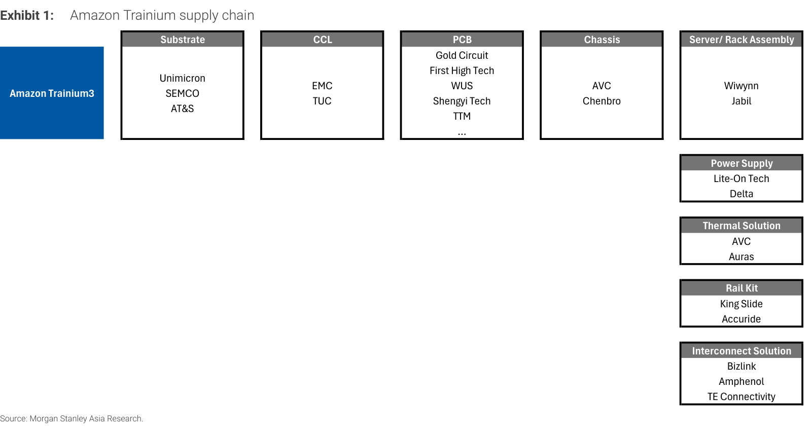
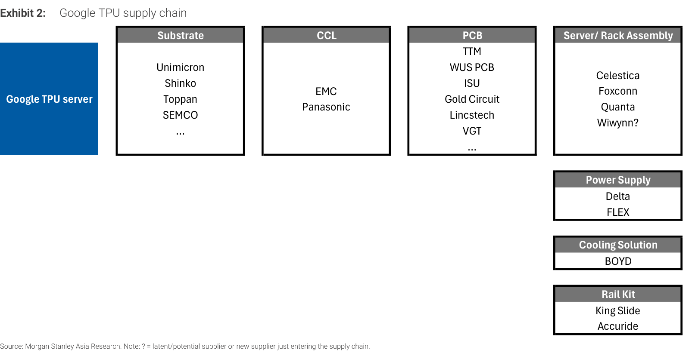
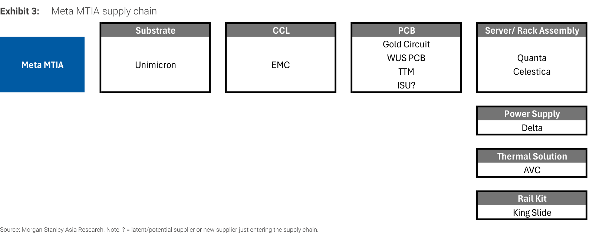
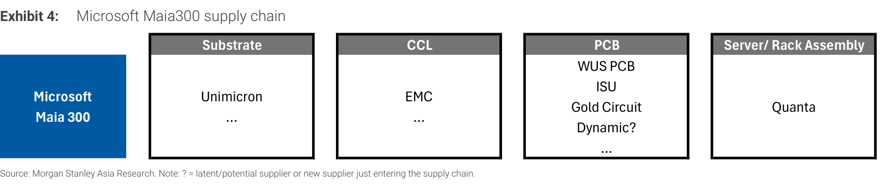
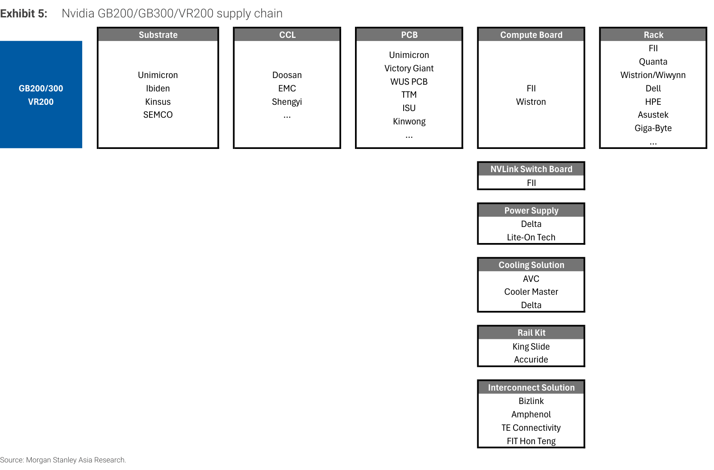
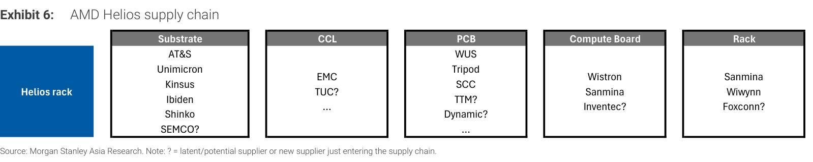

# MS｜美國雲端業者 3Q26 財報：對下游科技硬體廠的正面意涵

**券商**：Morgan Stanley  
**分析師**：Howard Kao、Irene Yen、Andy Meng, CFA  
**日期**：2026-11-02  
**主題**：美國四大雲端業者 3Q26 財報與 capex 指引，對大中華科技硬體供應鏈的影響（附各 AI 平台供應鏈地圖）  
**評級**：Industry View In-Line（維持 OW 大中華供應鏈）  
<a href="https://layx.uk/dl?g=產業&b=MS&d=20261102&h=Hyperscaler-3Q26-Results">📎 下載 PDF</a>

---

## 報告總結

MS 認為美國雲端業者 3Q26 財報對大中華供應鏈是正面的：語氣一致偏多、需求仍大於供給，本季雖未給 CY27 量化指引，但微軟預告 2027 年 1-6 月 capex「加速」，Google、亞馬遜、Meta 也都暗示明年更高。微軟下修 CY26 capex US\$5bn 是第三方產能交付延遲，不是需求問題。下一個觀察點是 CY27 指引如何影響台廠 4Q26 財報；報告並附上六個 AI 平台的供應鏈地圖。

---

## MS 完整投資邏輯鏈

| 論點層次 | Exhibit | 內容 |
|---|---|---|
| 需求信號 | 封面 | 四大雲端業者語氣一致偏多，需求仍大於供給 |
| 前瞻指引 | 封面 | 微軟預告 2027 年 1-6 月 capex「加速」 |
| 短期雜音 | 封面 | 微軟下修 CY26 capex US\$5bn 至 US\$170bn，原因是第三方產能交付延遲 |
| 受益傳導 | 1–6 | 基板、CCL、PCB、機櫃組裝、電源、散熱橫跨六個 AI 平台 |
| 觀察重點 | 封面 | CY27 capex 指引對 C4Q26 財報的影響 |
| **結論** | 封面 | **維持 OW 大中華供應鏈，偏好伺服器組裝與 PCB／CCL／載板** |

> **報告最大邏輯缺口**：本季沒有 CY27 的量化 capex 指引，結論建立在「評論暗示需求續強」之上；報告也沒有給個股評等、目標價或預估數字，無法判斷哪些公司的預期已反映。

---

## 報告核心觀點

| 主題 | MS 觀點 | 市場共識 | 是否 Contra-Consensus |
|---|---|---|---|
| 雲端需求 | 語氣一致正面，需求仍大於供給 | — | — |
| CY27 capex | 本季無量化指引，但各家評論暗示需求維持強勁 | — | — |
| 微軟 CY26 capex | 下修 US\$5bn 至 US\$170bn，反映第三方產能交付延遲而非需求問題；C1H27 預期「加速」，主因 CPU（記憶體與儲存成本上升）、GPU 與遞延交付 | — | — |
| 下一個觀察點 | 雲端業者 CY27 capex 指引對大中華科技硬體 C4Q26 財報的影響 | — | — |

**偏好排序**：報告未排序，依文中順序為：伺服器組裝（緯創、聯想、緯穎）→ PCB／CCL（金像電、台光電、台燿）→ ABF 載板（欣興、南電）→ CPU 插座（嘉澤）。
**零件／個股偏好**：見文末個股清單。

### 四大雲端業者 CY26 capex 指引與 CY27 評論（取自報告 Key Takeaways）

| 業者 | CY26 capex 指引 | 變動 | CY27 評論 |
|---|---|---|---|
| 微軟（MSFT） | US\$170bn | 下修 US\$5bn（第三方產能交付延遲） | C1H27 capex「加速」 |
| Meta（META） | US\$135–145bn | 由 US\$130–145bn 收窄（下限上調 US\$5bn） | 持續「積極」投資 |
| Google（GOOG） | US\$195–205bn | 維持 | 年增幅「顯著」 |
| 亞馬遜（AMZN） | US\$220bn | 維持 | 「明顯」高於 CY26 |

> **原文補充**：個股偏好的理由——緯創是 Nvidia、AMD 的 L6 關鍵夥伴，新客戶帶來 L10（聯想與一家 AI 實驗室）與 L11 AI 伺服器曝險（亞馬遜、Oracle）；聯想是微軟、Oracle 的通用伺服器主要供應商，AI 伺服器 pipeline 約 US\$54bn（C2Q26／F1Q27）；緯穎是三家雲端業者（微軟、Meta、亞馬遜）的通用伺服器主要供應商，並可能成為兩家新客戶（一家雲端業者與一家 AI 實驗室）的組裝夥伴，也是 Trainium 伺服器機櫃及 Meta 的 AMD Helios 機櫃的關鍵供應商；金像電（GCE）與台光電／台燿（EMC／TUC）受惠於通用及 AI 伺服器的 PCB 與 CCL 需求；欣興、南電是大中華主要 ABF 載板供應商，供應運算（CPU／GPU／ASIC）與網通晶片；嘉澤是 CPU 插座主要供應商，AI 零組件業務（QD、SOCAMM、NPO 插座）起量中。

---

## Exhibit 1｜Amazon Trainium supply chain

### 解讀摘要

六張圖中涵蓋環節最多的一張：除基板、CCL、PCB、機箱與組裝外，另列電源、散熱、滑軌、互連四個環節，共 9 個類別。雙鴻（Auras）只出現在這張的散熱欄（與奇鋐並列），Lite-On 也只在這張與 Nvidia 圖的電源欄出現。對台廠來說，Trainium3 的曝險面最廣。

### 表格

| 環節 | 供應商 |
|---|---|
| Substrate | Unimicron、SEMCO、AT&S |
| CCL | EMC、TUC |
| PCB | Gold Circuit、First High Tech、WUS、Shengyi Tech、TTM… |
| Chassis | AVC、Chenbro |
| Server/Rack Assembly | Wiwynn、Jabil |
| Power Supply | Lite-On Tech、Delta |
| Thermal Solution | AVC、Auras |
| Rail Kit | King Slide、Accuride |
| Interconnect Solution | Bizlink、Amphenol、TE Connectivity |

---

## Exhibit 2｜Google TPU supply chain

### 解讀摘要

TPU 的機櫃組裝是多家並行：Celestica、Foxconn、Quanta，緯穎帶「?」（潛在或剛進入的供應商）。基板名單有四家（Unimicron、Shinko、Toppan、SEMCO），在四個 ASIC 平台中最多（Trainium3 三家、MTIA 與 Maia300 各一家）；冷卻欄只有 BOYD，沒有台廠。

### 表格

| 環節 | 供應商 |
|---|---|
| Substrate | Unimicron、Shinko、Toppan、SEMCO… |
| CCL | EMC、Panasonic |
| PCB | TTM、WUS PCB、ISU、Gold Circuit、Lincstech、VGT… |
| Server/Rack Assembly | Celestica、Foxconn、Quanta、Wiwynn? |
| Power Supply | Delta、FLEX |
| Cooling Solution | BOYD |
| Rail Kit | King Slide、Accuride |

---

## Exhibit 3｜Meta MTIA supply chain

### 解讀摘要

名單最集中：基板只有 Unimicron、CCL 只有 EMC、電源只有 Delta、散熱只有 AVC，組裝為 Quanta 與 Celestica。單一供應商的欄位多，代表 Meta MTIA 的台廠曝險集中在少數幾家；ISU 帶「?」，是潛在供應商。

### 表格

| 環節 | 供應商 |
|---|---|
| Substrate | Unimicron |
| CCL | EMC |
| PCB | Gold Circuit、WUS PCB、TTM、ISU? |
| Server/Rack Assembly | Quanta、Celestica |
| Power Supply | Delta |
| Thermal Solution | AVC |
| Rail Kit | King Slide |

---

## Exhibit 4｜Microsoft Maia300 supply chain

### 解讀摘要

只列基板、CCL、PCB、組裝四個環節，組裝唯一列出 Quanta；PCB 的 Dynamic 帶「?」。與其他平台相比，電源、散熱、滑軌等環節尚未列出供應商，推測是 Maia300 的供應鏈地圖較不完整，或相關環節尚未確定（報告未說明）。

### 表格

| 環節 | 供應商 |
|---|---|
| Substrate | Unimicron… |
| CCL | EMC… |
| PCB | WUS PCB、ISU、Gold Circuit、Dynamic?… |
| Server/Rack Assembly | Quanta |

---

## Exhibit 5｜Nvidia GB200/GB300/VR200 supply chain

### 解讀摘要

名單最長：基板四家（Unimicron、Ibiden、Kinsus、SEMCO）、PCB 六家以上（Unimicron、Victory Giant、WUS PCB、TTM、ISU、Kinwong），計算板與 NVLink 交換板由 FII（外部資訊：鴻海旗下公司）與緯創負責，機櫃組裝多達 FII、Quanta、緯創／緯穎、Dell、HPE、華碩、技嘉。Nvidia 平台的 PCB 欄沒有 Gold Circuit，這在六張圖中只有 Nvidia 與 AMD 兩張如此（其餘四個 ASIC 平台都有）。

### 表格

| 環節 | 供應商 |
|---|---|
| Substrate | Unimicron、Ibiden、Kinsus、SEMCO |
| CCL | Doosan、EMC、Shengyi… |
| PCB | Unimicron、Victory Giant、WUS PCB、TTM、ISU、Kinwong… |
| Compute Board | FII、Wistron |
| Rack | FII、Quanta、Wistron/Wiwynn、Dell、HPE、Asustek、Giga-Byte… |
| NVLink Switch Board | FII |
| Power Supply | Delta、Lite-On Tech |
| Cooling Solution | AVC、Cooler Master、Delta |
| Rail Kit | King Slide、Accuride |
| Interconnect Solution | Bizlink、Amphenol、TE Connectivity、FIT Hon Teng |

---

## Exhibit 6｜AMD Helios supply chain

### 解讀摘要

六張圖中「?」最多的一張，共 6 個潛在或新進供應商（SEMCO?、TUC?、TTM?、Dynamic?、Inventec?、Foxconn?），代表 AMD Helios 機櫃的供應鏈仍在成形。機櫃欄為 Sanmina、緯穎與鴻海?，與報告內文所述「緯穎是 Meta 的 AMD Helios 機櫃關鍵供應商」一致。

### 表格

| 環節 | 供應商 |
|---|---|
| Substrate | AT&S、Unimicron、Kinsus、Ibiden、Shinko、SEMCO? |
| CCL | EMC、TUC?… |
| PCB | WUS、Tripod、SCC、TTM?、Dynamic?… |
| Compute Board | Wistron、Sanmina、Inventec? |
| Rack | Sanmina、Wiwynn、Foxconn? |

---

## 跨 Exhibit 彙整表

### 彙整 1｜主要台廠在六個平台供應鏈圖中的出現次數

（來源：Exhibit 1–6；「?」為報告標註的潛在／新進供應商，另計）

| 供應商（環節） | 出現平台 | 已確認次數 | 潛在（?） |
|---|---|---|---|
| Unimicron（基板；Nvidia 圖另列於 PCB） | Trainium3、TPU、MTIA、Maia300、Nvidia、Helios | 6 / 6 | 0 |
| EMC（CCL） | Trainium3、TPU、MTIA、Maia300、Nvidia、Helios | 6 / 6 | 0 |
| WUS（PCB） | Trainium3、TPU、MTIA、Maia300、Nvidia、Helios | 6 / 6 | 0 |
| TTM（PCB） | Trainium3、TPU、MTIA、Nvidia | 4 / 6 | 1（Helios） |
| Gold Circuit（PCB） | Trainium3、TPU、MTIA、Maia300 | 4 / 6 | 0 |
| ISU（PCB） | TPU、Maia300、Nvidia | 3 / 6 | 1（MTIA） |
| Quanta（組裝） | TPU、MTIA、Maia300、Nvidia | 4 / 6 | 0 |
| Wiwynn（組裝） | Trainium3、Nvidia（Wistron/Wiwynn）、Helios | 3 / 6 | 1（TPU） |
| Delta（電源／散熱） | Trainium3、TPU、MTIA、Nvidia | 4 / 6 | 0 |
| AVC（機箱／散熱） | Trainium3、MTIA、Nvidia | 3 / 6 | 0 |
| King Slide（滑軌） | Trainium3、TPU、MTIA、Nvidia | 4 / 6 | 0 |
| Auras（散熱） | Trainium3 | 1 / 6 | 0 |

> **洞察一**：Unimicron、EMC、WUS 在六個平台全部出現（6/6），營收曝險與哪個 ASIC／GPU 平台勝出關係較小，屬「平台中性」；反過來，Auras 只出現在 Trainium3（1/6），單一平台依賴度最高。
> **洞察二**：Gold Circuit 在四個 ASIC 平台（Trainium3、TPU、MTIA、Maia300）都有，在 Nvidia 與 AMD 兩張圖都沒有，曝險偏向 ASIC 側；這是從圖中名單歸納，報告未明說。
> **值得驗證**：MS 在內文點名偏好南電（NYPCB），但南電沒有出現在任何一張圖的基板欄（基板欄出現的是 Unimicron、Ibiden、Kinsus、SEMCO、AT&S、Shinko、Toppan），聯想與嘉澤也不在圖中；報告沒有說明這些公司的曝險來自哪個平台或環節，圖與內文的選股邏輯需要對照原報告其他章節才能確認。

---

## 相關個股清單

| 類別 | 公司 | Ticker | 評等 | 備註 |
|---|---|---|---|---|
| 伺服器組裝 | 緯創（Wistron） | 3231 | — | 報告：Nvidia、AMD 的 L6 關鍵夥伴；代號為外部資訊 |
| 伺服器組裝 | 聯想（Lenovo） | 0992.HK | — | AI 伺服器 pipeline 約 US\$54bn；代號為外部資訊 |
| 伺服器組裝 | 緯穎（Wiwynn） | 6669 | — | Trainium 機櫃、Meta 的 AMD Helios 機櫃關鍵供應商；代號為外部資訊 |
| PCB | 金像電（GCE／Gold Circuit） | 2368 | — | 代號為外部資訊 |
| CCL | 台光電（EMC） | 2383 | — | 報告稱 like；六個平台皆出現 |
| CCL | 台燿（TUC） | 6274 | — | 報告稱 like；代號為外部資訊 |
| ABF 載板 | 欣興（Unimicron） | 3037 | — | 報告稱 like |
| ABF 載板 | 南電（NYPCB） | 8046 | — | 報告稱 like；代號為外部資訊 |
| CPU 插座 | 嘉澤（Lotes） | 3533 | — | QD、SOCAMM、NPO 插座起量中 |
