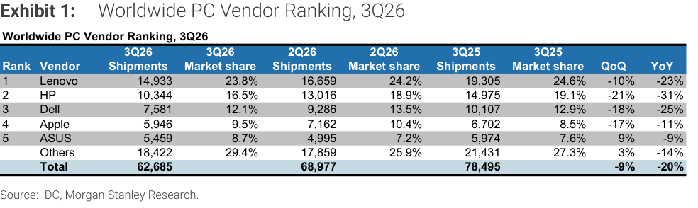
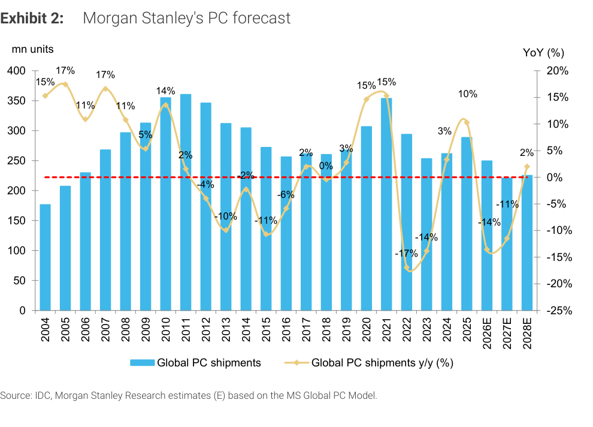

# MS｜AMD 3Q26 法說：對台灣硬體涵蓋標的的意涵

**券商**：Morgan Stanley  
**分析師**：Howard Kao、Irene Yen、Andy Meng, CFA  
**日期**：2026-11-04  
**主題**：AMD 3Q26 法說會重點（PC 通路銷售放緩、伺服器 CPU TAM、ABF 載板與供應鏈）與對台灣 OEM／ODM、伺服器與載板廠的影響  
**評級**：Industry View In-Line  
<a href="https://layx.uk/dl?g=產業&b=MS&d=20261104&h=AMD-3Q26-Implications">📎 下載 PDF</a>

---

## 報告總結

這是 11/2 Intel 法說後的第二篇 CPU 大廠財報解讀，AMD 的訊號和 Intel 同向。PC 端，AMD 說 3Q 末 PC 通路銷售轉慢（消費端尤其明顯），預估 CY27 PC 出貨年減雙位數 %，與 MS 的 -11% 一致，對低階消費型 OEM／ODM 偏負面；伺服器端，AMD 預期 CPU TAM 到 2030 年達 US\$220bn，Venice CPU 3Q 開始出貨、4Q 由雲端業者部署，利好嘉澤、緯穎、欣興、南電；供給端，AMD 已鎖定 2027 年所需的晶圓、載板、封裝與記憶體，仍是需求大於供給。

---

## MS 完整投資邏輯鏈

| 論點層次 | Exhibit | 內容 |
|---|---|---|
| PC 需求現況 | 1 | 3Q26 全球 PC 出貨 62.7mn，-20% YoY |
| PC 需求轉弱 | 封面 | AMD 稱 3Q 末 PC 通路銷售放緩，消費端尤其明顯 |
| 預估對照 | 2 | MS 預估 2027E 全球 PC 出貨 -11%，AMD 同樣預估年減雙位數 % |
| 伺服器需求 | 封面 | AMD 預期 CPU TAM 2030 年達 US\$220bn（隱含約 50% CAGR） |
| 供給限制 | 封面 | AMD 已鎖定 2027 所需的晶圓、載板、先進封裝與記憶體，仍是需求大於供給 |
| **結論** | 封面 | **PC 偏空、伺服器 CPU 與載板鏈偏多；若 AMD 在 PC 與伺服器同時搶下市占，嘉澤最受惠** |

> **報告最大邏輯缺口**：報告沒有量化 AMD 的伺服器 CPU 出貨成長對緯穎、嘉澤、欣興、南電的營收貢獻，也沒有給 AMD 在 PC、伺服器的目標市占；「US\$220bn TAM」屬公司說法，MS 未提供自己的驗證。

---

## 報告核心觀點

| 主題 | MS 觀點 | 市場共識 | 是否 Contra-Consensus |
|---|---|---|---|
| PC 需求 | AMD 稱 3Q 末 PC sell-through 放緩，消費端尤其明顯，預估 CY27 PC 出貨年減雙位數 %，與 MS 約 -11% 的預估一致；AMD 同時預期 CY27 表現優於市場 | — | — |
| 伺服器 CPU | AMD 預期 CPU TAM 2030 年達 US\$220bn，隱含約 50% CAGR；Venice CPU 3Q 開始出貨，雲端業者 4Q 部署 | — | — |
| ABF 載板與供應鏈 | AMD 已取得 2027 年更高成長所需的晶圓、載板、先進封裝與記憶體，並計畫再增加；供應鏈在 PC 與伺服器間相當「可互換」，但整體仍是需求大於供給 | — | — |
| 標的影響 | 負面訊息對宏碁、仁寶等低階消費型 OEM／ODM 偏空；伺服器 CPU 出貨強勁利好嘉澤、緯穎、欣興、南電，並間接利好金像電、台光電、台燿、金居；若 AMD 在 PC 與伺服器同時拿下市占，嘉澤受惠 | — | — |

**偏好排序**：報告未排序。  
**零件／個股偏好**：正面——嘉澤、緯穎、欣興、南電（直接），金像電、台光電、台燿、金居（間接）；負面——宏碁、仁寶。

---

## Exhibit 1｜Worldwide PC Vendor Ranking, 3Q26

### 解讀摘要

3Q26 全球 PC 出貨 62,685K 台，QoQ -9%、YoY -20%。減量集中在前四大品牌：HP -2,672K（QoQ -21%）、Lenovo -1,726K（-10%）、Dell -1,705K（-18%）、Apple -1,216K（-17%），合計 -7,319K，超過總減幅 -6,292K；只有華碩（+464K，+9%）與 Others（+563K，+3%）逆勢增加，抵銷了 1,027K。

> **原文補充**：AMD 說 3Q 末 PC 通路銷售轉慢，消費端尤其明顯；這張表與 11/2 Intel 法說解讀（[[20261102_MS_CPU-3Q26-Earnings]]）的 Exhibit 1 是同一份 IDC 資料，兩家 CPU 大廠對 PC 的說法互相印證。

### 表格

（單位：千台；資料來源 IDC）

| 排名 | 廠商 | 3Q26 出貨 | 3Q26 市占 | 2Q26 出貨 | 2Q26 市占 | 3Q25 出貨 | 3Q25 市占 | QoQ | YoY |
|---|---|---|---|---|---|---|---|---|---|
| 1 | Lenovo | 14,933 | 23.8% | 16,659 | 24.2% | 19,305 | 24.6% | -10% | -23% |
| 2 | HP | 10,344 | 16.5% | 13,016 | 18.9% | 14,975 | 19.1% | -21% | -31% |
| 3 | Dell | 7,581 | 12.1% | 9,286 | 13.5% | 10,107 | 12.9% | -18% | -25% |
| 4 | Apple | 5,946 | 9.5% | 7,162 | 10.4% | 6,702 | 8.5% | -17% | -11% |
| 5 | ASUS | 5,459 | 8.7% | 4,995 | 7.2% | 5,974 | 7.6% | 9% | -9% |
| | Others | 18,422 | 29.4% | 17,859 | 25.9% | 21,431 | 27.3% | 3% | -14% |
| | **Total** | **62,685** | | **68,977** | | **78,495** | | **-9%** | **-20%** |

### 增量貢獻拆解（3Q26 vs 2Q26 出貨變化）

| 成長來源 | 貢獻（千台） | 佔總變化 |
|---|---|---|
| HP（10,344 − 13,016） | -2,672 | 42.5% |
| Lenovo（14,933 − 16,659） | -1,726 | 27.4% |
| Dell（7,581 − 9,286） | -1,705 | 27.1% |
| Apple（5,946 − 7,162） | -1,216 | 19.3% |
| ASUS（5,459 − 4,995） | +464 | -7.4% |
| Others（18,422 − 17,859） | +563 | -8.9% |
| **淨變化（62,685 − 68,977）** | **-6,292** | **100%** |

> 計算：佔比 = 各項 ÷ 總變化 -6,292，例如 HP = 2,672 ÷ 6,292 = 42.5%；六項加總 42.5 + 27.4 + 27.1 + 19.3 − 7.4 − 8.9 = 100%。

> **洞察一**：前五大品牌合計市占由 2Q26 的 74.1% 降到 3Q26 的 70.6%（2Q26：51,118K ÷ 68,977K；3Q26：44,263K ÷ 62,685K），降幅 3.5ppt，與 Others 市占 +3.5ppt（25.9% → 29.4%）一致。品牌集中度在下降，跌幅最深的是 HP 與 Dell；報告沒有拆解各品牌的原因。

---

## Exhibit 2｜Morgan Stanley's PC forecast

### 解讀摘要

MS 的全球 PC 出貨預估：2026E 年減 14%、2027E 再減 11%、2028E 才回升 2%。柱狀圖沒有數值標籤，依 YoY 反推約 289mn（2025，+10%）→ 249mn（2026E）→ 221mn（2027E）→ 226mn（2028E），2027E 的出貨量低於 2006 年以後的所有年份，只高於 2004、2005 年（視覺估算，交叉驗證通過）。這張預估圖的 YoY 標籤與 11/2 Intel 解讀的 Exhibit 2 完全一致。

### 表格

（YoY 為圖上標籤；出貨量為柱高視覺估算，信心中等，驗算：289 × 0.86 = 248.5、× 0.89 = 221.2、× 1.02 = 225.6，與圖中柱高相符）

| 年度 | YoY（圖上標籤） | 出貨量（mn，視覺估算） |
|---|---|---|
| 2004 | 15% | — |
| 2005 | 17% | — |
| 2006 | 11% | — |
| 2007 | 17% | — |
| 2008 | 11% | — |
| 2009 | 5% | — |
| 2010 | 14% | — |
| 2011 | 2% | — |
| 2012 | -4% | — |
| 2013 | -10% | — |
| 2014 | -2% | — |
| 2015 | -11% | — |
| 2016 | -6% | — |
| 2017 | 2% | — |
| 2018 | 0% | — |
| 2019 | 3% | — |
| 2020 | 15% | 約 307 |
| 2021 | 15% | 約 354 |
| 2022 | -17% | 約 294 |
| 2023 | -14% | 約 254 |
| 2024 | 3% | 約 262 |
| 2025 | 10% | 約 289 |
| 2026E | -14% | 約 249 |
| 2027E | -11% | 約 221 |
| 2028E | 2% | 約 226 |

> **洞察二（配合 Exhibit 1）**：2027E 全年約 221mn（視覺估算），季均約 55mn，比 3Q26 IDC 的 62.7mn 低約 12%（55.3 ÷ 62.7 − 1 = −11.8%）。也就是說，MS 與 AMD 說的「CY27 年減雙位數 %」不只是延續 3Q26 的水準，還需要單季出貨在現有低檔再往下掉一成多。
> **值得驗證**：AMD 同時說 CY27 會優於市場。若 PC 市場 -11%，AMD 的 PC 市占必須上升才成立；報告沒有給 AMD 的 PC 目標市占，嘉澤「受惠於 AMD 同時在 PC 與伺服器搶市占」的結論因此無法量化。

> **洞察三**：AMD 預期 2030 年 CPU TAM 達 US\$220bn、隱含約 50% CAGR；若以 2026 到 2030 共四年複利估算（期間為本筆記的假設，報告未明說），2026 年基期約 US\$43bn（220 ÷ 1.5⁴ = 43.5），與 Intel 11/2 法說所說「伺服器 CPU TAM 由 US\$40bn 到五年後逾 US\$200bn」（見 [[20261102_MS_CPU-3Q26-Earnings]]）量級相近。兩家都以 CPU TAM 五倍化為主軸，但都是公司說法。

---

## 相關個股清單

| 類別 | 公司 | Ticker | 評等 | 備註 |
|---|---|---|---|---|
| 負面（低階消費型 OEM／ODM） | 宏碁 | 2353 | — | 報告未給評等 |
| 負面（低階消費型 OEM／ODM） | 仁寶 | 2324 | — | 報告未給評等 |
| 正面（伺服器 CPU 放量、AMD 同時搶 PC 與伺服器市占） | 嘉澤 | 3533 | — | 報告未給評等 |
| 正面（伺服器 CPU 放量） | 緯穎 | 6669 | — | 報告未給評等 |
| 正面（載板價量） | 欣興 | 3037 | — | 報告未給評等 |
| 正面（載板價量） | 南電 | 8046 | — | 報告未給評等 |
| 間接受惠 | 金像電 | 2368 | — | 報告未給評等 |
| 間接受惠 | 台光電 | 2383 | — | 報告未給評等 |
| 間接受惠 | 台燿 | 6274 | — | 報告未給評等 |
| 間接受惠 | 金居 | 8358 | — | 報告未給評等 |

> 報告內文只寫公司英文名，Ticker 取自股票中英文對照表。
