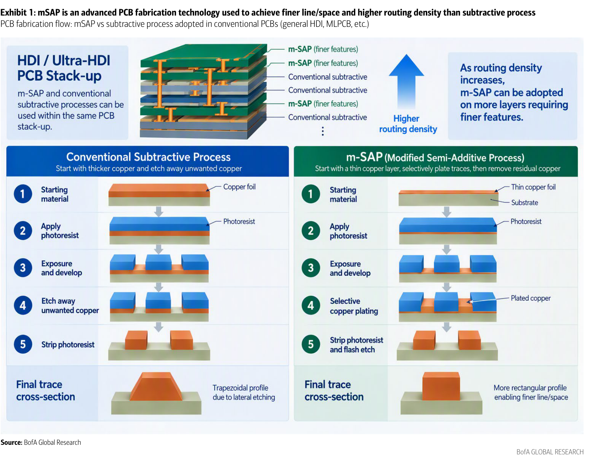
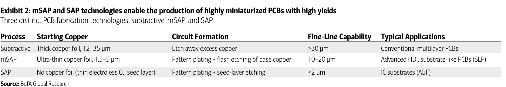
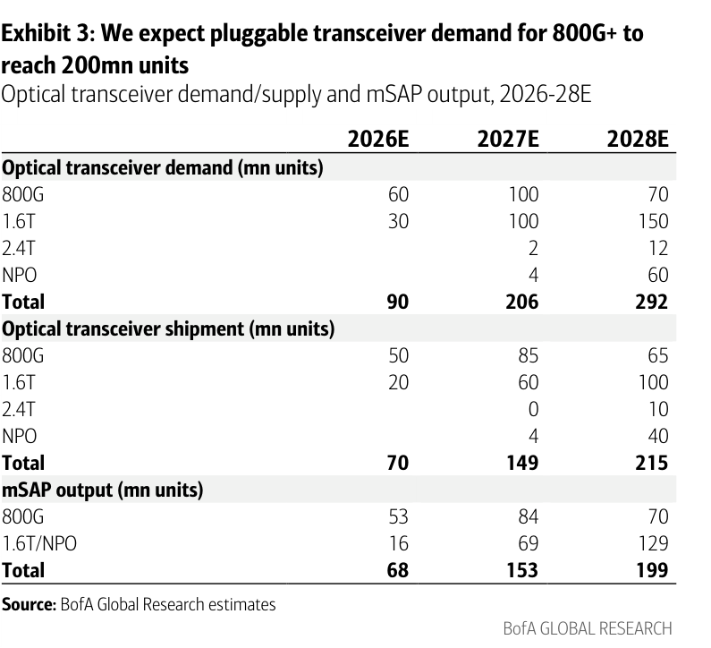
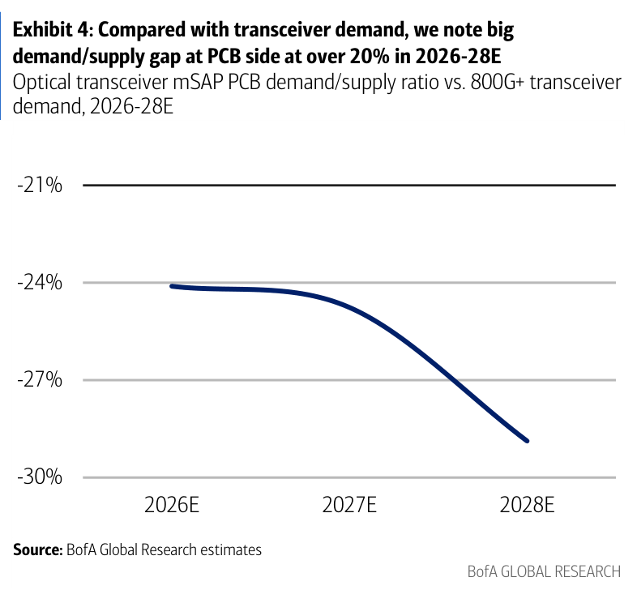
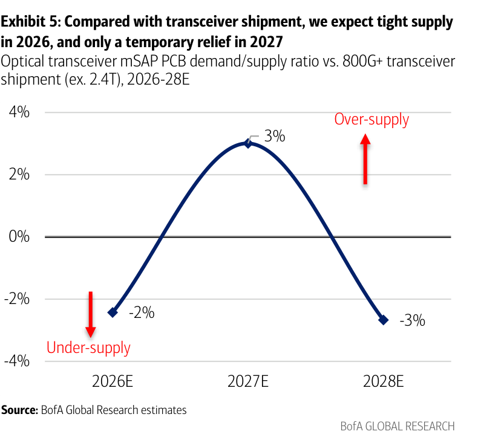
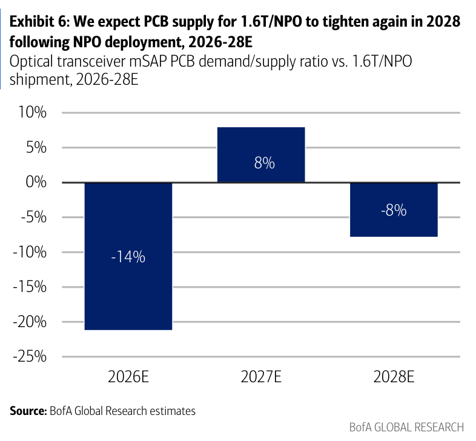
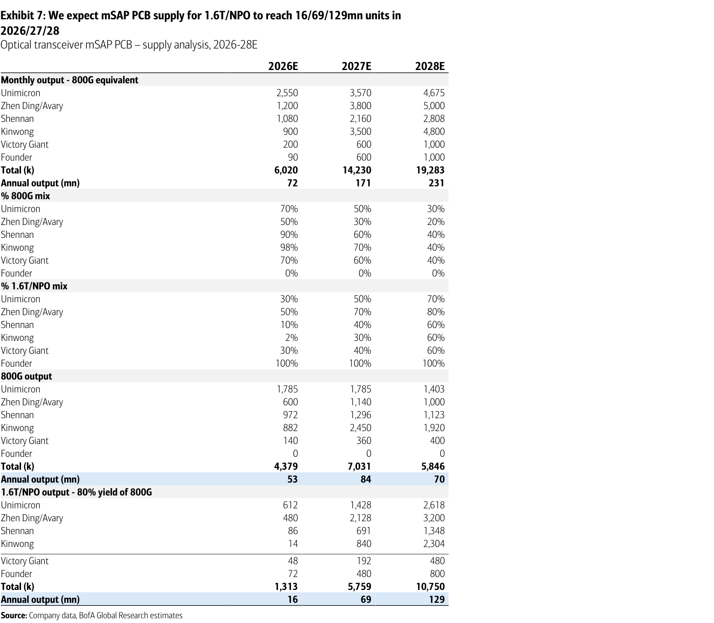

# BofA｜光收發模組 mSAP PCB：供給緊俏延續，2027 僅短暫緩解

**券商**：BofA Securities（美林）  
**分析師**：Katherine Zhu、Doris Kao、Mike Yang、Robert Cheng、Gina Wu  
**日期**：2026-11-05  
**主題**：Industry Overview——光收發模組（400G→1.6T→NPO）所需 mSAP PCB 的供需、擴產與受惠股；同日啟動覆蓋景旺電子（Kinwong）  
**評級**：Buy（景旺電子 H/A 啟動覆蓋；臻鼎、欣興、深南電路維持 Buy）  
<a href="https://layx.uk/dl?g=產業&b=BofA&d=20261105&h=mSAP-Optical-Transceivers">📎 下載 PDF</a>

---

## 報告總結

mSAP（改良型半加成法）原本主要供 Apple 使用、合格供應商少，如今 800G 更依賴 mSAP、1.6T 則完全採用 mSAP，需求強、供給緊。BofA 預估 800G+ 的 mSAP PCB 2026 年供給短缺約 2%（1.6T 缺口 14%），2027 年因業者擴產出現短暫緩解，2028 年隨 NPO 放量再度吃緊。

關鍵在於 2027 的「緩解」來自 1.6T 光模組出貨受 DSP 短缺壓抑，而非 PCB 真正過剩；對照實際需求仍有約 25% 缺口。BofA 因此同日啟動覆蓋景旺電子（Buy），並維持臻鼎、欣興、深南電路 Buy；偏好看 mSAP 與載板的上行空間。

---

## BofA 完整投資邏輯鏈

| 論點層次 | Exhibit | 內容 |
|---|---|---|
| 技術門檻高 | 1、2 | mSAP 以薄銅電鍍成線，可做更細線寬線距，製程比一般 HDI 複雜 |
| 需求明確 | 3 | 800G+ 需求 2026-28E 由 90 百萬顆倍增至 292 百萬顆 |
| 供給受限 | 7 | 設備交期 2 年以上、良率是兩大瓶頸 |
| 短暫緩解 | 5、6 | 2027 供過於求僅 +3%（1.6T/NPO +8%），2028 回到短缺 |
| 真實缺口仍大 | 4 | 對照實際需求，2026-28E 缺口維持 24-29% |
| **結論** | 封面 | **供給緊俏延續；啟動覆蓋 Kinwong Buy，維持 Buy 臻鼎、欣興、深南電路** |

> **報告最大邏輯缺口**：供給數字（Exhibit 7）以公司擴產目標為基礎，報告自己也指出設備交期與良率可能成為瓶頸，卻未提供「實際達成率打折」的敏感度；而 2027 的緩解幅度本來就只有 +3%，這個假設只要偏差幾個百分點就會翻轉結論。

---

## 報告核心觀點

| 主題 | BofA 觀點 | 市場共識 | 是否 Contra-Consensus |
|---|---|---|---|
| 2027 供需 | 對出貨僅短暫轉寬鬆（+3%），對實際需求仍缺約 25% | 擔心 2027 起供給過剩 | 是 |
| 1.6T 出貨 | DSP 短缺（台積電 3nm 產能分配）使出貨預估比實際需求低 40% | — | 補充觀點 |
| 2028 | NPO 放量，供給再度吃緊 | — | 補充觀點 |
| 2.4T 可能改用 BT 載板 | 欣興、深南電路、景碩、臻鼎受惠 | — | 補充觀點 |

**偏好排序**：報告未明確排序；啟動覆蓋景旺電子 Buy，維持臻鼎、欣興、深南電路 Buy。
**受惠標的**：Zhen Ding 臻鼎-KY（4958）、Unimicron 欣興（3037）、Shennan 深南電路、Kinwong 景旺電子；載板面提及景碩（3189）。

---

## Exhibit 1｜mSAP 與減成法的 PCB 製程流程

### 解讀摘要
傳統減成法從厚銅箔開始，靠蝕刻去除多餘銅，側向蝕刻使線路截面呈梯形；mSAP 從極薄銅層開始，先選擇性電鍍長出線路、再剝除光阻並閃蝕殘餘底銅，線路截面更接近矩形，因此可做更細的線寬線距、更高佈線密度。兩種製程可在同一疊構內混用，佈線密度愈高，需要細線的層數愈多，mSAP 的使用層數就愈增加——mSAP 含量是隨規格遞增的連續變數，不是有或無。

### 表格
| 步驟 | 減成法（Subtractive） | mSAP |
|---|---|---|
| 1 起始材料 | 銅箔＋基材 | 薄銅箔＋基材 |
| 2 | 塗佈光阻 | 塗佈光阻 |
| 3 | 曝光與顯影 | 曝光與顯影 |
| 4 | 蝕刻去除多餘銅 | 選擇性電鍍銅 |
| 5 | 剝除光阻 | 剝除光阻並閃蝕 |
| 最終截面 | 梯形（側蝕） | 較矩形，可做更細線寬線距 |

> **洞察一**：兩種製程只在步驟 4 起分岔——減成法「減」銅、mSAP「加」銅。「加」的路徑起始銅越薄、需蝕刻的量越少，才能把線寬壓到更細；這也是 mSAP 設備與良率門檻高於一般 HDI 的根源（見 Exhibit 7 的供給限制）。

---

## Exhibit 2｜三種 PCB 製程比較

### 解讀摘要
三種製程依起始銅厚與細線能力由粗到細排序：減成法（12–35 µm 銅箔，≥30 µm）→ mSAP（1.5–5 µm 超薄銅箔，10–20 µm）→ SAP（無銅箔、僅 electroless Cu 種子層，≤2 µm，用於 ABF 載板）。mSAP 位在一般多層板與 IC 載板之間，用途為進階 HDI 與類載板（SLP）。

### 表格
| 製程 | 起始銅 | 線路形成 | 細線能力 | 典型應用 |
|---|---|---|---|---|
| 減成法（Subtractive） | 厚銅箔 12–35 µm | 蝕刻去除多餘銅 | ≥30 µm | 傳統多層 PCB |
| mSAP | 超薄銅箔 1.5–5 µm | 圖形電鍍＋閃蝕底銅 | 10–20 µm | 進階 HDI、類載板（SLP） |
| SAP | 無銅箔（薄 electroless Cu 種子層） | 圖形電鍍＋種子層蝕刻 | ≤2 µm | IC 載板（ABF） |

> **洞察一**：線寬能力從 ≥30 µm 到 10–20 µm 再到 ≤2 µm，mSAP 與 SAP 相差約 5–10 倍。報告後文提到 2.4T 光模組可能改用 BT 載板而非 PCB（對載板廠欣興、深南、景碩、臻鼎是潛在利多），邏輯即是規格再往細推，會從 mSAP 的能力範圍滑向 SAP。
> **洞察二（配合 Exhibit 7 與供給面）**：部分 mSAP 設備與 SAP（BT/ABF 載板）共用，而載板的供給更緊——光模組 PCB 擴產與載板擴產在設備上互相競爭，是設備交期成為瓶頸的結構原因。

---

## Exhibit 3｜800G+ 光收發模組需求、出貨與 mSAP 產出

### 解讀摘要
2026-28E 800G+ 需求由 90 百萬顆增至 206 百萬顆（2027E）與 292 百萬顆（2028E），主力由 800G 轉為 1.6T（需求 30→100→150 百萬顆），2028 年再加入 NPO 60 百萬顆。實際出貨明顯低於需求（2027E 僅 149 百萬顆），主因 1.6T 受 DSP 供給限制；mSAP PCB 產出 68→153→199 百萬顆，2027 年略高於出貨（153 vs 149）、但仍遠低於需求。

> **原文補充**：供應鏈預期 2027 年全球 800G 與 1.6T 需求各約 90-100 百萬顆；但受 DSP 短缺影響，業界預期 1.6T 實際只出貨 60-70 百萬顆。BofA 目前 1.6T 出貨預估比實際終端需求低 40%（依台積電 3nm 產能分配推估）。

### 表格
| 百萬顆 | 2026E | 2027E | 2028E |
|---|---|---|---|
| **光模組需求** | | | |
| 　800G | 60 | 100 | 70 |
| 　1.6T | 30 | 100 | 150 |
| 　2.4T | — | 2 | 12 |
| 　NPO | — | 4 | 60 |
| 　**合計** | **90** | **206** | **292** |
| **光模組出貨** | | | |
| 　800G | 50 | 85 | 65 |
| 　1.6T | 20 | 60 | 100 |
| 　2.4T | — | 0 | 10 |
| 　NPO | — | 4 | 40 |
| 　**合計** | **70** | **149** | **215** |
| **mSAP 產出** | | | |
| 　800G | 53 | 84 | 70 |
| 　1.6T/NPO | 16 | 69 | 129 |
| 　**合計** | **68** | **153** | **199** |

> 交叉驗證：各年合計與分項相加一致（2027E 需求 100+100+2+4=206、出貨 85+60+0+4=149、mSAP 84+69=153）。

> **洞察一**：2027E 需求 206 與出貨 149 差 57 百萬顆（占需求 28%），其中 1.6T 一項就差 40 百萬顆（100−60），占整體缺口 70%（40/57）。「2027 供給緩解」因此幾乎完全取決於 1.6T 出貨——也就是 DSP——而不是 PCB 產能本身。
> **洞察二**：mSAP 產出 2026→2028E 成長 2.9 倍（68→199），低於需求成長的 3.2 倍（90→292）；2028E 出貨 215 與 mSAP 產出 199 之間仍有 16 百萬顆落差，印證 2028 回到短缺。
> **值得驗證**：1.6T 出貨預估（2027E 60 百萬顆）依賴台積電 3nm DSP 產能分配；若其他晶圓廠（如 MaxLinear 在 Samsung 的 DSP）貢獻增量，出貨上修將直接消耗 2027 的 +3% 緩解空間，甚至使 mSAP 再度短缺。

---

## Exhibit 4｜mSAP PCB 供需比 vs. 800G+ 光模組需求

### 解讀摘要
以實際需求（扣除 2.4T）為分母，mSAP 供給缺口在 2026E 約 -24%、2027E 約 -25%、2028E 約 -29%，逐年擴大。意義是：即使 2027 出貨端看起來寬鬆，對照「如果光模組都能出貨」的真實需求，PCB 仍短缺逾兩成，缺口的真正解方是 DSP 與整個光模組供應鏈，而不是只靠 PCB 擴產。

### 表格
| 供需比（mSAP 產出 ÷ 800G+ 需求 −1） | 2026E | 2027E | 2028E |
|---|---|---|---|
| 圖上讀值（視覺估算） | 約 -24% | 約 -25% | 約 -29% |
| 依 Exhibit 3 推算 | 68/90−1 = -24.4% | 153/204−1 = -25.0% | 199/280−1 = -28.9% |

> 圖上無資料標籤；依 Exhibit 3 以「需求扣除 2.4T」（2026E 90、2027E 204、2028E 280）推算，與圖形讀值吻合，信心中等。

> **洞察一**：缺口隨時間「擴大」而非收斂：2026E→2028E 由 -24% 擴至 -29%，代表即使業者全力擴產（Exhibit 7 產能 2026→2028 成長 3.2 倍），需求成長（3.1 倍，90→280）仍追著供給跑。
> **洞察二（配合 Exhibit 5）**：Exhibit 4 與 5 的差別只在分母（需求 vs. 出貨）。兩者並列代表報告的核心立場：2027 年表面寬鬆是「出貨受限」造成的假象，真實缺口一直在 24-29% 區間。

---

## Exhibit 5｜mSAP PCB 供需比 vs. 800G+ 光模組出貨（不含 2.4T）

### 解讀摘要
對照出貨而非需求，供需比 2026E 為 -2%（供給不足）、2027E 轉為 +3%（供過於求）、2028E 回到 -3%。這條倒 U 形曲線是市場擔心「2027 起 PCB 過剩」的來源；BofA 的看法是 2027 的過剩幅度極小（+3%），且 2028 NPO 放量後立刻回到短缺，因此只是短暫緩解。

### 表格
| 供需比（mSAP 產出 ÷ 出貨 −1，不含 2.4T） | 2026E | 2027E | 2028E |
|---|---|---|---|
| 圖上標示 | -2% | +3% | -3% |
| 依 Exhibit 3 推算 | 68/70−1 = -2.9% | 153/149−1 = +2.7% | 199/205−1 = -2.9% |

> 交叉驗證：2027E、2028E 推算值與圖上標示吻合；2026E 推算 -2.9% 對圖上 -2%，差 0.9ppt，屬四捨五入與分母取整數造成的差異（誤差容忍內）。

> **洞察一**：2027E 的 +3% 絕對量只有約 4 百萬顆（153−149），相當於 mSAP 產出的 2.6%。換句話說，2027 的「供給緩解」只要實際產出比預估少 3%（約 4.6 百萬顆），就會歸零甚至翻成短缺。
> **洞察二**：-2%→+3%→-3% 的擺盪幅度僅 ±3%，明顯小於 DRAM、ABF 等傳統供需循環的過剩／短缺幅度，對 PCB 廠的意義是：這輪光模組 mSAP 景氣即使有「緩解年」，價格壓力應遠小於一般 PCB 景氣反轉。

---

## Exhibit 6｜mSAP PCB 供需比 vs. 1.6T/NPO 出貨

### 解讀摘要
針對最先進的 1.6T 與 NPO，供需比 2026E 為 -14%（嚴重短缺）、2027E +8%（短暫過剩）、2028E -8%（NPO 放量後再度短缺）。1.6T 用 6/7 次增層 HDI 搭配 M8+ CCL，良率較低、占用產能更多，因此 2026 缺口最大；2027 出貨不足使供給短暫寬鬆；2028 NPO 對層數與線寬要求更高、再度拉緊。

### 表格
| 供需比（mSAP 產出 ÷ 1.6T/NPO 出貨 −1） | 2026E | 2027E | 2028E |
|---|---|---|---|
| 圖上標示 | -14% | +8% | -8% |
| 依 Exhibit 3 推算（1.6T+NPO 出貨 20／64／140；產出 16／69／129） | 16/20−1 = -20% | 69/64−1 = +7.8% | 129/140−1 = -7.9% |

> 交叉驗證：2027E、2028E 吻合；2026E 圖上標籤 -14%，但長條高度約 -21%，依 Exhibit 3 整數推算為 -20%，與標籤不一致（文字敘述亦採 14%）。

> **洞察一**：1.6T/NPO 的緩解幅度（+8%）是整體（+3%）的 2.7 倍，但同樣被 2028 的 -8% 抵銷；而 1.6T/NPO 2027→2028E 供給由 69 增至 129 百萬顆（+87%），出貨需求卻由 64 增至 140 百萬顆（+119%）。需求成長快於供給，是 2028 再度短缺的算術來源。
> **值得驗證**：2026E 的 -14% 標籤與 -21%（長條）／-20%（推算）不一致。若實際缺口是 -20% 而非 -14%，代表 2026 年 1.6T PCB 比報告文字描述更緊，與「1.6T PCB 單價由 CNY200 升至 CNY250-300」的漲價幅度（+25-50%）方向更一致；若標籤為準則缺口較小。報告未說明差異原因。

---

## Exhibit 7｜1.6T/NPO mSAP PCB 供給分析（分廠）

### 解讀摘要
六家供應商的 800G 當量月產能由 2026E 6,020k 倍增至 2027E 14,230k（+136%）、2028E 19,283k，其中臻鼎（1,200k→3,800k）、景旺（900k→3,500k）、勝宏（200k→600k）擴張最積極；欣興僅 2,550k→3,570k（+40%）。產品結構同步由 800G 轉向 1.6T/NPO，1.6T/NPO 產出（以 800G 良率 80% 折算）由 1,313k 增至 5,759k 與 10,750k，換算年產出 16、69、129 百萬顆。

> **原文補充**：BofA 點名臻鼎、景旺、勝宏為較積極擴產者；供給有兩大變數：(1) 設備交期長（2 年以上，包括雷射鑽孔與電鍍設備），且部分設備同樣用於更緊俏的載板（SAP）；(2) mSAP 比 HDI/HLC 更複雜、有經驗的供應商少，良率可能成為瓶頸，部分業者為縮短交期選用低階設備擴產，可能傷及良率與產出。

### 表格
| 月產能（k，800G 當量） | 2026E | 2027E | 2028E |
|---|---|---|---|
| 欣興 Unimicron | 2,550 | 3,570 | 4,675 |
| 臻鼎 Zhen Ding/Avary | 1,200 | 3,800 | 5,000 |
| 深南 Shennan | 1,080 | 2,160 | 2,808 |
| 景旺 Kinwong | 900 | 3,500 | 4,800 |
| 勝宏 Victory Giant | 200 | 600 | 1,000 |
| 方正 Founder | 90 | 600 | 1,000 |
| **合計** | **6,020** | **14,230** | **19,283** |
| 年產出（百萬） | 72 | 171 | 231 |

| 1.6T/NPO 占產能比重 | 2026E | 2027E | 2028E |
|---|---|---|---|
| 欣興 | 30% | 50% | 70% |
| 臻鼎 | 50% | 70% | 80% |
| 深南 | 10% | 40% | 60% |
| 景旺 | 2% | 30% | 60% |
| 勝宏 | 30% | 40% | 60% |
| 方正 | 100% | 100% | 100% |

| 800G 產出（k） | 2026E | 2027E | 2028E |
|---|---|---|---|
| 欣興 | 1,785 | 1,785 | 1,403 |
| 臻鼎 | 600 | 1,140 | 1,000 |
| 深南 | 972 | 1,296 | 1,123 |
| 景旺 | 882 | 2,450 | 1,920 |
| 勝宏 | 140 | 360 | 400 |
| 方正 | 0 | 0 | 0 |
| **合計（k）** | **4,379** | **7,031** | **5,846** |
| 年產出（百萬） | 53 | 84 | 70 |

| 1.6T/NPO 產出（k，800G 良率 80%） | 2026E | 2027E | 2028E |
|---|---|---|---|
| 欣興 | 612 | 1,428 | 2,618 |
| 臻鼎 | 480 | 2,128 | 3,200 |
| 深南 | 86 | 691 | 1,348 |
| 景旺 | 14 | 840 | 2,304 |
| 勝宏 | 48 | 192 | 480 |
| 方正 | 72 | 480 | 800 |
| **合計（k）** | **1,313** | **5,759** | **10,750** |
| 年產出（百萬） | 16 | 69 | 129 |

> 交叉驗證：欣興 2026E 1.6T/NPO 產出 = 2,550×30%×80% = 612，與表一致；2027E 3,570×50%×80% = 1,428，一致。各廠 2028E 1.6T/NPO 產出加總 2,618+3,200+1,348+2,304+480+800 = 10,750，與合計一致。

### 增量貢獻拆解（2027E→2028E 1.6T/NPO 產出增量 +4,991k）
| 成長來源 | 貢獻（k） | 佔總增量 |
|---|---|---|
| 景旺 Kinwong（840→2,304） | +1,464 | 29.3% |
| 欣興 Unimicron（1,428→2,618） | +1,190 | 23.8% |
| 深南 Shennan（691→1,348） | +657 | 13.2% |
| 臻鼎 Zhen Ding（2,128→3,200） | +1,072 | 21.5% |
| 方正 Founder（480→800） | +320 | 6.4% |
| 勝宏 Victory Giant（192→480） | +288 | 5.8% |
| **淨增量** | **+4,991** | **100%** |

> 計算：10,750 − 5,759 = 4,991；景旺 +1,464 / 4,991 = 29.3%；欣興 +1,190 / 4,991 = 23.8%；臻鼎 +1,072 / 4,991 = 21.5%。

> **洞察一**：2027E 臻鼎與景旺的總月產能分別是 2026E 的 3.2 倍與 3.9 倍，欣興僅 1.4 倍。1.6T/NPO 產出 2027E 臻鼎占 37%（2,128/5,759），2028E 降為 30%，景旺則由 15% 升至 21%——景旺是 2028 年增量最大的來源（29%）。這也是 BofA 同日啟動覆蓋景旺 Buy 的產能面理由。
> **洞察二（配合 Exhibit 5、6）**：Exhibit 7 的 2027E 供給（153 百萬顆）是 Exhibit 5 的 +3% 緩解的分子。這些產能的前提是設備在 2025-26 年已下單、2 年交期內如期到貨且良率爬升順利；任何一項延後，緩解就消失。
> **值得驗證**：供給端是以公司擴產目標為基礎（資料來源註明 Company data），而景旺 2027E 1.6T/NPO 占比由 2% 躍升至 30%、產出由 14k 升至 840k（60 倍），這個爬坡速度最依賴新技術良率；若景旺 2027E 1.6T/NPO 只達預期的一半（缺 420k，約 5 百萬顆），就足以抵消 Exhibit 5 的 +3% 緩解。

---

## 相關個股清單

| 類別 | 公司 | Ticker | 評等 | 備註 |
|---|---|---|---|---|
| PCB／載板 | Unimicron 欣興 | 3037 | Buy | PO NT\$1,650（35x 2H27-1H28E，約歷史均值 20x 之上 1 個標準差）；股價 NT\$888；上行空間約 86%（自行計算） |
| PCB | Zhen Ding 臻鼎-KY | 4958 | Buy | PO NT\$630（25x 2027E，歷史高位）；股價 NT\$433；上行空間約 46%（自行計算） |
| PCB（啟動覆蓋） | Kinwong 景旺電子 | 3228.HK／603228.CH | Buy（Initiation） | H 股 PO HK\$82（12x 2027E）、A 股 PO CNY98（17x 2027E，較 H 股溢價 40%）；股價 HK\$53.65／CNY61.53 |
| PCB | Shennan 深南電路 | 002916.CH | Buy | PO CNY409（30x 2027E）；股價 CNY225.6 |
| 載板 | Kinsus 景碩 | 3189 | 未於本報告列評等 | 2.4T 若改用 BT 載板，為潛在受惠者之一 |
| 供應商（無評等） | Victory Giant 勝宏、Founder 方正 | — | — | Exhibit 7 列入的 mSAP 供應商 |
