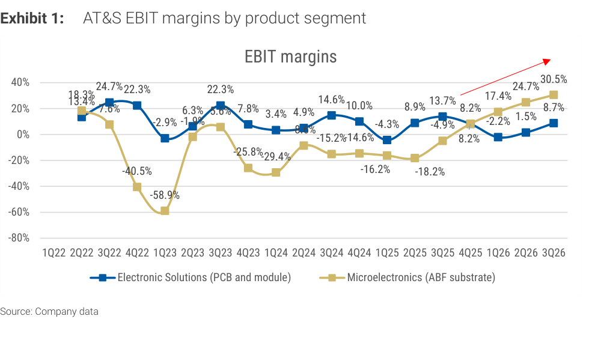

# MS｜ABF 基板：AT&S F2Q26/27 財報 Read-across

**券商**：Morgan Stanley（摩根士丹利）  
**分析師**：Howard Kao、Andy Meng（CFA）、Irene Yen  
**日期**：2026-11-05  
**主題**：ABF 基板廠 AT&S（奧地利）F2Q26/27（日曆 3Q26）財報對台灣 ABF 供應鏈（欣興、南電）的 read-across  
**評級**：Industry View In-Line  
<a href="https://layx.uk/dl?g=產業&b=MS&d=20261105&h=ABF-ATS-Implications">📎 下載 PDF</a>

---

## 報告總結

這份 MS update 的催化劑是 AT&S 公布 F2Q26/27（日曆 3Q26）財報：營收 €682mn（+24% QoQ），其中 Microelectronics（ABF 基板）+23% QoQ，且 ABF 部門 EBIT 利潤率再 +580bp 至 30.5%（管理層歸因量增、產品組合改善與定價環境好轉）。全年 guidance 維持不變（營收 +45-55% YoY、EBITDA 利潤率 32-37%）。

投資意涵：MS 認為這對同為 ABF 的欣興（Unimicron）與南電（NYPCB）是正面 read-across；Kulim 擴產（€1.5-2.0bn）由 AMD 與另一家領先科技客戶的長約承諾支撐，加上 9 月與 Marvell 擴大合作，顯示供給緊俏且客戶看得到多年需求。

---

## MS 完整投資邏輯鏈

| 論點層次 | Exhibit | 內容 |
|---|---|---|
| 獲利確認 | 1 | AT&S ABF 部門 EBIT 利潤率 30.5%，連續第五季上升 |
| 定價與產品組合 | 封面 | 管理層歸因：量增、產品組合、定價環境改善 |
| 前景穩定 | 封面 | 全年營收 +45-55% YoY、EBITDA 利潤率 32-37% 維持不變 |
| 供給紀律 | 封面 | Kulim €1.5-2.0bn 擴產由長約客戶承諾支撐 |
| **結論** | 封面 | **對欣興、南電為正面 read-across；供給緊俏、多年能見度** |

> **報告最大邏輯缺口**：AT&S 的產品組合、客戶（AMD、Marvell）與地域（歐洲／馬來西亞）和台廠不同，利潤率改善能否等比例傳導到欣興與南電，報告只做定性連結、沒有量化台廠的利潤率敏感度；且本期 guidance 只是「維持」而非上修，邊際動能以利潤率為主。

---

## 報告核心觀點

| 主題 | MS 觀點 | 意義 |
|---|---|---|
| AT&S ABF 利潤率 | +580bp QoQ 至 30.5% | 定價、量能與組合同步改善 |
| AT&S guidance | 營收 +45-55% YoY、EBITDA 利潤率 32-37%，不變 | 高檔維持，無下修 |
| 擴產性質 | 長約客戶承諾支撐 | 供給紀律佳、非投機擴產 |
| 台廠 read-across | 欣興、南電正面 | ABF 上行週期延續 |

**受惠標的**：Unimicron 欣興（3037）、Nan Ya PCB 南電（8046）。

---

## Exhibit 1｜AT&S 分部 EBIT 利潤率

### 解讀摘要
Microelectronics（ABF 基板，黃線）EBIT 利潤率自 2Q25 的 -18.2% 起連續五季上升（-4.9%→8.2%→17.4%→24.7%→30.5%），累計擺盪 +48.7ppt，3Q26 單季再 +580bp。相對地，Electronic Solutions（PCB 與模組，藍線）3Q26 為 8.7%（較 2Q26 的 1.5% 回升 720bp），仍低於 ABF 部門 21.8ppt，顯示本輪獲利彈性主要來自 ABF 基板。

> **原文補充**：管理層將 ABF 利潤率提升歸因於「更高量能、更佳產品組合與改善的定價環境」；AT&S 預期 Microelectronics 擴產「在本財年即對營收與獲利產生正面影響」。

### 表格
| 季度 | ABF（Microelectronics）EBIT 利潤率 | Electronic Solutions EBIT 利潤率 |
|---|---|---|
| 1Q23（谷底） | -58.9% | -2.9% |
| 2Q25 | -18.2% | 8.9% |
| 3Q25 | -4.9% | 13.7% |
| 4Q25 | 8.2% | 8.2% |
| 1Q26 | 17.4% | -2.2% |
| 2Q26 | 24.7% | 1.5% |
| 3Q26 | 30.5%（+580bp QoQ） | 8.7%（+720bp QoQ） |

> 視覺估算，交叉驗證：2Q26→3Q26 ABF 24.7%→30.5% = +5.8ppt，與文字「+580bp」一致。

> **洞察一**：ABF 利潤率自 1Q23 谷底 -58.9% 回到 30.5%，擺盪約 89ppt；3Q26 已高於圖上所有歷史高點（前高為 2Q22 的 18.3%），是首次站上 30%，代表本輪上行週期的利潤池已超越上一輪，對欣興、南電的毛利率上行空間是正面佐證。
> **洞察二**：Electronic Solutions 與 ABF 的利潤率在 4Q25 交叉（同為 8.2%）後再度分岔，ABF 由落後轉為領先。同一家公司內兩個部門的相對利潤率翻轉，說明「基板」而非「一般 PCB」才是定價權所在，與南電 ABF／BT 占比高的邏輯一致。
> **值得驗證**：guidance 維持而非上修，而 3Q26 利潤率已升至 30.5%，若 4Q 利潤率持平於此水準，全年 EBITDA 利潤率 32-37% 區間的上緣是否有上修空間，需看下季指引。

---

## 相關個股清單

| 類別 | 公司 | Ticker | MS 觀點 | 備註 |
|---|---|---|---|---|
| ABF 基板 | Unimicron 欣興 | 3037 | 正面 | 估值法 RI model（CoE 9.2%，中期成長 14%，終端成長 3%） |
| ABF／BT 基板 | Nan Ya PCB 南電 | 8046 | 正面 | 同日 3Q26 財報 OW、TP NT\$2,000，見 [[8046_南電]] |
| 參考（未覆蓋） | AT&S | ATSV.VI | not covered | 歐洲 ABF 基板廠，本報告 read-across 來源 |
