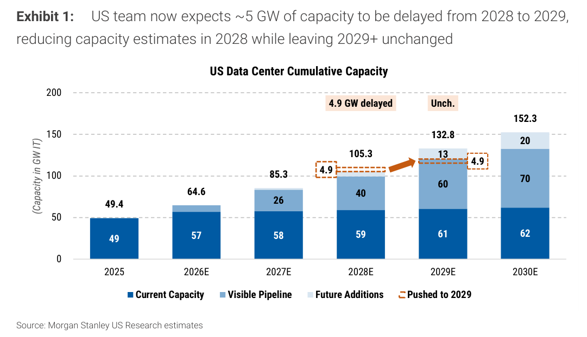
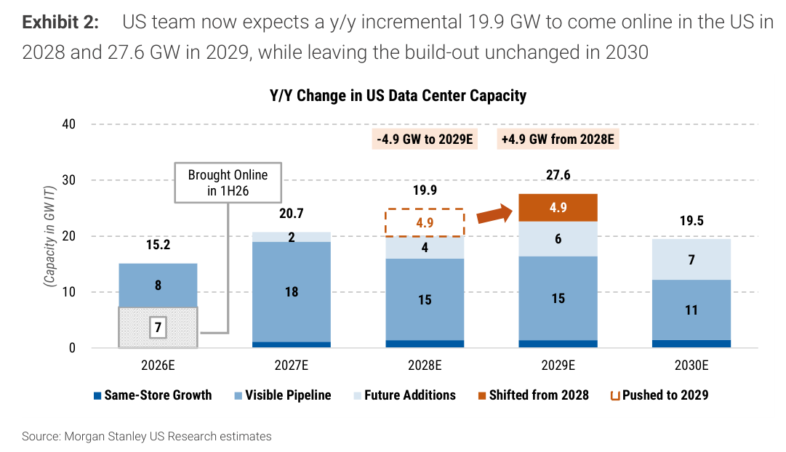
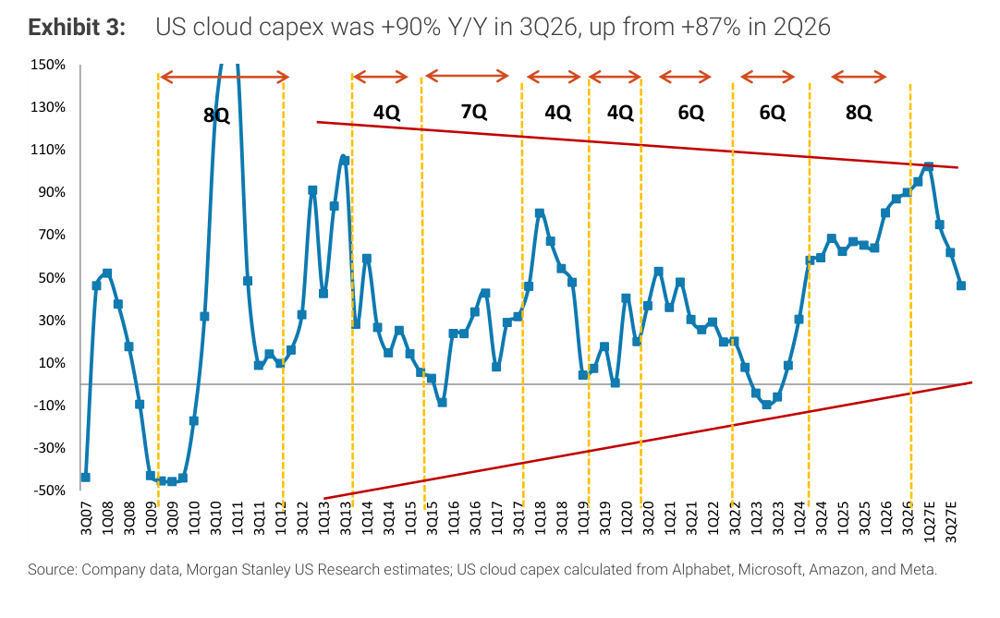
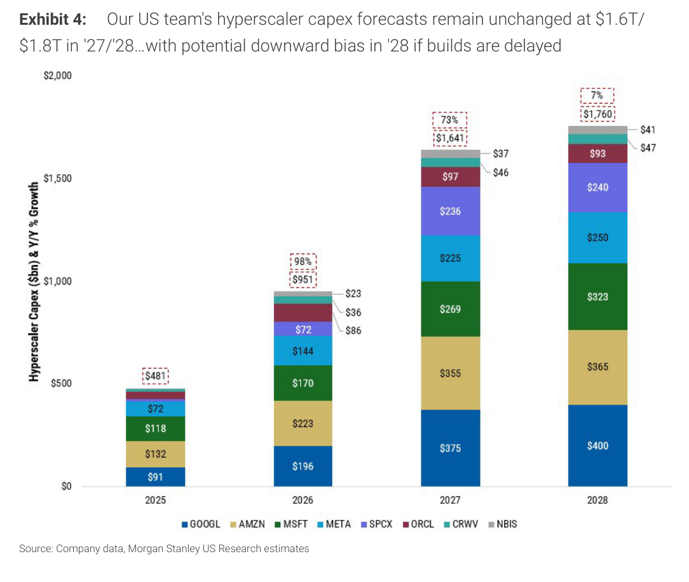
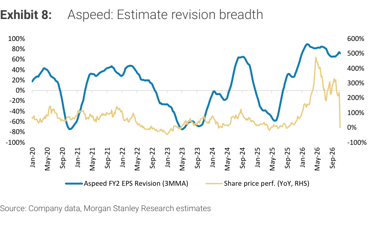

# MS｜Cloud Semis：成長見頂，上行空間收斂

**券商**：Morgan Stanley  
**分析師**：Daniel Yen, CFA、Charlie Chan、Daisy Dai, CFA、Ethan Jia  
**日期**：2026-11-09  
**主題**：美國期中選舉後資料中心建置遞延風險，雲端半導體（信驊、澜起科技）降評至 Equal-weight  
**評級**：Industry View Attractive  
<a href="https://layx.uk/dl?g=產業&b=MS&d=20261109&h=Cloud-Semis">📎 下載 PDF</a>

---

## 報告總結

MS 美國團隊預期約 20% 的 2028 年美國資料中心新增容量（約 4.9GW，含德州與俄亥俄部分專案）因各州新立法而遞延到 2029 年，但 hyperscaler 2027／28 年 capex 預測仍維持 US\$1.6tn／US\$1.8tn，只留下 2028 年可能下修的偏誤。MS 亞洲團隊據此認為未來 2-4 季風險升高：獲利成長仍可支撐股價，但本益比進一步擴張變難，因為市場更在意成長的方向而非絕對成長；信驊與澜起科技因此由 Overweight 降為 Equal-weight，目標價分別砍 40%、52%。

---

## MS 完整投資邏輯鏈

| 論點層次 | Exhibit | 內容 |
|---|---|---|
| 觸發事件 | 封面 | 期中選舉後各州新增資料中心立法，專案核准與動工延遲 |
| 容量遞延 | 1、2 | 約 4.9GW 由 2028 年移到 2029 年 |
| 成長高點 | 3 | 雲端 capex 年增率可能於 1Q27 見頂 |
| 支出預測 | 4 | 2027／28 年預測不變，2028 年有下修偏誤 |
| 修正見頂 | 8 | 信驊盈餘預估修正廣度已近高點 |
| 評等動作 | 封面 | 信驊、澜起科技降為 Equal-weight |
| **結論** | 封面 | **獲利仍成長，但估值難再擴張** |

> **報告最大邏輯缺口**：MS 同時上修信驊 2026／27／28 年 EPS 6%／10%／10%（主要來自股數假設調整，營收與淨利大致不變），目標價卻從 NT\$24,000 砍到 NT\$14,417（-40%），來源是殘餘收益模型的成長率假設下調（終端成長率 5.5%→3.0%、中期成長率 21.4%→18.0%），而非獲利下修；報告沒有說明「2028 年遞延」如何量化成這兩個成長率的降幅。

---

## 報告核心觀點

| 主題 | MS 觀點 | 市場共識 | 是否 Contra-Consensus |
|---|---|---|---|
| 2028 年資料中心容量 | 美國約 20%（約 10% 全球）的 2028 年新增容量遞延到 2029 年，可能讓 2028 年科技供應鏈出現「空窗」（air pocket），削弱定價力並導致庫存累積 | 報告未提供 | — |
| Hyperscaler capex | 2027／28 年預測維持 US\$1.6tn／US\$1.8tn，預期業者會把專案轉往立法友善的州（如田納西、路易斯安那） | 報告未提供 | — |
| 亞洲供應鏈能見度 | 預估修正廣度見頂，2027／28 年通用伺服器生產的能見度轉弱 | 報告未提供 | — |
| 評等 | 信驊、澜起科技降至 Equal-weight | Refinitiv 評等分布 100% Overweight | 是（降評與共識評等分布相反） |

**偏好排序**：報告未排序。  
**零件／個股偏好**：長期仍喜歡信驊的供應鏈地位（Google 次世代 TPU 預期採用其 BMC，預估 2027 年貢獻 13% 營收），但認為再評價空間有限；澜起科技則看到中國採購放緩與評價下修風險，結構性內容成長仍在，但建議在減速前降低曝險。  
**上行風險**：盈餘持續改善、部署速度加快、1Q27 之後 capex 仍持續加速。

### 評等與目標價調整（取自報告內文）

| 公司 | 代號 | 評等 | 目標價 | 幅度 |
|---|---|---|---|---|
| 信驊 | 5274.TWO | Overweight → Equal-weight | NT\$24,000 → NT\$14,417 | -40% |
| 澜起科技（H 股） | 6809.HK | Overweight → Equal-weight | HK\$432 → HK\$207 | -52% |
| 澜起科技（A 股） | 688008.SS | Overweight → Equal-weight | Rmb377 → Rmb180 | -52% |

> 計算：14,417 / 24,000 - 1 = -39.9%；207 / 432 - 1 = -52.1%；180 / 377 - 1 = -52.3%。

### 信驊與澜起科技估計與估值假設（取自報告內文）

| 項目 | 信驊（NT\$） | 澜起科技 |
|---|---|---|
| EPS 修正 | 2026E 220.93（前 207.93，+6%）／2027E 344.84（前 313.49，+10%）／2028E 487.89（前 443.53，+10%） | 2026／27／28E 分別 -2%／-26%／-24%（記憶體介面、MRCD／MDB、PCIe／CXL 出貨預估下調） |
| 估值方法 | 殘餘收益模型：CoE 9.8%、派息率 85%、中期成長 18.0%（前 21.4%）、終端成長 3.0%（前 5.5%） | 殘餘收益模型：CoE 8.4%、派息率 30%、中期成長 13.6%（前 19.3%）、終端成長 4.0% |
| Bull／Bear 情境 | NT\$17,600／NT\$6,900（前 NT\$29,300／NT\$11,500），對應 51x／20x 2027E EPS | A 股 Rmb218／Rmb83、H 股 HK\$259／HK\$94 |
| 目標價隱含倍數 | 42x 2027E EPS（等於 2020 年以來一年前瞻 P/E 均值 42x） | 37x 2027E P/E（A 股 2020 年以來均值 70x） |

> 計算：信驊目標價 14,417 / 2027E EPS 344.84 = 41.8x，約 42x；Bull 17,600 / 344.84 = 51.0x；Bear 6,900 / 344.84 = 20.0x。

---

## Exhibit 1｜美國團隊預期約 5GW 容量由 2028 年遞延至 2029 年

### 解讀摘要
MS 美國團隊把約 4.9GW 的 2028 年容量新增往後移到 2029 年，2029 年起的累計容量不變，所以 2028 年累計容量是被拉低而非整體建置規模縮水。機制是各州州長推動資料中心新立法，導致專案核准與動工延遲，這使「空窗」只落在 2028 年，也就是 2028 年供應鏈出貨與認列的時間差，而不是需求消失。對供應商而言，意義是 2028 年訂單與定價力承壓，2029 年才補回。

### 表格
| 年度 | 2025 | 2026E | 2027E | 2028E | 2029E | 2030E |
|---|---|---|---|---|---|---|
| **美國資料中心累計容量（GW IT）** | 49.4 | 64.6 | 85.3 | 105.3 | 132.8 | 152.3 |
| 　現有容量 | 49 | 57 | 58 | 59 | 61 | 62 |
| 　可見管線 | — | — | 26 | 40 | 60 | 70 |
| 　未來新增 | — | — | — | — | 13 | 20 |
| 　遞延至 2029（圖中標示） | — | — | — | 4.9 | 4.9（移入） | — |

（圖中標籤為四捨五入，分項不一定加總到合計；2025／2026E 的管線分項圖中未標示。）

> **洞察一**：遞延量占 2028 年原先預期新增容量的約五分之一。原 2028 年新增 = 19.9 + 4.9 = 24.8GW，遞延占 4.9 / 24.8 = 19.8%，與報告所稱「約 20%」吻合；2028 年累計容量成長由原先 (105.3 + 4.9) / 85.3 - 1 = +29.2% 降為 105.3 / 85.3 - 1 = +23.4%。

---

## Exhibit 2｜美國年增容量：2028 年 19.9GW、2029 年 27.6GW

### 解讀摘要
Exhibit 1 的累計容量換成逐年新增後，遞延的影響更直觀：2028 年新增由原先的 24.8GW 降到 19.9GW，2029 年則由原先的 22.7GW 增為 27.6GW，2030 年 19.5GW 維持不變。這等於把 2028 年的成長高峰削平、2029 年墊高，供應鏈營收曲線變成「2028 年微降、2029 年大增」，而不是「2028 年高點、2029 年小降」。

### 表格
| 年度 | 2026E | 2027E | 2028E | 2029E | 2030E |
|---|---|---|---|---|---|
| **美國年增容量（GW IT）** | 15.2 | 20.7 | 19.9 | 27.6 | 19.5 |
| 　1H26 已上線 | 7 | — | — | — | — |
| 　可見管線 | 8 | 18 | 15 | 15 | 11 |
| 　未來新增 | — | 2 | 4 | 6 | 7 |
| 　由 2028 年移入 | — | — | — | 4.9 | — |
| 　被推遲至 2029 年（原屬 2028） | — | — | 4.9 | — | — |

（同店成長項約 1GW，圖中未標；分項為四捨五入。）

> **洞察二**：遞延讓 2028 年新增容量年減，是因為基期是 2027 年。2028 年 19.9GW 對 2027 年 20.7GW 為 19.9 / 20.7 - 1 = -3.9%（報告寫 -4%），2029 年 27.6 / 19.9 - 1 = +38.7%（報告寫 +38%）。若沒有遞延，2028 年為 24.8 / 20.7 - 1 = +19.8%，2029 年為 22.7 / 24.8 - 1 = -8.5%——遞延把兩年的方向對調。

---

## Exhibit 3｜美國雲端 capex 3Q26 年增 90%，高於 2Q26 的 87%

### 解讀摘要
美國雲端 capex（以 Alphabet、微軟、亞馬遜、Meta 計算）年增率在 3Q26 達 +90%，2Q26 為 +87%，且圖上預估年增率將於 1Q27 前後見到約 100% 的高點，之後轉為下滑（讀圖估計，3Q27E 約 46%）。圖中以虛線區隔歷次擴張期，長度落在 4-8 季之間，本輪已經 8 季，與歷史最長的一段持平，這是 MS 判斷成長可能在 1Q27 見頂的主要依據。重點是年增率的「方向」：即使 capex 絕對金額仍成長，增速下滑也會壓縮估值。

### 表格
| 擴張期序 | 1 | 2 | 3 | 4 | 5 | 6 | 7 | 8（本輪） |
|---|---|---|---|---|---|---|---|---|
| 上行季數 | 8 | 4 | 7 | 4 | 4 | 6 | 6 | 8 |

（依圖中虛線之間的標註讀取；起訖季度未逐一確認。）

> **洞察三**：歷史擴張期平均 (8 + 4 + 7 + 4 + 4 + 6 + 6 + 8) / 8 = 47 / 8 = 5.9 季，本輪 8 季比平均長 2.1 季，且 8 季已是圖中的歷史上限（共 2 段），與 MS 「1Q27 見頂」的判斷一致。

---

## Exhibit 4｜Hyperscaler capex：2027／28 年預測不變，2028 年有下修偏誤

### 解讀摘要
MS 美國團隊把 hyperscaler capex 預測維持在 2027 年 US\$1,641bn（+73%）、2028 年 US\$1,760bn（+7%），原因是預期業者會盡可能自建並把專案轉往立法友善的州，但標註「若建置遞延，2028 年有下修偏誤」。2028 年增速只剩 +7% 是這張圖最關鍵的訊號：成長高峰在 2026-27 年，2028 年已近平台。

### 表格
| US\$bn | 2025 | 2026 | 2027 | 2028 |
|---|---|---|---|---|
| **合計** | 481 | 951 | 1,641 | 1,760 |
| 　年增率 | — | +98% | +73% | +7% |
| 　GOOGL | 91 | 196 | 375 | 400 |
| 　AMZN | 132 | 223 | 355 | 365 |
| 　MSFT | 118 | 170 | 269 | 323 |
| 　META | 72 | 144 | 225 | 250 |
| 　SPCX（圖例原文） | — | 72 | 236 | 240 |
| 　ORCL | — | 86 | 97 | 93 |
| 　CRWV | — | 36 | 46 | 47 |
| 　NBIS | — | 23 | 37 | 41 |

（2025 年 ORCL、CRWV、NBIS、SPCX 在圖中未標示數值；各年分項加總與圖上合計差 1 屬四捨五入。）

> **洞察四**：2028 年的增量只有 2027 年的約六分之一。增量 2026 = 951 - 481 = US\$470bn、2027 = 1,641 - 951 = US\$690bn、2028 = 1,760 - 1,641 = US\$119bn，2028 年增量僅 2027 年的 119 / 690 = 17%。

> **洞察五（配合 Exhibit 2）**：2028 年美國新增容量 -4% 而 hyperscaler capex +7%，兩者口徑不同（前者為美國 IT 容量、後者為全球支出），不能直接相除；但方向上，capex 增速從 2027 年的 +73% 掉到 +7%，同時實體新增容量轉為負成長，雙重放緩支持「2028 年是空窗」的說法。

---

## Exhibit 8｜信驊：盈餘預估修正廣度

### 解讀摘要
圖中藍線是信驊 FY2 EPS 修正廣度（3 個月移動平均），黃線是股價年增率（右軸）。修正廣度在 2026 年初攀上約 +90% 的歷史高點、目前仍在 +65-70%（讀圖估計），股價年增率則在 2026 年 5 月前後達約 +500% 後急降至接近 0%。MS 把「修正廣度見頂」視為降評依據：歷次高點之後，修正廣度都在數個月內回落到負值。

### 表格
（圖形資料，無表格數據可提取；讀圖估計：高點 2020 年 3 月約 +43%、2022 年約 +47%、2024 年 9 月約 +65%、2026 年初約 +90%；低點 2020 年 9 月約 -75%、2023 年 4 月約 -75%、2025 年 3 月約 -58%。）

> **洞察六**：修正廣度見頂後的回落幅度大。以 2024 年 9 月高點約 +65% 到 2025 年 3 月低點約 -58% 為例，半年內擺動約 123 個百分點（讀圖估計）；目前約 +65-70% 的位置在歷史第二高的水準，向下空間比向上大，這解釋了 MS 為何在 EPS 上修的同時降評。

> **值得驗證**：降評的核心假設是「2028 年遞延傳導到 Asia supply chain」且「修正廣度見頂將重演歷史回落」。若 hyperscaler 把專案轉到友善州而非延後，capex 預測（US\$1.6tn／US\$1.8tn）不變，則信驊 2027-28 年 EPS 上修 10% 仍成立，降評實質只剩估值面（目標價 -40%）。

---

## 相關個股清單

| 類別 | 公司 | Ticker | 評等 | 備註 |
|---|---|---|---|---|
| 雲端半導體（BMC） | 信驊（Aspeed Technology） | 5274 | Equal-weight（前 Overweight） | PT NT\$14,417（前 NT\$24,000）；喜歡長期地位但再評價空間有限 |
| 雲端半導體（記憶體介面） | 澜起科技（Montage Technology） | 6809.HK／688008.SS | Equal-weight（前 Overweight） | PT HK\$207／Rmb180；代號為報告內文列示，非台股 |
