# Daiwa｜鴻勁精密 首次涵蓋：打破 AI 測試瓶頸（Buy，TP TWD6,365）

**券商**：Daiwa  
**分析師**：Leon Chen、Mike Liu  
**日期**：2026-11-10  
**主題**：鴻勁精密（Hon Precision, 7769）首次涵蓋——AI/HPC 測試分選機（handler）與主動溫控（ATC）龍頭  
**評級**：Buy (1)，12 個月目標價 TWD6,365（2027E EPS 30x）  
<a href="https://layx.uk/dl?g=產業&b=Daiwa&d=20261110&h=HON-Precision-initiation">📎 下載 PDF</a>

---

## 報告總結

Daiwa 首次涵蓋鴻勁（7769），給予 Buy (1)、12 個月目標價 TWD6,365（2027E EPS 30x）。鴻勁在 AI/HPC 最終測試（FT）handler 市占逾 70%、系統級測試（SLT）約 50%；AI 晶片功耗與封裝尺寸上升，帶動 ATC、mega-tray、AOI 疊加單機價值，加上冷板耗材與 CPO 測試選擇權，Daiwa 預估 2026-28E EPS CAGR 55%。股價自 2026 年 5 月高點回落約 53%、約 19x 1-year-forward PER，PEG 僅 0.35x，Daiwa 認為已充分反映 2H26-1H27 產能滿載造成的短期成長停滯與總經雜訊。

---

## Daiwa 完整投資邏輯鏈

| 論點層次 | Exhibit | 內容 |
|---|---|---|
| 測試強度提升 | Exhibit 3 | AI/HPC 晶片單顆最終測試時間由數百秒拉長至 10 分鐘以上，新世代晶片再數倍成長 |
| 單機價值堆疊 | Exhibit 1 | ATC 機型→AOI→mega-tray 逐層疊加單機 ASP |
| 經常性收入 | Exhibit 2 | 冷板耗材隨每代晶片更換，2025-28E CAGR 約 66% |
| 市場與份額 | Exhibit 5+6+7 | 測試設備 capex 2024-27E CAGR 46.4%；鴻勁 handler 份額 35%→79% |
| 長期選擇權 | Exhibit 4 | CPO 光電共測（Insertion 4）2027 年起出貨，營收貢獻預期 <5% |
| **結論** | 封面 | **Buy (1)、TP TWD6,365（30x 2027E EPS）；2026-28E EPS CAGR 55%，PEG 0.35x** |

> **報告最大邏輯缺口**：報告強調「強大營運槓桿」，但表列毛利率與營業利益率的差距（營業費用占比）在 2026E-28E 幾乎不變（約 7ppt，見 Exhibit 11），營益率的提升幾乎全部來自毛利率；同時 mega-tray 的 ASP 溢價在報告內有 20-25%、20-30%、25-30% 三種寫法（見 Exhibit 1），而 2027E 起的單價成長高度依賴 mega-tray 在 2027E 達 40% 滲透率的假設。

---

## 報告核心觀點

| 主題 | Daiwa 觀點 | 市場共識 | 是否 Contra-Consensus |
|---|---|---|---|
| 成長驅動 | 多層次「單機價值堆疊」使 ASP 成長快於出貨量 | Bloomberg 共識過去一年將 2026E／2027E EPS 分別上修 68%／122% | 與共識方向一致 |
| 估值 | 現價約 19x 1-year-forward PER（高點 45-50x），PEG 0.35x，TP 30x 2027E | 股價自 2026-05-29 高點回落約 53% | 偏正面 |
| 獲利預估 | 2026E／2027E／2028E EPS TWD132.70／212.18／317.27 | Daiwa 相對共識 +1.0%／-3.9%／-12.2% | 2027-28E 低於共識 |
| 短期風險 | 2H26-1H27 產能滿載，成長動能可能暫時放緩，2H27 新產能與新產品才是下一波轉折 | — | 明確點出 |

**個股**：7769（Buy (1)，TP TWD6,365，現價 TWD4,040，上行空間 +57.5%）  
**催化劑**：1）2027 年產能擴張爬坡；2）mega-tray 滲透與更高功率 ATC 導入；3）CPO 測試方案初步認證  
**風險**：AI/HPC 投資放緩、新產品導入延遲、市占流失

---

## Exhibit 1｜鴻勁：ASP 乘數（單機價值堆疊）

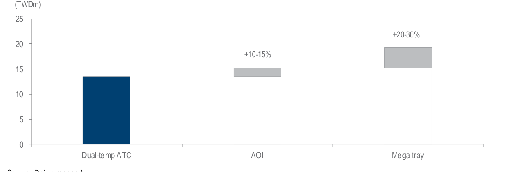

### 解讀摘要

以雙溫 ATC 機型為基礎（約 TWD13.5m），加上 AOI（+10-15%，約 TWD15.2m）、再加上 mega-tray（+20-30%，約 TWD19.3m），單機價值可由雙溫 ATC 的基準再提升約四成。驅動機制是 AI 加速器 TDP 世代成長 50-70%（Nvidia Rubin／Rubin Ultra 2.3kW／3.6kW，對比 Blackwell 1.2-1.4kW）與封裝尺寸由 120mm 增至約 150mm，傳統 handler（約 TWD6m）已無法處理，必須升級為雙溫 ATC（TWD12-15m）或三溫 ATC（TWD15-18m），mega-tray 於 2026 年 10 月推出。

> **原文補充**：Apple A20 Pro 已於 2026 年採用晶圓級多晶片模組（WMCM）封裝，需要可處理最高 3,000W 熱耗散的高階 ATC 系統，鴻勁的內容擴張因此延伸到旗艦手機 AP。Daiwa 預估 mega-tray 出貨滲透率 2027E 達 40%。

### 表格

| 項目 | 單機價值（TWDm） | 相對基準 |
|---|---|---|
| 標準 handler | 約 6 | — |
| 雙溫 ATC | 12-15（圖中基準約 13.5） | 約 2-2.5 倍標準機 |
| 三溫 ATC | 15-18 | — |
| 加 AOI | +10-15%（圖中約 15.2） | +10-15% |
| 再加 mega-tray | +20-30%（圖中約 19.3） | 相對 AOI 後約 +27% |
| 圖中最終堆疊值 | 約 19.3 | 相對基準約 +43%（視覺估算） |

> 基準與堆疊值為視覺估算，標籤僅有百分比（信心中）；+43% 為計算：(15.2/13.5)×(19.3/15.2)−1。

> **洞察一**：mega-tray 滲透 40%、溢價 25% 的混合效果為 +10%（0.4×0.25），把 2025 年混合 ASP TWD14.2m 乘上 1.10 得約 TWD15.6m，與報告模型 2027E 隱含單價 TWD15.5m（66,963 / 4,325）幾乎吻合；換言之 2027E 的單價成長幾乎可由 mega-tray 滲透率假設單獨解釋；若再計入 AOI 的 10-15%，混合單價會高於模型值，報告未說明 AOI 的滲透率假設。

> **值得驗證**：mega-tray 溢價在報告內有 25-30%（封面與成長催化劑）、20-30%（圖中標籤）、20-25%（財務分析）三種寫法，若實際溢價落在較低端，2027E 單價成長會被高估約 1-2ppt。

---

## Exhibit 2｜鴻勁：冷板營收趨勢

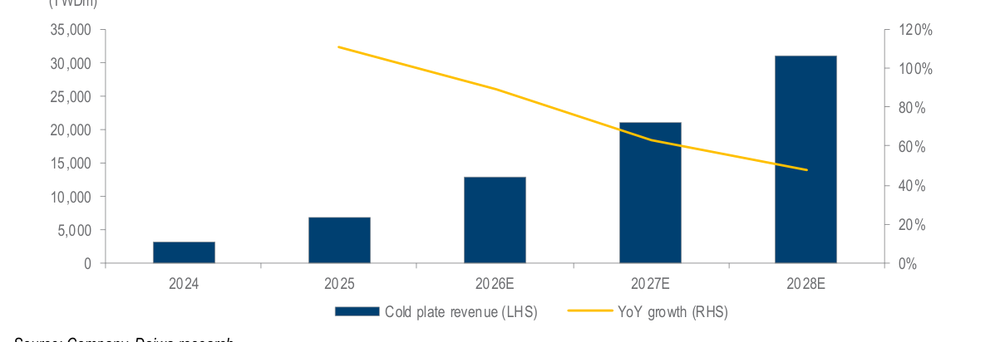

### 解讀摘要

冷板營收預估由 2024 年 TWD3.2bn 增至 2028E TWD31.0bn，2025-28E CAGR 約 66%，年增率由 2025 年的 111% 逐年降到 2028E 的 48%。機制是 AI 處理器生命週期壓縮到 1-1.5 年（過去 2-3 年），每台 handler 需要 5-10 片依晶粒尺寸、插座佈局與熱點客製的冷板，SLT handler 因平行測試甚至高達 24 片；每換一代晶片就要換一批冷板，形成與設備換機無關的年金式收入，且毛利率為全產品線最高。

### 表格

| 年度 | 冷板營收（TWDm） | YoY | 占總營收 | 每台 handler 出貨對應冷板營收（TWDm/台） |
|---|---|---|---|---|
| 2024 | 3,204 | — | 22.9% | 8.1（394 台） |
| 2025 | 6,764 | +111% | 22.3% | 4.2（1,610 台） |
| 2026E | 12,824 | +90% | 22.2% | 4.35（2,947 台） |
| 2027E | 20,967 | +63% | 23.1% | 4.85（4,325 台） |
| 2028E | 31,014 | +48% | 23.2% | 5.24（5,920 台） |

> 數據取自原文 P&L 表與出貨量假設（高信心）；2025-28E CAGR 驗算：(31,014/6,764)^(1/3)−1 = 66%，與原文一致。

> **洞察二**：每台 handler 帶動的冷板營收由 2025 年 TWD4.2m 升至 2028E TWD5.2m（+25%），冷板成長快於 handler 出貨量成長（2025-28E 出貨 CAGR 54%、冷板 CAGR 66%），代表模型假設冷板「單機附掛量」持續增加；2024 年每台 8.1m 因基期出貨僅 394 台而偏高，不具比較意義。

---

## Exhibit 3｜全球：AI/HPC 晶片測試時間趨勢

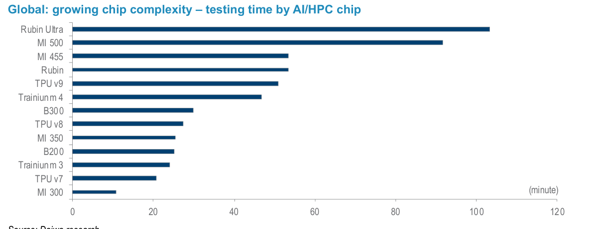

### 解讀摘要

各世代 AI/HPC 晶片的單顆測試時間大幅上升：Nvidia Rubin Ultra 約 103 分鐘、Rubin 約 53 分鐘（對比 B300 約 30 分鐘、B200 約 25 分鐘），AMD MI 500 約 92 分鐘（MI 300 僅約 11 分鐘），Google TPU v9 約 51 分鐘（v7 約 21 分鐘），AWS Trainium 4 約 47 分鐘（Trainium 3 約 24 分鐘）。複雜封裝（CoWoS、EMIB）使驗證時間比一般消費性晶片（5-10 秒）長 2 到 10 倍；為維持每日產能，晶片廠必須擴大平行測試架構並採購更多 handler。

### 表格

| 晶片 | 測試時間（分鐘，視覺估算） | 相對上一代 |
|---|---|---|
| Rubin Ultra | 約 103 | 相對 Rubin 約 1.9 倍 |
| MI 500 | 約 92 | 相對 MI 455 約 1.7 倍 |
| MI 455 | 約 53 | 相對 MI 350 約 2.1 倍 |
| Rubin | 約 53 | 相對 B300 約 1.8 倍 |
| TPU v9 | 約 51 | 相對 TPU v8 約 1.9 倍 |
| Trainium 4 | 約 47 | 相對 Trainium 3 約 2.0 倍 |
| B300 | 約 30 | 相對 B200 約 1.2 倍 |
| TPU v8 | 約 27 | 相對 TPU v7 約 1.3 倍 |
| MI 350 | 約 25 | 相對 MI 300 約 2.3 倍 |
| B200 | 約 25 | — |
| Trainium 3 | 約 24 | — |
| TPU v7 | 約 21 | — |
| MI 300 | 約 11 | — |

> 視覺估算（長條無數據標籤），信心中；與原文「AI GPU 最終測試時間由數百秒擴增到逾 10 分鐘」吻合。

> **洞察三**：由 2025 年主流（B200 約 25 分鐘、MI 300 約 11 分鐘）到 2027 年後的新世代（Rubin Ultra 約 103 分鐘、MI 500 約 92 分鐘），測試時間成長約 4 到 8 倍；若每日測試量不變，所需 handler 平行度與台數需成等比例增加，這是鴻勁出貨量預估（2025 年 1,610 台→2028E 5,920 台，3.7 倍）的需求面基礎。

---

## Exhibit 4｜鴻勁：CPO 測試方案

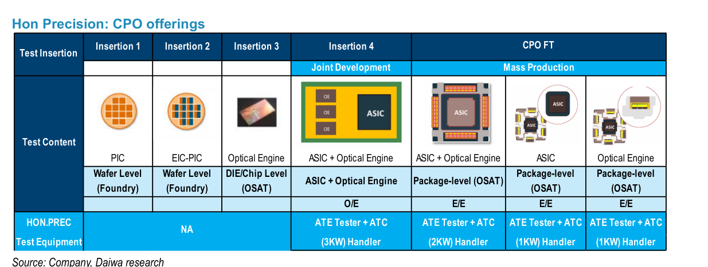

### 解讀摘要

CPO 測試分為 Insertion 1-4 與 CPO FT：Insertion 1（PIC）與 2（EIC-PIC）為晶圓級（晶圓代工端）、Insertion 3（Optical Engine）為晶粒／晶片級（OSAT 端），這三段鴻勁目前無產品（NA）；Insertion 4 為 ASIC + Optical Engine 的封裝級光電共測（O/E），是與 ATE 廠 Teradyne 及光學儀器廠合作的「共同開發」階段，使用 3kW ATE 測試機加 ATC handler；CPO FT 則為已量產的電性測試（E/E），涵蓋 ASIC + OE（2kW）、ASIC（1kW）、OE（1kW）。

> **原文補充**：鴻勁目前透過供應最終測試（FT）handler，為 Nvidia Spectrum-X、Quantum-X 等量產平台上的交換器 ASIC 與光學引擎做電性測試；Insertion 4 可在單次接觸（single touchdown）內同時驗證位元錯誤率（BER）、光迴路、串擾與高功率熱管理。公司目標為 2026 年底完成工程驗證、2027 年開始出貨、2028 年量產；Daiwa 預期 2027-28 年營收貢獻 <5%，但有助擴大市場對 TAM 的想像。

### 表格

| 測試階段 | 測試內容 | 測試層級 | 鴻勁產品 | 狀態 |
|---|---|---|---|---|
| Insertion 1 | PIC | 晶圓級（晶圓代工） | NA | — |
| Insertion 2 | EIC-PIC | 晶圓級（晶圓代工） | NA | — |
| Insertion 3 | Optical Engine | 晶粒／晶片級（OSAT） | NA | — |
| Insertion 4 | ASIC + Optical Engine（O/E） | 封裝級（OSAT） | ATE 測試機 + 3kW ATC handler | 共同開發 |
| CPO FT | ASIC + Optical Engine（E/E） | 封裝級（OSAT） | ATE 測試機 + 2kW ATC handler | 量產 |
| CPO FT | ASIC（E/E） | 封裝級（OSAT） | ATE 測試機 + 1kW handler | 量產 |
| CPO FT | Optical Engine（E/E） | 封裝級（OSAT） | ATE 測試機 + 1kW handler | 量產 |

> **洞察四**：7 個測試情境中鴻勁僅有 4 個有產品（57%），全部集中在封裝級（OSAT 端）；晶圓級與晶粒級的 3 個步驟為 NA。已量產的 3 個 FT 情境功率僅 1-2kW，最高功率的 3kW O/E 共測機型才是高單價機型，但尚在共同開發。因此近期 CPO 營收主要來自低功率 E/E 測試，與報告「2027-28 年貢獻 <5%」一致；高價值選擇權要等 Insertion 4 在 2027 年之後認證通過才會兌現。

---

## Exhibit 5｜全球：半導體測試設備資本支出

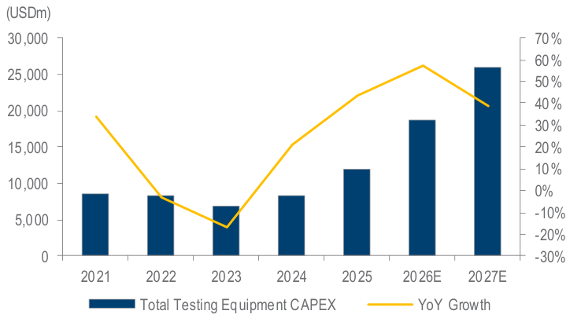

### 解讀摘要

依 TechInsights，全球測試設備 capex 由 2024 年 US\$8.3bn 擴增至 2027E US\$26.1bn（CAGR 46.4%）：2023 年 -17%、2024 年 +21%、2025 年約 +44%、2026E 約 +57%、2027E 約 +39%。其中 SoC 測試系統在 2024-25 年先行成長、2027E 降為 +9.6%，而封裝處理設備（handler 所屬）較具韌性。機制是測試資本支出分階段部署：先投資測試機（tester），再依先進封裝（CoWoS、chiplet）量產進度投資後段 handler。

### 表格

| 年度 | 測試設備 capex（US\$bn，視覺估算） | YoY |
|---|---|---|
| 2021 | 約 8.6 | 約 +34% |
| 2022 | 約 8.3 | 約 -3% |
| 2023 | 約 6.9 | 約 -17% |
| 2024 | 約 8.3（原文 8.3） | 約 +21% |
| 2025 | 約 11.9 | 約 +44% |
| 2026E | 約 18.7 | 約 +57% |
| 2027E | 約 26.1（原文 26.1） | 約 +39% |

> 2024 與 2027E 數值取自原文（高信心），其餘為視覺估算；交叉驗證：8.3→26.1 為 3.14 倍，CAGR = 3.14^(1/3)−1 = 46.4%，吻合；18.7/11.9 = +57%、26.1/18.7 = +40%，吻合。

> **洞察五**：2024→2027E 的 capex 增量為 US\$17.8bn（26.1−8.3），其中 2026E 與 2027E 兩年合計 US\$14.2bn（(18.7−11.9)+(26.1−18.7) = 6.8+7.4），占 80%，2025 年僅 US\$3.6bn（占 20%）。需求高度集中在預測期後兩年：若 AI 投資放緩，2026E-27E 是最需要確認的兩年，也是鴻勁 2026-27E 營收分別 +91%、+57% 的外在依據。

---

## Exhibit 6｜全球：測試設備—晶圓探測與封裝處理成長

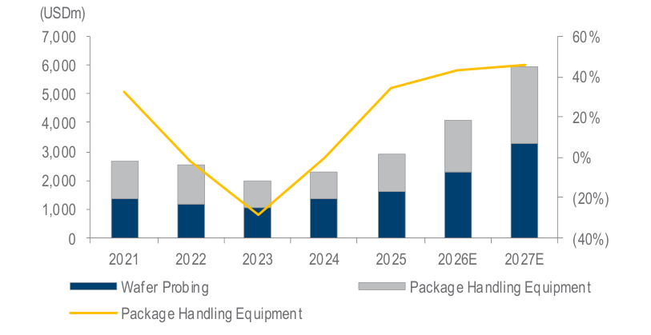

### 解讀摘要

晶圓探測（Wafer Probing）與封裝處理設備（Package Handling Equipment）合計由 2024 年約 US\$2.3bn 增至 2027E 約 US\$5.95bn；其中封裝處理設備由 2024 年 US\$941m 增至 2027E 約 US\$2.6bn（CAGR 40.9%），年增率 2025 年 34%、2027E 46%（再加速）。這反映「先裝測試機、後裝 handler」的投資節奏，handler 的成長高峰落在 2027E。

### 表格

| 年度 | 封裝處理設備（US\$m） | 年增率 |
|---|---|---|
| 2024 | 941（原文） | 約 0% |
| 2025 | 約 1,260（由 34% 推算） | 34%（原文） |
| 2026E | 約 1,800（視覺估算） | 約 +43% |
| 2027E | 約 2,600（原文） | 46%（原文） |

> 2024、2027E 與年增率取自原文；2025-26E 為推算與視覺估算（信心中）；驗算：(2,600/941)^(1/3)−1 = 40.3%，與原文 40.9% 相近。

> **洞察六**：handler 市場 2025→2027E 成長 2.06 倍（約 1,260→2,600m），但鴻勁預估 handler 營收 2025→2027E 成長 2.93 倍（TWD22.8bn→67.0bn），多出的差距來自份額提升（57%→79%，+1.39 倍）；成長分解：2.06 × 1.39 ≈ 2.86 倍，大致吻合。以對數拆解，鴻勁 handler 營收成長約 7 成來自市場擴張、約 3 成來自份額提升；後者在 2027E 之後已接近上限（見 Exhibit 7）。

---

## Exhibit 7｜鴻勁：handler 市占預估

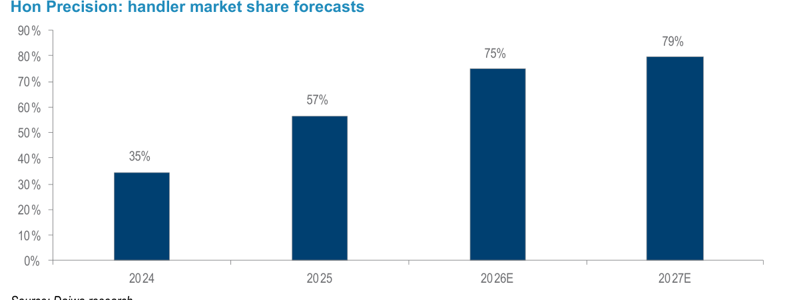

### 解讀摘要

鴻勁在全球測試 handler TAM 的份額由 2024 年 35% 升至 2025 年 57%，Daiwa 預估 2026E 75%、2027E 79%。高價值 AI/HPC 最終測試（FT）handler 份額管理層表示逾 70%（金額與數量皆然），SLT handler 營收份額約 50%，與 Chroma 形成高階 SLT 的雙寡占。主要原因是 1.5-3kW 以上的動態功率與 >120mm 封裝翹曲，使標準 handler 超出極限。

### 表格

| 年度 | 鴻勁 handler 市占 | 年增（ppt） |
|---|---|---|
| 2024 | 35% | — |
| 2025 | 57% | +22 |
| 2026E | 75% | +18 |
| 2027E | 79% | +4 |

> **洞察七**：市占增幅 2025 年 +22ppt、2026E +18ppt，到 2027E 只剩 +4ppt；79% 的份額意味 2027E 全球 handler 市場約 US\$2.6bn 中僅剩約 US\$0.55bn 給所有其他供應商（2,600×21%）。這使 2027E 之後的成長只能來自市場擴張與單價提升，份額已不是變數；若 FT 份額（>70%）受 Advantest 等廠商綁約或中國業者追趕侵蝕，預估的 79% 就是向下風險。

---

## Exhibit 8｜鴻勁：同業比較

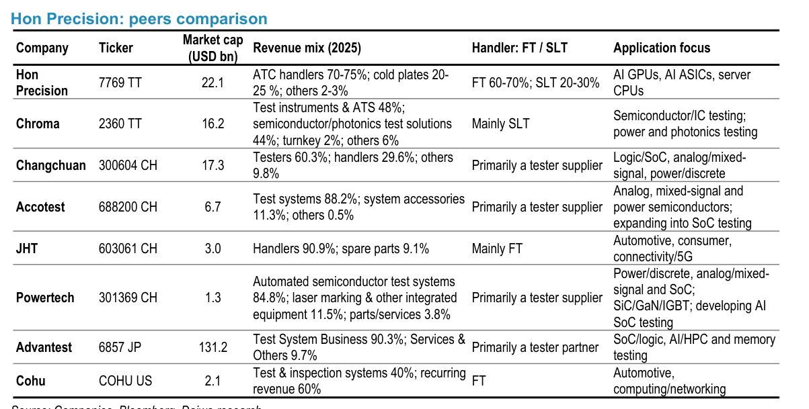

### 解讀摘要

鴻勁與同業的營收組合與測試定位差異明顯：鴻勁（市值 US\$22.1bn）ATC handler 占 70-75%、冷板 20-25%、其他 2-3%，FT 占 60-70%、SLT 占 20-30%，聚焦 AI GPU、AI ASIC 與伺服器 CPU；Chroma（2360）以測試儀器與自動測試系統 48%、半導體／光子測試方案 44% 為主，主要做 SLT；Advantest（6857 JP，市值 US\$131.2bn）測試系統 90.3%、為測試機夥伴；Cohu（COHU US，US\$2.1bn）測試與檢測系統 40%、經常性收入 60%，做 FT；中國同業長川（300604 CH）以測試機為主（測試機 60.3%、handler 29.6%）、華峰測控（688200 CH）與聯動科技（301369 CH）為測試機廠，JHT（603061 CH，US\$3.0bn）handler 占 90.9%、主要做 FT，應用偏車用、消費與連網。

> **原文補充**：Daiwa 認為國際大廠仰賴品牌與標準架構，Advantest 等以 SoC ATE 測試機主導（市占 >55%），自家 handler 主要做記憶體與標準邏輯，因此一線晶片廠與 OSAT 通常把測試機與 handler 分開採購，形成 Advantest／Teradyne 測試機搭配鴻勁高功率 ATC handler 的組合。中國業者受限於低功率消費、車用與工業 IC 測試，缺乏對易碎多晶片 CoWoS 封裝施加數百公斤接觸力而不破裂的專利與結構剛性；鴻勁地處台灣先進封裝聚落，可提供即時現場共同驗證與客製冷板工程，且不受地緣政治出口管制限制。

### 表格

| 公司 | Ticker | 市值（US\$bn） | 2025 營收組合 | Handler 定位 | 應用重點 |
|---|---|---|---|---|---|
| 鴻勁 | 7769 TT | 22.1 | ATC handler 70-75%；冷板 20-25%；其他 2-3% | FT 60-70%；SLT 20-30% | AI GPU、AI ASIC、伺服器 CPU |
| 致茂 | 2360 TT | 16.2 | 測試儀器與 ATS 48%；半導體／光子測試方案 44%；統包 2%；其他 6% | 主要為 SLT | 半導體／IC 測試、電源與光子測試 |
| 長川科技 | 300604 CH | 17.3 | 測試機 60.3%；handler 29.6%；其他 9.8% | 以測試機供應為主 | 邏輯／SoC、類比／混合訊號、功率／離散 |
| 華峰測控 | 688200 CH | 6.7 | 測試系統 88.2%；系統配件 11.3%；其他 0.5% | 以測試機供應為主 | 類比、混合訊號與功率半導體；擴展至 SoC 測試 |
| 金海通（JHT） | 603061 CH | 3.0 | Handler 90.9%；備品 9.1% | 主要為 FT | 車用、消費、連網／5G |
| 聯動科技（PowerTECH） | 301369 CH | 1.3 | 自動化半導體測試系統 84.8%；雷射打標與其他整合設備 11.5%；零件與服務 3.8% | 以測試機供應為主 | 功率／離散、類比／混合訊號與 SoC；開發 AI SoC 測試 |
| Advantest | 6857 JP | 131.2 | 測試系統 90.3%；服務與其他 9.7% | 測試機夥伴 | SoC／邏輯、AI/HPC 與記憶體測試 |
| Cohu | COHU US | 2.1 | 測試與檢測系統 40%；經常性收入 60% | FT | 車用、運算／網通 |

> **洞察八**：表中同時以 AI/HPC 為應用重點且以 handler 為主營收的公司只有鴻勁一家：Chroma 營收以測試儀器為主、Advantest 是測試機、Cohu 與 JHT 規模與應用偏車用／消費。鴻勁市值（US\$22.1bn）約為 handler 純種同業 JHT（US\$3.0bn）的 7.4 倍、Cohu（US\$2.1bn）的 10.5 倍，評價溢價反映的是 AI/HPC 應用與 ATC 能力，而非 handler 品類本身，因此鴻勁的估值對 AI 資本支出的敏感度高於傳統 handler 同業。（中文公司名稱為編者對照，原文為英文名。）

---

## Exhibit 9｜鴻勁：營收成長

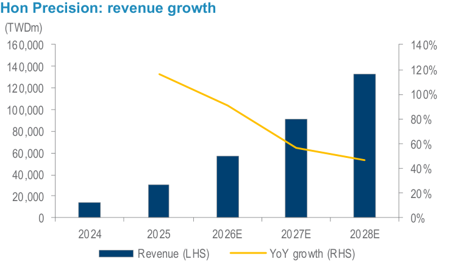

### 解讀摘要

營收由 2024 年 TWD14.0bn 增至 2025 年 30.3bn（+116% YoY），Daiwa 預估 2026E 57.7bn（+91%）、2027E 90.7bn（+57%）、2028E 133.5bn（+47%）。成長主要來自核心 handler 與 ATC 系統（占營收 70-75%）：2026E 產能預計 +40% YoY、2027-28E 每年 +50%，稼動率維持 90% 以上；handler 混合單價由 2025 年 TWD14.2m 升至 2028E TWD16.3m。

### 表格

| 年度 | 營收（TWDm） | YoY | Handler 出貨（台） | Handler 營收（TWDm） |
|---|---|---|---|---|
| 2024 | 13,992 | +47.5% | 394 | 10,418 |
| 2025 | 30,271 | +116.3% | 1,610 | 22,842 |
| 2026E | 57,704 | +90.6% | 2,947 | 43,288 |
| 2027E | 90,655 | +57.1% | 4,325 | 66,963 |
| 2028E | 133,460 | +47.2% | 5,920 | 96,728 |

> 取自原文財務摘要（高信心）。

> **洞察九**：2025-28E 營收 CAGR 約 64%（(133,460/30,271)^(1/3)−1）；報告採用的 EPS CAGR 55% 是 2026-28E 區間（(317.27/132.70)^(1/2)−1），排除了 2025→2026E 的最大成長年（EPS +75%）。若以 2025 年為基期，EPS CAGR 約 61%（(317.27/75.71)^(1/3)−1），PEG 由 0.35x（19/55）降為約 0.31x；也就是說報告的 PEG 是以較保守的區間計算。

---

## Exhibit 10｜鴻勁：營收組合

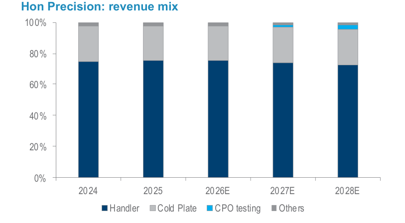

### 解讀摘要

營收結構在預測期變動不大：handler 由 2024 年約 75% 降到 2028E 約 72.5%，冷板維持 22-23%，CPO 測試於 2027E 起出現並在 2028E 約占 2-3%，其他約 2-4%。冷板占比被管理層與 Daiwa 預期維持在 22-23%，即使其毛利率最高，也不預期提升占比。

### 表格

| 年度 | Handler | 冷板 | 其他（含 CPO 測試） | 其他營收（TWDm） |
|---|---|---|---|---|
| 2024 | 74.5% | 22.9% | 2.7% | 371 |
| 2025 | 75.5% | 22.3% | 2.2% | 665 |
| 2026E | 75.0% | 22.2% | 2.8% | 1,592 |
| 2027E | 73.9% | 23.1% | 3.0% | 2,724 |
| 2028E | 72.5% | 23.2% | 4.3% | 5,718 |

> 比例為計算值（各項 / 總營收，高信心）；圖中 CPO 測試區塊於 2027E-28E 才可見，約占 1-3%（視覺估算）。

> **洞察十**：「其他營收」由 2027E 的 TWD2.7bn 升至 2028E 的 TWD5.7bn（+110%），是預測期內成長最快的項目，也是 CPO 測試出貨的首年主要反映處；但其占總營收仍僅 4.3%，與報告「CPO <5%」相符，代表 CPO 在 2028E 之前不會改變獲利結構，影響主要是評價與市場想像。

---

## Exhibit 11｜鴻勁：毛利率與營業利益率

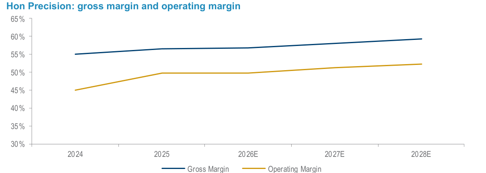

### 解讀摘要

毛利率由 2024 年 55.0% 升至 2028E 59.2%（2025 年 56.5%、2026E 56.8%、2027E 58.1%），營業利益率由 44.9% 升至 52.4%（2025 年 49.7%、2026E 49.7%、2027E 51.2%）。毛利率成長來自 ATC／mega-tray／AOI 的產品組合升級與高毛利冷板耗材；管理層預期 2026-28E 營業費用率維持 5-8%，研發支出每年成長逾 60%（用於 CPO Insertion 4、12/25kW 熱管理與微通道冷板／蓋），Daiwa 認為大幅營收成長將帶來強大營運槓桿。

### 表格

| 年度 | 毛利率 | 營業利益率 | 毛利率－營業利益率 |
|---|---|---|---|
| 2024 | 55.0% | 44.9% | 10.1ppt |
| 2025 | 56.5% | 49.7% | 6.8ppt |
| 2026E | 56.8% | 49.7% | 7.1ppt |
| 2027E | 58.1% | 51.2% | 6.9ppt |
| 2028E | 59.2% | 52.4% | 6.8ppt |

> 取自原文財務摘要比率表（高信心）；差距為計算值。

> **洞察十一**：2026E→2028E 毛利率 +2.4ppt、營業利益率 +2.7ppt，營業費用率只帶來約 0.3ppt 的槓桿（差距由 7.1ppt 降到 6.8ppt）；研發每年成長逾 60%，費用率因而在約 7% 持平。因此獲利成長的品質取決於毛利率能否由 56.8% 升至 59.2%（即 mega-tray、冷板占比與 CPO 的組合貢獻），而非營運槓桿。2025 年差距由 10.1ppt 降到 6.8ppt（營收 +116% 的規模效應），預測期則持平在約 7ppt。

---

## Exhibit 12｜測試流程與 ATC 全功率測試

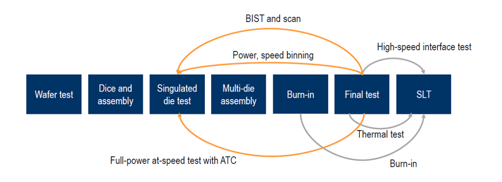

### 解讀摘要

先進封裝晶片的測試流程為：晶圓測試（Wafer test）→ 切割與組裝（Dice and assembly）→ 單顆晶粒測試（Singulated die test）→ 多晶粒組裝（Multi-die assembly）→ 老化（Burn-in）→ 最終測試（Final test）→ 系統級測試（SLT）。圖中橘色回圈標示 ATC 全速全功率測試（Full-power at-speed test with ATC）從最終測試回饋到單顆晶粒測試的位置，並涵蓋 BIST 與掃描、功率／速度分級；灰色路徑為高速介面測試、熱測試與 Burn-in。

### 表格

| 流程階段 | 與鴻勁（handler／ATC）的關聯（依圖示推論） |
|---|---|
| Wafer test | 晶圓探測（prober），非 handler |
| Singulated die test | 單顆晶粒測試，需 handler 與 ATC 全功率測試 |
| Burn-in | 老化測試（灰色路徑） |
| Final test（FT） | 鴻勁主力：AI/HPC FT handler 市占逾 70% |
| SLT | 鴻勁 20-30% 營收、市占約 50%（與 Chroma 並列） |

> **洞察十二**：圖示顯示 ATC 全功率測試同時涵蓋單顆晶粒階段與最終測試（兩個階段共用「全功率、全速」測試需求），表示多晶粒封裝使 handler 的使用點由 FT 與 SLT 兩段擴增到更前段的晶粒級；這是 Daiwa 提出「測試強度與次數同步上升」的流程依據，但報告並未量化各階段的 handler 滲透，也未說明鴻勁在單顆晶粒測試階段的實際份額（推論，需追蹤）。

---

## 相關個股清單

| 類別 | 公司 | Ticker | 評等 | 備註 |
|---|---|---|---|---|
| 測試 handler／ATC | 鴻勁（Hon Precision） | 7769 TT | Buy (1) | 首次涵蓋；TP TWD6,365（30x 2027E EPS 212.18）；現價 TWD4,040；2026-28E EPS TWD132.70／212.18／317.27 |
| 測試儀器／SLT | 致茂（Chroma） | 2360 TT | Not Rated | 與鴻勁並列高階 SLT 雙寡占；2026E／27E PER 26.7x／18.1x |
| 測試機 | Advantest | 6857 JP | Outperform [2] | 測試機龍頭（市占 >55%），與鴻勁互補 |
