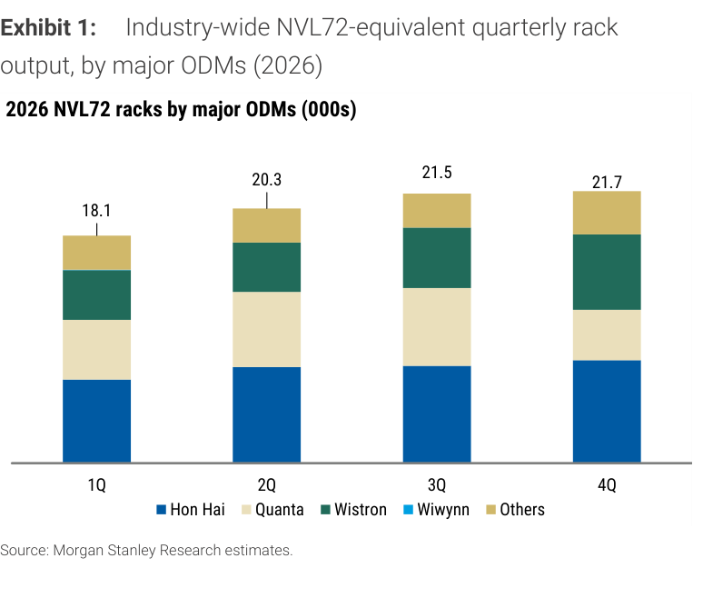
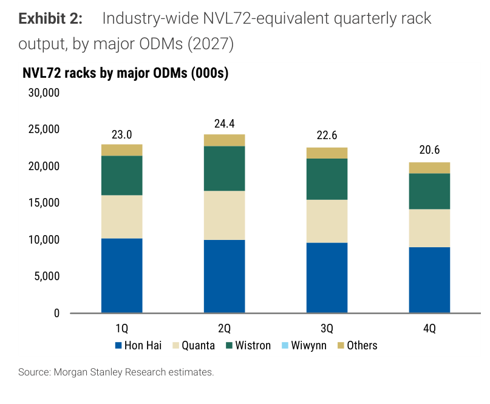
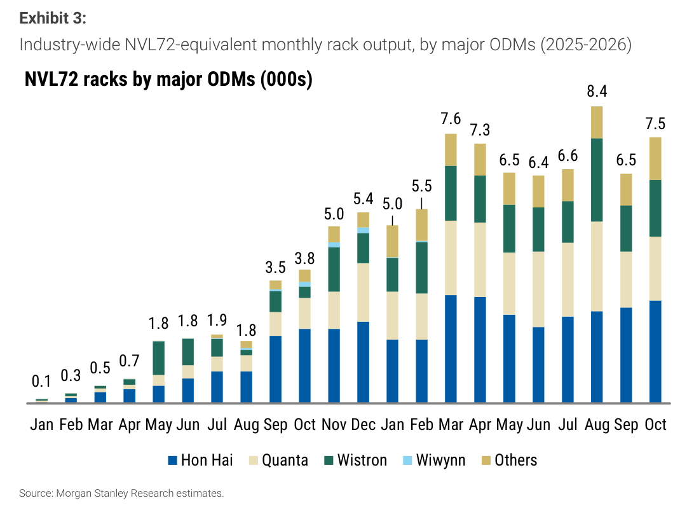
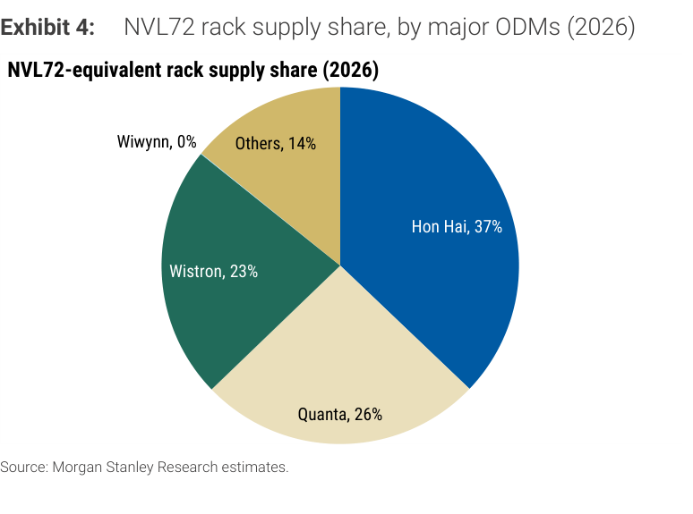
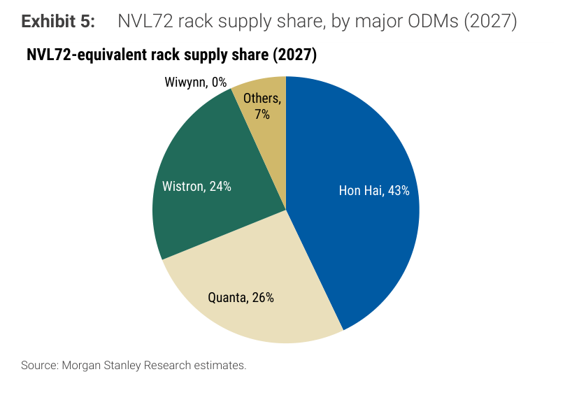

# MS｜NVL72 Racks Shipment in October 2026; 2027 Rack Forecast is Unchanged

**券商**：Morgan Stanley  
**分析師**：Howard Kao、Irene Yen、Andy Meng  
**日期**：2026-11-10  
**主題**：GB200/GB300 NVL72 機架 10 月出貨量追蹤，2027 年預測維持 90.4K 台  
**評級**：Industry View In-Line  
<a href="https://layx.uk/dl?g=產業&b=MS&d=20261110&h=NVL72-Racks-Shipment">📎 下載 PDF</a>

---

## 報告總結

MS 追蹤 10 月 GB200/GB300 NVL72 機架產出約 7.5K 台（+16% MoM），Hon Hai 約 2.9K（+7%）、Quanta 約 1.8K（+24%）、Wistron 約 1.6K（+22%）。2026 年預測維持 82K 台（+209% YoY）、2027 年維持 90.4K 台（約 +10% YoY），Hon Hai 2027 年份額由 37% 升至 43%。標的偏好由上次的 Wistron > Hon Hai > Quanta 改為 Wistron > Quanta > Hon Hai（依 PT 上行空間），三者皆維持 OW。

---

## MS 完整投資邏輯鏈

| 論點層次 | Exhibit | 內容 |
|---|---|---|
| 需求信號確認 | Exhibit 3 | 10 月 7.5K 台，自 9 月 6.5K 回升（+16% MoM），仍低於 8 月高點 8.4K |
| 2026 全年強勁 | Exhibit 1 | 4 季合計 81.6K 台（MS 預測 82K，+209% YoY），4Q 僅較 3Q 持平略增 |
| 2027 仍有增量 | Exhibit 2 | 4 季合計 90.6K 台（MS 預測 90.4K），2Q 為高點，4Q 降至 20.6K |
| 份額格局重組 | Exhibit 4+5 | Hon Hai 37%→43%，Others 14%→7%，Quanta 26% 不變 |
| **結論** | 封面 | **Wistron > Quanta > Hon Hai（依 PT 上行空間，三者皆 OW）** |

> **報告最大邏輯缺口**：Wistron 以 computing tray（L10）折算 rack equivalent，尚未計入 L11 組裝與測試時間，實際交付給終端客戶的機架數可能低於 MS 預測值（原文已註明）。

---

## 報告核心觀點

| 主題 | MS 觀點 | 市場共識 | 是否 Contra-Consensus |
|---|---|---|---|
| 10 月產出 | 約 7.5K 台（+16% MoM），三大 ODM 全數月增 | 報告未載 | — |
| 2026 全年 | 82K 台（+209% YoY）維持不變 | 報告未載 | — |
| 2027 全年 | 90.4K 台（+10-11% YoY）維持不變 | 報告未載 | — |
| Hon Hai 份額 | 2027 年升至 43%（2026 年 37%），2027 年產量 38.8K（+28%） | 報告未載 | — |
| 標的偏好 | Wistron > Quanta > Hon Hai（上次為 Wistron > Hon Hai > Quanta） | 報告未載 | 偏好順序調整 |

**偏好排序**：Wistron > Quanta > Hon Hai  
**個股**：3231.TW（OW）、2382.TW（OW）、2317.TW（OW）

---

## Exhibit 1｜2026 季度 NVL72 機架出貨量

### 解讀摘要

2026 年季度產出為 1Q 18.1K → 2Q 20.3K → 3Q 21.5K → 4Q 21.7K，合計 81.6K 台，與 MS 全年預測 82K 相符。增速逐季收斂：QoQ 由 +12%（2Q）降至 +6%（3Q）、+1%（4Q），代表 2026 年的成長主要發生在上半年的產能爬坡，下半年進入平台期。與上次報告（10-12，4Q26E 22.1K）相比，4Q 預估下修 0.4K 台（-2%），3Q 實績 21.5K 則與上次預估 21.4K 相近。

### 表格

| 季度 | 出貨量（千台） | QoQ |
|---|---|---|
| 1Q26 | 18.1 | — |
| 2Q26 | 20.3 | +12% |
| 3Q26 | 21.5 | +6% |
| 4Q26E | 21.7 | +1% |
| **2026 合計** | **81.6** | **MS 預測 82K（+209% YoY）** |

> **洞察一**：4Q26E 21.7K 扣除 10 月實績 7.5K，推得 11-12 月合計約 14.2K 台、月均 7.1K，低於 10 月的 7.5K（-5%）。MS 對年底的假設是小幅回落而非續升，與「平台期」的判讀一致。

> **洞察二**：上次報告 4Q26E 為 22.1K，本次降至 21.7K，但全年預測仍維持 82K 台——合計 81.6K 與 82K 之間的 0.4K 差距是四捨五入與逐季估算的結果，並非新的下修訊號。

---

## Exhibit 2｜2027 季度 NVL72 機架出貨量

### 解讀摘要

2027 年呈「前高後低」：1Q 23.0K → 2Q 24.4K → 3Q 22.6K → 4Q 20.6K，合計 90.6K 台（MS 預測 90.4K，約 +10-11% YoY）。2Q 為全年高點，下半年季減 7%、9%。全年預測與上次報告相同，沒有因 10 月實績或 4Q26 微調而變動。

### 表格

| 季度 | 出貨量（千台） | QoQ |
|---|---|---|
| 1Q27E | 23.0 | +6%（相對 4Q26E 21.7） |
| 2Q27E | 24.4 | +6% |
| 3Q27E | 22.6 | -7% |
| 4Q27E | 20.6 | -9% |
| **2027 合計** | **90.6** | **MS 預測 90.4K（約 +10-11% YoY）** |

> **洞察三**：4Q27E 20.6K 較 2Q27E 高點低 16%（20.6 / 24.4 = 0.84），月均約 6.9K，低於目前 10 月的 7.5K。換言之 2027 年的 +10% 成長有很大部分來自上半年的高基期，下半年的產出水位反而比 2026 年 10 月還低；原文未說明 2H27 新世代機架（外部知識：Rubin 世代預計 2H27 起導入）是否已納入此預測，若未納入則下半年存在上行空間，但報告並未量化。

---

## Exhibit 3｜2025-2026 月度 NVL72 機架出貨量

### 解讀摘要

月度產出自 2025 年 1 月的 0.1K 台升至 2026 年 3 月的 7.6K，之後 3 月至 10 月落在 6.4–8.4K 的區間震盪：4 月 7.3K、5 月 6.5K、6 月 6.4K、7 月 6.6K、8 月 8.4K（高點）、9 月 6.5K、10 月 7.5K。10 月 7.5K 較 9 月 +16%，年增約 97%（10 月 2025 為 3.8K）。這代表 2026 年的月產出已在約 7K 的水位橫向整理超過半年，而非持續向上。

> **原文補充**：三大 ODM 10 月營收與機架數——Quanta 營收 NT\$353.3bn（+9% MoM／+104% YoY），GB200/300 機架約 1.8K（+24% MoM），NB 出貨 2.7M 台（-36% MoM／-23% YoY）；Wistron 營收 NT\$402.6bn（+6% MoM／+108% YoY），GB200/300 computing tray 約 1.60K rack equivalents（+22% MoM），其中 Wiwynn 營收約 NT\$165.1bn（-4% MoM／+81% YoY）；Hon Hai 營收 NT\$1,305.3bn（+13% MoM／+46% YoY），雲端與網通產品因代工（consignment）占比提高而月減，但整體機架產量月增，MS 模型為約 2.9K（+7% MoM）。

### 表格

| 月份 | 2026 年 1 月 | 2 月 | 3 月 | 4 月 | 5 月 | 6 月 | 7 月 | 8 月 | 9 月 | 10 月 |
|---|---|---|---|---|---|---|---|---|---|---|
| 產出（千台） | 5.0 | 5.5 | 7.6 | 7.3 | 6.5 | 6.4 | 6.6 | 8.4 | 6.5 | 7.5 |

> 視覺讀取柱頂標籤；交叉驗證：1Q 5.0+5.5+7.6=18.1（吻合 Exhibit 1）、3Q 6.6+8.4+6.5=21.5（吻合），2Q 7.3+6.5+6.4=20.2（Exhibit 1 為 20.3，四捨五入差）。

| 10 月產出拆解 | 台數（千台） | MoM |
|---|---|---|
| Hon Hai | 約 2.9 | +7% |
| Quanta | 約 1.8 | +24% |
| Wistron（rack equivalent） | 約 1.6 | +22% |
| 其他（推算：7.5 − 6.3） | 約 1.2 | — |
| **合計** | **約 7.5** | **+16%** |

> **洞察四**：3-10 月 8 個月平均約 7.1K 台（(7.6+7.3+6.5+6.4+6.6+8.4+6.5+7.5) / 8 = 56.8 / 8），而 MS 的 2027 年預測全年平均為 7.5K 台/月（90.4 / 12），僅比目前平台高約 6%。換言之，2027 年預測的成長主要來自 2026 年底的出貨水位延續與 2Q27 高點，而不是新一輪的爬坡；市場若期待 2027 年出現類似 2025 年的倍數成長，這份預測並不支持。

> **洞察五**：10 月自 9 月增加的 1.0K 台中，三大 ODM 合計貢獻約 0.84K（Hon Hai +0.2K、Quanta +0.35K、Wistron +0.29K），占月增量的 84%，月增動能集中在大廠。

---

## Exhibit 4｜2026 年 NVL72 機架供應份額

### 解讀摘要

2026 年份額為 Hon Hai 37%、Quanta 26%、Wistron 23%、Others 14%、Wiwynn 0%。Hon Hai 已是最大供應商；Wiwynn 為 Wistron 旗下公司，獨立份額為 0%（推論：其產出已併入 Wistron 的 computing tray 折算，原文未明述）。以 MS 的各 ODM 預測量驗算：Hon Hai 30.3K / 82K = 37%，Quanta 20.9K / 82K = 25.5%，Wistron 18.7K / 82K = 22.8%，與圖中標籤吻合。

### 表格

| ODM | 2026E 份額 | 2026E 台數（千台，原文各 ODM 預測） |
|---|---|---|
| Hon Hai | 37% | 30.3 |
| Quanta | 26% | 20.9 |
| Wistron | 23% | 18.7 |
| Wiwynn | 0% | — |
| Others | 14% | 約 12.1（推算：82 − 69.9） |

---

## Exhibit 5｜2027 年 NVL72 機架供應份額

### 解讀摘要

2027 年份額為 Hon Hai 43%、Quanta 26%、Wistron 24%、Others 7%、Wiwynn 0%。相較 2026 年，Hon Hai +6ppt、Wistron +1ppt、Quanta 持平，Others -7ppt。份額增量幾乎全由 Hon Hai 取得，且主要來源是 Others 的萎縮，而非從 Quanta 或 Wistron 手中奪取。

### 表格

| ODM | 2026E 份額 | 2027E 份額 | 變化 | 2027E 台數（千台） | YoY |
|---|---|---|---|---|---|
| Hon Hai | 37% | 43% | +6ppt | 38.8 | +28% |
| Quanta | 26% | 26% | 0 | 23.5 | +12% |
| Wistron | 23% | 24% | +1ppt | 22.0 | +18% |
| Wiwynn | 0% | 0% | 0 | — | — |
| Others | 14% | 7% | -7ppt | 約 6.1（推算） | 約 -50% |

> **洞察六（配合 Exhibit 4）**：2027 年全市場淨增 8.4K 台（90.4 − 82），其中 Hon Hai +8.5K、Wistron +3.3K、Quanta +2.6K，三者合計 +14.4K，被 Others 的 -6.0K（約 12.1K → 6.1K）抵銷。Hon Hai 一家的增量（+8.5K）就超過整個市場的淨增量，Others 萎縮的 6.0K 台是三大廠新增量的 42%——也就是說，大廠的 2027 年成長約四成是「搶 Others 的訂單」，其餘六成才是市場本身的擴張。

> **值得驗證**：Others 在 2027 年縮減約一半（12.1K → 6.1K）是份額格局的關鍵假設，但報告未說明這部分產出由誰承接、是否為 Nvidia 認證收斂所致；若 Others 實際維持 10K 以上，三大廠的 2027 年預測將面臨下修，Hon Hai 的 +28% 首當其衝。

---

## 跨 Exhibit 彙整表

### 彙整 1｜各 ODM 2026/2027 年台數與份額（Exhibit 1+2+4+5 合算）

| ODM | 2026E 台數 | 2027E 台數 | 增減 | YoY | 2026 份額 | 2027 份額 |
|---|---|---|---|---|---|---|
| Hon Hai | 30.3K | 38.8K | +8.5K | +28% | 37% | 43% |
| Quanta | 20.9K | 23.5K | +2.6K | +12% | 26% | 26% |
| Wistron | 18.7K | 22.0K | +3.3K | +18% | 23% | 24% |
| Others（推算） | 約 12.1K | 約 6.1K | -6.0K | 約 -50% | 14% | 7% |
| **合計** | **82K** | **90.4K** | **+8.4K** | **+10%** | 100% | 100% |

> **洞察七（彙整視角）**：Hon Hai 單位成長最高（+28%）卻在 PT 上行空間排序墊底（Wistron > Quanta > Hon Hai），而上次報告的順序是 Wistron > Hon Hai > Quanta——顯示 MS 的選股排序更多取決於各股的估值與 PT 空間，而非單純的機架台數成長；本次順序調整（Quanta 超越 Hon Hai）並非因台數預測改變（2027 年各 ODM 預測與上次相近，Quanta 2026E 由 21.3K 小降至 20.9K），較可能來自股價相對變動，原文未交代原因。

---

## 相關個股清單

| 類別 | 公司 | Ticker | 評等 | 備註 |
|---|---|---|---|---|
| ODM | Wistron | 3231.TW | OW | MS 首選；2026E 18.7K、2027E 22.0K 機架（+18% YoY）；10 月約 1.6K（+22% MoM） |
| ODM | Quanta | 2382.TW | OW | 次選；2026E 20.9K、2027E 23.5K（+12% YoY）；10 月約 1.8K（+24% MoM） |
| ODM | Hon Hai | 2317.TW | OW | 2027 份額 43%；2026E 30.3K、2027E 38.8K（+28% YoY）；10 月約 2.9K（+7% MoM） |
| 子系統 | Wiwynn | 6669.TW | — | 機架份額 0%（併入 Wistron 折算）；10 月營收約 NT\$165.1bn（-4% MoM／+81% YoY） |
