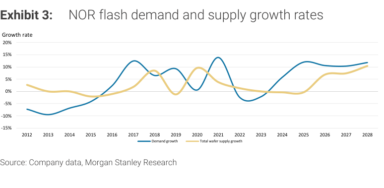
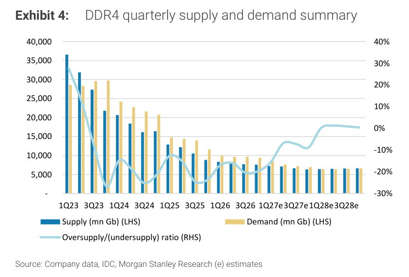
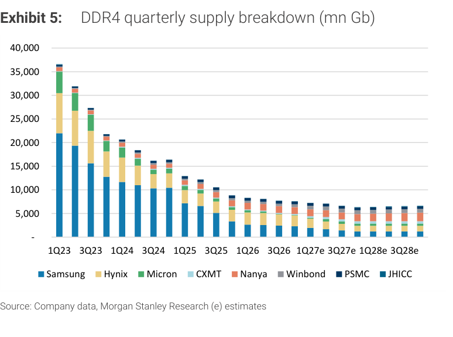
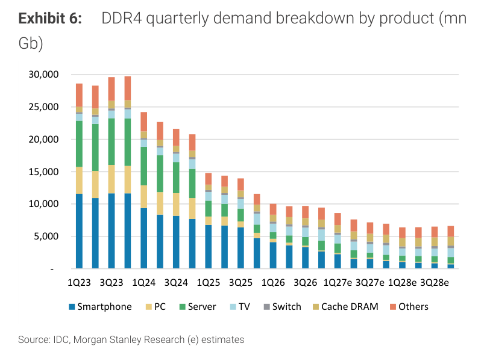
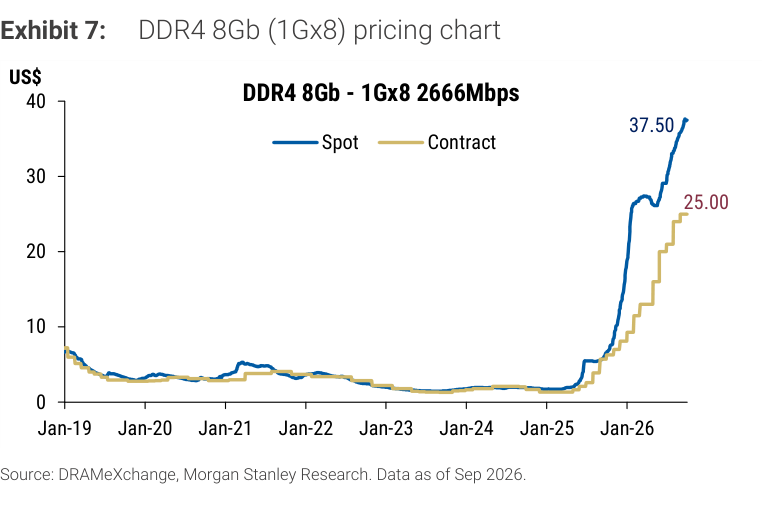
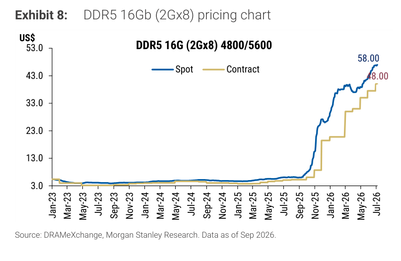
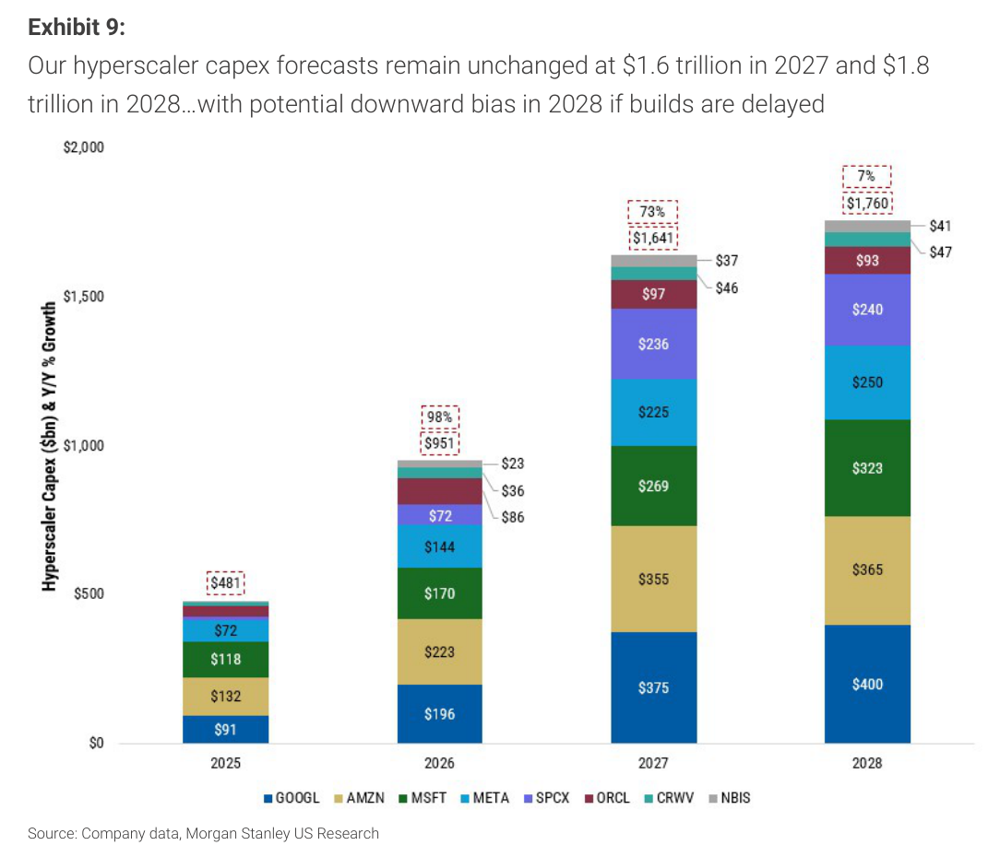
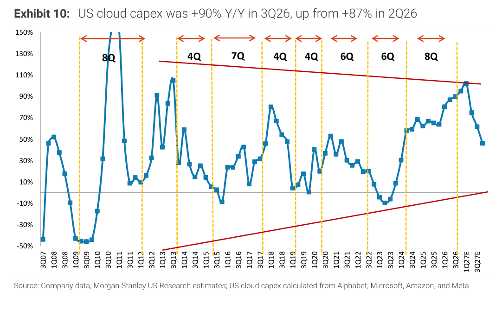
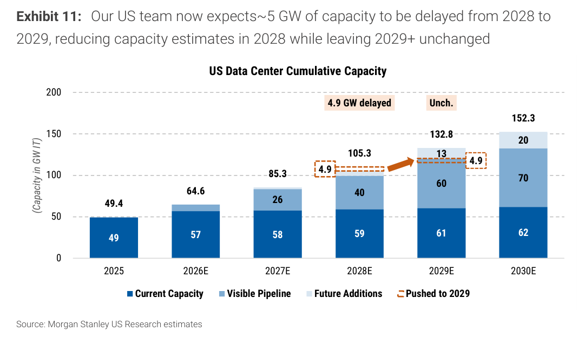
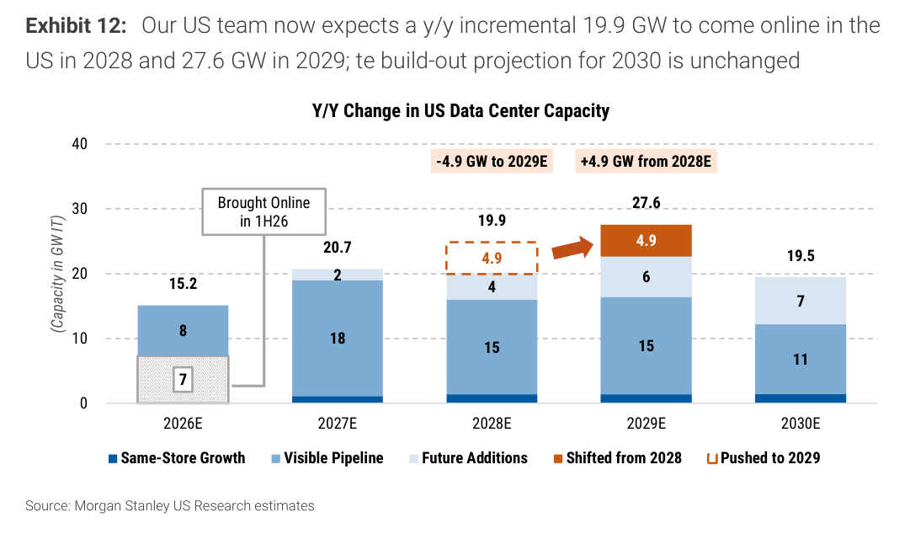

# MS｜Old Memory: Peak Pricing Power? Reduce exposure.

**券商**：Morgan Stanley  
**分析師**：Daniel Yen, CFA、Charlie Chan、Daisy Dai, CFA、Ethan Jia  
**日期**：2026-11-10  
**主題**：利基型記憶體（DDR3/4、SLC/MLC NAND、NOR）漲價能力見頂，降低持股  
**評級**：Industry View Attractive  
<a href="https://layx.uk/dl?g=產業&b=MS&d=20261110&h=Old-Memory">📎 下載 PDF</a>

---

## 報告總結

MS 對利基型記憶體轉趨保守：美國期中選舉後，美國團隊預期約 4.9GW（約 20%）的 2028 年美國資料中心新增容量遞延至 2029 年，可能在 2028 年形成供應鏈空窗，加上消費需求轉弱，利基記憶體的漲價能力無法長期抵銷需求下滑。MS 將力積電、華邦電、兆易創新、旺宏降評至 EW、群聯降評至 UW，下調南亞科與愛普目標價，並以 1.0x P/B 作為下檔評價錨；2028 年供需缺口預估收斂至 SLC -3%、MLC -5%、NOR -1%、DDR4 +1%（過剩）。本報告只談利基型記憶體，不涵蓋主流 DDR5 與 TLC/QLC NAND。

---

## MS 完整投資邏輯鏈

| 論點層次 | Exhibit | 內容 |
|---|---|---|
| 價格已大幅擴張 | Exhibit 7+8 | DDR4 8Gb 現貨 US\$37.50／合約 US\$25.00；DDR5 16Gb 現貨 US\$58.00／合約 US\$48.00 |
| 雲端需求增速見頂 | Exhibit 9+10 | 超大型雲端 capex 2027E +73%，2028E 僅 +7%；美國雲端 capex 3Q26 +90% YoY |
| 資料中心建置遞延 | Exhibit 11+12 | 約 4.9GW 由 2028 年遞延至 2029 年，2028 年美國新增容量 -4% YoY |
| 供需正常化 | Exhibit 3+4+5+6 | DDR4 缺口於 2028 年轉為 +1% 過剩，NOR 缺口收斂至 -1% |
| **結論** | 封面 | **降評 5 檔（力積電、華邦電、兆易創新、旺宏降至 EW；群聯降至 UW），評價改以 1.0x P/B 為下檔支撐** |

> **報告最大邏輯缺口**：本次 PT 下調的主因是「目標 P/B 倍數調降（反映族群波動度）」，而非獲利預估大幅下修——2026E EPS 反而多半上修（華邦電 +8%、力積電 +10%、愛普 +21%）。同時，資料中心遞延只是時點移轉（2029、2030 年累計容量預估不變），原文並未量化這段 2028 年「空窗」對利基型記憶體實際出貨與價格的衝擊幅度，也未驗證消費需求下修的規模。

---

## 報告核心觀點

| 主題 | MS 觀點 | 市場共識 | 是否 Contra-Consensus |
|---|---|---|---|
| 利基記憶體漲價能力 | 雙面刃：LTA 少讓漲價更快，但需求轉弱時缺乏保護 | 賣方仍多為買進：華邦電／力積電／兆易創新 100%、旺宏 80%、群聯 73% 為 Buy/OW | Contra（轉保守） |
| 需求端 | 雲端支出能見度下降；PC 半導體研究指向 1Q–3Q26 拉貨後 4Q 更深的消費性修正 | 報告未載 | — |
| 供需 | 2028 年缺口：SLC -3%、MLC -5%、NOR -1%、DDR4 +1%（過剩） | 報告未載 | — |
| 評價 | 以 1.0x P/B 為下檔錨（不視為保證底部，也不適用於 fabless） | 報告未載 | — |
| 風險／報酬 | 群聯 0.1、華邦電 0.5、力積電 0.8、旺宏／兆易創新 1.5、愛普 4.3、南亞科 9.2、長鑫 183（Bull/Bear 偏斜比） | — | — |

**偏好排序**：長鑫（CXMT）> 愛普 > 南亞科 > 旺宏 > 兆易創新 > 力積電 > 華邦電 > 群聯  
**升降評**：華邦電、兆易創新、力積電、旺宏 OW→EW；群聯 EW→UW；愛普維持 OW 但移除 Top Pick；南亞科維持 OW

---

## Exhibit 3｜NOR Flash 需求與供給成長率

### 解讀摘要

NOR 需求成長自 2024 年起轉強、2025 年約 +12%，之後維持約 10-12%；供給成長 2025 年仍約 -1%，2026 年起才加速至約 7%，2028 年約 10-11%。需求與供給成長率的差距因此由 2025 年約 13ppt 快速收斂到 2028 年約 1ppt，與 MS 模型「2028 年 NOR 缺口 -1%」吻合。缺貨不會一夕消失，但「缺口縮小」本身就會削弱邊際漲價能力，股價可能在獲利見頂之前就先重新評價。

### 表格

| 年度 | 需求成長 | 總晶圓供給成長 | 差距（需求−供給） |
|---|---|---|---|
| 2025 | 約 12% | 約 -1% | 約 13ppt |
| 2026E | 約 10.5% | 約 7% | 約 3.5ppt |
| 2027E | 約 10.3% | 約 7.5% | 約 2.8ppt |
| 2028E | 約 11.8% | 約 10.5% | 約 1.3ppt（MS 缺口 -1%） |

> 視覺估算（曲線無數據標籤）；2028 年差距與原文文字「NOR 缺口 -1%」交叉驗證，誤差在讀圖容許範圍內。

> **洞察一**：2025→2026E 差距由約 13ppt 降至約 3.5ppt，已收斂約 73%；2026→2028E 再收斂約 2.2ppt。換言之支撐 2025 年 NOR 價格行情的「供給不增、需求續增」結構在 2026 年已大部分消失，2027-28 年的剩餘空間很小，這與 MS 轉為謹慎的時點一致。

---

## Exhibit 4｜DDR4 季度供需總量摘要

### 解讀摘要

DDR4 供給由 1Q23 約 36.6bn Gb 一路下滑，需求同步萎縮；供給下滑速度快於需求，使短缺比率（右軸，負值為供不應求）自 2023 年底起長期維持約 -15% 至 -27%。2027 年起短缺逐步收窄：3Q27E 約 -7%，1Q28E 轉為約持平，與 MS 文字「2028 年 DDR4 +1% 過剩」吻合。注意收斂的原因並非供給回升，而是需求萎縮得更快。

### 表格

| 季度 | 供給（bn Gb） | 需求（bn Gb） | 供需比率 |
|---|---|---|---|
| 1Q23 | 約 36.6 | 約 28.6 | 約 +28%（過剩） |
| 1Q24 | 約 20.6 | 約 24.2 | 約 -15% |
| 1Q25 | 約 12.9 | 約 14.8 | 約 -13% |
| 1Q26 | 約 8.3 | 約 10.0 | 約 -15% |
| 1Q27E | 約 7.1 | 約 8.6 | 約 -15% |
| 1Q28E | 約 6.5 | 約 6.4 | 約 +1% |

> 視覺估算：供給為柱高讀值，需求以 Exhibit 6 堆疊總高交叉驗證（1Q23 約 28.6、1Q26 約 10.0）；供需比率為曲線讀值，信心中低 ❓。

> **洞察二**：1Q23→1Q26，供給 -77%（36.6→8.3）、需求 -65%（28.6→10.0），供給退場快於需求萎縮；1Q27E→1Q28E 供給僅 -8%（7.1→6.5）、需求 -26%（8.6→6.4）。DDR4 供需「正常化」主要是需求加速萎縮（推論：客戶轉向 DDR5 等新規格，原文未明述）而非供給回補——這對 DDR4 供應商是更差的情境：價格靠缺貨支撐，缺貨又靠需求萎縮消失。

---

## Exhibit 5｜DDR4 季度供給拆解

### 解讀摘要

DDR4 供給由三星、海力士、美光主導（1Q23 三家合計約 96%）轉為逐步退場：三星由 1Q23 約 22bn Gb 降到 2028 年約 1bn Gb 出頭，海力士、美光同步縮減，使台灣與中國廠商（南亞科、華邦電、力積電、長鑫、晉華）的份額持續上升。到 3Q27E，三大國際廠商占比估降至約四成，其餘由台灣與中國業者承接。

### 表格

| 時點 | 三星 | 海力士 | 美光 | 三大合計占比 | 台／中業者合計占比 |
|---|---|---|---|---|---|
| 1Q23 | 約 22.0 | 約 8.5 | 約 4.5 | 約 96% | 約 4% |
| 3Q25 | 約 5.0 | 約 2.5 | 約 0.8 | 約 78% | 約 22% |
| 3Q27E | 約 1.2 | 約 1.2 | 約 0.4 | 約 42% | 約 58% |

> 視覺估算（堆疊柱無數據標籤），僅用於顯示趨勢，單位 bn Gb，信心低 ❓；三大合計占比的 1Q23 數值與堆疊頂部（約 35.0 / 36.6）交叉驗證。

> **洞察三（配合 Exhibit 4）**：供給由三大國際廠商轉到台／中業者，意味著 2027-28 年邊際供給者是南亞科、華邦電、力積電與長鑫，而 Exhibit 4 顯示總供給仍在縮減。MS 對這四家的處理不同（南亞科 OW、華邦電／力積電 EW、長鑫 OW 且偏斜比最高 183），顯示 MS 認為份額上升並不等於獲利上升：需求萎縮使份額大的廠商面臨 2028 年的庫存與價格風險。

---

## Exhibit 6｜DDR4 季度需求拆解（按產品）

### 解讀摘要

DDR4 總需求自 1Q23 約 28.6bn Gb 降到 1Q26 約 10.0bn Gb，預估 3Q27E 約 7bn Gb。結構上，智慧型手機一直占最大宗（約四成），伺服器需求由 1Q23 約 7bn Gb（約 25%）降到 1Q26 約 1bn Gb（約一成）並於預測期維持低位，TV、Switch、Cache DRAM 與其他應用相對穩定。這表示 DDR4 剩下的需求以消費性與嵌入式為主，與資料中心需求的連動度已很低。

### 表格

| 時點 | 總需求（bn Gb） | 智慧型手機 | 伺服器 | 其他（TV／Switch／Cache／Others／PC） |
|---|---|---|---|---|
| 1Q23 | 約 28.6 | 約 11.6（約 40%） | 約 7.2（約 25%） | 約 9.8 |
| 1Q26 | 約 10.0 | 約 4.1（約 41%） | 約 1.0（約 10%） | 約 4.9 |
| 3Q27E | 約 7 | 約 1.3（約 19%） | 約 0.9（約 13%） | 約 4.8 |

> 視覺估算（堆疊柱無數據標籤），信心低 ❓；總需求與 Exhibit 4 的需求柱高吻合（誤差 <3%）。

> **洞察四（配合 Exhibit 4）**：DDR4 需求中伺服器僅剩約一成（1Q26），因此 MS 報告首頁所說的「雲端支出能見度下降」對 DDR4 的直接衝擊有限；較大的風險在智慧型手機（約四成，3Q27E 預估降至約兩成）與消費性需求。這與 MS 在文中強調「消費需求轉弱、客戶無法再吸收漲價」的論點一致，也是本報告把降評重點放在消費端暴露較高的標的（如群聯 UW）的原因。

---

## Exhibit 7｜DDR4 8Gb (1Gx8) 價格走勢

### 解讀摘要

DDR4 8Gb 2666Mbps 現貨價（Sep 2026）為 US\$37.50、合約價為 US\$25.00，現貨高出合約約 50%。價格在 2019-2024 年長期在約 US\$1.5-5 區間，2025 年中起急升，現貨先於合約領漲，並在 2026 年初跳升到約 US\$26 後維持高位再往上。現貨與合約的巨大價差表示合約價仍在向上追價，同時也代表現貨對需求轉弱的反應會更早、更劇烈。

### 表格

| 項目 | 現貨 | 合約 | 現貨相對合約 |
|---|---|---|---|
| DDR4 8Gb 價格（2026 年 9 月，US\$） | 37.50 | 25.00 | +50% |
| 每 Gb 單價（US\$/Gb，8Gb 換算） | 4.69 | 3.13 | — |
| 2025 年初價位（視覺估算） | 約 1.5-2 | 約 1.5-2 | — |

> 數據標籤為 37.50 與 25.00（高信心）；2025 年初價位為視覺估算，現貨約上漲 20 倍、合約約 14 倍（信心中低）。

> **洞察五**：現貨比合約高 50%，若 MS 預期的「缺貨收斂、客戶抗拒」發生，現貨價將先向合約價收斂，合約價的漲幅會跟著放緩；對照 Exhibit 8，DDR5 的現貨溢價只有約 21%，DDR4 的價差明顯較大，代表 DDR4 的價格含有較多短缺溢價，回檔風險也較大。

---

## Exhibit 8｜DDR5 16Gb (2Gx8) 價格走勢

### 解讀摘要

DDR5 16Gb 現貨價於 2025 年 9 月前後起由約 US\$5-6 急升，2025 年底至 2026 年初跳升至約 US\$25-38，最新現貨為 US\$58.00、合約為 US\$48.00，現貨僅高出合約約 21%。合約價呈階梯式上調（2026 年初與 3 月、5 月等多次），顯示 DDR5 的定價機制更偏長約、反映成本的步進式調整，價格形態比 DDR4 平滑。

### 表格

| 項目 | 現貨 | 合約 | 現貨相對合約 |
|---|---|---|---|
| DDR5 16Gb 價格（2026 年 9 月，US\$） | 58.00 | 48.00 | +21% |
| 每 Gb 單價（US\$/Gb，16Gb 換算） | 3.63 | 3.00 | — |

> 數據標籤為 58.00 與 48.00（高信心）。

> **洞察六（配合 Exhibit 7）**：以每 Gb 換算，DDR4 8Gb 現貨 US\$4.69/Gb 比 DDR5 16Gb 現貨 US\$3.63/Gb 貴約 29%，合約價也貴約 4%（3.13 vs 3.00）。舊世代產品每位元價格高於新世代，是供給退場造成的稀缺溢價；它提高客戶轉向 DDR5 的誘因，與 Exhibit 4 中 DDR4 需求加速萎縮的現象互相印證，也說明舊世代的高價格並非可持續的定價能力。

> **值得驗證**：圖中曲線末端讀值約 US\$47（現貨）／約 US\$40（合約），低於標籤的 58.00／48.00，標籤應為較新（Sep 2026）的資料，原文未說明兩者差異；此外資料截至 9 月，距報告發布日（11 月 10 日）已有時間差，若 10 月後價格已回檔，上述現貨溢價與跨世代每 Gb 價差會被高估。

---

## Exhibit 9｜超大型雲端業者資本支出預估

### 解讀摘要

MS 美國團隊的超大型雲端業者資本支出預估維持不變：2026 年 US\$951bn（+98%）、2027 年 US\$1,641bn（+73%）、2028 年 US\$1,760bn（+7%），並指出 2028 年若建置遞延可能有下行偏誤。成長率由 2026 年的近乎倍增快速收斂到 2028 年的個位數，利基記憶體在 2026-27 年受惠的雲端需求推力將在 2028 年大幅減弱。

### 表格

| 公司 | 2025 | 2026E | 2027E | 2028E |
|---|---|---|---|---|
| Google（GOOGL） | 91 | 196 | 375 | 400 |
| Amazon（AMZN） | 132 | 223 | 355 | 365 |
| Microsoft（MSFT） | 118 | 170 | 269 | 323 |
| Meta（META） | 72 | 144 | 225 | 250 |
| SPCX | — | 72 | 236 | 240 |
| Oracle（ORCL） | — | 86 | 97 | 93 |
| CoreWeave（CRWV） | — | 36 | 46 | 47 |
| Nebius（NBIS） | — | 23 | 37 | 41 |
| **合計（US\$bn）** | **481** | **951** | **1,641** | **1,760** |
| **YoY** | — | **+98%** | **+73%** | **+7%** |

> 各年加總：2026 年 196+223+170+144+72+86+36+23 = 950（吻合 951）；2027 年 375+355+269+225+236+97+46+37 = 1,640（吻合 1,641）；2028 年 400+365+323+250+240+93+47+41 = 1,759（吻合 1,760）。2025 年僅四家有標籤，其餘未列。

> **洞察七**：2028 年新增 capex 僅 US\$119bn（1,760−1,641），只有 2027 年新增量 US\$690bn（1,641−951）的 17%；四大雲端（Google、Amazon、Microsoft、Meta）占 2028 年 capex 約 76%（1,338 / 1,760）。對記憶體等供應鏈而言，需求的「增量」在 2028 年萎縮近 83%，即使 capex 絕對水位仍高。

---

## Exhibit 10｜美國雲端業者 capex 年增率

### 解讀摘要

美國雲端業者（Alphabet、Microsoft、Amazon、Meta）capex 年增率 3Q26 為 +90%，高於 2Q26 的 +87%。圖中以雙箭頭標示歷次「成長週期」長度（3Q07 起依序為 8Q、4Q、7Q、4Q、4Q、6Q、6Q、8Q），目前這一輪（3Q24–2Q26）已達 8 個季度，與歷史上最長的一輪相當。曲線顯示年增率在 4Q26E 前後見頂約 +100% 後，預測至 3Q27E 回落到約 +46%。

### 表格

| 項目 | 數值 |
|---|---|
| 3Q26 美國雲端 capex 年增率 | +90%（2Q26 為 +87%） |
| 歷史各輪成長週期長度（季） | 8、4、7、4、4、6、6、8（本輪 8） |
| 歷史前 7 輪平均長度（計算） | 約 5.6 季（(8+4+7+4+4+6+6)/7） |
| 預測高點（視覺估算） | 約 +100%，約 4Q26E 前後 |
| 3Q27E 年增率（視覺估算） | 約 +46% |

> 週期長度取自圖中箭頭標籤，3Q26 年增率取自標題，高點與 3Q27E 為視覺估算（信心中）。

> **洞察八**：本輪 8 季的長度已超過前 7 輪平均 5.6 季約 2.4 季，與最長一輪並列，說明統計上「繼續延長」的空間有限，這是 MS 判斷雲端支出能見度下降的歷史對照；但需注意這是以過去週期做的型態類比，並未對應到具體的公司指引。

---

## Exhibit 11｜美國資料中心累計容量與遞延

### 解讀摘要

MS 美國團隊預期約 4.9GW 的美國資料中心新增容量由 2028 年遞延到 2029 年（涉及德州與俄亥俄州部分專案，州政府推出新的資料中心立法），相當於美國 2028 年新增量的 20%、全球的 10%；2029 年以後的累計容量維持不變。2028 年累計容量因此為 105.3GW，2029 年 132.8GW、2030 年 152.3GW。

### 表格

| 年度 | 累計容量（GW IT） | 現有容量 | 可見管線 | 未來新增 | 當年新增 |
|---|---|---|---|---|---|
| 2025 | 49.4 | 49 | — | — | — |
| 2026E | 64.6 | 57 | — | — | 15.2 |
| 2027E | 85.3 | 58 | 26 | — | 20.7 |
| 2028E | 105.3（含 4.9 遞延） | 59 | 40 | — | 19.9 |
| 2029E | 132.8 | 61 | 60 | 13 | 27.6 |
| 2030E | 152.3 | 62 | 70 | 20 | 19.5 |

> 累計容量逐年相減驗算：2027E 85.3−64.6=20.7、2028E 105.3−85.3=20.0（標示 19.9）、2029E 132.8−105.3=27.5（標示 27.6）、2030E 152.3−132.8=19.5，吻合。

> **洞察九**：遞延前 2028 年美國新增量為 19.9+4.9 = 24.8GW，遞延 4.9GW 占 19.8%（吻合文中「20%」）；遞延後 2028 年新增 19.9GW，低於 2027 年的 20.7GW（-4%），之後 2029 年反彈至 27.6GW（+38%，原文亦寫 +38%）。對供應鏈而言，這是「2028 年一個負成長年」而非「需求消失」——2030 年累計容量不變，所以記憶體相關訂單是被延後而不是被取消，空窗的衝擊取決於庫存與價格如何在 2028 年反應。

---

## Exhibit 12｜美國資料中心年度新增容量

### 解讀摘要

美國年度新增容量預估為 2026E 15.2GW（其中 7GW 已於 1H26 上線）、2027E 20.7GW、2028E 19.9GW、2029E 27.6GW、2030E 19.5GW。2029 年的 27.6GW 包含自 2028 年遞延而來的 4.9GW；2028 年的新增量中，來自尚未確認專案（「未來新增」）的約 4GW，2029 年約 6GW，2030 年約 7GW，顯示後段年度對尚未成形專案的依賴逐步提高。

### 表格

| 年度 | 新增容量（GW） | 可見管線 | 未來新增 | 備註 |
|---|---|---|---|---|
| 2026E | 15.2 | 8 | — | 含 1H26 已上線 7GW |
| 2027E | 20.7 | 18 | 2 | — |
| 2028E | 19.9 | 15 | 4 | 另有 4.9 遞延至 2029 |
| 2029E | 27.6 | 15 | 6 | 含自 2028 年遞延 4.9 |
| 2030E | 19.5 | 11 | 7 | — |

> 數字取自圖中標籤；「同店成長」區塊過小未標示數值，故各年「可見管線＋未來新增」小於總量，差額為同店成長與遞延部分。

> **洞察十（配合 Exhibit 11）**：2029 年反彈（+27.6GW）有 4.9GW 是遞延而來、6GW 為尚未確認的專案，因此 2029 年的「+38%」不是同等品質的需求。若新增容量於 2029 年再度遞延（原文已提示資料中心立法與施工進度為風險），2028-29 兩年的記憶體需求面都將比現在的預測更弱。

---

## 跨 Exhibit 彙整表

### 彙整 1｜利基記憶體漲價能力 vs 雲端需求增量（Exhibit 7+8+9+11 合算）

| 指標 | 2026E | 2027E | 2028E |
|---|---|---|---|
| 超大型雲端 capex（US\$bn） | 951 | 1,641 | 1,760 |
| capex 年增率 | +98% | +73% | +7% |
| 美國資料中心新增容量（GW） | 15.2 | 20.7 | 19.9 |
| 新增容量年增率 | — | +36% | -4% |
| MS DDR4 供需缺口 | — | — | +1%（過剩） |

> 新增容量年增率（計算）：2027E 20.7/15.2 = +36%；2028E 19.9/20.7 = -4%。

> **洞察十一（彙整視角）**：capex 增速（+98%→+73%→+7%）與新增容量增速（+36%→-4%）在 2028 年同步轉弱，且恰好與 DDR4 缺口轉為過剩的時點重疊——MS 把「需求端增速見頂」與「供給端缺口收斂」放在同一個時間窗，是報告降評判斷的核心；這比單一因子（如價格已漲多）更有說服力，但三者各有獨立不確定性，任一者延後（如 capex 上修或遞延容量提前）都可能使結論改變。

---

## 相關個股清單

| 類別 | 公司 | Ticker | 評等 | 備註 |
|---|---|---|---|---|
| 記憶體（NOR／SLC） | 旺宏 | 2337.TW | OW→EW | PT NT\$220→90（現價 82.1，+10%）；2026/27/28E EPS -14%/-20%/-21% |
| 記憶體 IDM | 華邦電 | 2344.TW | OW→EW | PT NT\$288→120（現價 135.0，-11%）；2026/27/28E EPS +8%/-9%/-22% |
| 晶圓代工／DRAM | 力積電 | 6770.TW | OW→EW | PT NT\$111→54（現價 59.2，-9%）；2026/27/28E EPS +10%/-11%/-11% |
| NOR／MCU | 兆易創新 | 603986.SS | OW→EW | PT Rmb750→259（現價 244.6，+6%）；2026/27/28E EPS -25%/-36%/-33% |
| NAND 控制晶片 | 群聯 | 8299.TWO | EW→UW | PT NT\$2,588→1,357（現價 1,675，-19%）；AlphaSignals 論點轉弱、財報略低於共識 |
| DRAM | 南亞科 | 2408.TW | OW | PT NT\$600→550（現價 383，+44%）；2027/28E EPS -7%/-9% |
| 特殊記憶體 | 愛普 | 6531.TW | OW（移除 Top Pick） | PT NT\$1,666→1,465（現價 730，+101%）；2026/27/28E EPS +21%/+2%/-12% |
| DRAM（中國） | 長鑫 CXMT | 688825.SS | OW | PT Rmb88（現價 40.5，+117%）；偏好排序第一 |

> 以上評等、PT 與現價取自原文 Exhibit 1/Exhibit 2（本檔未裁圖，兩者皆為多公司評等／估值比較表，依跳過規則 1 不納入圖表區）；現價截至 2026-11-10。
