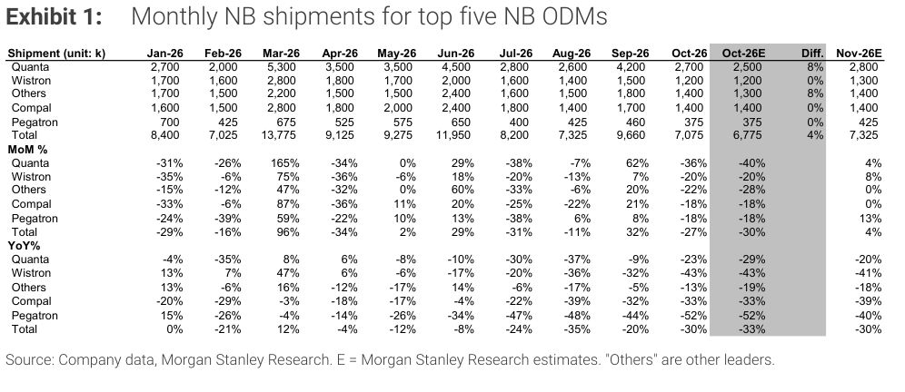
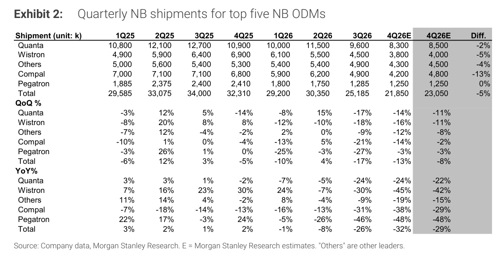

# Morgan Stanley｜Monthly NB Databook：Oct-26 出貨優於預期 4%，4Q26e 下修 5% 至 21.9M

**券商**：Morgan Stanley  
**分析師**：Howard Kao; Irene Yen; Andy Meng, CFA  
**日期**：2026-11-15  
**主題**：台灣五大 NB ODM 月度出貨追蹤  
**評級**：Industry View In-Line  
<a href="https://layx.uk/dl?g=產業&b=MS&d=20261115&h=Monthly-Databook-NB">📎 下載 PDF</a>

---

## 報告總結

Oct-26 五大 NB ODM 出貨 7,075k（-27% m/m、-30% y/y），比 MS 預期高 4%，但 MS 仍把 4Q26 build 下修 5% 至 21.9M（-13% q/q、-32% y/y），依據是 ODM 最新指引，且隱含季末拉貨動能有限。3Q26 已是 -26% y/y 的低基期，4Q 再降 13% q/q，遠低於 4Q 過去 15 年平均「持平」的季節性。MS 認為 PC 需求展望到 2027 年仍在轉弱：華碩預期 2027 全球 PC 出貨 -10～15% y/y、廣達預期全球 NB 出貨高個位數到 -10% y/y，與 MS 自己 2027 全球 PC -11.5% 的預測方向一致；1Q27 初步看法是 NB build 續降，但尚未建立正式預估。上月見 [[20261014_MS_Monthly-Databook-NB]]。

---

## MS 完整投資邏輯鏈

| 論點層次 | Exhibit | 內容 |
|---|---|---|
| 數據確認 | Exhibit 1 | Oct-26 出貨 7,075k，+4% vs MSe |
| 預估下修 | Exhibit 2 | 4Q26e 由 23,050k 降至 21,850k（-5%） |
| 需求結構 | 封面文字 | 季末拉貨弱，q/q -13% 遠低於歷史持平 |
| 外部印證 | 封面文字 | 華碩、廣達對 2027 年 PC／NB 展望轉保守 |
| 前瞻 | 封面文字 | 1Q27 預期續降，尚無正式預估 |
| **結論** | 封面 | **短期單月優於預期，不改 4Q 與 2027 年轉弱的方向** |

> **報告最大邏輯缺口**：封面說下修依據是「最新的 ODM 指引」，但沒有逐家揭露指引內容；下修 1,200k 中有 600k（50%）來自仁寶，這部分的細節報告沒有交代。

---

## Exhibit 1｜Monthly NB Shipments for Top Five NB ODMs

### 解讀摘要
Oct-26 實際 7,075k 比預期 6,775k 高 300k（+4%），但全部的超額都來自廣達（2,700k vs 2,500k，+200k）與 Others（1,400k vs 1,300k，+100k）；緯創、仁寶、和碩剛好落在預期。與上月相比（Sep-26 9,660k，季末拉貨）-27% m/m，是季末後的正常回落；y/y -30%，五家全部衰退，和碩（-52%）與緯創（-43%）最深。MS 預估 Nov-26 7,325k（+4% m/m、-30% y/y）。

### 表格

| ODM | Aug-26 | Sep-26 | Oct-26 實際 | Oct-26E | vs E | Oct m/m | Oct y/y | Nov-26E |
|---|---|---|---|---|---|---|---|---|
| Quanta | 2,600 | 4,200 | 2,700 | 2,500 | +8% | -36% | -23% | 2,800 |
| Wistron | 1,400 | 1,500 | 1,200 | 1,200 | 0% | -20% | -43% | 1,300 |
| Others | 1,500 | 1,800 | 1,400 | 1,300 | +8% | -22% | -13% | 1,400 |
| Compal | 1,400 | 1,700 | 1,400 | 1,400 | 0% | -18% | -33% | 1,400 |
| Pegatron | 425 | 460 | 375 | 375 | 0% | -18% | -52% | 425 |
| **Total** | **7,325** | **9,660** | **7,075** | **6,775** | **+4%** | **-27%** | **-30%** | **7,325** |

（單位：千台）

> **洞察一**：4Q26e 的 21,850k 扣掉 Oct 實際 7,075k 與 Nov-E 7,325k，隱含 Dec 約 7,450k，只比 Nov-E 多 2%，相對 Sep 的 9,660k 低 23%。也就是說 MS 這次的預測內建「幾乎沒有季末拉貨」——今年 Mar 為 13,775k、Jun 為 11,950k、Sep 為 9,660k，季末月出貨逐季縮小，Dec 再降到 7,450k。（本筆記推算：21,850 − 7,075 − 7,325。）
>
> **值得驗證**：4Q26e 對 Dec 的假設相當保守。若 Dec 仍有小幅季末拉貨，例如 Dec 比 Nov-E 多 10%（7,325 × 1.10 ≈ 8,058k；作為對照，Sep 比 Aug 多 32%），4Q26 會變成 22,458k，比 MS 新預估高 2.8%。這個單一假設就足以抹平大半這次下修（-5%）的幅度，後續 Dec 實際數字是最直接的檢驗。

---

## Exhibit 2｜Quarterly NB Shipments for Top Five NB ODMs

### 解讀摘要
圖中 4Q26E 有兩欄：白底是本次新預估（21,850k），灰底是前次預估（23,050k），最右欄 Diff 是新相對舊。總量 -5%，其中仁寶下修最多（4,800k → 4,200k，-13%），緯創 -5%、Others -4%、廣達 -2%、和碩不變。3Q26 實際 25,185k（-17% q/q、-26% y/y），4Q26E 再降到 21,850k（-13% q/q、-32% y/y），y/y 跌幅由 3Q 的 -26% 擴大到 -32%。MS 指出即使 3Q 基期已低，13% 的 q/q 降幅仍遠低於 4Q 過去 15 年平均持平的水準。

### 表格

| ODM | 4Q25 | 3Q26 | 4Q26E（新） | 4Q26E（前次） | 下修幅度 | q/q（新） | y/y（新） |
|---|---|---|---|---|---|---|---|
| Quanta | 10,900 | 9,600 | 8,300 | 8,500 | -2% | -14% | -24% |
| Wistron | 6,900 | 4,500 | 3,800 | 4,000 | -5% | -16% | -45% |
| Others | 5,300 | 4,900 | 4,300 | 4,500 | -4% | -12% | -19% |
| Compal | 6,800 | 4,900 | 4,200 | 4,800 | -13% | -14% | -38% |
| Pegatron | 2,410 | 1,285 | 1,250 | 1,250 | 0% | -3% | -48% |
| **Total** | **32,310** | **25,185** | **21,850** | **23,050** | **-5%** | **-13%** | **-32%** |

（單位：千台）

### 增量貢獻拆解（4Q26E 下修來源）

| 成長來源 | 貢獻（k） | 佔總下修 |
|---|---|---|
| 仁寶（Compal） | -600 | 50% |
| 廣達（Quanta） | -200 | 17% |
| 緯創（Wistron） | -200 | 17% |
| Others | -200 | 17% |
| 和碩（Pegatron） | 0 | 0% |
| **淨下修** | **-1,200** | **100%** |

> 計算：4,800 − 4,200 = 600（仁寶）；8,500 − 8,300 = 200（廣達）；4,000 − 3,800 = 200（緯創）；4,500 − 4,300 = 200（Others）；合計 23,050 − 21,850 = 1,200；仁寶占 600 ÷ 1,200 = 50%（廣達、緯創、Others 各占 16.7%，四捨五入為 17%）。

> **洞察二**：Oct 的小幅超預期與 4Q 的大幅下修是兩件事。Oct 超額 300k 來自廣達與 Others，而 4Q 下修的一半來自仁寶——兩者方向相反且來源不同，所以「Oct 優於預期」不能直接解讀為 4Q 風險降低。
>
> **洞察三（配合 Exhibit 1）**：y/y 衰退幅度在 2026 年逐季擴大：1Q26 -1%、2Q26 -8%、3Q26 -26%、4Q26E -32%。緯創（-45%）、和碩（-48%）、仁寶（-38%）下滑最深，具名 ODM 中廣達（-24%）相對最穩，與上月筆記指出的「Dell 曝險高者受衝擊最大」方向一致。
>
> **原文補充**：華碩預期 2027 全球 PC 出貨 -10～15% y/y；廣達預期全球 NB 出貨高個位數至 -10% y/y；MS 自己預測 2027 全球 PC 出貨 -11.5%。MS 看到供應鏈對 2027 的展望近月轉差，但表示 1Q27 尚未有正式預估。

---

## 相關個股清單

| 類別 | 公司 | Ticker | 評等 | 備註 |
|---|---|---|---|---|
| 台灣 ODM | 仁寶 | 2324 | — | 4Q26E 下修最多（-13%），見 [[2324_仁寶]] |
| 台灣 ODM | 緯創 | 3231 | — | 4Q26E y/y -45%，見 [[3231_緯創]] |
| 台灣 ODM | 廣達 | 2382 | — | Oct 優於預期、y/y 相對最穩，見 [[2382_廣達]] |
| 台灣 ODM | 和碩 | 4938 | — | 4Q26E y/y -48%，見 [[4938_和碩]] |
