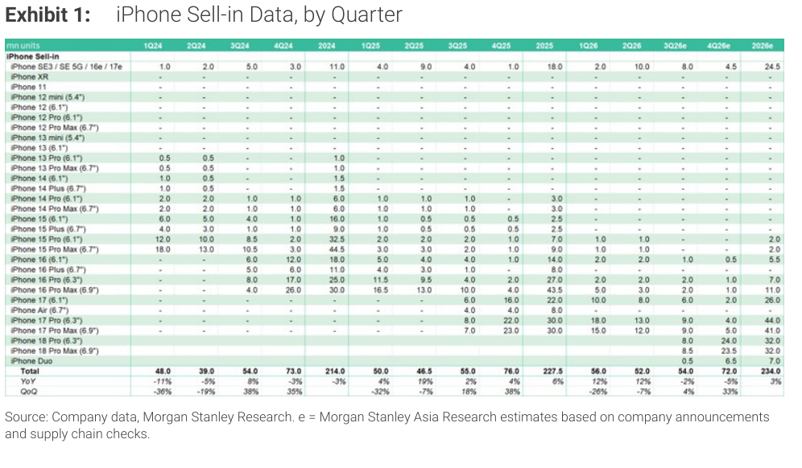
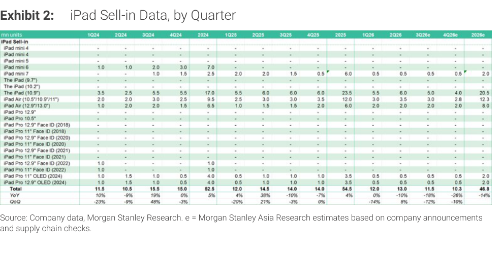

# Morgan Stanley｜Monthly iOS Databook：4Q26 iPhone／iPad 建置預估維持不變

**券商**：Morgan Stanley  
**分析師**：Howard Kao; Derrick Yang; Andy Meng, CFA; Irene Yen; Vivi Huang; Betty Chen  
**日期**：2026-11-15  
**主題**：iPhone / iPad 供應鏈月度出貨追蹤  
**評級**：Industry View In-Line  
<a href="https://layx.uk/dl?g=產業&b=MS&d=20261115&h=Monthly-Databook-iOS">📎 下載 PDF</a>

---

## 報告總結

本月不調整任何預估。4Q26 iPhone build 維持 72M（+33% q/q、-5% y/y），舊款 iPhone 16／17e 生產偏軟是 y/y 衰退的主因；新款 iPhone 18 家族 2H26 維持 71M（-21% y/y，且較去年少一個 SKU），其中 iPhone Duo 7M。CY26 iPhone 234M（+3% y/y）。iPad 4Q26 維持 10.3M（-10% q/q、-26% y/y），CY26 46.8M（-14% y/y），年底生產動能仍低。上月（[[20261014_MS_Monthly-Databook-iOS]]）剛下修 4Q26 iPhone 1M 與 iPad，這個月是「下修後的持平」。

---

## MS 完整投資邏輯鏈

| 論點層次 | Exhibit | 內容 |
|---|---|---|
| 需求信號（iPhone） | 封面文字 | 4Q26 build 72M 不變；舊款機型偏軟 |
| 新品動態 | Exhibit 1 | iPhone 18 家族 2H26 71M，4Q26 占 75% |
| 需求信號（iPad） | Exhibit 2 | 4Q26 10.3M 不變，y/y -26% |
| 全年落點 | 封面文字 | CY26 iPhone 234M（+3%）、iPad 46.8M（-14%） |
| **結論** | 封面 | **預估不變；後續看 iPhone 18 ramp 與 sell-through 再調整** |

> **報告最大邏輯缺口**：預估是「MS 依公司公告與供應鏈查核」自行估算（Exhibit 圖註），報告沒有提供 iPhone 18 ramp 的任何即時驗證數據，也沒有說明 Duo 7M 的依據；4Q26 的 72M 有 75% 押在尚未量產的新機。

---

## Exhibit 1｜iPhone Sell-in Data, by Quarter

### 解讀摘要
4Q26e 72.0M 較 3Q26e 54.0M 季增 33%，主要由 iPhone 18 Pro／Pro Max 帶動（合計 47.5M，占 4Q 66%），但仍低於 4Q25 的 76.0M（-5% y/y）。MS 把 y/y 衰退歸因兩件事：舊款（iPhone 16／17e 等）生產偏軟，以及 iPhone 18 家族 2H26 較去年同期少推一個 SKU（2H25 為 iPhone 17、Air、Pro、Pro Max 四款，2H26 為 Pro、Pro Max、Duo 三款）。全年 234.0M 比 2025 年 227.5M 多 6.5M（+2.9%），代表在 4Q 轉弱下全年仍靠 Pro 系列撐出小幅成長。

### 表格

| 機型 | 3Q26e | 4Q26e | 2026e |
|---|---|---|---|
| iPhone SE3／SE 5G／16e／17e | 8.0 | 4.5 | 24.5 |
| iPhone 15 Pro／Pro Max | — | — | 4.0 |
| iPhone 16 (6.1") | 1.0 | 0.5 | 5.5 |
| iPhone 16 Pro (6.3") | 2.0 | 1.0 | 7.0 |
| iPhone 16 Pro Max (6.9") | 2.0 | 1.0 | 11.0 |
| iPhone 17 (6.1") | 6.0 | 2.0 | 26.0 |
| iPhone 17 Pro (6.3") | 9.0 | 4.0 | 44.0 |
| iPhone 17 Pro Max (6.9") | 9.0 | 5.0 | 41.0 |
| iPhone 18 Pro (6.3") | 8.0 | 24.0 | 32.0 |
| iPhone 18 Pro Max (6.9") | 8.5 | 23.5 | 32.0 |
| iPhone Duo | 0.5 | 6.5 | 7.0 |
| **Total** | **54.0** | **72.0** | **234.0** |
| YoY | -2% | -5% | +3% |
| QoQ | +4% | +33% | — |

（單位：百萬台；iPhone 18 家族 2H26 = 17.0 + 54.0 = 71.0M）

> **洞察一**：4Q26e 72.0M 中 iPhone 18 家族占 54.0M（24.0 + 23.5 + 6.5），舊機型合計僅 18.0M（4.5 + 0.5 + 1.0 + 1.0 + 2.0 + 4.0 + 5.0）。「舊款偏軟」在數字上只是 18.0M 的盤子，4Q 能不能守住 72M，關鍵幾乎全在新機 ramp。
>
> **洞察二**：Pro 級（iPhone 18 Pro／Pro Max 47.5M ＋ iPhone 17 Pro／Pro Max 9.0M）合計 56.5M，占 4Q26e 的 78%（56.5 ÷ 72.0）。出貨結構繼續往高階集中，零組件含量較高的機型貢獻了絕大部分的量。
>
> **洞察三**：iPhone 18 家族 71M 對照去年同期 iPhone 17 家族 90.0M（2H25：22.0 + 8.0 + 30.0 + 30.0，取自 Exhibit 1 的 3Q25＋4Q25 欄），計算得 -21%，與報告給的 -21% 相符，驗證圖表讀值。（本筆記推算。）
>
> **值得驗證**：iPhone Duo 7M 是單一新品類的假設（占 2H26 家族 71M 的 9.9%，且 6.5M 集中在 4Q）。若 Duo 實際只有一半，4Q26e 約少 3.3M（-4.5%）；每少 1M，4Q26e 下修約 1.4%（1 ÷ 72.0）。MS 自己也說會「持續監控 ramp 與 sell-through」，代表此數字目前沒有硬數據支撐。

---

## Exhibit 2｜iPad Sell-in Data, by Quarter

### 解讀摘要
iPad 4Q26e 維持 10.3M（-10% q/q、-26% y/y），比 3Q26e 的 11.5M（-18% y/y）更弱，y/y 跌幅在 4Q 擴大。2025 年 4Q 基期為 14.0M，今年同期少 3.7M。全年 46.8M（-14% y/y，2025 為 54.5M）。拆到機型，The iPad (10.9") 全年 20.5M（占 44%）、iPad Air 合計 20.3M（12.3 + 8.0，占 43%），這兩條線決定了 iPad 的大盤。

### 表格

| 機型 | 1Q26 | 2Q26 | 3Q26e | 4Q26e | 2026e |
|---|---|---|---|---|---|
| iPad mini 7 | 0.5 | 0.5 | 0.5 | 0.5 | 2.0 |
| The iPad (10.9") | 5.5 | 6.0 | 5.0 | 4.0 | 20.5 |
| iPad Air (10.5"/10.9"/11") | 3.0 | 3.5 | 3.0 | 2.8 | 12.3 |
| iPad Air (12.9"/13.0") | 2.0 | 2.0 | 2.0 | 2.0 | 8.0 |
| iPad Pro 11" OLED (2024) | 0.5 | 0.5 | 0.5 | 0.5 | 2.0 |
| iPad Pro 12.9" OLED (2024) | 0.5 | 0.5 | 0.5 | 0.5 | 2.0 |
| **Total** | **12.0** | **13.0** | **11.5** | **10.3** | **46.8** |
| YoY | 0% | -10% | -18% | -26% | -14% |
| QoQ | -14% | +8% | -12% | -10% | — |

（單位：百萬台）

> **洞察一**：2026 年各季 iPad 都不高於 2025 年同期（YoY 0%／-10%／-18%／-26%），跌幅逐季擴大；入門款 The iPad (10.9") 由 1Q26 的 5.5M 降到 4Q26e 的 4.0M（-27%），降幅大於整體的 -14%（12.0M → 10.3M），入門款是這波收縮的主要來源。（本筆記推算，1Q26 對 4Q26e。）
>
> **洞察二（配合 Exhibit 1）**：iPhone 與 iPad 的 4Q26e y/y 走勢分歧（iPhone -5%、iPad -26%）；MS 對 iPhone 全年還能維持 +3%，但 iPad 全年已是 -14%，Apple 硬體 build 的弱勢集中在平板。

---

## 相關個股清單

> 以下為依產業常識列示，非報告所載；報告本身是 Apple 出貨追蹤，未列個股評等。

| 類別 | 公司 | Ticker | 備註 |
|---|---|---|---|
| 組裝 ODM | 鴻海 | 2317 | iPhone 主要組裝商，見 [[2317_鴻海]] |
| 組裝 ODM | 和碩 | 4938 | iPhone 組裝，見 [[4938_和碩]] |
| 光學（鏡頭） | 大立光 | 3008 | Pro 級機型比重高，見 [[3008_大立光]] |
