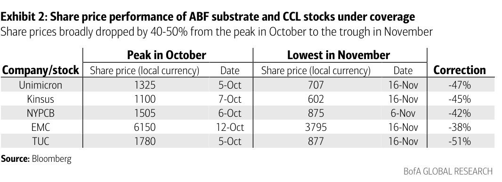
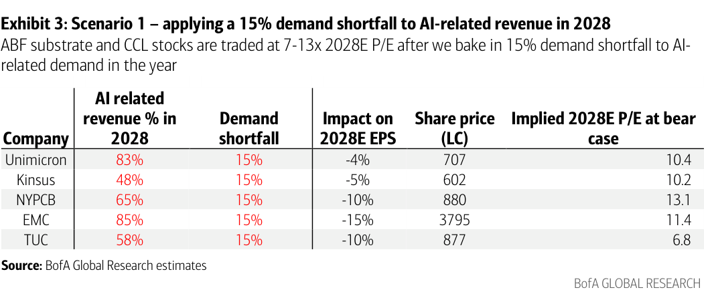
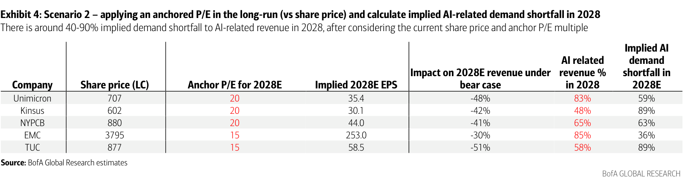
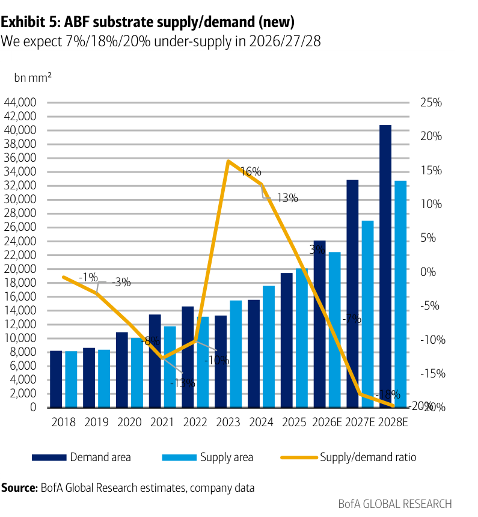
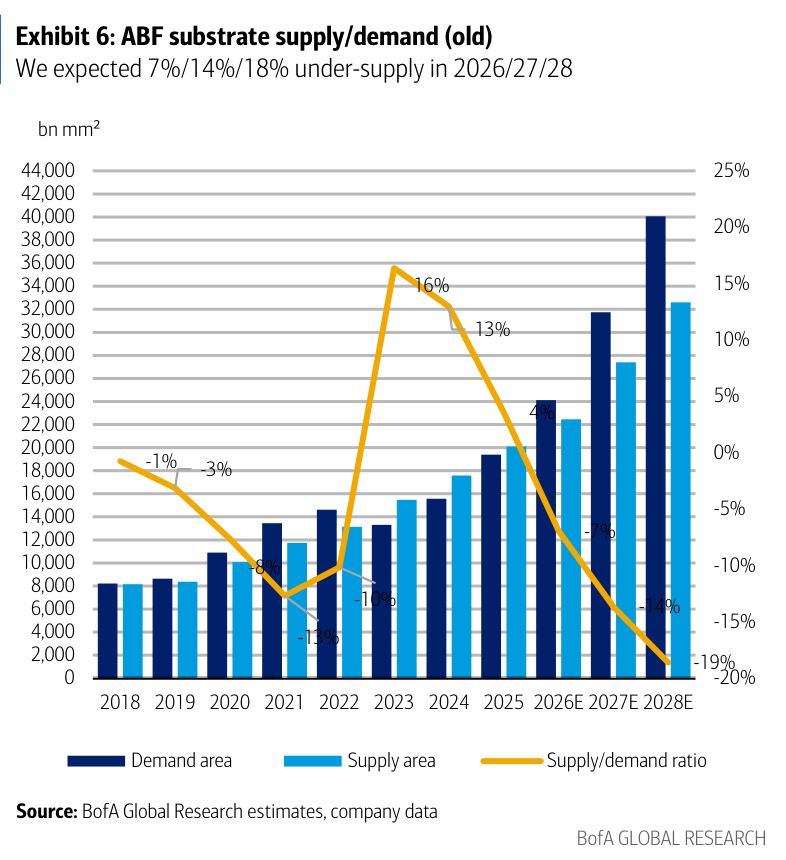
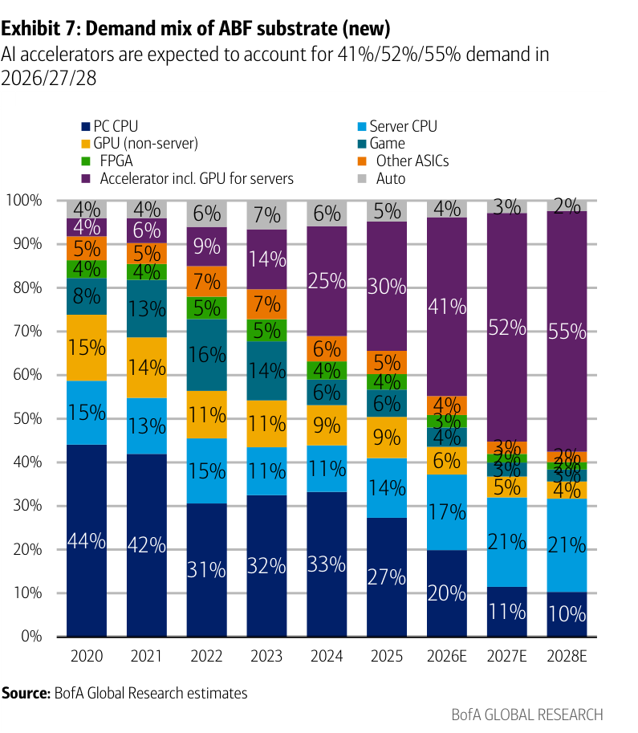
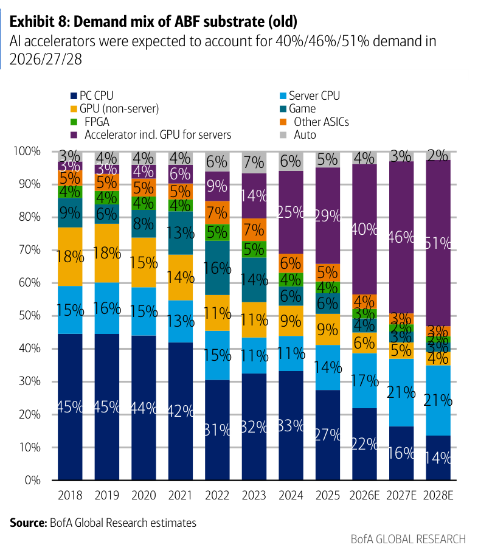
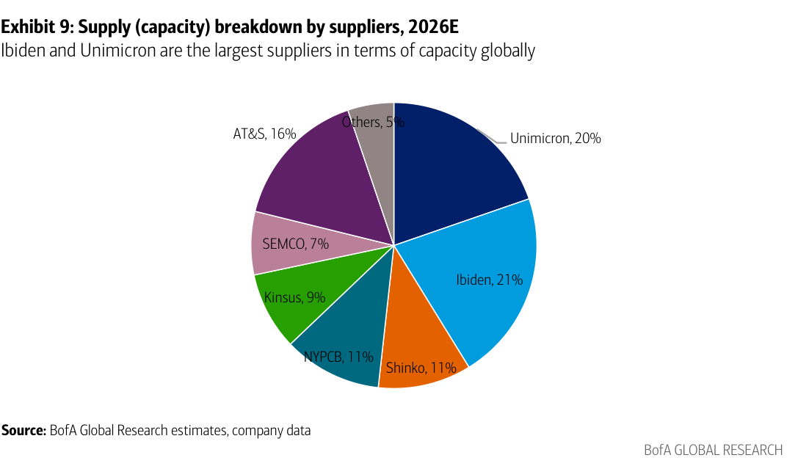
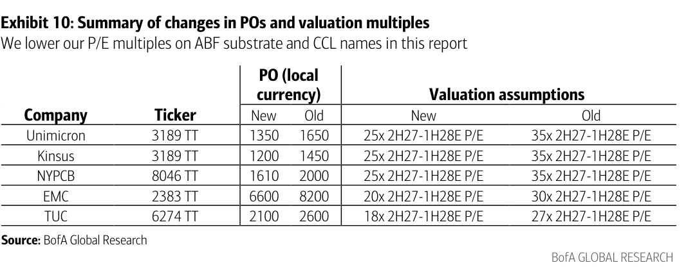
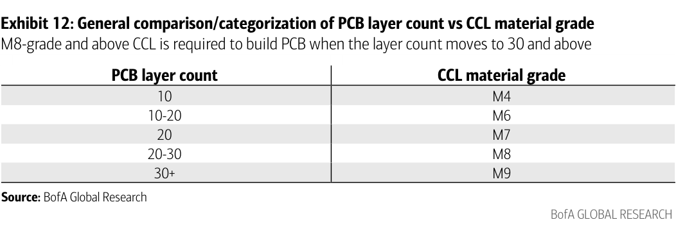

# BofA｜ABF 載板與 CCL：估值重置後下檔有限

**券商**：BofA Securities (Merrill Lynch Taiwan / BofAS Japan)  
**分析師**：Mike Yang、Masashi Kubota  
**日期**：2026-11-17  
**主題**：ABF substrate & CCL: making the case for limited downside after valuation reset  
**評級**：Buy（欣興 3037、景碩 3189、南電 8046、台光電 2383、台燿 6274）  
<a href="https://layx.uk/dl?g=產業&b=BofA&d=20261117&h=ABF-CCL">📎 下載 PDF</a>

> 本篇略過 Exhibit 1（與 Exhibit 10 重複的目標價摘要）、Exhibit 11（評等與價格表）及 Exhibit 13-27（五檔個股的預估修正、與共識比較、損益表）。前次 BofA 載板更新見 [[20260819_BofA_ABF-Substrate]]。

---

## 報告總結

10 月高點至 11 月低點，ABF 載板與 CCL 五檔股價下跌 38-51%，BofA 認為現價隱含市場過度擔憂 AI 伺服器週期反轉：假設 2028 年 AI 營收短少 15%，五檔僅 7-13x 2028E P/E；若以長期錨定本益比反推，隱含 AI 需求缺口 36-89%。

BofA 因 3Q26 毛利率優於預期與載板／CCL 續漲而上修 2027-28E 營業利益，但將目標本益比下調約 30%，目標價下調 17-20%，仍維持 Buy。載板供不應求預估擴大為 7%/18%/20%（前次 7%/14%/19%），CCL 偏好台光電與台燿。

---

## BofA 完整投資邏輯鏈

| 論點層次 | Exhibit | 內容 |
|---|---|---|
| 股價修正 | 2 | 10 月高點至 11 月低點下跌 38-51% |
| 壓力測試一 | 3 | 2028 年 AI 營收短少 15%，現價僅 7-13x 2028E P/E |
| 壓力測試二 | 4 | 錨定本益比反推，隱含 AI 需求缺口 36-89% |
| 供需更新 | 5-6 | 載板 2027 年供不應求由 14% 擴大至 18% |
| 需求結構 | 7-8 | AI 加速器占需求比 2027E 由 46% 升至 52% |
| 供給上限 | 9 | 2026E 產能前兩大為 Ibiden 21%、欣興 20% |
| 估值調整 | 10 | 目標本益比下調約 30%，目標價下調 17-20% |
| 材料升級 | 12 | 30 層以上需 M9，CPO 最多使 CCL 降級至 M8/M9 |
| **結論** | 報告封面 | **估值重置後維持 Buy，CCL 偏好台光電與台燿** |

> **報告最大邏輯缺口**：目標價下調的主因是本益比下調約 30%（例如欣興、景碩、南電由 35x 降至 25x），報告只以「整個 AI 伺服器供應鏈去評價」帶過，沒有說明新倍數的獨立依據；而文末「Price objective basis & risk」段落仍引用舊目標價與舊倍數（欣興 NT\$1,650／35x、台光電 NT\$8,200／30x 等），與 Exhibit 10 的新目標價並存，文件內部不一致。

---

## 報告核心觀點

| 主題 | BofA 觀點 | 市場共識 | 是否 Contra-Consensus |
|---|---|---|---|
| 估值 | 股價自 10 月高點下跌 40-50%；情境一下 7-13x 2028E P/E，低於 2023 年中 AI 伺服器需求興起前的估值區間中點 | 報告未載明；描述為市場擔憂 AI 伺服器週期反轉或 capex 成長放緩 | 是（認為市場過度悲觀） |
| 獲利預估 | 上修 2027-28E 營業利益：欣興 4-9%、景碩 19-31%、南電 3-6%、台光電 19-24%、台燿 22-23%、生益科技 32-33%（3Q26 毛利率優於預期、載板／BT／CCL 續漲） | 報告未載明 | 報告未載明 |
| 目標價 | 目標本益比下調約 30%，目標價下調 17-20% | 報告未載明 | 報告未載明 |
| 載板供需 | 2026/27/28 年供不應求 7%/18%/20%（前次 7%/14%/19%）；T-glass 漲價（Nittobo、Resonac）將讓載板廠進一步調升 ASP | 報告未載明 | 報告未載明 |
| CCL 供需 | 部分設備交期仍至少 1.5-2 年，供需大致偏正面；偏好台光電、台燿 | 報告未載明 | 報告未載明 |
| CPO 影響 | CPO／OOI 最多使 CCL 降級至 M8/M9，並非材料需求消失 | 報告未載明 | 報告未載明 |

**偏好排序**：載板重申 Buy 欣興、景碩、南電；CCL 五檔皆 Buy，但個股層級更看好台光電與台燿。  
**零件／個股偏好**：台光電（M7 以上占 2027-28 年營收至少 70-80%、AI 高階 CCL 市占約 50-60%，並可能受惠 SpaceX AI 伺服器機櫃採用 M10）與台燿（為少數大幅擴充高階 CCL 產能的供應商，2026-30 年產能約 3 倍）。

---

## Exhibit 2｜ABF 載板與 CCL 個股股價表現

### 解讀摘要
五檔自 10 月 5-12 日的高點回落至 11 月低點，跌幅 38%（台光電）到 51%（台燿）；除南電低點出現在 11/6 外，其餘四檔的最低價都落在 11/16，代表報告撰寫時股價仍在底部附近，尚未見到反彈。BofA 把這個價差當作後面兩個情境的起點：市場在價格裡已預先反映了多大的 AI 需求缺口。

### 表格

| 公司 | 10 月高點（NT\$） | 日期 | 11 月低點（NT\$） | 日期 | 修正幅度 |
|---|---|---|---|---|---|
| 欣興 | 1,325 | 10/5 | 707 | 11/16 | -47% |
| 景碩 | 1,100 | 10/7 | 602 | 11/16 | -45% |
| 南電 | 1,505 | 10/6 | 875 | 11/6 | -42% |
| 台光電 | 6,150 | 10/12 | 3,795 | 11/16 | -38% |
| 台燿 | 1,780 | 10/5 | 877 | 11/16 | -51% |

> **洞察一**：跌幅由深到淺依序為台燿 -51%、欣興 -47%、景碩 -45%、南電 -42%、台光電 -38%，五檔平均約 -45%（(47+45+42+38+51)÷5 = 44.6，本筆記推算）。載板與 CCL 的跌幅同量級，市場是把整條 AI 伺服器 PCB 材料鏈一起去評價，而非只殺其中一環。

---

## Exhibit 3｜情境一：2028 年 AI 相關營收短少 15%

### 解讀摘要
情境一假設 2028 年 AI 相關需求比 BofA 預估短少 15%：因各家 AI 營收占比不同（景碩 48% 到台光電 85%），對 2028E EPS 的衝擊分化為 -4%（欣興）到 -15%（台光電）。即使在這個熊市情境下，五檔以 11/16 收盤價換算仍只有 6.8-13.1x 2028E P/E，BofA 據此主張現價已過度反映對 AI 伺服器週期反轉或 capex 成長放緩的擔憂。

> **原文補充**：BofA 指出情境一下五檔交易在 7-13x 2028E P/E，低於各自在 2023 年中 AI 伺服器需求興起前的估值區間中點（原文："below the midpoint of their valuation range before the rise of AI server demand from mid-2023"）。

### 表格

| 公司 | 2028 年 AI 營收占比 | 需求缺口 | 對 2028E EPS 衝擊 | 股價（NT\$） | 熊市情境 2028E P/E |
|---|---|---|---|---|---|
| 欣興 | 83% | 15% | -4% | 707 | 10.4x |
| 景碩 | 48% | 15% | -5% | 602 | 10.2x |
| 南電 | 65% | 15% | -10% | 880 | 13.1x |
| 台光電 | 85% | 15% | -15% | 3,795 | 11.4x |
| 台燿 | 58% | 15% | -10% | 877 | 6.8x |

> **洞察一**：營收缺口與 EPS 衝擊的對應並不一致。以「15% × AI 營收占比」換算營收短少幅度：欣興 12.5%、景碩 7.2%、南電 9.8%、台光電 12.8%、台燿 8.7%；EPS 衝擊分別為 -4%、-5%、-10%、-15%、-10%。南電、台光電、台燿的 EPS 降幅約為營收短少的 1.0-1.2 倍，景碩約 0.7 倍，欣興只有約 0.3 倍（-4% ÷ 12.5%）。（本筆記推算。）
>
> **值得驗證**：欣興對 AI 缺口特別「鈍感」是它在熊市情境仍有 10.4x 的關鍵，報告沒有說明原因。若欣興的 EPS 敏感度和南電、台光電、台燿一樣約 1 倍（EPS -12.5%），熊市 EPS 會再低約 8 個百分點，熊市 P/E 將由 10.4x 升至約 11.4x（707 ÷ [707 ÷ 10.4 ÷ 0.96 × 0.875]，本筆記推算，受四捨五入影響）。

---

## Exhibit 4｜情境二：以錨定本益比反推隱含的 AI 需求缺口

### 解讀摘要
情境二反過來算：先給各股長期錨定的 2028E 本益比（欣興、景碩、南電 20x，台光電、台燿 15x），用現價除以錨定倍數得到「股價隱含的 2028E EPS」，再反推市場已折價多少 AI 相關營收。結果是隱含的 AI 需求缺口落在 36%（台光電）到 89%（景碩、台燿），對應 2028E 營收衝擊 -30% 到 -51%。BofA 的論點是現價相當於假設 AI 相關營收腰斬甚至更糟，與 Exhibit 5-9 的供不應求方向不符。

### 表格

| 公司 | 股價（NT\$） | 2028E 錨定 P/E | 隱含 2028E EPS（NT\$） | 熊市情境對 2028E 營收衝擊 | 2028 年 AI 營收占比 | 隱含 AI 需求缺口 |
|---|---|---|---|---|---|---|
| 欣興 | 707 | 20x | 35.4 | -48% | 83% | 59% |
| 景碩 | 602 | 20x | 30.1 | -42% | 48% | 89% |
| 南電 | 880 | 20x | 44.0 | -41% | 65% | 63% |
| 台光電 | 3,795 | 15x | 253.0 | -30% | 85% | 36% |
| 台燿 | 877 | 15x | 58.5 | -51% | 58% | 89% |

> **洞察一**：表中三個欄位可互相驗算：營收衝擊 ≈ 隱含缺口 × AI 營收占比。欣興 59% × 83% ≈ 49%（表 -48%）、景碩 89% × 48% ≈ 43%（-42%）、南電 63% × 65% ≈ 41%（-41%）、台光電 36% × 85% ≈ 31%（-30%）、台燿 89% × 58% ≈ 52%（-51%），誤差 1 個百分點內，確認讀值自洽。（本筆記推算。）
>
> **值得驗證**：錨定本益比是情境二的單一最大假設，且同為載板的三檔用 20x、CCL 兩檔用 15x，報告沒有說明理由；同時 Exhibit 10 的 12 個月目標倍數是 25x／20x／18x（2H27-1H28E），高於這裡的錨定倍數，兩套倍數的用途不同（長期均值 vs 目標價），報告也沒有交代差別。以欣興為例，錨定倍數由 20x 降到 15x，隱含 2028E EPS 會由 35.4 升至 47.1（707 ÷ 15），隱含缺口會明顯縮小；反之則放大。
>
> **洞察二（配合 Exhibit 3）**：同一支股票在兩個情境下的 AI 缺口天差地遠：情境一假設 15%，情境二反推出 36-89%，兩者相差 2.4 倍（台光電 36% ÷ 15%）到 5.9 倍（景碩、台燿 89% ÷ 15%）。（本筆記推算。）

---

## Exhibit 5｜ABF 載板供需（新）

### 解讀摘要
新版模型預估 2026/27/28 年載板供不應求 7%/18%/20%，供需比（供給面積 ÷ 需求面積 − 1）自 2023-24 年的 +16%／+13% 完全反轉。需求面積由 2026E 約 24,100 增至 2028E 約 40,800（bn mm²），供給面積由約 22,500 增至約 32,700，2027 年需求成長 36%、供給約 20%，缺口擴大主因是 BofA 上修 AI 加速器與 CPU 的 TAM。

> **原文補充**：此次更新反映「Core Wars」報告將 CPU TAM 上修至 US\$240bn；需求成長預估為 2027/28 年 36%/24%（前次 32%/26%）。模型同時納入 Ibiden 提及的 SAP（semi-additive process）需求在 2026-30 年成長 2.5 倍，其中伺服器 CPU 成長 1.5 倍、AI 加速器成長 4.4 倍。另外 Nittobo 與 Resonac 調漲 T-glass 價格，將讓載板廠進一步調升 ASP。

### 表格

| 年度 | 2018 | 2019 | 2020 | 2021 | 2022 | 2023 | 2024 | 2025 | 2026E | 2027E | 2028E |
|---|---|---|---|---|---|---|---|---|---|---|---|
| 供需比（供給 ÷ 需求 − 1） | -1% | -3% | -8% | -13% | -10% | 16% | 13% | 3% | -7% | -18% | -20% |

| 年度 | 2025 | 2026E | 2027E | 2028E |
|---|---|---|---|---|
| 需求面積（bn mm²） | 19,400 | 24,100 | 32,900 | 40,800 |
| 供給面積（bn mm²） | 20,000 | 22,500 | 27,000 | 32,700 |

（面積為長條圖目測估算，與標示的供需比及內文 36%/24% 需求成長交叉驗證通過，誤差約 1-2%。）

> **洞察一**：缺口在 2027 年一次擴大 11 個百分點（-7% → -18%），2028 年只再擴大 2 個百分點（→ -20%）。2028 年需求成長（24%）逼近供給成長（約 21%），代表供需失衡的最大增量落在 2027 年，之後的邊際惡化趨緩。（本筆記推算，供給成長由面積目測：27,000 → 32,700。）

---

## Exhibit 6｜ABF 載板供需（舊）

### 解讀摘要
舊版（即 [[20260819_BofA_ABF-Substrate]] 的預估）供不應求為 2026/27/28 年 7%/14%/19%，需求成長 32%/26%。與新版比較，2026E 維持 -7%，2027E 由 -14% 擴大到 -18%（+4 個百分點），2028E 由 -19% 擴大到 -20%（+1 個百分點）。新版缺口的擴大幾乎全在 2027 年，是需求上修所致，供給面積在圖上幾乎沒有變動。

### 表格

| 年度 | 2024 | 2025 | 2026E | 2027E | 2028E |
|---|---|---|---|---|---|
| 供需比（舊） | 13% | 4% | -7% | -14% | -19% |
| 供需比（新，Exhibit 5） | 13% | 3% | -7% | -18% | -20% |
| 變動（百分點） | 0 | -1 | 0 | -4 | -1 |

> **洞察一**：報告對舊版 2028E 的描述前後不一：圖副標寫「7%/14%/18%」，圖上標籤與內文則是 -19%。新舊 2028E 差距因此可能是 1 或 2 個百分點，不影響「缺口擴大集中在 2027 年」的結論，但讀者引用舊值時要留意。

---

## Exhibit 7｜ABF 載板需求結構（新）

### 解讀摘要
新版預估 AI 加速器（含伺服器用 GPU）占載板需求 2026/27/28 年 41%/52%/55%，2023 年僅 14%、2025 年 30%；PC CPU 則由 2020 年的 44% 降到 2028E 的 10%，伺服器 CPU 由 2023 年的 11% 升至 2027-28E 的 21%。AI 加速器加伺服器 CPU 合計占比由 2023 年 25% 升至 2028E 76%，載板需求結構已從 PC 主導轉為伺服器主導。

### 表格

| 類別 | 2025 | 2026E | 2027E | 2028E |
|---|---|---|---|---|
| PC CPU | 27% | 20% | 11% | 10% |
| 伺服器 CPU | 14% | 17% | 21% | 21% |
| GPU（非伺服器） | 9% | 6% | 5% | 4% |
| AI 加速器（含伺服器用 GPU） | 30% | 41% | 52% | 55% |
| 車用 | 5% | 4% | 3% | 2% |
| 其他（遊戲、FPGA、其他 ASIC） | 15% | 11% | 8% | 8% |

（2026E 為 4% + 3% + 4%，2027E、2028E 的小分類標籤擁擠，合併呈現；各欄加總受四捨五入影響。）

> **洞察一**：以 2026E 總需求為 100，並套用內文需求成長 36%/24%，AI 加速器的絕對需求由 41 增至 70.7（2027E）與 92.7（2028E），年增約 72% 與 31%；PC CPU 則由 20 降至 15.0（2027E，-25%）再回到 16.9（2028E）。也就是 2027 年載板需求的成長幾乎全來自 AI 加速器，PC CPU 的絕對需求是下滑的。（本筆記推算，以標示百分比與內文成長率相乘，受四捨五入影響。）

---

## Exhibit 8｜ABF 載板需求結構（舊）

### 解讀摘要
舊版預估 AI 加速器占比 2026/27/28 年 40%/46%/51%，PC CPU 22%/16%/14%，伺服器 CPU 17%/21%/21%。新版把 AI 加速器占比上調 1/6/4 個百分點，同步把 PC CPU 占比下調 2/5/4 個百分點，伺服器 CPU 占比不變，顯示此次需求上修主要來自 AI 加速器，並以壓低 PC 需求結構作對沖。

### 表格

| 類別 | 2025 | 2026E | 2027E | 2028E |
|---|---|---|---|---|
| PC CPU | 27% | 22% | 16% | 14% |
| 伺服器 CPU | 14% | 17% | 21% | 21% |
| GPU（非伺服器） | 9% | 6% | 5% | 4% |
| AI 加速器（含伺服器用 GPU） | 29% | 40% | 46% | 51% |
| 車用 | 5% | 4% | 3% | 2% |
| 其他（遊戲、FPGA、其他 ASIC） | 15% | 11% | 9% | 8% |

> **洞察一（配合 Exhibit 7）**：以 2026E 總需求為 100，新舊版 2027E 總需求分別為 136（成長 36%）與 132（成長 32%），AI 加速器絕對需求分別為 70.7 與 60.7（新版高約 16.5%）；2028E 為 92.7 與 84.8（高約 9.3%）。同期非加速器需求則由舊版 71.3 降到新版 65.3（2027E，-8.4%）、81.5 降到 75.9（2028E，-6.9%）。換言之，新版缺口擴大是「AI 加速器需求上修」加上「非 AI 需求下修」兩件事同時發生。（本筆記推算，受四捨五入影響。）

---

## Exhibit 9｜2026E 各載板廠產能占比

### 解讀摘要
2026E 全球載板產能由 Ibiden（21%）與欣興（20%）領先，AT&S 16%、南電與 Shinko 各 11%、景碩 9%、SEMCO 7%、其他 5%。台灣三廠（欣興、南電、景碩）合計 40%，日本兩廠（Ibiden、Shinko）合計 32%，與 8 月的筆記一致（見 [[20260819_BofA_ABF-Substrate]]）。

### 表格

| 供應商 | 2026E 產能占比 |
|---|---|
| Ibiden | 21% |
| 欣興 | 20% |
| AT&S | 16% |
| 南電 | 11% |
| Shinko | 11% |
| 景碩 | 9% |
| SEMCO | 7% |
| 其他 | 5% |
| **合計** | **100%** |

> **洞察一**：本圖只有 2026E 一個時點，無法看出 2027-28 年供給（Exhibit 5 估計成長約 20%／21%）由誰擴充；而報告列出的下行風險之一正是「同業擴產幅度大於預期」（greater ABF expansion from peers），供給份額是否改變是檢驗供不應求論點的關鍵，但圖上沒有提供。

---

## Exhibit 10｜目標價與估值倍數調整

### 解讀摘要
五檔目標價全面下調 17-20%，原因是目標本益比（2H27-1H28E）下調約 30%：欣興、景碩、南電由 35x 降至 25x（-29%），台光電由 30x 降至 20x（-33%），台燿由 27x 降至 18x（-33%）。目標價降幅小於倍數降幅，是因為 BofA 同時上修 2027-28E 營業利益，隱含 EPS 上修 13-21% 抵銷了部分倍數壓縮（見洞察一）。

### 表格

| 公司 | 代號 | 目標價（NT\$）新 | 目標價（NT\$）舊 | 目標價變動 | 目標倍數 新 | 目標倍數 舊 | 倍數變動 |
|---|---|---|---|---|---|---|---|
| 欣興 | 3037 | 1,350 | 1,650 | -18.2% | 25x | 35x | -28.6% |
| 景碩 | 3189 | 1,200 | 1,450 | -17.2% | 25x | 35x | -28.6% |
| 南電 | 8046 | 1,610 | 2,000 | -19.5% | 25x | 35x | -28.6% |
| 台光電 | 2383 | 6,600 | 8,200 | -19.5% | 20x | 30x | -33.3% |
| 台燿 | 6274 | 2,100 | 2,600 | -19.2% | 18x | 27x | -33.3% |

（倍數基準皆為 2H27-1H28E P/E；原報告 Exhibit 10 把欣興與景碩的代號都標為 3189，欣興代號應為 3037，本表已更正，Exhibit 11 亦標示欣興為 3037。）

> **洞察一**：目標價 ÷ 目標倍數可反推 BofA 隱含的 2H27-1H28E EPS：欣興 54.0（舊 47.1，+14.5%）、景碩 48.0（舊 41.4，+15.9%）、南電 64.4（舊 57.1，+12.7%）、台光電 330.0（舊 273.3，+20.7%）、台燿 116.7（舊 96.3，+21.2%）。（本筆記推算。）
>
> **值得驗證**：欣興、南電的隱含 EPS 上修（+14.5%、+12.7%）約為封面所述 2027-28E 營業利益上修幅度（4-9%、3-6%）的 2 倍以上，景碩（+15.9% vs 19-31%）、台光電（+20.7% vs 19-24%）、台燿（+21.2% vs 22-23%）則大致落在區間內；報告也聲明估值期間不變，因此欣興與南電的落差來源（稅率、業外或不同期間加權）沒有交代，也可能代表目標價與營業利益上修兩個數字未完全對齊。

---

## Exhibit 12｜PCB 層數與 CCL 材料等級對照

### 解讀摘要
AI 伺服器及相關應用的 PCB 層數與 CCL 材料等級大致對應：10 層用 M4、10-20 層用 M6、20 層用 M7、20-30 層用 M8、30 層以上用 M9，BofA 因此指出「層數升到 30 層以上時需要 M8 以上的 CCL」。這張表是 BofA 判斷 CPO 對 CCL 影響的基礎：只要主機板層數持續上升，材料等級就必須同步升級。

> **原文補充**：BofA 通路查證顯示，當插拔式光模組升級為 OBO（on-board optics）或 NPO（near-package optics）時，許多 CCL 材料會升級至 M9（採用低 Dk2 玻纖布與 HVLP4 銅箔）。CPO gen-2 搭配 OOI（optics on interposer）預計 2028 年前不會量產，且傳輸速率將升級至 3.2T，屆時在非 CPO／OOI 架構下，主機板 CCL 可能已升到 M10；因此 CPO／OOI 的導入可能只造成材料降級至 M8/M9，而非需求消失。BofA 的通路查證另顯示，SpaceX 的 AI 伺服器機櫃可能採用 M10，台光電有潛在曝險。

### 表格

| PCB 層數 | CCL 材料等級 |
|---|---|
| 10 | M4 |
| 10-20 | M6 |
| 20 | M7 |
| 20-30 | M8 |
| 30+ | M9 |

> **值得驗證**：對照表最高只到 M9（30 層以上），沒有列出 M10 對應的層數；而報告的結論「CPO 最多讓 CCL 降級到 M8/M9」建立在「2028 年非 CPO 架構的主機板已是 M10」這一單一推論鏈（3.2T 傳輸升級＋CPO gen-2 延後）。若 CPO 提早量產或 M10 導入不如預期，CCL 材料降級的幅度與時點都會改變，報告沒有量化對台光電、台燿營收的影響。

---

## 跨 Exhibit 彙整表

### 彙整 1｜ABF 載板供需與需求結構：新舊對照（Exhibit 5-8）

| 項目 | 2026E 新／舊 | 2027E 新／舊 | 2028E 新／舊 |
|---|---|---|---|
| 供不應求程度 | -7% ／ -7% | -18% ／ -14% | -20% ／ -19% |
| 需求年增 | — | 36% ／ 32% | 24% ／ 26% |
| AI 加速器占需求比 | 41% ／ 40% | 52% ／ 46% | 55% ／ 51% |
| PC CPU 占需求比 | 20% ／ 22% | 11% ／ 16% | 10% ／ 14% |
| 伺服器 CPU 占需求比 | 17% ／ 17% | 21% ／ 21% | 21% ／ 21% |
| 總需求指數（2026E = 100） | 100 ／ 100 | 136 ／ 132 | 168.6 ／ 166.3 |
| AI 加速器需求指數 | 41.0 ／ 40.0 | 70.7 ／ 60.7 | 92.7 ／ 84.8 |
| 非加速器需求指數 | 59.0 ／ 60.0 | 65.3 ／ 71.3 | 75.9 ／ 81.5 |

> **洞察一**：2027E 的供不應求由 -14% 擴大到 -18%，同時總需求只上修 3%（136 vs 132），但 AI 加速器需求上修 16.5%，非加速器需求反而下修 8.4%。這代表新版模型的結論對 AI 加速器占比極度敏感。假設性試算（借用 Exhibit 3 的 15% 幅度，並非報告原意）：2027E AI 加速器需求短少 15%，指數由 70.7 降至約 60.1，總需求降至約 125.4；供給指數取圖上目測的 112（27,000 ÷ 24,100），供不應求會由 -18% 縮小到約 -11%（112 ÷ 125.4 − 1）。（本筆記推算，指數由標示占比與內文成長率相乘，受四捨五入與圖形目測影響。）

---

## 相關個股清單

| 類別 | 公司 | Ticker | 評等 | 備註 |
|---|---|---|---|---|
| ABF 載板 | 欣興 | 3037 | Buy | 目標價 NT\$1,350（↓ 自 1,650）；25x 2H27-1H28E P/E；2027-28E 營業利益上修 4-9%；2028 年 AI 營收占比 83%；見 [[3037_欣興]] |
| ABF 載板 | 景碩 | 3189 | Buy | 目標價 NT\$1,200（↓ 自 1,450）；25x；營業利益上修 19-31%；2028 年 AI 營收占比 48%；見 [[3189_景碩]] |
| ABF 載板／PCB | 南電 | 8046 | Buy | 目標價 NT\$1,610（↓ 自 2,000）；25x；營業利益上修 3-6%；2028 年 AI 營收占比 65%；見 [[8046_南電]] |
| CCL | 台光電 | 2383 | Buy | 目標價 NT\$6,600（↓ 自 8,200）；20x；營業利益上修 19-24%；M7 以上占 2027-28 年營收 70-80%；見 [[2383_台光電]] |
| CCL | 台燿 | 6274 | Buy | 目標價 NT\$2,100（↓ 自 2,600）；18x；營業利益上修 22-23%；2026-30 年產能約 3 倍，2030 年泰國可能再增約 2mn 張／月；見 [[6274_台燿]] |
| CCL | 生益科技 | 600183 | — | 封面僅提及 2027-28E 營業利益上修 32-33%，報告未列評等與目標價 |
