# MS｜TFT-LCD 面板價格（11 月）：電視、監視器與筆電面板價格持平；玻璃封裝題材已反映在評價

**券商**：Morgan Stanley  
**分析師**：Derrick Yang、Ryan Kim、Vivi Huang、Andy Meng, CFA  
**日期**：2026-11-22（封面標示 2026-11-22 23:13 GMT，系統日期以檔名為準）  
**主題**：Greater China Technology Hardware｜TFT-LCD Panel Prices for Nov-26: TVs, Monitors and NBs Flat MoM（Idea 報告）  
**評級**：Industry View：Greater China Technology Hardware In-Line；S. Korea Technology Attractive  
<a href="https://layx.uk/dl?g=產業&b=MS&d=20261122&h=TFT-LCD-Panel-Price-Nov">📎 下載 PDF</a>

---

## 報告總結

MS 月度面板價格追蹤：11 月 TV、監視器與筆電面板價格全數持平，旺季後訂單動能減弱，使面板廠雖在 3Q26 末調漲、並以產出控制維持議價力，仍被淡季壓力抵銷；MS 基本情境是 4Q26 季平均價格持平，部分大尺寸 TV 面板 12 月可能小漲。此報告的重點在評價：台廠友達與群創 2027 年 P/B 為 1.2x 與 1.0x，已高於 2023 年以來高點 1.1x 與 0.9x，MS 認為玻璃在先進封裝的題材已反映在評價，估值應隨其他 AI 相關個股回落；中國面板股偏好京東方勝過 TCL。

---

## MS 完整投資邏輯鏈

| 論點層次 | Exhibit | 內容 |
|---|---|---|
| 價格現況 | Ex 1, 2, 3, 4 | 11 月 TV／IT 面板價格全數持平；4Q26 季均價預期持平 |
| 供需 | Ex 5 | 稼動率 3Q26 約 85%，4Q26E 降至低 80% |
| 價格與股價脫鉤 | Ex 6, 7, 8, 9 | 面板股價在 2026 年急升，而 32" 面板價格長期橫盤 |
| 評價 | 封面、第 5 頁 | 友達 1.2x、群創 1.0x 2027 P/B 高於 2023 年以來高點 |
| 風險報酬 | 第 5 頁 | 風險報酬大致平衡；偏好京東方（BOE） |
| **結論** | 報告封面 | **面板價格續談漲價但幅度有限；評價 1.0–1.8x P/B 應隨 AI 題材回落** |

> **報告最大邏輯缺口**：MS 預期面板股評價下修，但同時指出「後續幾個月仍會持續談漲價」，兩者的時間差沒有交代；且報告對 Ex 10、11 的 Corning（GLW）顯示玻璃出貨與稼動率關係沒有文字說明。

---

## 報告核心觀點

| 主題 | MS 觀點 | 市場共識 | 是否 Contra-Consensus |
|---|---|---|---|
| TV 面板價格 | 11 月持平；4Q26 季均價持平，12 月部分大尺寸可能小漲 | 報告未列 | — |
| 供給紀律 | 產出控制被淡季訂單減弱抵銷；需求比供給紀律更能推高面板價，供給紀律主要保護下檔 | 報告未列 | — |
| 評價 | 友達 1.2x、群創 1.0x 2027 P/B 高於 2023 年以來峰值（1.1x、0.9x）；玻璃封裝題材已在價格中 | 市場視玻璃封裝為面板廠的 AI 題材 | ✅ |
| 個股 | 偏好京東方（1.1x P/B）勝過 TCL（1.8x），因規模、玻璃基板進度與較便宜的估值 | 報告未列 | — |

**偏好排序**：京東方 > TCL；友達、群創、TCL 皆為 Equal-weight。  
**零件／個股偏好**：BOE（000725.SZ）；LG Display 0.5x 2026e P/B 與歷史景氣中位水準相同。

---

## Ex. 1｜TFT-LCD TV 面板價格走勢

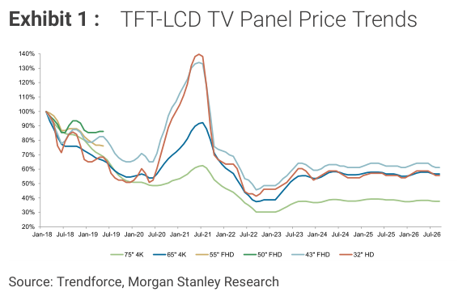

### 解讀摘要
以 2018 年 1 月為 100%，各尺寸 TV 面板價格在 2021 年中達到高峰（32" 與 43" 約 130–140%、65" 約 92%），之後大幅回落並自 2023 年起長期橫盤；2026 年 7 月附近，43" 約 61%、65" 約 56%、32" 約 55%、75" 約 38%（圖上目測）。2026 年初的小漲（1–3 月每月 +1%、+2%、+2%）在 7、8 月分別 -2%、-1% 後，9–11 月持平。

---

## Ex. 2｜TFT-LCD 面板價格（2026 年 11 月）

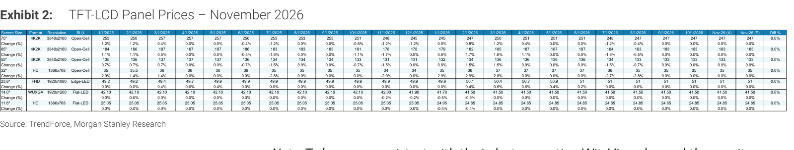

### 解讀摘要
Nov-26 預估價（US\$）全數與 10 月相同（Diff 0.0%）。自 2025 年 1 月到 Nov-26，TV 面板價格小幅下滑：75" 由 253 降到 247（-2.4%），65" 由 184 降到 183（-0.5%），55" 由 135 降到 133（-1.5%），32" 維持 35；IT 面板中 23.8" 由 49.2 升到 51（+3.7%），14" 由 42.10 降到 41.50（-1.4%），11.6" 由 25.05 降到 24.85（-0.8%）。

| 尺寸 | 規格 | 2025/1 | 2026/10 | Nov-26(E) | Nov-26 MoM |
|---|---|---|---|---|---|
| 75" | 4K2K Open-Cell | 253 | 247 | 247 | 0.0% |
| 65" | 4K2K Open-Cell | 184 | 183 | 183 | 0.0% |
| 55" | 4K2K Open-Cell | 135 | 133 | 133 | 0.0% |
| 32" | HD Open-Cell | 35 | 35 | 35 | 0.0% |
| 23.8" | FHD Edge-LED | 49.2 | 51 | 51 | 0.0% |
| 14.0" | WUXGA Flat-LED | 42.10 | 41.50 | 41.50 | 0.0% |
| 11.6" | HD Flat-LED | 25.05 | 24.85 | 24.85 | 0.0% |

> **原文補充**：WitsView 自 2025 年 1 月起改變報價方式：每月 5 日只提供全月面板價格展望，20 日提供最終價格，大致相當於過去的下半月報價。

---

## Ex. 3｜TV 面板價格走勢（QoQ）

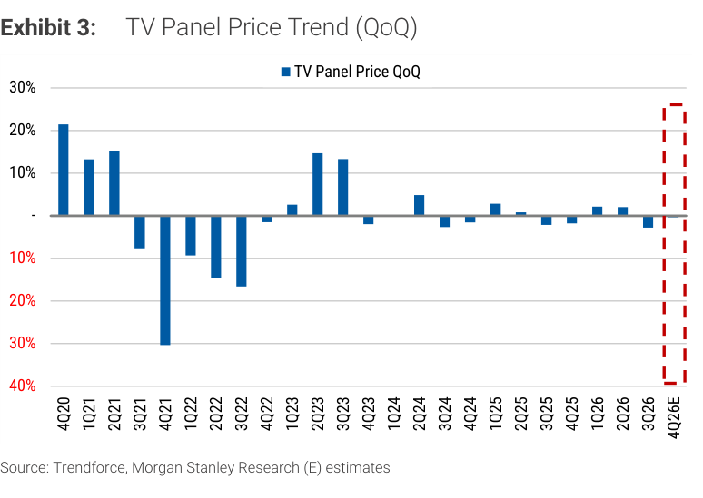

### 解讀摘要
季度價格變動：2021 年初約 +21%、+13%、+15%，4Q21 最深跌 -30%，之後多數季度在 ±5% 內；最近 3Q26 為小幅負成長（約 -3%，圖上目測），4Q26E 持平（紅色虛線框）。這與 MS 基本情境「TV 面板價格 4Q26 季均價大致持平」一致。

---

## Ex. 4｜IT 面板價格走勢（QoQ）

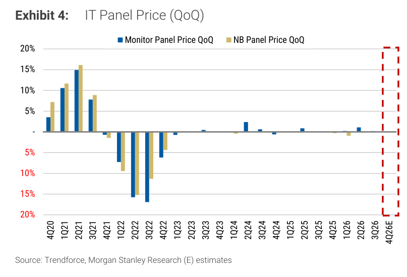

### 解讀摘要
監視器與筆電面板價格 QoQ 在 2021 年上半年最高（約 +10–15%），2022 年出現 -15% 至 -17% 的低點，2023 年起接近零；4Q26E 預期持平。淡季需求疲弱，特別是筆電，削弱面板廠與品牌議價力。

---

## Ex. 5｜顯示器廠平均稼動率

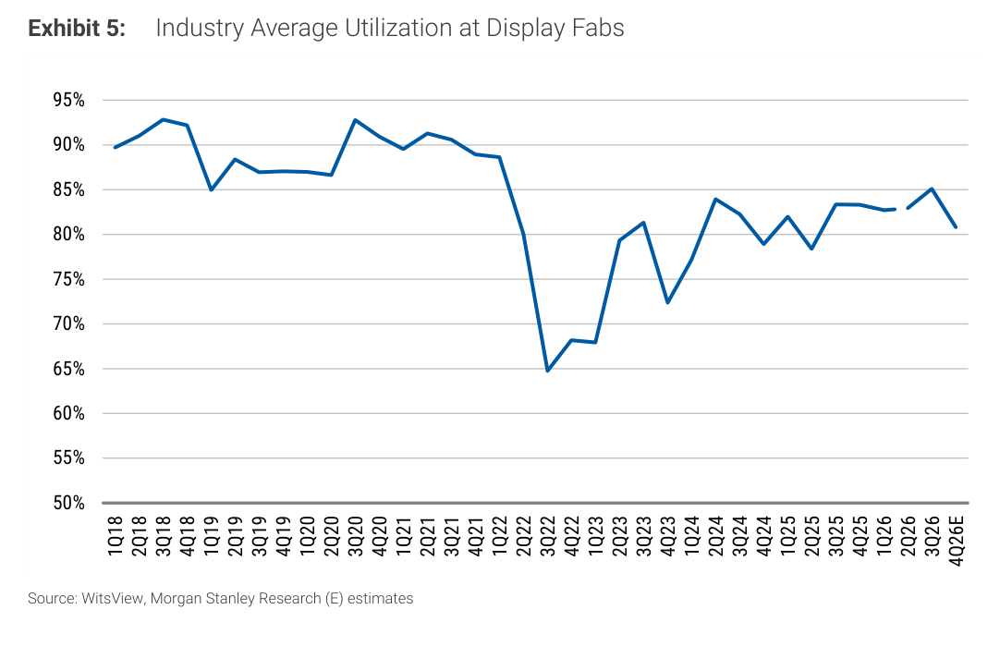

### 解讀摘要
稼動率由 2018 年高點約 93% 降到 2022–23 年谷底約 65%，之後回升至 80–85%。MS 文字：4Q24 約 80%、1Q25 82%、2Q25 78%、3Q25 起 80–85%，2026 年 2Q 為 80–85%、3Q26 小幅上升至 85%，4Q26 預期降到低 80% 區間（面板廠在淡季進一步收緊產出）。

> **洞察一（配合 Ex. 3、4）**：稼動率降到低 80%（約 -3ppt，85% → 低 80%）與價格持平同時發生，意味面板廠以減產而非降價因應淡季，價格底部由供給紀律支撐，但上行空間受制於訂單；這與 MS「需求才是推高價格的主因，供給紀律主要保護下檔」的結論一致。

---

## Ex. 6｜友達（AUO）股價 vs 面板價格

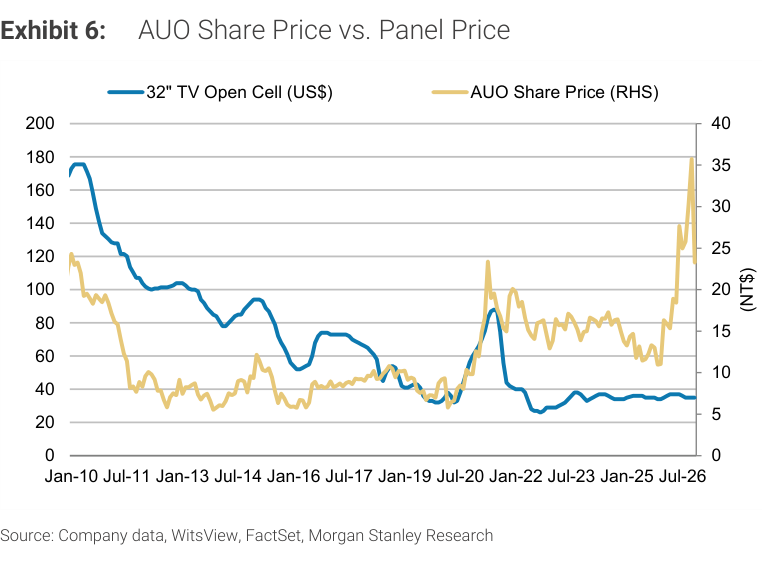

### 解讀摘要
友達股價（右軸，NT\$）在 2026 年出現急升，圖形尾端達約 NT\$35 以上，而 32" TV open cell 面板價格（左軸，US\$）自 2023 年起長期維持約 US\$35，兩者在最近一年明顯脫鉤。MS 評等 Equal-weight，PT NT\$27（1.4x 2026e P/B）；公司多元化努力需要時間才會有顯著獲利貢獻。

---

## Ex. 7｜群創（Innolux）股價 vs 面板價格

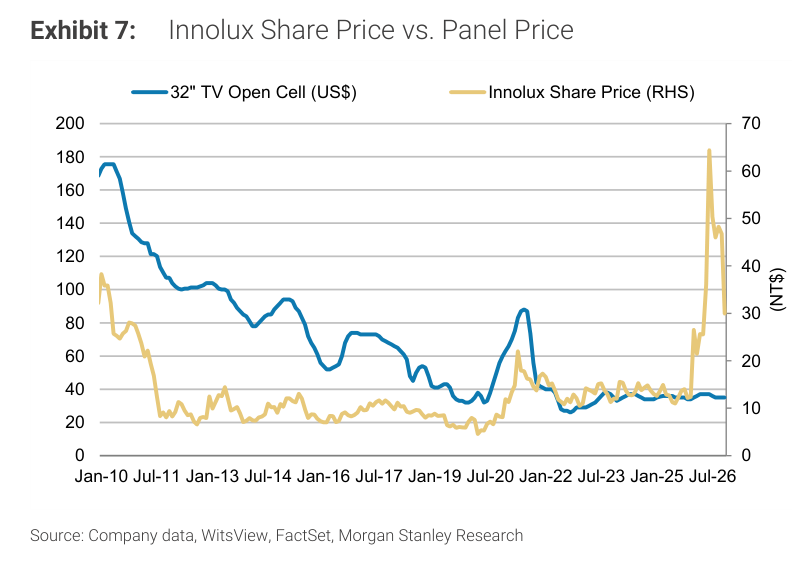

### 解讀摘要
群創股價（右軸，NT\$）在 2026 年急升至約 NT\$60 以上後回落（圖上目測），與 32" 面板價格長期平坦形成對比。MS 供應鏈查證指出群創參與一家晶圓代工客戶的玻璃基板專案，但預期 2028 年前沒有實質貢獻，且量產前會有更多競爭者進入；評等 Equal-weight，PT NT\$60（2.1x 2026e P/B）。

---

## Ex. 8｜京東方（BOE）股價 vs 面板價格

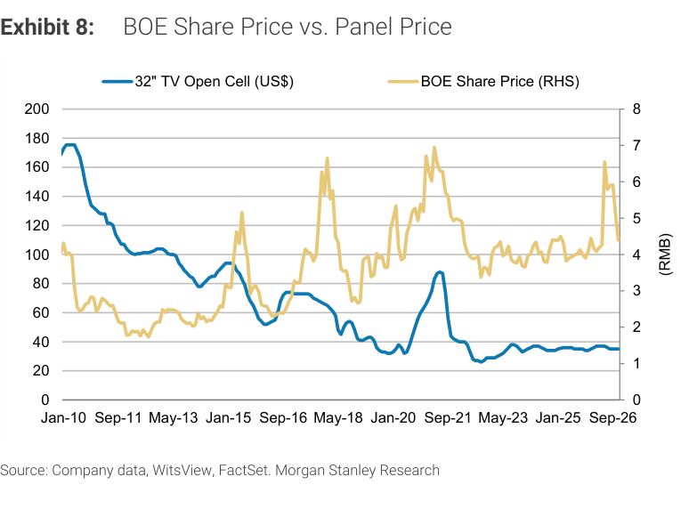

### 解讀摘要
BOE 股價（右軸，Rmb）2026 年也出現尖峰（約 Rmb6–7，圖上目測）後回落，幅度與位置較台廠溫和。MS 偏好 BOE，PT Rmb9.30（2.5x 2026e P/B），理由是規模優勢、顯示器曝險較高、玻璃基板進度較快，並以 2026–28 年 ROE 5–8% 對比 2023–25 年平均 P/B 1.1x、ROE 2–4% 來說明 2.5x 的合理性。

---

## Ex. 9｜TCL 股價 vs 面板價格

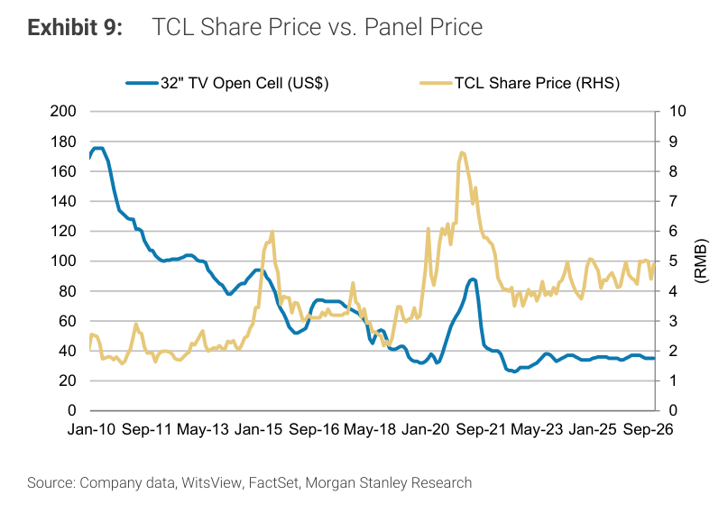

### 解讀摘要
TCL 股價（右軸，Rmb）近年在約 Rmb4–5 的區間，並無友達、群創那樣的急升。MS 評等 Equal-weight，PT Rmb4.70（1.7x 2026e P/B），現價 1.8x 2026e P/B，高於 2022 年以來景氣中位平均 1.4x。

> **洞察二（配合 Ex. 6–9 與封面）**：友達 1.2x 對 2023 年以來高點 1.1x（高 9%，1.2 / 1.1 - 1）、群創 1.0x 對 0.9x（高 11%），而 BOE 1.1x、TCL 1.8x，TCL 其實比台廠更貴；MS 指出台廠評價的支撐是「玻璃在先進封裝」這項 AI 題材，而 32" 面板價格長期持平，基本面與股價脫鉤，並偏好 BOE。

---

## Ex. 10｜GLW 顯示器出貨 vs 稼動率

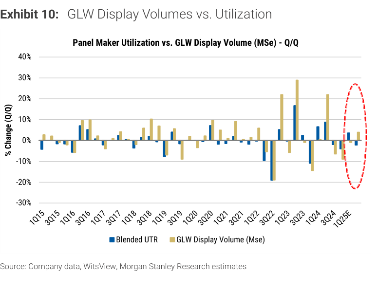

### 解讀摘要
圖示面板廠合併稼動率（Blended UTR）與 GLW 顯示器出貨量（MS 估計；GLW 推測為 Corning 的股票代號，報告未明說）的季變動（Q/Q），長期兩者同向，但最近幾季（紅色虛線圈）變動幅度縮小至約 ±10% 內。報告無對應文字說明，僅能由圖形判讀同向性。

---

## Ex. 11｜GLW 顯示器營收 vs 稼動率

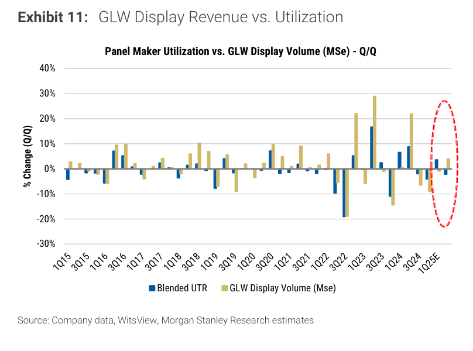

### 解讀摘要
與 Ex. 10 相同的稼動率季變動，對照 GLW 顯示器相關營收的變動（標題寫 Display Revenue，圖內軸標籤仍為 GLW Display Volume（MSe），圖表標籤疑有沿用錯誤，需對照原報告確認）。最近幾季（紅色虛線圈）同樣趨於小幅波動。

---

## Where We Could Be Wrong（原文第 7 頁）

| 風險 | 說明 |
|---|---|
| 終端需求更強 | 主要應用需求優於預期，面板出貨增加、價格壓力減輕 |
| 更嚴格的產出控制 | 主要面板廠集體將稼動率調整到極端，可緩解需求疲弱時的價格壓力 |
| 非商品化顯示業務 | 非商品化業務進展快於預期，面板廠財報可能較佳 |

---

## 相關個股清單

| 類別 | 公司 | Ticker | 評等 | 備註 |
|---|---|---|---|---|
| 面板 | 友達 AUO | 2409.TW | Equal-weight | PT NT\$27（1.4x 2026e P/B）；現價 1.2x 2027 P/B |
| 面板 | 群創 Innolux | 3481.TW | Equal-weight | PT NT\$60（2.1x 2026e P/B）；現價 1.0x 2027 P/B；玻璃基板 2028 年前無實質貢獻 |
| 面板 | 京東方 BOE | 000725.SZ | 偏好 | PT Rmb9.30（2.5x 2026e P/B） |
| 面板 | TCL | 000100.SZ | Equal-weight | PT Rmb4.70（1.7x 2026e P/B） |
| 面板 | LG Display | 034220.KS | — | 0.5x 2026e P/B，與歷史景氣中位水準相同 |
| DDIC | 聯詠 Novatek | 3034.TW | Underweight | PC、手機與車用需求疲弱；OLED DDI 路線圖較韓國同業有競爭力 |
