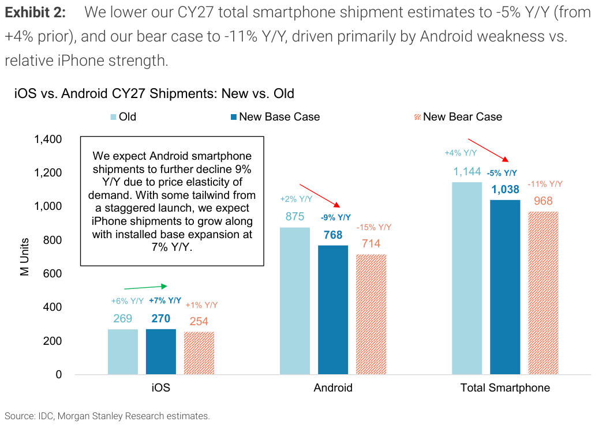
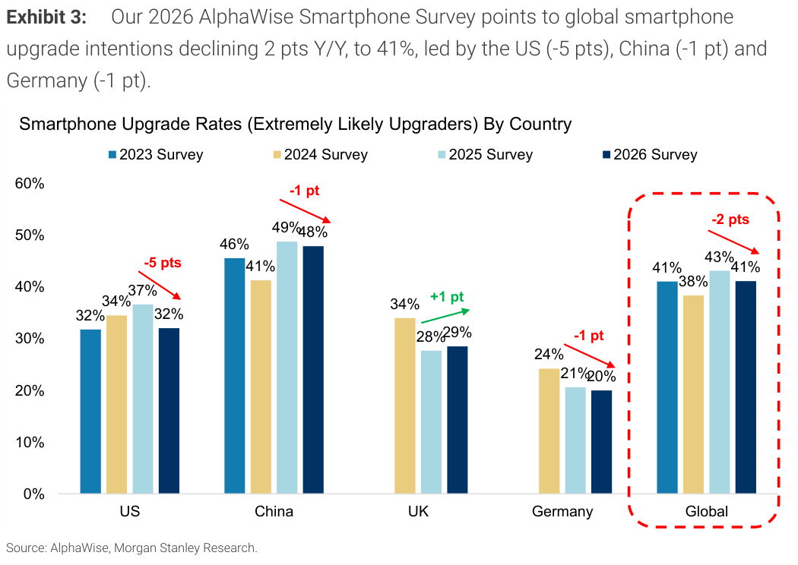
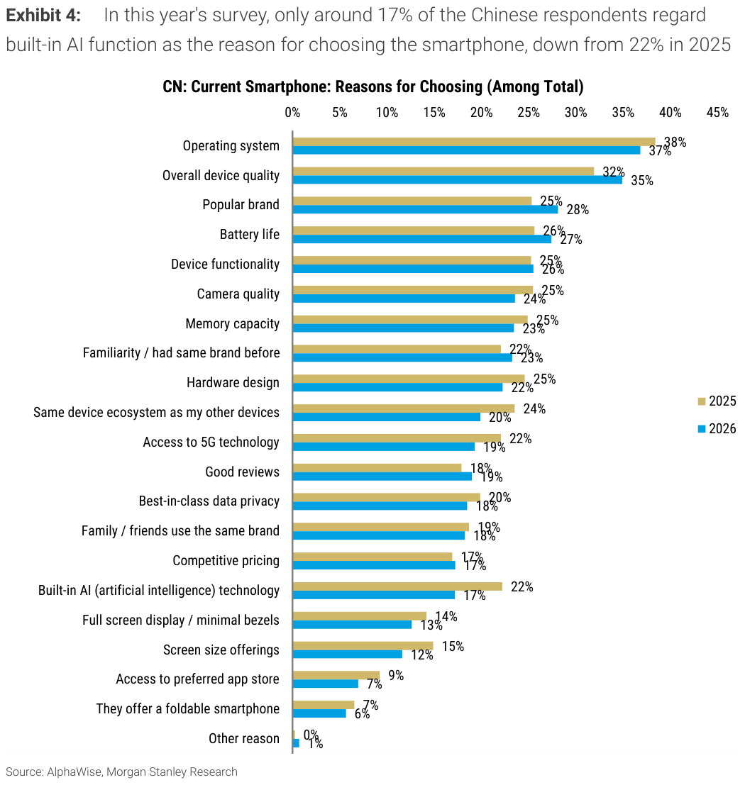
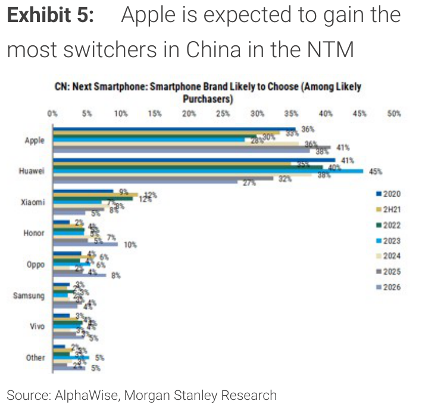
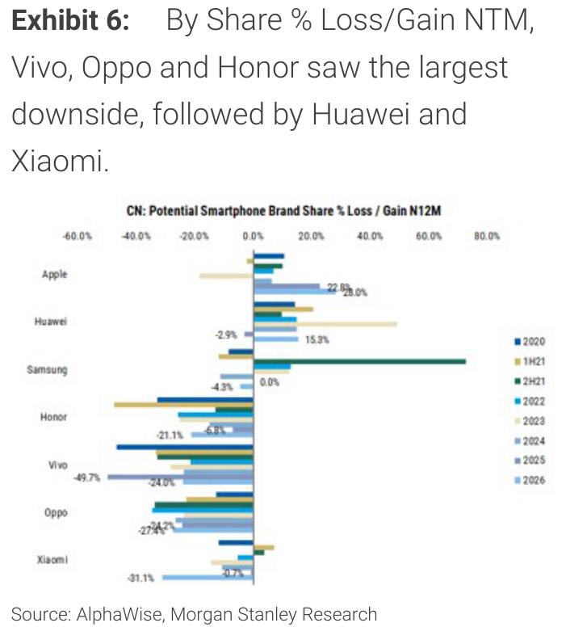

# MS｜Driver ICs：Android 疲弱限縮定價能力（Egis 降評 UW，Himax、Goodix 下調目標價）

**券商**：Morgan Stanley  
**分析師**：Daniel Yen, CFA、Charlie Chan、Daisy Dai, CFA、Ethan Jia  
**日期**：2026-11-23（封面標示 2026-11-20 13:25 GMT，系統日期以檔名為準）  
**主題**：Greater China 半導體｜Driver ICs：Android Weakness Limits Pricing Power（Idea 報告）  
**評級**：Industry View Attractive  
<a href="https://layx.uk/dl?g=產業&b=MS&d=20261123&h=Driver-ICs-Android-Weakness">📎 下載 PDF</a>

---

## 報告總結

MS 認為記憶體成本上升正在擠壓手機品牌給顯示、觸控與感測 IC 的預算。2027 年全球手機出貨由 +4% 下修為 -5%（Android -9%、iPhone +7%），Android 疲弱使 DDIC 供應商難以轉嫁晶圓與封裝漲價，即使 OLED 新專案提高單機含量。

據此 Egis 降評為 UW、目標價由 NT\$105 降至 NT\$66；Himax 維持 EW、目標價由 US\$17.4 降至 US\$9.2；Goodix 維持 UW、目標價由 Rmb58 降至 Rmb40。

---

## MS 完整投資邏輯鏈

| 論點層次 | Exhibit | 內容 |
|---|---|---|
| 需求下修 | Exhibit 2 | 2027 全球手機出貨由 +4% 下修為 -5%，熊市情境 -11% |
| 下修集中於 Android | Exhibit 2 | Android -9% 至 768M，iPhone +7% 至 270M；下修幾乎全來自 Android |
| 換機意願走弱 | Exhibit 3 | 全球「極可能換機」比率 41%（-2 pts），美國 -5 pts 降幅最大 |
| AI 賣點不足 | Exhibit 4 | 中國受訪者以內建 AI 為選機理由的比率 17%，低於去年 22% |
| 品牌流向 Apple | Exhibit 5–6 | 中國淨轉換意願 Apple +28%，四家 Android 品牌 -21% 至 -31% |
| **結論** | 報告封面 | **Egis 降至 UW；Himax EW、Goodix UW，三檔皆下調目標價與 EPS** |

> **報告最大邏輯缺口**：標題主張 Android 疲弱「限縮定價能力」，但報告正文並未量化 DDIC 單價或毛利率對出貨量的敏感度，也未估算 OLED 含量增加可抵銷多少需求下滑；毛利率與定價的證據只出現在個股估計修正表（Exhibit 7–19），且三檔的下修驅動不同（見下方「個股調整彙整」的洞察）。

---

## 報告核心觀點

| 主題 | MS 觀點 | 市場共識 | 是否 Contra-Consensus |
|---|---|---|---|
| 2027 全球手機出貨 | -5%（前次 +4%）；熊市 -11% | 報告未列 | — |
| Android vs iPhone | Android -9%（768M）、iPhone +7%（270M） | 報告未列 | — |
| 中國換機需求 | 2027 出貨 -7%，2026E 為 -12%；內建 AI 選機理由 17%（去年 22%） | 報告未列 | — |
| Himax | EW，PT US\$9.2（上行空間 21%） | 共識 PT 區間 US\$7.00–30.00 | MS 位於區間低端，偏保守 |
| Egis | UW（由 EW 降評），PT NT\$66（較股價 NT\$68.90 低 4%） | 報告未列 | 降評 |
| Goodix | UW 維持，PT Rmb40 | 報告未列 | — |

**偏好排序**：報告未給三檔之間的偏好排序；評等為 Egis UW、Himax EW、Goodix UW。  
**零件／個股偏好**：無。

---

## Exhibit 2｜2027 全球手機出貨下修（iOS vs Android，新舊對照）

### 解讀摘要
MS 把 2027 全球手機出貨由 +4% 下修為 -5%（1,144M→1,038M），少了 106M 台，其中 107M 來自 Android（875M→768M，-12.2%），iPhone 反而多 1M（269M→270M），所以下修幾乎全部集中在 Android。機制是美國硬體團隊認為 Android 受價格彈性拖累（高記憶體成本推高機價與壓縮規格），iPhone 則靠錯峰發表與安裝基數擴大維持 +7%。對 DDIC、觸控與指紋供應商而言，需求下滑落在其主要客戶群：Android 占 2027 年基準情境出貨的 74%。

> **原文補充**：熊市情境全球 -11%（968M），Android -15%（714M）、iPhone +1%（254M）。正文指出 Android 供應鏈 2027 年承受最大壓力：出貨下滑、持續 de-spec 與毛利率壓縮，品牌透過漲價與削減 BOM 來抵銷零組件成本上升。

### 表格
| 情境 | iOS（M） | iOS Y/Y | Android（M） | Android Y/Y | 全球（M） | 全球 Y/Y |
|---|---|---|---|---|---|---|
| 舊 | 269 | +6% | 875 | +2% | 1,144 | +4% |
| 新基準 | 270 | +7% | 768 | -9% | 1,038 | -5% |
| 新熊市 | 254 | +1% | 714 | -15% | 968 | -11% |

### 增量貢獻拆解
| 下修來源（舊→新基準） | 貢獻 | 佔總下修 |
|---|---|---|
| Android（875M→768M） | -107M | 101% |
| iOS（269M→270M） | +1M | -1% |
| **淨下修** | **-106M** | **100%** |

> 計算：Android 768 - 875 = -107M；iOS 270 - 269 = +1M；全球 1,038 - 1,144 = -106M；Android 佔下修 107 / 106 = 101%。

> **洞察一**：Android 在全球出貨的占比由舊情境 76.5%（875 / 1,144）降到 74.0%（768 / 1,038），而 iPhone 的預測幾乎沒動，代表這次下修不是總體需求的均勻衰退，而是 Android 單一生態系的需求被擠出。
> **值得驗證**：基準情境 Android -9% 依賴「價格彈性」假設；若走到熊市（Android 714M），Android 再少 54M，佔熊市相對基準額外缺口 70M（968 vs 1,038）的 77%（54 / 70）。Android 的價格彈性是整份報告的單點風險，若實際跌幅落在 -15% 一側，三檔個股 2027 年預估還有再下修空間。

---

## Exhibit 3｜AlphaWise 2026 手機調查：極可能換機比率（各國）

### 解讀摘要
全球「極可能在 12 個月內換機」比率為 41%，較去年 43% 少 2 pts（2023 年 41%、2024 年 38%、2025 年 43%）。各國中美國降幅最大（37%→32%，-5 pts），中國 49%→48%（-1），德國 21%→20%（-1），英國 28%→29%（+1）。MS 據此推算 2027 年換機週期為 4.4 年，高於前一年的 4.2 年。換機意願下降與 Exhibit 2 的出貨下修互相印證，且中國雖然仍是四國中意願最高（48%），選機理由卻在轉弱（見 Exhibit 4）。

### 表格
| 國家 | 2023 | 2024 | 2025 | 2026 | 2026 vs 2025 |
|---|---|---|---|---|---|
| 美國 | 32% | 34% | 37% | 32% | -5 pts |
| 中國 | 46% | 41% | 49% | 48% | -1 pt |
| 英國 | — | 34% | 28% | 29% | +1 pt |
| 德國 | — | 24% | 21% | 20% | -1 pt |
| 全球 | 41% | 38% | 43% | 41% | -2 pts |

> 英國、德國 2023 年圖中未顯示長條，故留空。

> **洞察一**：2026 年全球 41% 與 2023 年的 41% 相同，換機意願回到三年前水準；2025 年的 43% 是這四年的高點，所以 -2 pts 是從高點回落，而不是跌破歷史低點（2024 年為 38%）。

---

## Exhibit 4｜中國受訪者選擇現有手機的理由（2025 vs 2026）

### 解讀摘要
中國受訪者以「內建 AI」作為選機理由的比率由 22% 降至 17%，是 20 個選項中降幅最大的一項（-5 pts）；「整體裝置品質」升至 35%（+3）、「熱門品牌」升至 28%（+3），價格（Competitive pricing）持平 17%。意義是 AI 功能尚未成為換機的實質誘因，Android 品牌難以靠 AI 賣點支撐加價；品質與品牌偏好的上升則有利 Apple 這類高端品牌（見 Exhibit 5–6）。

### 表格
| 選機理由 | 2025 | 2026 | 變動 |
|---|---|---|---|
| Operating system | 38% | 37% | -1 |
| Overall device quality | 32% | 35% | +3 |
| Popular brand | 25% | 28% | +3 |
| Battery life | 26% | 27% | +1 |
| Device functionality | 25% | 26% | +1 |
| Camera quality | 25% | 24% | -1 |
| Memory capacity | 25% | 23% | -2 |
| Familiarity / had same brand before | 22% | 23% | +1 |
| Hardware design | 25% | 22% | -3 |
| Same device ecosystem as my other devices | 24% | 20% | -4 |
| Access to 5G technology | 22% | 19% | -3 |
| Good reviews | 18% | 19% | +1 |
| Best-in-class data privacy | 20% | 18% | -2 |
| Family / friends use the same brand | 19% | 18% | -1 |
| Competitive pricing | 17% | 17% | 0 |
| Built-in AI technology | 22% | 17% | -5 |
| Full screen display / minimal bezels | 14% | 13% | -1 |
| Screen size offerings | 15% | 12% | -3 |
| Access to preferred app store | 9% | 7% | -2 |
| They offer a foldable smartphone | 7% | 6% | -1 |
| Other reason | 0% | 1% | +1 |

> **洞察一**：「硬體規格類」選項多數下降（記憶體容量 -2、硬體設計 -3、5G -3、螢幕尺寸 -3），「品質／品牌類」上升（品質 +3、品牌 +3），價格持平。這與 Exhibit 2 的 de-spec 敘事一致：消費者選機時看重的是整體品質與品牌，而不是堆規格，品牌在記憶體漲價下削減規格對換機意願的傷害可能小於預期，但對規格導向的 Android 中低階品牌較不利。（自行推導）

---

## Exhibit 5｜中國：下一支手機可能選擇的品牌（有購買意願者）

### 解讀摘要
中國有購買意願的受訪者中，下一支手機會選 Apple 與 Huawei 的占絕大多數；以 2026 年調查讀圖，Apple 約 38%、Huawei 約 27%，其餘品牌（Xiaomi 5%、Honor 10%、Oppo 8%、Samsung 4%、Vivo 5%、其他 5%）合計仍低於前兩者。Huawei 由 2023 年約 45% 降到 2026 年約 27%，Apple 由 2025 年約 41% 降到約 38%。報告以此說明品牌偏好集中在兩家高端品牌，其餘 Android 品牌是淨流出方。

> 本圖為低解析度內嵌點陣圖，小字標籤為視覺估讀，誤差約 ±1 pt，只作方向參考。

### 表格
| 品牌 | 2025 | 2026 |
|---|---|---|
| Apple | 約 41% | 約 38% |
| Huawei | 約 32% | 約 27% |
| Honor | — | 約 10% |
| Oppo | — | 約 8% |
| Xiaomi | — | 約 5% |
| Vivo | — | 約 5% |
| Samsung | — | 約 4% |
| 其他 | — | 約 5% |

> **值得驗證**：本圖所謂「Apple 將是下一年淨轉換最大的贏家」（見 Exhibit 6）在這張圖看不出來：Apple 的選擇意願 2026 年反而較 2025 年低，贏家身分來自 Exhibit 6 的「淨轉換」（流入減流出），而非原始選擇比率。

---

## Exhibit 6｜中國：未來 12 個月品牌潛在份額損益（淨轉換意願）

### 解讀摘要
以 2026 年調查的淨轉換意願看，Apple 為 +28.0%（占現有安裝基數），是唯一大幅淨流入的品牌，Huawei 約 +15.3%；Xiaomi、Oppo、Vivo、Honor 四家為 -21% 至 -31%（Xiaomi 約 -31.1%、Oppo 約 -27.4%、Vivo 約 -24.0%、Honor 約 -21.1%），Samsung 約 -4.3%。意義是購買會往 Apple 集中，對 Xiaomi、Oppo、Vivo、Honor 這四家的零組件需求形成額外壓力，這四家正是 DDIC、觸控、指紋供應商的核心客戶。

> **原文補充**：正文寫 Apple 淨轉換意願為 +28%，Xiaomi、Oppo、Vivo、Honor 為 -21% 至 -31%；轉向 Apple 的購買會進一步壓縮這四家品牌的零組件需求。

### 表格
| 品牌 | 2026 淨轉換意願 | 備註 |
|---|---|---|
| Apple | +28.0% | 正文確認 |
| Huawei | +15.3% | 圖面讀值 |
| Samsung | -4.3% | 圖面讀值 |
| Honor | -21.1% | 落在正文 -21% 至 -31% 區間 |
| Vivo | -24.0% | 落在正文區間 |
| Oppo | -27.4% ❓ | 標籤與前一年重疊，讀值不確定 |
| Xiaomi | -31.1% | 正文區間下緣 |

> **值得驗證**：圖說寫「Vivo、Oppo、Honor 下行最大，其次是 Huawei 與 Xiaomi」，但圖面與正文的數字顯示 Xiaomi（-31.1%）才是最大流出方，且 Huawei 為 +15.3%（淨流入），不是流出。圖說與數據不一致，使用時以數字為準。

---

## 個股調整彙整（原 Exhibit 1、7–19 重點）

Exhibit 1（三檔個股 What's changed 彙整）與 Exhibit 7–19（Himax、Goodix、Egis 的估計修正、季度損益、RI 模型、財務摘要、歷史 P/E）屬個股財務數據，依跳過規則不收錄圖片，下表只整理其核心數字。

| 項目 | Himax（HIMX.O） | Goodix（603160.SS） | Egis（6462.TWO） |
|---|---|---|---|
| 評等 | EW（維持） | UW（維持） | EW → UW |
| 目標價 | US\$17.4 → US\$9.2（股價 US\$7.58，上行空間 21%） | Rmb58 → Rmb40 | NT\$105 → NT\$66（股價 NT\$68.90，-4%） |
| EPS 修正（2026／27／28E） | -17%／-17%／-33%（US\$0.33／0.60／0.98） | -14%／-18%／-5%（Rmb1.02／1.11／1.40，表內為 -15%／-18%／-6%） | 2026E 虧損擴大至 NT\$-8.28（前次 -1.48）；2027E -25% 至 NT\$4.03；新增 2028E NT\$7.42 |
| 修正原因 | 手機需求弱、LCD 觸控與顯示驅動面臨降本壓力、2028 CPO 不確定性 | 手機需求弱、OLED TDDI 的長期風險 | 手機需求弱、新業務 ramp 需時、Alcor 近期新案有限 |
| RI 模型假設調整 | beta 1.3→1.5（CoE 9.9%→11.0%）；終端成長率 3.4%→2.0%；中期成長率 8.0%、派息率 50% | 終端成長率 4.9%→2.5%；CoE 8.4%、中期成長率 16.5% 不變 | beta 1.25→1.50（CoE 9.5%→11.0%）；中期成長率 14.8%→8.0%；終端成長率 5.0%→2.0%；派息率 40% |
| 多／空情境 | 多 US\$26.0→13.7（+81%）；空 US\$8.7→4.6（-39%） | 多 Rmb80→55；空 Rmb31→21 | 多 NT\$143→95（24x 2027E EPS）；空 NT\$49→30（7x） |

> **洞察一（配合 Exhibit 7–19）**：三檔的下修驅動並不相同，並非單一「定價能力受限」故事。Himax 的下修主要來自營收（2026／27／28E 營收 -9%／-15%／-15%），毛利率變動僅 +0.2／+0.1／-1.4ppt，EPS -17%／-17%／-33% 的放大來自營運槓桿（2028E 營益率 21.3%→16.5%，-4.7ppt）；Egis 2026E 毛利率 35.6%→31.1%（-4.5ppt）且費用 +30%，是毛利率與費用雙重惡化；Goodix 2026E 營收 -19%、毛利率 43.0%→41.0%（-2.1ppt）、營業利益 -54%（營益率 13.4%→7.7%），但業外收入由 -Rmb120m 轉為 +Rmb170m 緩衝，EPS 僅 -15%；2027–28E 營收只修 -1%、毛利率不變，營業利益 -12%／-1%。這些數字取自被跳過的 Exhibit 7、12、16 的估計修正表，屬自行比對。
> **值得驗證**：Himax 2027E 營收 US\$983m（+13.6% Y/Y）仍依賴 OLED DDIC／T-con 與 WiseEye 的貢獻，且報告預估 CPO 相關 WLO 將占 2027 年營收 11%；若 CPO 導入或 OLED 出貨低於預期，下修空間大於目前 -17%。

---

## 相關個股清單

| 類別 | 公司 | Ticker | 評等 | 備註 |
|---|---|---|---|---|
| DDIC／TDDI | Himax 奇景光電 | HIMX.O | EW | PT US\$9.2（前次 US\$17.4）；WLO／CPO 預估 2027 占營收 11% |
| 觸控／指紋 | Goodix 匯頂 | 603160.SS | UW | PT Rmb40（前次 Rmb58）；OLED TDDI 為長期風險 |
| 指紋／IP | Egis 神盾 | 6462.TWO | UW（降評） | PT NT\$66（前次 NT\$105）；2026E 虧損擴大 |
