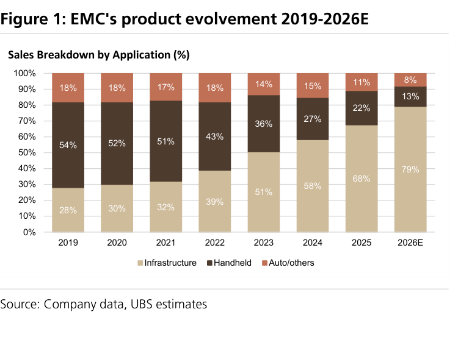
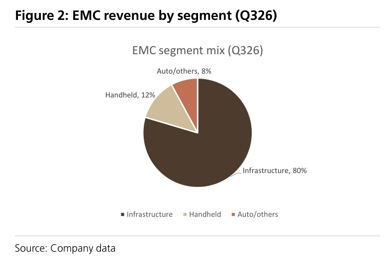
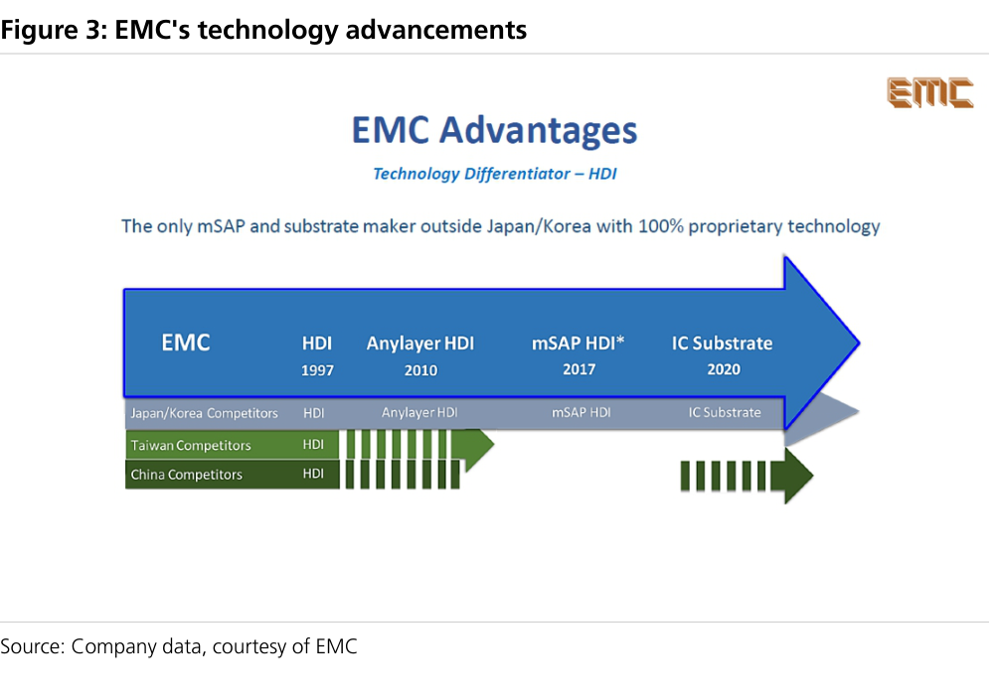
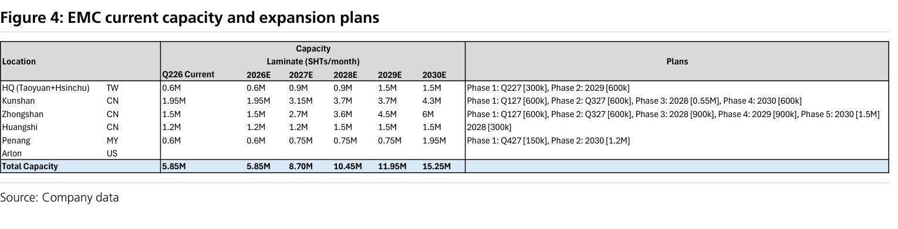
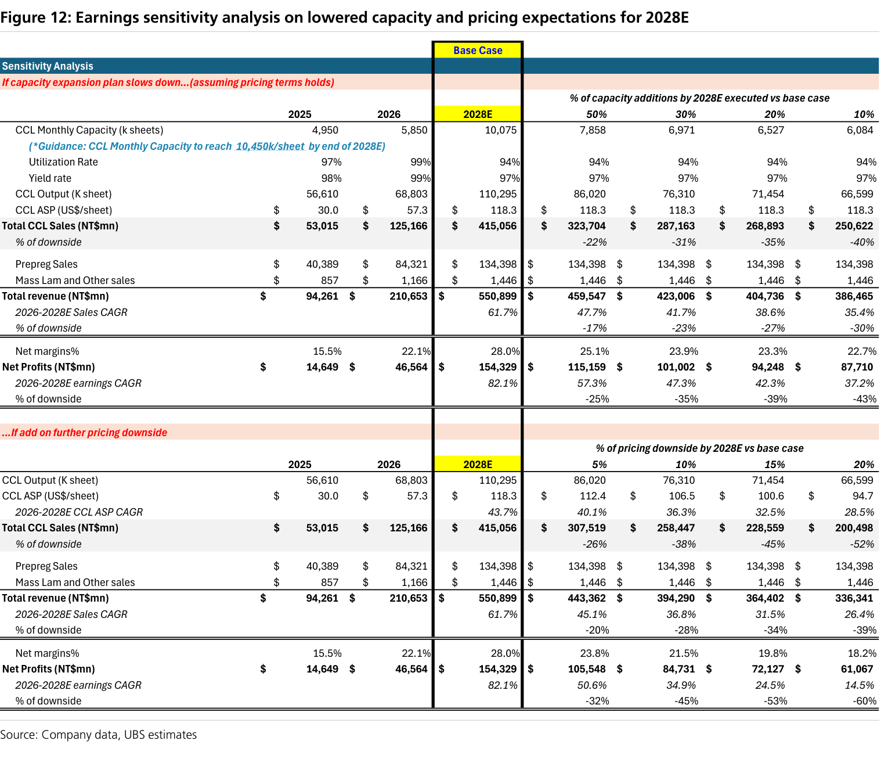
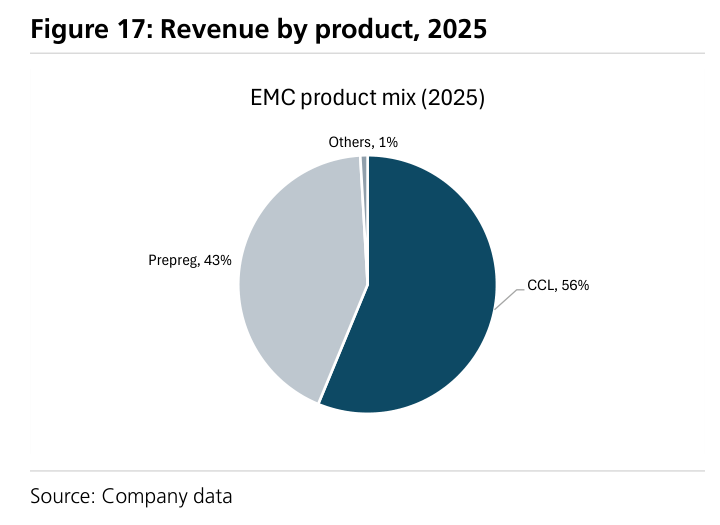
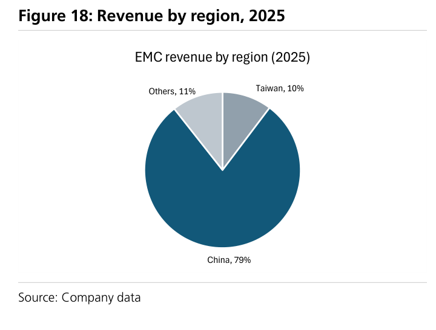

# UBS｜台光電（EMC）首次覆蓋深度報告

**券商**：UBS  
**分析師**：Diana Chang、Randy Abrams  
**日期**：2026-11-23  
**主題**：Elite Material — Manifesting AI-driven upcycle; initiate at Buy  
**評級**：Buy（首次覆蓋）  
<a href="https://layx.uk/dl?g=產業&b=UBS&d=20261123&h=EMC-Initiation">📎 下載 PDF</a>

---

## 報告總結

UBS 以 Buy 首次覆蓋台光電（2383.TW），目標價 NT\$5,000，較 20 Nov 股價 NT\$2,810 有 78% 上行空間（5,000 / 2,810 - 1）。時機是股價自 8 月高點回落 56%（同期 TAIEX -21%），現價約 10x／7x UBS 2027／28E P/E，低於長期均值 13.5x。核心論點：EMC 是全球高速無鹵素 CCL 龍頭（2025 年市占 38.6%），跨 NVIDIA GPU 與多家 CSP ASIC，M7+ 占比由 Q126 的 55–60% 升到 Q326 的 65–70%，M9 於 2H26 出貨；UBS 預估 2026–28E 營收年複合成長 62%、EPS 年複合成長 82%，並已把產能打折。

---

## UBS 完整投資邏輯鏈

| 論點層次 | Exhibit | 內容 |
|---|---|---|
| 基本面轉型 | Fig 1, 2 | 基礎設施營收占比由 2019 年 28% 升到 2026E 79% |
| 技術護城河 | Fig 3 | 唯一在日韓以外掌握 mSAP 與載板材料的 CCL 廠 |
| 產能與訂單 | Fig 4 | 月產能 5.85mn（2026E）→ 15.25mn（2030E）；LTA 逾 9.4mn 張 |
| 壓力測試 | Fig 12 | 產能僅達標 50% 時 2028E 獲利 -25%，再加價格降 20% 為 -60% |
| 營收結構 | Fig 17, 18 | CCL 56%、Prepreg 43%；中國 79% |
| 估值 | 封面 | 12x 2028E P/E，PEG 0.3x |
| **結論** | 報告封面 | **Buy，PT NT\$5,000** |

> **報告最大邏輯缺口**：UBS 的 2027／28E EPS 與共識的關係，內文與封面不一致：內文稱約低於共識 4%／4%，封面共識表為 280.61／446.26，UBS 的 280.82（2027E）幾乎等於共識、430.74（2028E）低 3.5%（430.74 / 446.26 - 1），因此「保守」只在 2028E 成立。

---

## 報告核心觀點

| 主題 | UBS 觀點 | 市場共識／疑慮 | 是否 Contra-Consensus |
|---|---|---|---|
| 材料升級 | M8 為 Blackwell 標準，Feynman 往 M9／M10；M9 ASP 約為 M6 的 5–6 倍、毛利率 >50% | 擔心 AI 放緩 | ✅ |
| 獲利彈性 | 高階組合擴張使獲利成長（82% CAGR）大於營收（62% CAGR） | — | ✅ |
| 評價 | 10x／7x 2027／28E P/E，低於長期均值 13.5x，AI 週期區間 10–48x 的低端 | 評價已反映放緩 | ✅ |
| 客戶集中 | GPU（NVIDIA）＋多家 CSP ASIC（AWS、Google、Meta）分散 | — | ➡️ |

**偏好排序**：UBS 在台灣 CCL 三檔中最看好 EMC。  
**零件／個股偏好**：EMC 2383；對照 TUC 6274、ITEQ 6213。

---

## Fig. 1｜EMC 產品演進 2019–2026E（銷售按應用）

### 解讀摘要
基礎設施（伺服器、交換器、LEO）占比由 2019 年 28% 持續升到 2026E 的 79%，手機等手持裝置由 54% 降到 13%，汽車／工業／其他由 18% 降到 8%。轉折在 2023 年：基礎設施占比由 2022 年 39% 跳到 51%，那一年 EMC 成為 NVIDIA H100 伺服器板的主供。

| 年度 | 基礎設施 | 手持裝置 | 汽車／工業／其他 |
|---|---|---|---|
| 2019 | 28% | 54% | 18% |
| 2021 | 32% | 51% | 17% |
| 2023 | 51% | 36% | 14% |
| 2025 | 68% | 22% | 11% |
| 2026E | 79% | 13% | 8% |

---

## Fig. 2｜EMC 營收按區隔（Q326）

### 解讀摘要
Q326 營收組合：基礎設施 80%、手持裝置 12%、汽車／工業／其他 8%。基礎設施內部：AI 伺服器占 55–60%、一般伺服器 15–20%、交換器 15–20%、LEO 衛星 5–10%。

> **洞察一（配合 Fig. 1）**：Q326 基礎設施實際 80% 已略高於 2026E 全年 79%，代表全年組合預估已被第四季之前的實績追上；2026E 之後組合改善空間主要是手持與其他再縮，而非基礎設施內部再擴。

---

## Fig. 3｜EMC 技術進展

### 解讀摘要
圖示 EMC 自稱的技術優勢：是日韓以外唯一擁有 100% 自有技術的 mSAP 與載板材料供應商。時間軸為 1997 年 HDI、2010 年 Anylayer HDI、2017 年 mSAP HDI、2020 年 IC 載板；日韓競爭者涵蓋四個階段，台灣與中國競爭者主要停留在較早階段（圖面文字過小，僅能辨識大致趨勢）。這與 UBS 的論點相符：EMC 的 HDI／mSAP 經驗是進入高階光模組 CCL（Doosan 與 EMC 為 800G 以上主要供應商）與載板材料的基礎。

---

## Fig. 4｜EMC 目前產能與擴產計畫

### 解讀摘要
EMC 月產能 2026E 5.85mn 張，2027E 8.70mn（+49% YoY）、2028E 10.45mn（+20%）、2029E 11.95mn（+14%）、2030E 15.25mn（+28%）；2026 年 10 月董事會核准約 NT\$98.6bn 的階段性擴產資本支出，涵蓋台灣、中國大陸與馬來西亞。訂單端已簽 LTA 逾 9.4mn 張增量產能，可支撐到 2028 年滿載。

| 年度 | 月產能（mn 張） | YoY |
|---|---|---|
| 2026E | 5.85 | — |
| 2027E | 8.70 | +49% |
| 2028E | 10.45 | +20% |
| 2029E | 11.95 | +14% |
| 2030E | 15.25 | +28% |

> **洞察二**：擴產節奏已出現延遲：觀音首批 300k 張/月原定 2026 年 12 月，因勞力與材料短缺及政府安檢延後約 6 個月；2028 年計畫的 600k 張延到 2029 年；中國崑山可較快推進。LTA 9.4mn 張相當於 2030 年增量（15.25 - 5.85 = 9.4mn）的全部，所以訂單覆蓋是以「完成全部擴產」為前提。
> **值得驗證**：UBS 的 EMC 2028E 月產能假設為 10.08mn 張，只比公司計畫 10.45mn 低約 3.5%（10.08 / 10.45 - 1），遠小於產業報告摘要所稱「較公告計畫折價 10–30%」；同一份報告系列中 TUC 2028E 低約 14%、ITEQ 低約 21%，EMC 的保守程度明顯較低。

---

## Fig. 12｜2028E 獲利對產能與價格假設的敏感度

### 解讀摘要
以 2028E 淨利 NT\$154,329m 為基準：若擴產只完成 50%／30%／20%／10%，淨利分別下降 25%／35%／39%／43%；若價格同時低於預期 5%／10%／15%／20%（配合上述低產能），分別下降 32%／45%／53%／60%。報告以此說明就算 AI 支出在 2028 年轉弱，仍有一定的獲利基礎。

| 情境 | 2028E 淨利相對基準 |
|---|---|
| 產能達成 50%／30%／20%／10% | -25%／-35%／-39%／-43% |
| 另加價格低 5%／10%／15%／20% | -32%／-45%／-53%／-60% |

> **洞察三（配合 Fig. 4）**：Fig. 12 最差情境（-60%）後的 2028E 淨利約 NT\$61bn（61,067），仍是 2025 年淨利（NT\$14,649m，取自 Fig. 12 表）的約 4.2 倍（61,067 / 14,649）。

---

## Fig. 17｜2025 年營收按產品別

### 解讀摘要
2025 年營收：CCL 56%、Prepreg 43%、Others 1%。Prepreg 近半，代表營收並非只來自 CCL 板材；報告對這個比重沒有進一步論述。

---

## Fig. 18｜2025 年營收按地區別

### 解讀摘要
2025 年營收：中國 79%、台灣 10%、其他 11%。報告未註明地區是以客戶所在地或出貨地計，一般解讀應為 PCB 客戶工廠位置，而非終端需求地。

---

## 財務與預估重點（取自封面與內文，非圖表）

| 項目 | 數字 |
|---|---|
| Q326 | 營收 NT\$60.9bn（+29% QoQ／+142% YoY）；毛利率 37.7%（+3.8ppt QoQ，價格與組合各占約一半）；OPM 30.7%；EPS NT\$40.47 |
| Q426 指引 | 營收 +15–20% QoQ；毛利率 38.0–39.5%；UBS Q426E 營收 NT\$69.4bn（+14%）、GM 38.2%、EPS NT\$47.03（+16%） |
| 2026E／27E／28E EPS | NT\$129.98／280.82／430.74（共識 132.69／280.61／446.26） |
| 毛利率 | 35.7%（2026E）→ 40.5%／42.0%（2027／28E） |
| 估值 | 12x 2028E P/E（歷史區間 7–20x），2026–30E 獲利 CAGR 37%，PEG 0.3x |

> **值得驗證**：12x × NT\$430.74 = NT\$5,169，高於 PT NT\$5,000（隱含 11.6x，或約 EPS NT\$416.7）；與 TUC、ITEQ 的 PT 一樣，報告未說明封面 EPS 與估值用 EPS 的差異。

---

## 相關個股清單

| 類別 | 公司 | Ticker | 評等 | 備註 |
|---|---|---|---|---|
| CCL | 台光電 EMC | 2383.TW | Buy | PT NT\$5,000；Q326 營收創高 NT\$60.9bn |
| CCL | 台燿 TUC | 6274.TWO | Buy | 同日首次覆蓋，PT NT\$1,150 |
| CCL | 聯茂 ITEQ | 6213.TW | Buy | 同日首次覆蓋，PT NT\$650 |
| 競爭對手 | Doosan／Shengyi（SYT）／Panasonic | — | — | NVIDIA 運算板（Doosan）／交換器板（SYT、EMC）；Google TPU（Panasonic） |
