# UBS｜聯茂（ITEQ）首次覆蓋深度報告

**券商**：UBS  
**分析師**：Diana Chang、Randy Abrams  
**日期**：2026-11-23  
**主題**：ITEQ Corporation — Potential levers with upside; Initiate at Buy  
**評級**：Buy（首次覆蓋）  
<a href="https://layx.uk/dl?g=產業&b=UBS&d=20261123&h=ITEQ-Initiation">📎 下載 PDF</a>

---

## 報告總結

UBS 以 Buy 首次覆蓋聯茂（6213.TW），目標價 NT\$650，較 20 Nov 股價 NT\$355.5 有 83% 上行空間（650 / 355.5 - 1）。時機是股價自 10 月高點回落 58%（同期 TAIEX -26%），現價約 6x／5x 2027／28E 共識 P/E，處於循環谷底倍數。核心論點：聯茂是一般伺服器 CCL 龍頭（約占營收 58%），Intel Oak Stream 與 AMD Venice 帶動 M6 轉 M7（M7 ASP 約為 M6 的 2 倍），再加上 M9 已通過 NVIDIA 認證、樣品送 Google 的選擇權；UBS 預估 2026–28E 營收年複合成長 38%，毛利率由 2025 年 14% 升到 2027／28E 的 38%。主要風險是一般伺服器占比逾 50%，客戶資本支出優先給 AI。

---

## UBS 完整投資邏輯鏈

| 論點層次 | Exhibit | 內容 |
|---|---|---|
| 終端轉型 | Fig 1 | 基礎設施占比由 2018 年 37% 升到 H126 的 73% |
| 產品組合升級 | Fig 4, 5 | M6 及以下占比由 2025 年 95% 降到 2028E 的 80% |
| 一般伺服器換機 | Fig 3 | PCIe Gen6、Oak Stream／Venice 帶動層數與 M7 導入 |
| 產能擴張 | Fig 7, 8, 17 | 月產能 5.4mn（目前）→ 9.15mn（2029F） |
| 壓力測試 | Fig 14 | 產能只達 50% 時 2028E 獲利 -25%，再加價格降 20% 為 -61% |
| 估值 | 封面 | 10x 2028E P/E，PEG 0.3x |
| **結論** | 報告封面 | **Buy，PT NT\$650** |

> **報告最大邏輯缺口**：UBS 內文稱預估「略低於 Street」，但封面共識欄（20.50／43.17／50.75）顯示 UBS 的 EPS（23.53／57.14／65.90）比共識高約 15%／32%／30%；另 PEG 所稱「2026–2028E 獲利 CAGR 29%」與封面 EPS 不符：23.53 → 65.90 的 2 年年複合成長約 67%（√(65.90 / 23.53) - 1），29% 實際對應 2026–2030E（(65.05 / 23.53)^(1/4) - 1 = 29%）。

---

## 報告核心觀點

| 主題 | UBS 觀點 | 市場共識／疑慮 | 是否 Contra-Consensus |
|---|---|---|---|
| 一般伺服器 | PCIe Gen6 換機週期使層數增加、M6 轉 M7，ASP 與毛利率同步上升 | 擔心 AI 排擠一般伺服器需求 | ✅ |
| M9／M10 選擇權 | M9 低 CTE 已通過 NVIDIA 認證（2H25），2027 年可能貢獻低個位數營收，高毛利（>50%） | 市場視聯茂為高階後進者 | ✅ |
| 常規 CCL 週期 | 市場低估傳統 CCL 週期的長度；E-glass 緊缺約持續 2 年 | — | ✅ |
| 估值 | 6x／5x 2027／28E 共識 P/E，NTM P/E 低於歷史均值 1 個標準差；PT 10x 2028E | 評價已反映放緩 | ➡️ |

**偏好排序**：UBS 對台灣 CCL 三檔的偏好 EMC > TUC ≈ ITEQ，聯茂的差異是一般伺服器龍頭與 M9 選擇權。  
**零件／個股偏好**：聯茂 6213；對照 EMC 2383、TUC 6274。

---

## Fig. 1｜聯茂銷售按應用分解（2018–H126）

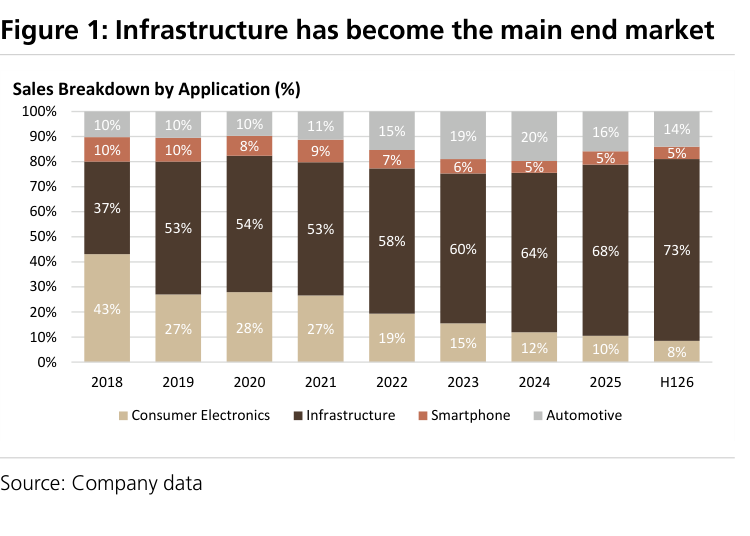

### 解讀摘要
基礎設施占比由 2018 年 37% 升到 2025 年 68%、H126 的 73%；消費電子由 43% 降到 H126 的 8%。汽車占比自 2018 年 10% 升到 2024 年 20% 後，2025 年回到 16%、H126 為 14%。（報告 Fig. 15 為同一張圖的重複刊出，依跳過規則不另收。）

| 年度 | 消費電子 | 基礎設施 | 手機 | 汽車 |
|---|---|---|---|---|
| 2018 | 43% | 37% | 10% | 10% |
| 2020 | 28% | 54% | 8% | 10% |
| 2022 | 19% | 58% | 7% | 15% |
| 2024 | 12% | 64% | 5% | 20% |
| 2025 | 10% | 68% | 5% | 16% |
| H126 | 8% | 73% | 5% | 14% |

---

## Fig. 2｜99% CCL 價值鏈曝險

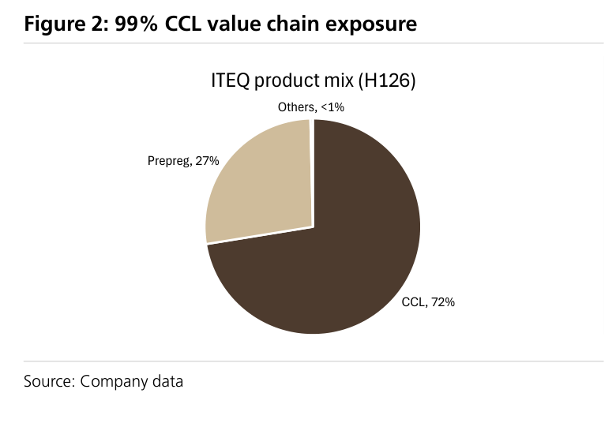

### 解讀摘要
H126 產品組合：CCL 72%、Prepreg 27%、其他 <1%；公司營收幾乎全部位於 CCL 價值鏈。

---

## Fig. 3｜CPU 升級週期帶動層數增加

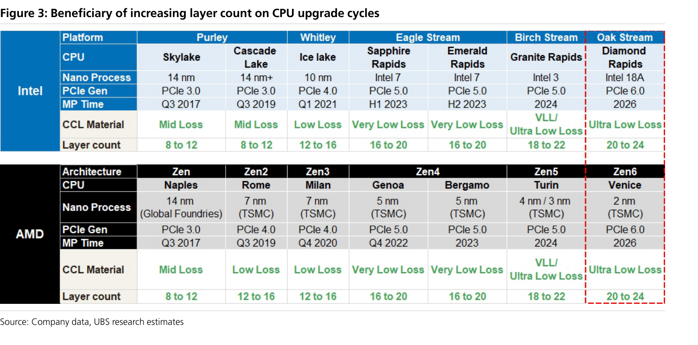

### 解讀摘要
Intel 與 AMD 各世代的 CPU 製程、PCIe 世代、層數與 CCL 材料：Purley 8–12 層（Mid Loss）、Birch Stream 18–22 層、Oak Stream（2026，PCIe 6.0）20–24 層，AMD Venice（2026，PCIe 6.0）20–24 層，材料由 Very Low Loss 升到 Ultra Low Loss。伺服器主機板層數每一次主要 CPU 世代大約增加 4 層，換機週期約 4–5 年。

---

## Fig. 4｜2025 年營收 95% 為 M6 及以下

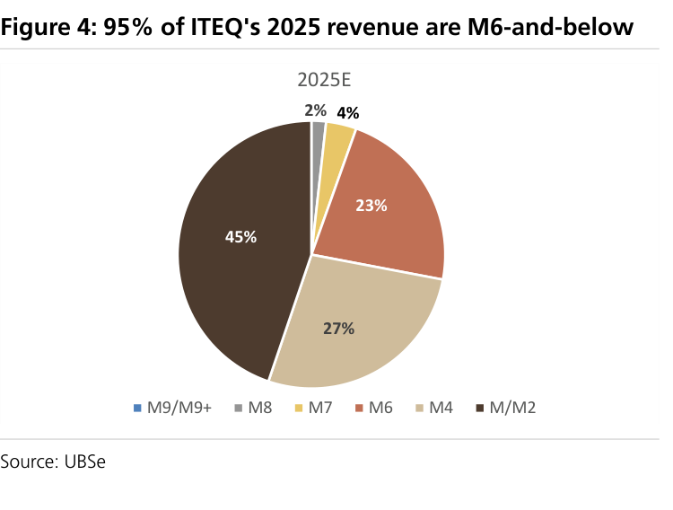

### 解讀摘要
2025E 產品組合：M/M2 45%、M4 27%、M6 23%、M7 4%、M8 2%（M9／M9+ 近 0）；M6 及以下合計 95%。聯茂在高階產品上是後進者，M7+ 僅在 H126 約占高個位數 %。

---

## Fig. 5｜M6 及以下降至 2028 年 80%

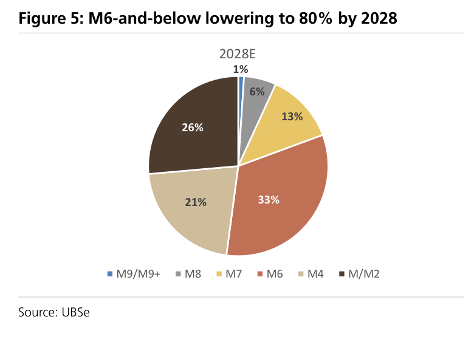

### 解讀摘要
2028E 組合：M/M2 26%、M4 21%、M6 33%、M7 13%、M8 6%、M9／M9+ 1%；M6 及以下降為 80%，M7+ 升為 20%。UBS 預估 M7 於 2027 年占營收 15–20%（管理層預期），M9 於 2028E 約 1%。

> **洞察一（配合 Fig. 4）**：M7+ 占比由 2025 年約 5% 升到 2028E 的 20%，僅增加 15 個百分點，但毛利率預估由 14% 升到 38%（+24 個百分點）；單靠組合改善無法解釋這幅度，其餘來自調價、稼動率回升與規模效益（UBS 內文所列因素）。
> **洞察二**：M9 2028E 僅占營收 1%，以 UBS 2028E 營收 NT\$103.8bn 計約 NT\$1.0bn（103,811 × 1%，推算），規模很小；但 M9 的毛利率超過 50%（M6 約 25–30%、M7 逾 30%），所以 M9 對聯茂的意義主要在毛利率組合與選擇權，而不是營收。

---

## Fig. 6｜汽車的先進應用

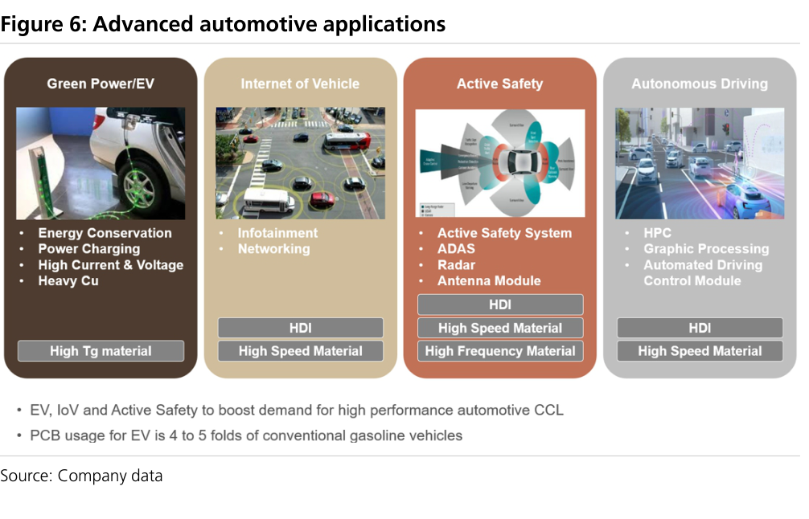

### 解讀摘要
圖示聯茂在汽車電子的四個領域：綠色能源／EV（高 Tg 材料，如能源保存、充電、重銅）、車聯網（HDI、高速材料）、主動安全（ADAS、雷達、天線模組，HDI、高速與高頻材料）、自動駕駛（HPC、GPU 處理、控制模組）。圖中說明 EV 使用的 PCB 數量為傳統燃油車的 4 至 5 倍。汽車占 H126 營收 14%，產品生命週期 5–7 年，是 M4–M6 的穩定出口；UBS 預期基礎設施成長較快，汽車占比將由 2025 年 15.9% 降至 2030E 的 12.8%。

---

## Fig. 7｜聯茂在泰國與中國擴產

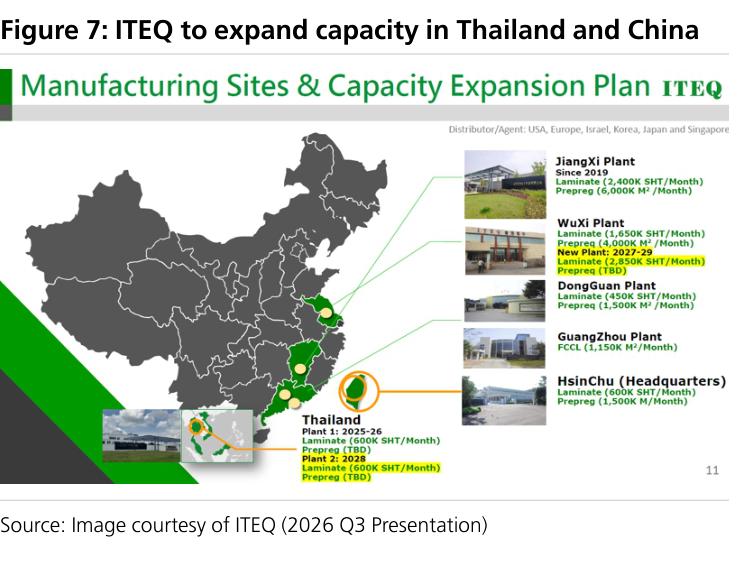

### 解讀摘要
製造據點圖：江西、無錫、東莞、廣州（FCCL）、新竹總部與泰國。泰國 Phase 1 剩餘 300k 張將於 Q426 投產、2028 年再增 600k 張，2027 年起為某大型 LEO 衛星專案量產（以 M4／M6 為主）；無錫則主要對應 AI 與高效能運算，2029F 前新增約 2.85mn 張（Q427F 600k、Q428F 1.35mn 等）。

---

## Fig. 8｜為潛在專案擴充產能（月產能，年底，k 張）

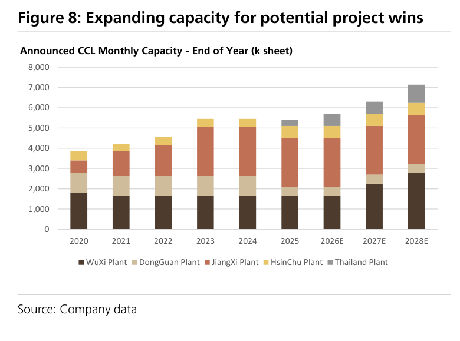

### 解讀摘要
圖表按廠區（無錫、東莞、江西、新竹、泰國）堆疊顯示年底月產能，由 2020 年起持續上升至 2028E。文字指出，聯茂產能由目前約 5.4mn 張增至 2029F 的 9.15mn，增量主要來自泰國與無錫；UBS 模型假設 2028E 為 6.55mn 張，較公司計畫 8.25mn 低約 21%（6.55 / 8.25 - 1）。

> **洞察三（配合 Fig. 14）**：UBS 2028E 營收 NT\$103.8bn 約為 2025 年 NT\$33.1bn 的 3.1 倍，但同期月產能只增 22%（6.55 / 5.35 - 1）；亦即營收成長 3.1x 中約 2.6x 來自單位價值（價格、組合與稼動率回升，3.14 / 1.22）。這表示 UBS 的預估對「價格能否維持」比對「產能能否到位」更敏感。

---

## Fig. 14｜2028E 獲利對產能與價格假設的敏感度

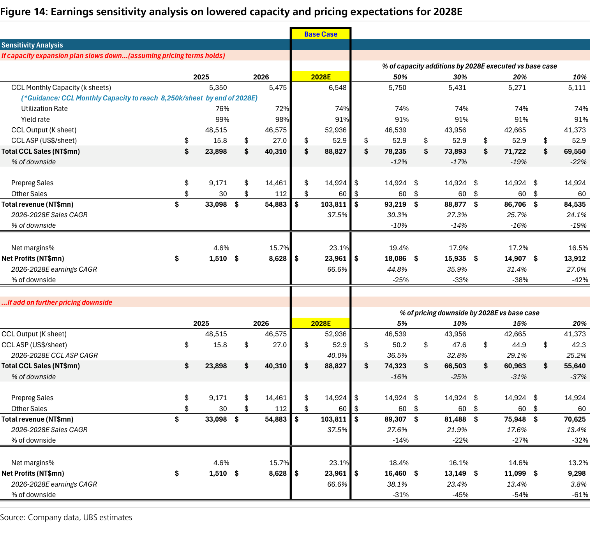

### 解讀摘要
以 2028E 淨利 NT\$23,961m 為基準：若擴產只完成 50%／30%／20%／10%，淨利分別為 18,086／15,935／14,907／13,912（-25%／-33%／-38%／-42%）；若價格同時低於預期 5%／10%／15%／20%，則為 16,460／13,149／11,099／9,298（-31%／-45%／-54%／-61%）。

| 情境（2028E 淨利，NT\$m） | 淨利 | 相對基準 |
|---|---|---|
| 基準 | 23,961 | — |
| 產能達成 50% | 18,086 | -25% |
| 產能達成 30% | 15,935 | -33% |
| 產能達成 20% | 14,907 | -38% |
| 產能達成 10% | 13,912 | -42% |
| 價格低 5%（同時產能 50%） | 16,460 | -31% |
| 價格低 10%（同時產能 30%） | 13,149 | -45% |
| 價格低 15%（同時產能 20%） | 11,099 | -54% |
| 價格低 20%（同時產能 10%） | 9,298 | -61% |

> **值得驗證**：基準 2028E 淨利率約 23.1%，在 -61% 的最差情境下淨利仍為 NT\$9.3bn，約為 2025 年淨利 NT\$1,510m 的 6 倍（9,298 / 1,510，取自 Fig. 14 表）；報告預設即使在最差情境，利潤水準仍遠高於 2025 年，但這取決於 2026–27 年的毛利率先升到 29%／38% 的假設。

---

## Fig. 16｜聯茂公司架構

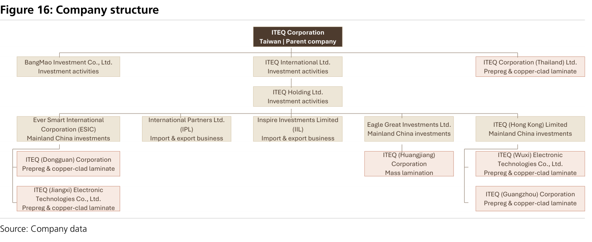

### 解讀摘要
母公司 ITEQ Corporation（台灣）下設國際控股（ITEQ International、ITEQ Holding），向下持有中國大陸各製造子公司（東莞、江西、無錫、廣州、黃江）、泰國子公司與香港投資平台。結構顯示聯茂的產能主要在中國大陸，泰國為非中國製造（LEO 專案）的出口據點。

---

## Fig. 17｜聯茂目前營運廠區與產能

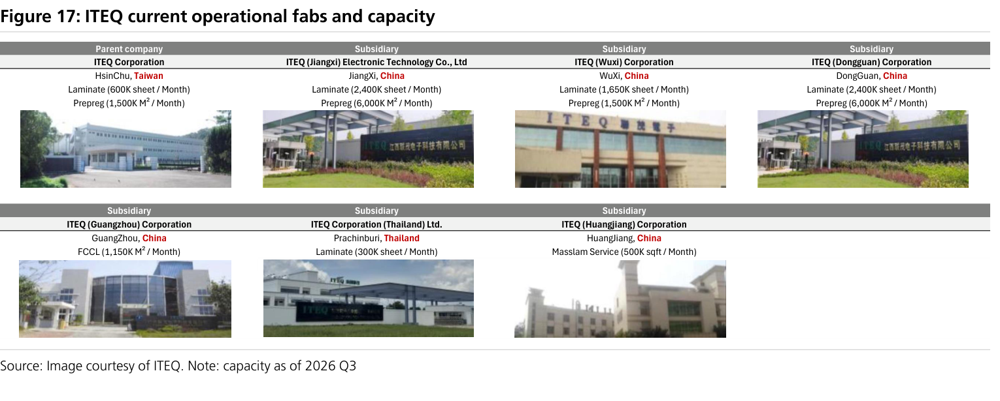

### 解讀摘要
圖列新竹母廠與各子公司廠房照片、層壓板與 prepreg 月產能（圖面文字過小，資料截至 2026 年 Q3，各廠數字不在此逐項轉錄）。

> **原文補充**：報告指出產業擴產的瓶頸是設備而非原料：浸膠線交期由約 6 個月延長至 12–18 個月，壓合機由 6 個月延長至 9 個月，原料交期約 2 個月；就聯茂自身而言，玻纖布（來源 Nittobo、Asahi、台玻，並認證 Taishan、Jushi、Honghe）是最立即的限制，使稼動率僅 70–75%，預期中國新增供應於 Q426 到位，2027 上半年升至 75–80%。

---

## 財務與預估重點（取自封面與內文，非圖表）

| 項目 | 數字 |
|---|---|
| Q326 | 營收 NT\$15.6bn（+35% QoQ／+102% YoY）；毛利率 34.3%（+12.3ppt QoQ）；OpM 27.8%；EPS NT\$8.41，高於共識 NT\$5.40 |
| Q426E | 營收 NT\$18.6bn（+19% QoQ）；毛利率 36.5%；EPS NT\$10.93（+30% QoQ） |
| 2026E／27E／28E EPS | NT\$23.53／57.14／65.90（封面共識 20.50／43.17／50.75） |
| 營收成長 | +66%／+67%／+13%（2026／27／28E） |
| 毛利率 | 14%（2025）→ 29%／38%／38%（2026／27／28E） |
| 估值 | 10x 2028E P/E（NT\$65.90 × 10 = NT\$659，PT NT\$650） |

---

## 相關個股清單

| 類別 | 公司 | Ticker | 評等 | 備註 |
|---|---|---|---|---|
| CCL | 聯茂 ITEQ | 6213.TW | Buy | PT NT\$650；一般伺服器 CCL 龍頭 |
| CCL | 台光電 EMC | 2383.TW | Buy | 同日首次覆蓋，PT NT\$5,000 |
| CCL | 台燿 TUC | 6274.TWO | Buy | 同日首次覆蓋，PT NT\$1,150 |
| 玻纖布供應 | Nittobo／Asahi／台玻 | 3110.JP／3407.JP／1802.TW | — | 聯茂主要玻纖布來源 |
