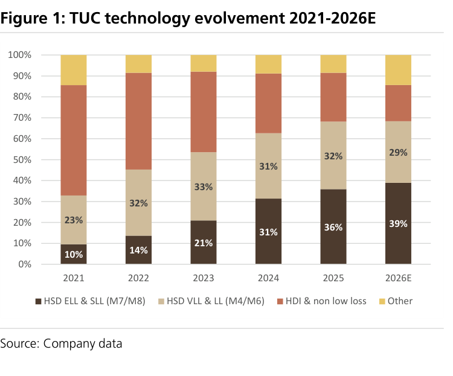
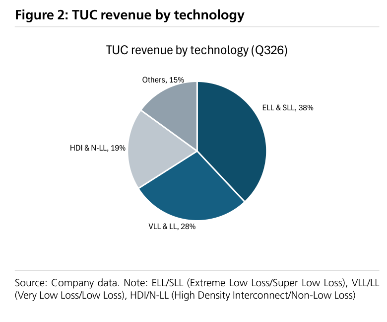
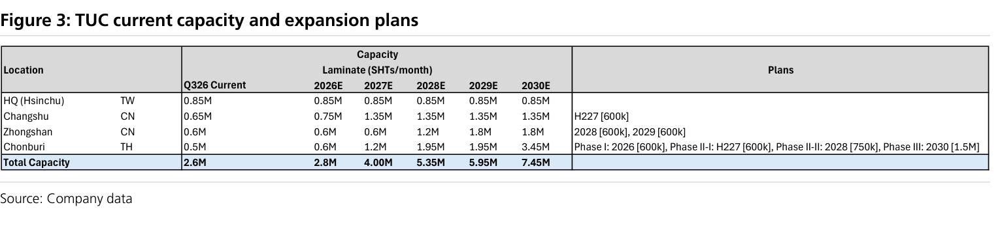
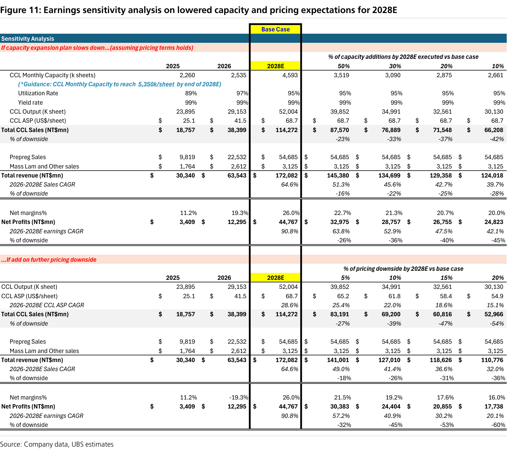
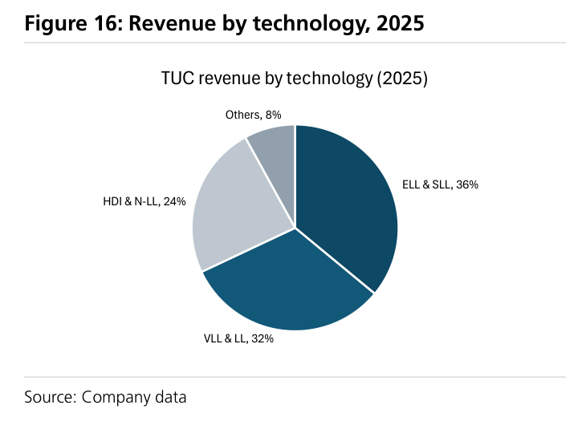
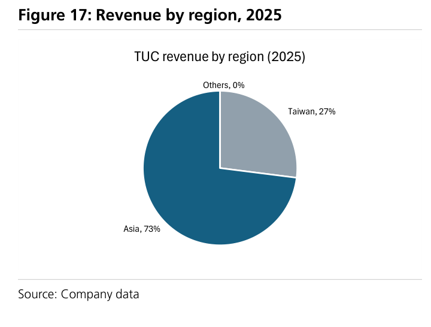

# UBS｜台燿（TUC）首次覆蓋深度報告

**券商**：UBS  
**分析師**：Diana Chang、Randy Abrams  
**日期**：2026-11-23  
**主題**：Taiwan Union Technology Corporation — Building streams of growth; Initiate at Buy  
**評級**：Buy（首次覆蓋）  
<a href="https://layx.uk/dl?g=產業&b=UBS&d=20261123&h=TUC-Initiation">📎 下載 PDF</a>

---

## 報告總結

UBS 以 Buy 首次覆蓋台燿（6274.TWO），目標價 NT\$1,150，較 20 Nov 股價 NT\$623 有 85% 上行空間（1,150 / 623 - 1）。催化劑是股價自 10 月高點回檔 65%（同期 TAIEX -28%），估值落到 6x／4x 2027／28E 共識 P/E，低於歷史 7–17x。核心論點：台燿高階 CCL 占比低於 EMC（M7+ 占 2025 年營收 36%，EMC 為 50–55%），但在網通交換器、電源、LEO 衛星與 CSP ASIC 同時有成長引擎，UBS 預估 2026–28E 營收年複合成長 65%、EPS 年複合成長 89%；UBS 的產能與調價假設已低於共識。

---

## UBS 完整投資邏輯鏈

| 論點層次 | Exhibit | 內容 |
|---|---|---|
| 基本面成長 | Fig 1, 2 | M7/M8 占比由 2021 年 10% 升到 2026E 39% |
| 多元成長引擎 | Fig 2, 16, 17 | 網通 800G／1.6T、ASIC、電源、LEO 同步貢獻 |
| 產能支撐 | Fig 3 | 月產能 2.4mn 張（2026 年初）→ 7.45mn（2030E） |
| 保守假設 | Fig 11 | 產能僅達標 50% 時 2028E 獲利 -26%，再加價格降 20% 為 -60% |
| 估值折價 | 封面 | 8x 2028E P/E；6x／4x 2027／28E 共識 P/E |
| **結論** | 報告封面 | **Buy，PT NT\$1,150** |

> **報告最大邏輯缺口**：PT 以 8x 2028E P/E 為準，但封面 2028E EPS NT\$149.51 × 8 = NT\$1,196，與 PT NT\$1,150 不一致（隱含 7.7x，或約 EPS NT\$143.75）；報告未說明是否使用調整後 EPS，使用時需留意。

---

## 報告核心觀點

| 主題 | UBS 觀點 | 市場共識／疑慮 | 是否 Contra-Consensus |
|---|---|---|---|
| 成長來源 | 網通、電源、LEO、ASIC 等多元領域，不在 AI 伺服器紅海正面硬碰 | 高階 CCL 占比不如 EMC，成長性被低估 | ✅ |
| 獲利 | 2028E EPS NT\$149.51，較共識 NT\$164.06 低約 9%（149.51 / 164.06 - 1） | 共識較高 | ➡️ UBS 較保守 |
| 估值 | 6x／4x 2027／28E 共識 P/E，12 個月預期 P/E 較歷史均值 12x 低 1 個標準差 | 市場擔心 AI 放緩 | ✅ |
| 產能 | UBS 預估 2028／2030E 月產能 4.6mn／5.2mn 張，較公司公告低 10–30% | 公司公告 5.35mn／7.45mn | ➡️ 保守 |

**偏好排序**：台燿在 UBS 台灣 CCL 三檔中位居 EMC 之後，產品組合升級潛力是最主要差異。  
**零件／個股偏好**：台燿 6274；對照 EMC 2383、ITEQ 6213。

---

## Fig. 1｜台燿技術演進 2021–2026E

### 解讀摘要
高階 ELL/SLL（M7/M8）占比由 2021 年 10% 逐年升到 2022 年 14%、2023 年 21%、2024 年 31%、2025 年 36%，2026E 達 39%；VLL/LL（M4/M6）則在 23–33% 之間。這個序列顯示台燿的升級節奏是穩定而非跳躍，與 UBS 預期 2030E 高階占比 65% 的假設相比，2026–2030 年仍需要平均每年約 6.5 個百分點的提升（(65 - 39) / 4）。

| 年度 | ELL/SLL（M7/M8） | VLL/LL（M4/M6） |
|---|---|---|
| 2021 | 10% | 23% |
| 2022 | 14% | 32% |
| 2023 | 21% | 33% |
| 2024 | 31% | 31% |
| 2025 | 36% | 32% |
| 2026E | 39% | 29% |

---

## Fig. 2｜台燿營收按技術別（Q326）

### 解讀摘要
Q326 營收組合：ELL & SLL 38%、VLL & LL 28%、HDI & N-LL 19%、Others（含電源）15%。M7/M8 占比較上季下降 1 個百分點，原因是中低階 CCL 較早調價；電源等其他類別則較上季增加 1 個百分點，季增 42%。

> **洞察一（配合 Fig. 1）**：Q326 EPS NT\$12.88、毛利率 36.9%（季增 7.2ppt），但高階占比不升反降，表示本季毛利躍升主要來自調價與泰國廠轉盈，而非產品組合升級；UBS「高階組合帶動利潤擴張」的假設（M7+ 達 65%）屬 2027 年之後才驗證的部分。

---

## Fig. 3｜台燿目前產能與擴產計畫

### 解讀摘要
台燿 2026 年初月產能 2.4mn 張（含泰國 300k），2026 年底預計 2.8mn；2026 年 3 月宣布常熟與泰國各增 600k 張（資本支出分別 Rmb953mn、Bt6.1bn），常熟預計 1H27 投產，泰國 3Q27、4Q27 各增 300k；2026 年 7 月再宣布 2028–29 年新增中山 1.2mn 張（Rmb2.36bn）與泰國 750k 張（Bt7.79bn）。

| 年度 | 月產能（mn 張，UBS 預期） |
|---|---|
| 2026 年初 | 2.4 |
| 2026E | 2.8 |
| 2027E | 4.00 |
| 2028E | 5.35 |
| 2029E | 5.95 |
| 2030E | 7.45 |

> **值得驗證**：UBS 自己的模型採 2028／2030E 月產能 4.6mn／5.2mn 張，較公司計畫低（2028E 約 14%，2030E 約 30%：4.6 / 5.35 - 1 = -14%、5.2 / 7.45 - 1 = -30%）；此折扣也已寫入 PT 的前提。

---

## Fig. 11｜2028E 獲利對產能與價格假設的敏感度

### 解讀摘要
UBS 以 2028E 為基準，模擬「若產能擴張只完成 50%／30%／20%／10%」與「再加上價格比預期低 5%／10%／15%／20%」兩層情境，結論是獲利下行幅度分別為 -26%／-36%／-40%／-45% 與 -32%／-45%／-53%／-60%。

| 情境（2028E 淨利，NT\$m） | 淨利 | 相對基準 |
|---|---|---|
| 基準 | 44,767 | — |
| 產能達成 50% | 32,975 | -26% |
| 產能達成 30% | 28,757 | -36% |
| 產能達成 20% | 26,755 | -40% |
| 產能達成 10% | 24,823 | -45% |
| 價格低 5%（同時產能達成 50%） | 30,383 | -32% |
| 價格低 10%（同時產能達成 30%） | 24,404 | -45% |
| 價格低 15%（同時產能達成 20%） | 20,855 | -53% |
| 價格低 20%（同時產能達成 10%） | 17,738 | -60% |

> **洞察二**：即使在「產能只完成 50% 且價格低 5%」的偏空情境，2028E 淨利仍有 NT\$30.4bn，是 2025 年淨利（NT\$3,412m，取自封面財務摘要）的約 8.9 倍（30,383 / 3,412）；UBS 的保守情境下，風險主要在「成長幅度」而非「是否成長」。

---

## Fig. 16｜2025 年營收按技術別

### 解讀摘要
2025 年：ELL & SLL 36%、VLL & LL 32%、HDI & N-LL 24%、Others 8%；高速低損耗產品（ELL/SLL + VLL/LL）合計 68%。依 Prismark，台燿在全球無鹵素高速板市占 16.4%，排名第三。與 Fig. 2 的 Q326 比較，Others 占比由 8% 升到 15%，主要是電源類。

---

## Fig. 17｜2025 年營收按地區別

### 解讀摘要
2025 年台燿營收 Asia 73%、Taiwan 27%、Others 0%，銷售對象幾乎都在亞洲。LEO 衛星專案要求非中國製造（out-of-China）的產能，泰國廠被指定供應該專案，這是台燿需要泰國擴產的另一個理由。

---

## 相關個股清單

| 類別 | 公司 | Ticker | 評等 | 備註 |
|---|---|---|---|---|
| CCL | 台燿 TUC | 6274.TWO | Buy | PT NT\$1,150；EPS 2026E／27E／28E：NT\$41.72／92.06／149.51（共識 41.96／92.10／164.06） |
| CCL | 台光電 EMC | 2383.TW | Buy | 同日首次覆蓋，PT NT\$5,000 |
| CCL | 聯茂 ITEQ | 6213.TW | Buy | 同日首次覆蓋，PT NT\$650 |
| 競爭對手 | Isola／Shengyi | — | — | LEO 星上現有供應商 Isola、EMC；電源第二供應商 Shengyi |
