# UBS｜台灣 CCL 產業首次覆蓋：值得付出的價值溢價（EMC、TUC、ITEQ 皆 Buy）

**券商**：UBS  
**分析師**：Diana Chang、Randy Abrams  
**日期**：2026-11-23  
**主題**：Taiwan CCL: Value premium worth paying — Positive on CCL supply chain with AI driven structural spec upgrades（Initiation of Coverage）  
**評級**：Positive（EMC Buy／PT NT\$5,000；TUC Buy／PT NT\$1,150；ITEQ Buy／PT NT\$650）  
<a href="https://layx.uk/dl?g=產業&b=UBS&d=20261123&h=Taiwan-CCL-Initiation">📎 下載 PDF</a>

---

## 報告總結

UBS 在台灣 CCL 族群近一個月重挫（EMC -43%、TUC -60%、ITEQ -53%，同期 TAIEX -22%）之際首次覆蓋，認為高階 CCL 正進入「規格驅動的結構性升級週期」：AI 提高 PCB 層數、CCL 規格與單位價值，同時設備交期、認證與玻纖布／銅箔瓶頸限制供給。UBS 已把三家公告擴產量打 10–30% 折扣並放緩調價，仍看到強勁成長。偏好排序 EMC > TUC ≈ ITEQ；主要風險為 AI 投資放緩、PTFE／CPO 改變材料規格，以及中國與日韓大廠擴產。

---

## UBS 完整投資邏輯鏈

| 論點層次 | Exhibit | 內容 |
|---|---|---|
| 需求結構升級 | Fig 1, 2, 3, 4 | 每機架 CCL 價值由約 US\$5,300 升至約 US\$17,000 |
| 平台規格上移 | Fig 5, 6, 7, 8 | GPU／ASIC／一般伺服器／光模組／LEO 都往 M7–M9 移動 |
| 供給上限 | Fig 13–19 | 設備交期 12–24 個月、T-glass、HVLP 銅箔、E-glass 同時偏緊 |
| 價格與成本傳導 | Fig 20–27 | 2026 年多輪調漲，傳統 CCL 年內漲幅逾 100% |
| 擴產與份額 | Fig 9–12 | 三家台廠規劃 2027 年 +32%、2028 年 +27% 產能，UBS 另折 10–30% |
| 風險排除 | Fig 28–33 | CPO 不會降到 M4；PTFE 良率遠低於 M9，仍待觀察 |
| **結論** | 報告封面 | **正面看待；EMC 最佳，TUC 看產品組合升級，ITEQ 看一般伺服器與 M9 選擇權** |

> **報告最大邏輯缺口**：「產能打折 10–30%」是 UBS 對公告計畫的主觀折扣，並無量化依據；且 PTFE 與 CPO 的結論多來自供應鏈訪談，NPO／CPO 設計尚未定案，UBS 自己也說目前無法給出 CCL 含量變化的量化估計。

---

## 報告核心觀點

| 主題 | UBS 觀點 | 市場共識／疑慮 | 是否 Contra-Consensus |
|---|---|---|---|
| CCL 景氣 | 規格驅動的結構性升級週期，不是短期漲價 | 擔心是商品漲價週期、AI 放緩即反轉 | ✅ |
| CPO 降規 | 即使 2029–30 年完整 CPO scale-up，CCL 仍維持 M6–M8，非 M4 | 9/17 傳聞 CCL 從 M8/M9 降到 M4，造成股價波動 | ✅ |
| 擴產過剩 | 上游與高階 CCL 資本支出較有紀律，PCB 廠較積極 | 中國大廠擴產引發 AI PCB 供應鏈過剩疑慮 | ✅ |
| PTFE | 製程良率是主要障礙（PTFE 遠低於 50%，M9 為 80–90%），EMC 以 M10 + Q-glass 對應 | 市場視為新材料風險 | ✅ |
| 評價 | 台廠 CCL 約 8x／5x 2027／28E P/E，低於基板 15x／10x、PCB 11x／7x | 股價大跌後尚未回到歷史均值 12–14x | ✅ |

**偏好排序**：EMC（高階佈局最完整）> TUC（網通、電源、LEO 多元成長）> ITEQ（一般伺服器龍頭，M9 有選擇權）。  
**零件／個股偏好**：EMC 2383、TUC 6274、ITEQ 6213；PTFE 若普及，Shengyi Technology 受惠大於台廠。

---

## Fig. 1｜AI 伺服器朝更高層數與材料等級演進

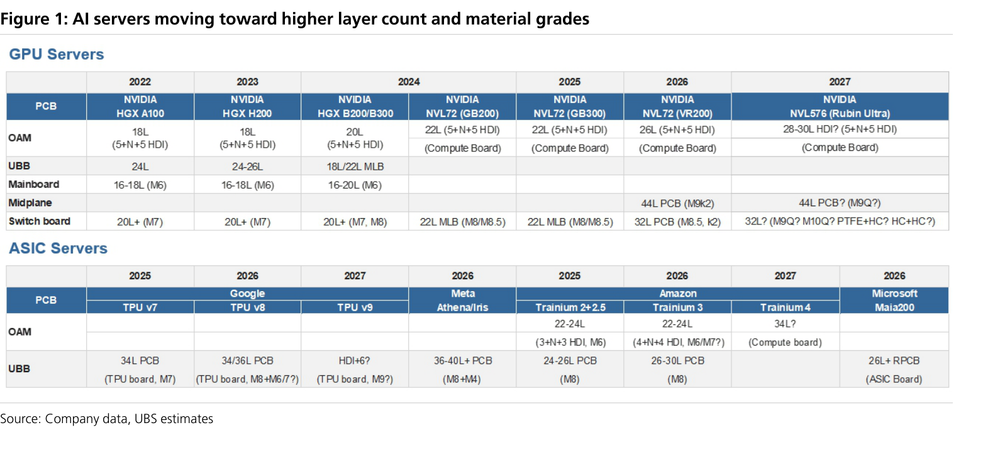

### 解讀摘要
圖 1 把 GPU 與 ASIC 平台的 PCB 層數與 CCL 等級按年份攤開：NVIDIA 的 UBB 由 A100 的 24–26 層增至 B300 的 28–30 層，Rubin 另有 44 層 mid-plane；HDI 結構由 A100 的 4+N+4 增加到 VR200 的 7+N+7，Rubin Ultra 可能到 8+N+8。材料上 Blackwell 以 M8 為主，部分 Rubin 與次世代 ASIC 採 M8.5／M9，Feynman 預期跳到 M9/M10。層數與等級同時上升，代表單位 CCL 價值不是單變數成長，而是面積、層數、等級三者相乘。

---

## Fig. 2｜每張運算板 CCL 含量

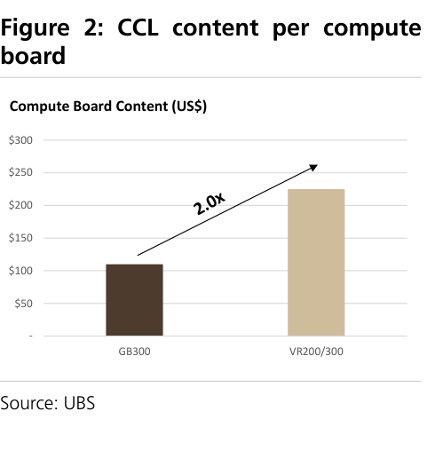

### 解讀摘要
每張運算 PCB 板的 CCL 含量由 GB300 的約 US\$110 升到 VR200/300 的約 US\$225，倍數 2.0x。原文範圍是 US\$100–120 對 US\$150–300，意味 Rubin 世代的增量來自 7+N+7 HDI 與更高材料等級。

| 平台 | 每板 CCL 含量 |
|---|---|
| GB300 | US\$100–120 |
| VR200/300 | US\$150–300 |

---

## Fig. 3｜每張交換器板 CCL 含量

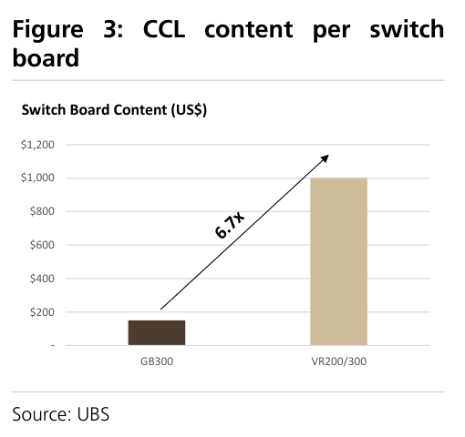

### 解讀摘要
交換器板的 CCL 含量從約 US\$150 升到約 US\$1,000，倍數 6.7x，是三種板型中升幅最大的一項。原文給的範圍是 US\$150 對 US\$500–1,500，且每個 NVL72 機架使用 9 片交換器板，因此這一項對單機架的貢獻變化最大。

---

## Fig. 4｜每個 AI 伺服器機架 CCL 含量

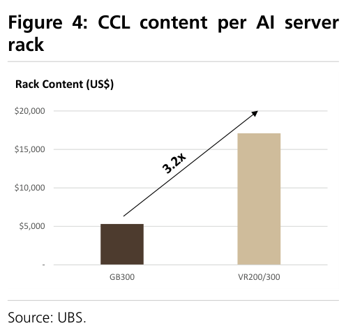

### 解讀摘要
整櫃 CCL 含量由 GB300 約 US\$5,300 升到 VR200/300 約 US\$17,000，倍數 3.2x。UBS 在文字中把含 mid-plane、BlueField 與周邊板的總量估為 VR200 US\$15,000–20,000、VR300 US\$30,000–40,000。

> **洞察一（配合 Fig. 2、3）**：機架 CCL 含量的結構從「運算板為主」轉成「交換器板為主」。依圖上約值推算：GB300 = 36 片 × US\$110 + 9 片 × US\$150 = US\$5,310，交換器占 1,350 / 5,310 = 25%；VR200/300 = 36 × US\$225 + 9 × US\$1,000 = US\$17,100，交換器占 9,000 / 17,100 = 53%。這代表網通板供應商（EMC、TUC 等）的敏感度比運算板供應商更高。（圖上約值為目測，非原文逐項揭露）
> **值得驗證**：交換器板單價區間 US\$500–1,500 差三倍，VR300 的 US\$30,000–40,000 也是區間估計；其中單一假設若偏差，機架總量估計變動幅度很大。

---

## Fig. 5｜GPU／ASIC 平台的 CCL／基板／PCB 供應商清單

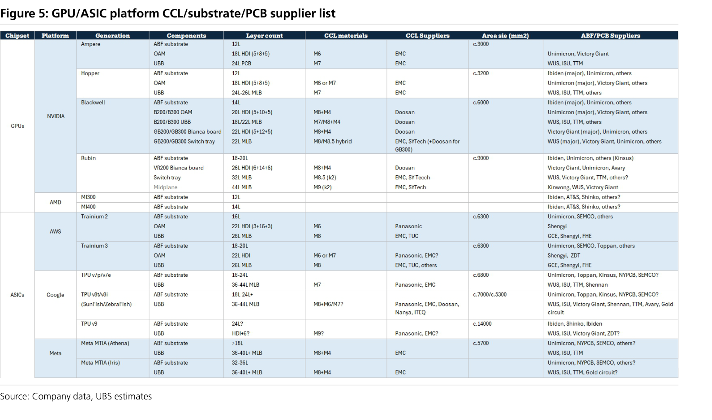

### 解讀摘要
此表按晶片平台（NVIDIA Ampere／Hopper／Blackwell／Rubin、AMD MI300／MI400、AWS Trainium、Google TPU、Meta MTIA）列出各板型的層數、CCL 材料與 CCL、PCB 供應商。從文字可歸納：GB200/300 世代 Doosan 為運算板 HDI 主供，EMC 與 Shengyi（SYT）供交換器板；VR200 預估 Doosan、EMC、SYT 分配約 2 : 1.5 : 1，EMC 與 SYT 在交換器板各半，EMC 另拿到 44 層 mid-plane 的額外配額。ASIC 方面 EMC 自述約占 70% 份額，Google TPU 由 Panasonic 獨供轉為 EMC 於 2025 年約占 50%，AWS Trainium 3 則有兩家台廠供應，EMC 仍為主。

---

## Fig. 6｜一般伺服器 CCL 規格（按平台）

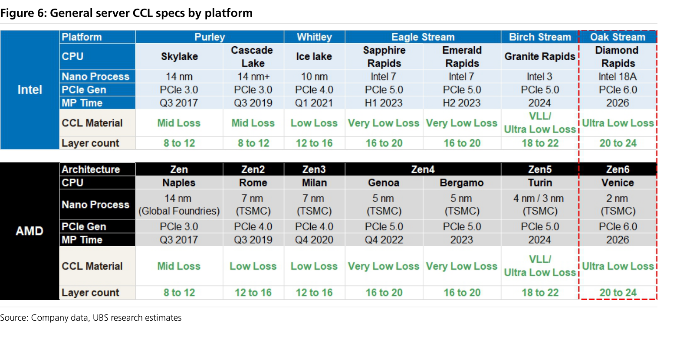

### 解讀摘要
Intel Oak Stream 與 AMD Venice 將導入 PCIe Gen6，主機板層數由前一代 Birch Stream/Turin 的 18–22 層增加到 20–24 層，CCL 材料由 M6 轉往 M7（M7 對 M6 的 ASP 溢價 30–50%）。這是 AI 以外的獨立升級週期，ITEQ 為此最大受益者。

| 平台 | CPU Gen | 層數 | CCL 材料 |
|---|---|---|---|
| Intel Purley | PCIe 3.0 | 8–12 | Mid Loss |
| Intel Eagle Stream | PCIe 5.0 | 16–20 | Very Low Loss |
| Intel Birch Stream | PCIe 5.0 | 18–22 | Very Low Loss |
| Intel Oak Stream | PCIe 6.0 | 20–24 | Ultra Low Loss |
| AMD Genoa／Bergamo | PCIe 5.0 | 16–20 | Very Low Loss |
| AMD Turin | PCIe 5.0 | 18–22 | VLL／Ultra Low Loss |
| AMD Venice | PCIe 6.0 | 20–24 | Ultra Low Loss |

> **洞察二**：UBS 的 CPU 出貨預估（伺服器 CPU 由 2025 年 23m 增至 2030 年 67m，x86 由 19m 增至 40m、ARM 由 4m 增至 27m）顯示一般伺服器不只換規格，總量也成長，ITEQ（一般伺服器占營收約 58%）因此並非單純「AI 的落後者」。

---

## Fig. 7｜光模組 PCB 規格比較

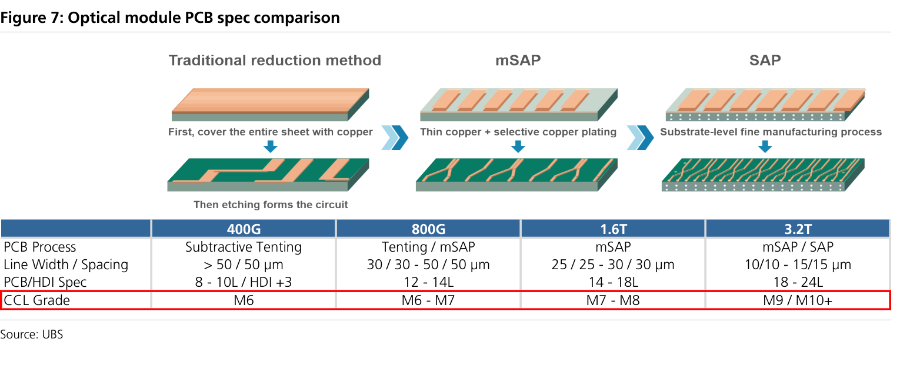

### 解讀摘要
光模組速率從 400G 到 3.2T，PCB 製程由減成法（subtractive）轉到 mSAP（800G 起，1.6T 全面採用）再到 SAP（3.2T），線寬／間距由 >50/50 µm 降到 10/10–15/15 µm，CCL 等級由 M6 升到 M9／M10+。UBS 引用其中國 PCB／CCL 團隊預估光學 mSAP PCB 市場 2026／2027／2028 年為人民幣 1.1／4.0／6.5 十億元，並指出關鍵設備（雷射鑽孔、壓合機）交期已超過 12 個月。

| 速率 | PCB 製程 | 線寬／間距 | HDI／層數 | CCL 等級 |
|---|---|---|---|---|
| 400G | Subtractive Tenting | > 50/50 µm | 8–10L／HDI +3 | M6 |
| 800G | Tenting／mSAP | 30/30–50/50 µm | 12–14L | M6–M7 |
| 1.6T | mSAP | 25/25–30/30 µm | 14–18L | M7–M8 |
| 3.2T | mSAP／SAP | 10/10–15/15 µm | 18–24L | M9／M10+ |

---

## Fig. 8｜LEO 衛星世代升級帶動更高 CCL 含量

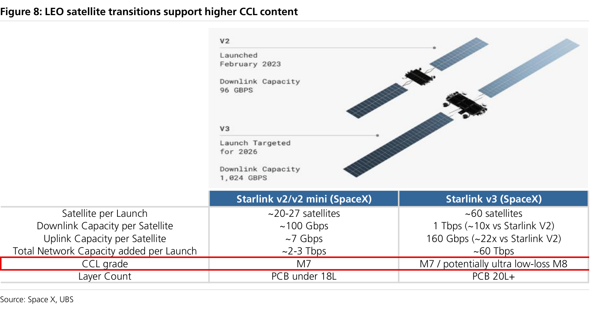

### 解讀摘要
SpaceX 衛星由 V2 mini 到 V3，單次發射增加的網路容量由約 2–3 Tbps 增至約 60 Tbps，CCL 等級由 M7 升到 M7／可能 ultra low-loss M8，層數由 18L 以下增至 20L+。Compeq 表示每顆衛星的 PCB 價值由 V2 mini 到 V3 可能倍增。星上（space）高度集中、利潤高：EMC 為星上 CCL 主供，TUC 正在認證 M8；地面終端機以 M4／M6 為主，EMC 與 TUC 為既有供應商，ITEQ 預計 2027 年起從泰國廠切入。

| 項目 | V2／V2 mini | V3 |
|---|---|---|
| 單次發射衛星數 | 約 20–27 顆 | 約 60 顆 |
| 單星下行容量 | 約 100 Gbps | 1 Tbps（約 10 倍，對比 Starlink V2） |
| 單次發射新增總容量 | 約 2–3 Tbps | 約 60 Tbps |
| CCL 等級 | M7 | M7／可能 ultra low-loss M8 |
| 層數 | 18L 以下 | 20L+ |

---

## Fig. 9｜2025 年全球 CCL 市占（按供應商）

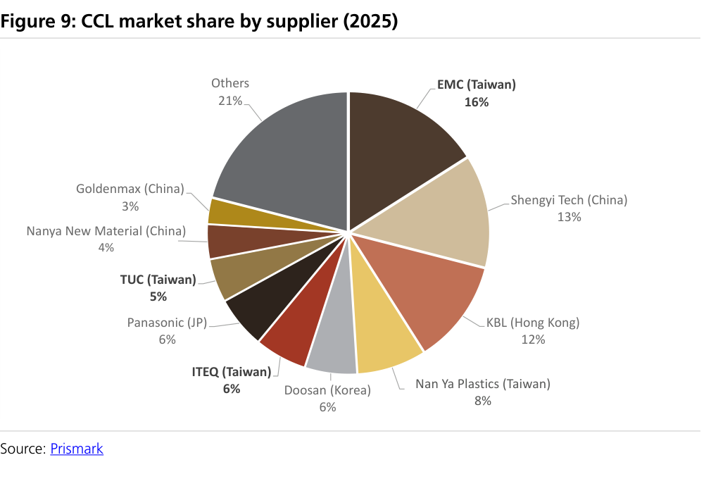

### 解讀摘要
EMC 以 16% 居首，其後是生益科技（SYT）13%、建滔（KBL）12%、南亞塑膠 8%，Panasonic、Doosan、ITEQ 各 6%，TUC 5%、南亞新材 4%、金安國紀 3%，其他 21%。EMC、ITEQ、TUC 三家合計 27%（16 + 6 + 5），其中 EMC 的 AI 營收占比約 60%，五年前為個位數。

| 供應商 | 2025 年市占 |
|---|---|
| EMC（台） | 16% |
| 生益科技（中） | 13% |
| 建滔（港） | 12% |
| 南亞塑膠（台） | 8% |
| Panasonic（日） | 6% |
| Doosan（韓） | 6% |
| ITEQ（台） | 6% |
| TUC（台） | 5% |
| 南亞新材（中） | 4% |
| 金安國紀（中） | 3% |
| 其他 | 21% |

---

## Fig. 10｜產業主要業者公告的 CCL 擴產

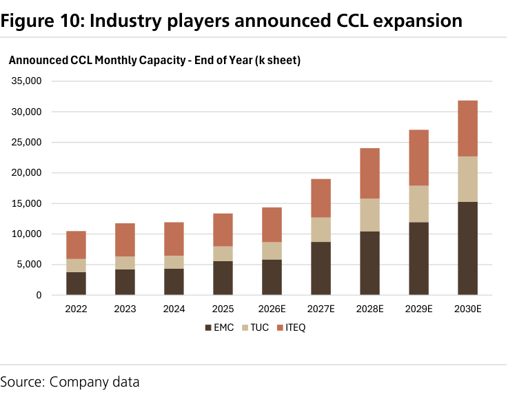

### 解讀摘要
EMC、TUC、ITEQ 三家公告的年底月產能由 2022 年約 10,500k 張，增加到 2030 年約 32,000k 張（圖上目測），2027／2028 年分別成長約 32%／27%。這是 UBS 用來衡量供給增量的基礎，UBS 自己的預估已把此計畫打 10–30% 折扣。

---

## Fig. 11｜EMC 領導擴產

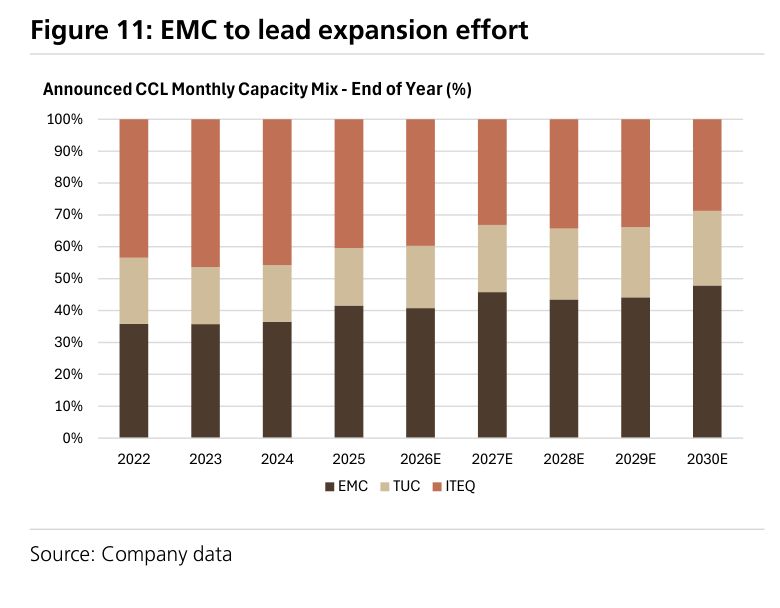

### 解讀摘要
三家合計產能中 EMC 占比由 2022 年約 36% 升至 2030 年約 48%（圖上目測），TUC 與 ITEQ 占比下降。用 Fig. 12 的 2030 年總產能驗算：EMC 15.25M / （15.25 + 7.45 + 9.15 = 31.85M）= 47.9%，與圖形一致。

> **洞察三（配合 Fig. 12）**：擴產幅度最大者同時是份額領先者，EMC 的規模優勢（採購議價、上游備貨、客戶配額）會自我強化；但這也代表 EMC 對設備交期與審查延遲最敏感，個股報告已揭露 Guanyin 首批 300k 張/月由 2026 年 12 月延後約 6 個月。

---

## Fig. 12｜台灣 CCL 業者產能與擴產計畫

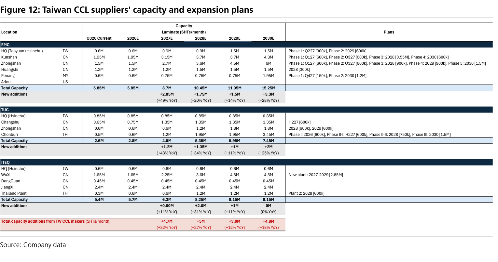

### 解讀摘要
此表逐廠列出 EMC、TUC、ITEQ 的月產能與擴產時程。文字總結：EMC 由 2025 年底 5.55mn 張增至 2030 年 15.25mn（+175%），TUC 由 2.41mn 增至 7.45mn（+209%），ITEQ 由 5.4mn 增至 9.15mn（+69%）。UBS 對 2025–2030 年營收的預估為 EMC NT\$94bn → NT\$698bn（依此推算年複合成長約 49%）、TUC NT\$30bn → NT\$218bn（48%）、ITEQ NT\$33bn → NT\$136bn（33%）。

| 公司 | 起點月產能 | 2030 年月產能 | 增幅 | 2025→2030E 營收 |
|---|---|---|---|---|
| EMC | 5.55mn 張 | 15.25mn | +175% | NT\$94bn → NT\$698bn |
| TUC | 2.41mn 張 | 7.45mn | +209% | NT\$30bn → NT\$218bn |
| ITEQ | 5.4mn 張 | 9.15mn | +69% | NT\$33bn → NT\$136bn |

> **值得驗證**：同一份 UBS 對 EMC 的起點不一致：此報告寫 2025 年底 5.55mn 張，EMC 個股報告內文則寫 4.95mn 張（個股報告的產能表顯示 Q326 現有 5.85M、2026E 5.85M）。起點不同會讓「+175%」這類增幅變動，使用時以個股報告的明細表為準。

---

## Fig. 13｜CCL 材料構成

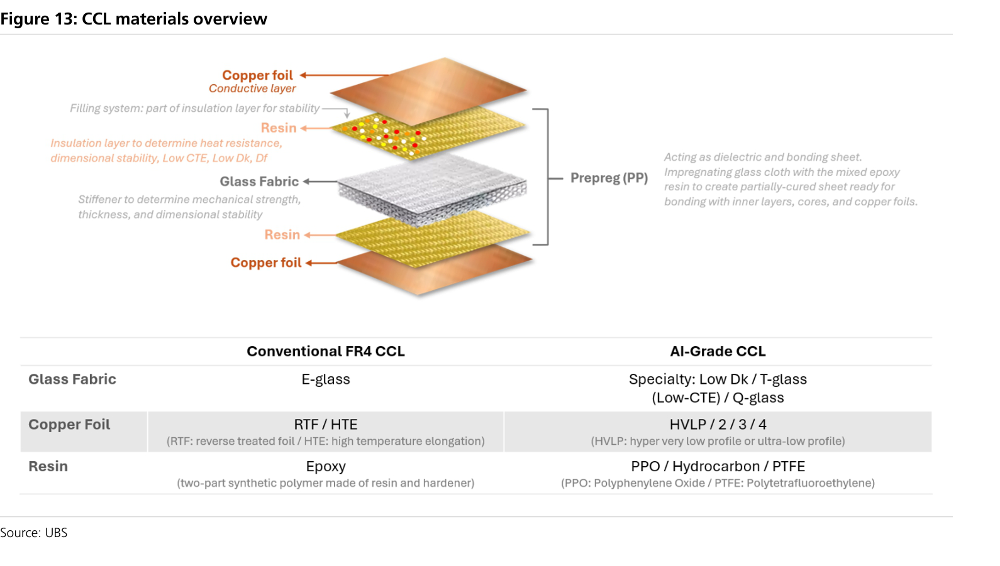

### 解讀摘要
CCL 約占 PCB 原料成本 40%，由銅箔（導電層）與 prepreg（樹脂＋玻纖布，絕緣與黏著層）構成。傳統 FR4 用 E-glass、RTF／HTE 銅箔與環氧樹脂；AI 級 CCL 則用 Low Dk／T-glass／Q-glass、HVLP 銅箔，以及 PPO／碳氫／PTFE 樹脂。後面三種原料的供給限制決定了高階 CCL 的調價能力。

| 項目 | 傳統 FR4 CCL | AI 級 CCL |
|---|---|---|
| 玻纖布 | E-glass | 特殊玻纖（Low-Dk／Low-CTE／T-glass／Q-glass） |
| 銅箔 | RTF／HTE | HVLP 2／3／4 |
| 樹脂 | 環氧（二聚合成樹脂＋硬化劑） | PPO／碳氫／PTFE |

---

## Fig. 14｜玻纖布應用

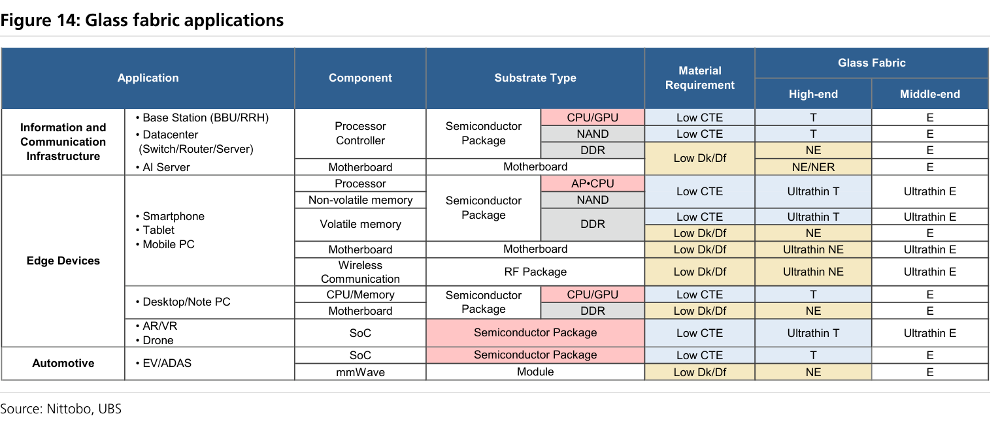

### 解讀摘要
此表對應應用、元件、基板類型與玻纖布規格：資料中心／AI 伺服器的 CPU／GPU 載板與主機板要求 Low CTE 或 Low Dk/Df，高階用 T-glass，中階用 E-glass；邊緣裝置（手機、平板、筆電）以 Ultrathin T／Ultrathin E 為主。UBS 補充 Low Dk 1（NE-glass）已被多數 AI PCB 採用，主用於 M7；下一步是 Low Dk 2（NER）給 M8，Nittobo 在 Low Dk 市占逾 75%。

---

## Fig. 15｜Nittobo 對特殊玻纖供應鏈的展望

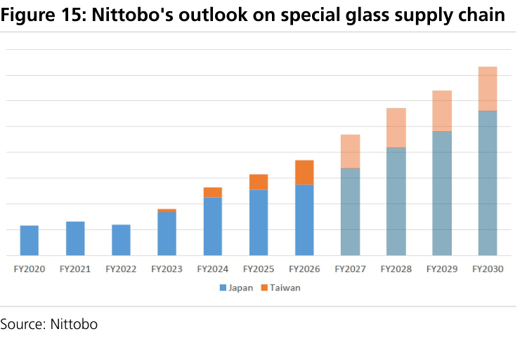

### 解讀摘要
圖形顯示特殊玻纖產出由 FY2020 到 FY2030 持續上升，日本廠為主體，台灣廠自 FY2023 起出現且占比逐年擴大。UBS 文字指出 Nittobo 約占高階 T-glass 全球 90%，高階線已滿載，投資額由 800 億日圓上調至 1,200 億日圓（FY24–FY27），並計畫 FY29 年 T-glass 產出年增約 20%。

---

## Fig. 16｜Nittobo T-glass 供給計畫

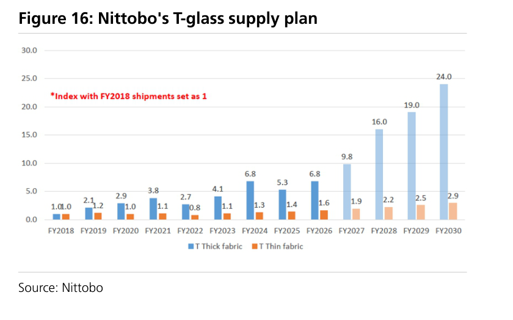

### 解讀摘要
以 FY2018 = 1 為基準，厚織物（thick fabric）供給指數 FY2026 為 6.8、FY2030 達 24.0，約為 3.5x（24.0 / 6.8）；薄織物成長相對平緩。供給新增集中在 FY2027 之後，與 UBS 判斷「T-glass 吃緊至少到 2027 年，新產能與新世代產品才放量」互相吻合。

> **洞察四**：Nittobo 的產出倍增主要落在 FY2028–FY2030，意味 2027 年之前高階 CCL 的玻纖布瓶頸沒有實質緩解，而台廠擴產（Fig. 10–12）也大多落在 2027–2028，所以「價格能維持」與「新產能不致過剩」其實是同一個時間窗口的假設。

---

## Fig. 17｜玻纖布特性比較

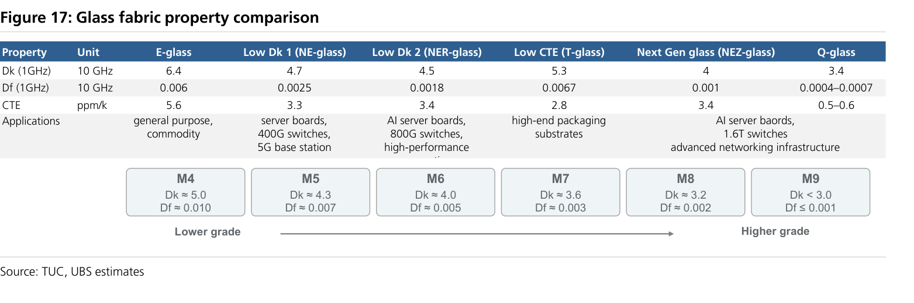

### 解讀摘要
Dk、Df、CTE 逐級改善：E-glass Dk 6.4／Df 0.006，Low Dk 1（NE）4.7／0.0025，Low Dk 2（NER）4.5／0.0018，Low CTE（T-glass）5.3／0.0067（CTE 2.8 ppm/K 最低之一），Next Gen（NEZ）4.0／0.001，Q-glass 3.4／0.0004–0.0007（CTE 0.5–0.6）。對應 CCL 等級 M4 到 M9，M9 要求 Dk < 3.0、Df ≤ 0.001。Q-glass 效能最好，但硬度高、鑽孔困難，ASP 為 NEZ 的 1.7–2x。

| 玻纖布 | Dk（10GHz） | Df | CTE（ppm/K） |
|---|---|---|---|
| E-glass | 6.4 | 0.006 | 5.6 |
| Low Dk 1（NE） | 4.7 | 0.0025 | 3.3 |
| Low Dk 2（NER） | 4.5 | 0.0018 | 3.4 |
| Low CTE（T-glass） | 5.3 | 0.0067 | 2.8 |
| Next Gen（NEZ） | 4.0 | 0.001 | 3.4 |
| Q-glass | 3.4 | 0.0004–0.0007 | 0.5–0.6 |

---

## Fig. 18｜銅箔分類比較

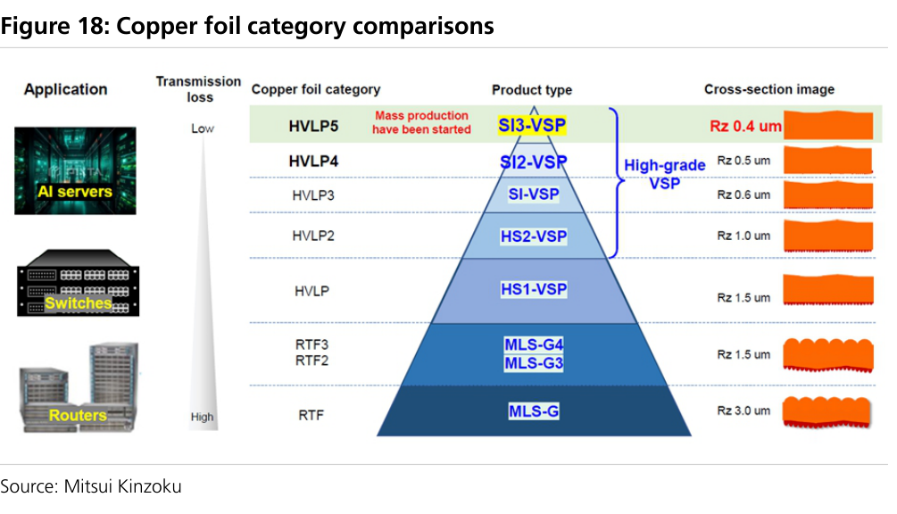

### 解讀摘要
銅箔由 RTF 往 HVLP 發展，表面粗糙度 Rz 由 3.0 µm 降到 HVLP5 的 0.4 µm；HVLP5（SI3-VSP）已開始量產。趨勢是頻率越高、集膚效應越顯著，導線損耗越大，因此粗糙度越低越好。UBS 預期 M8／M9 需由 HVLP2 升級到 HVLP3/4/5，HVLP4+ 2026 年成為主流，用於 NVIDIA Rubin、Google TPU v8、AWS Trainium 3、AMD MI400。

| 銅箔等級 | Rz |
|---|---|
| HVLP5 | 0.4 µm（已開始量產） |
| HVLP4 | 0.5 µm |
| HVLP3 | 0.6 µm |
| HVLP2 | 1.0 µm |
| HVLP | 1.5 µm |
| RTF2／RTF3 | 1.5 µm |
| RTF | 3.0 µm |

---

## Fig. 19｜銅箔演進與應用

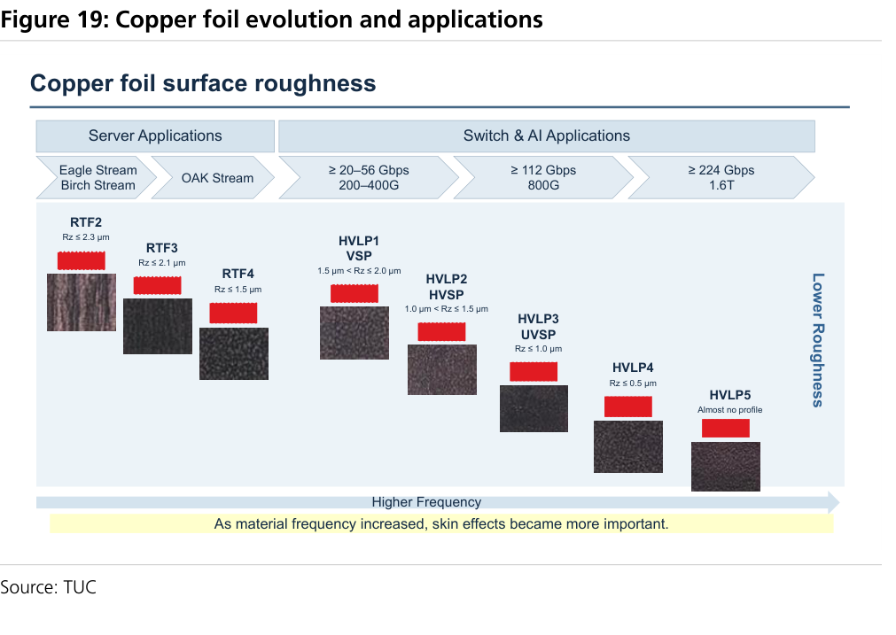

### 解讀摘要
圖表按傳輸速率對應銅箔：伺服器應用（Eagle／Birch Stream）20–56 Gbps（200–400G）用 RTF2–RTF4，交換器／AI 應用 112 Gbps（800G）以上用 HVLP1–HVLP2，224 Gbps（1.6T）以上走向 HVLP3–HVLP5。UBS 補充高階銅箔供給掌握在少數日商：Mitsui Kinzoku 在 HVLP4 市占 40–60%，目標月產能由 FY25 的 620 噸增到 FY28 的 1,200 噸；Co-Tech（金居）HVLP 家族占其營收 15–20%，規劃 2027 年底月產能 800–850 噸並在馬來西亞設廠。設備交期 18–24 個月，良率爬升與認證要 2–3 年。

---

## Fig. 20｜傳統 CCL 在 E-glass 緊缺與原料通膨下的調價週期

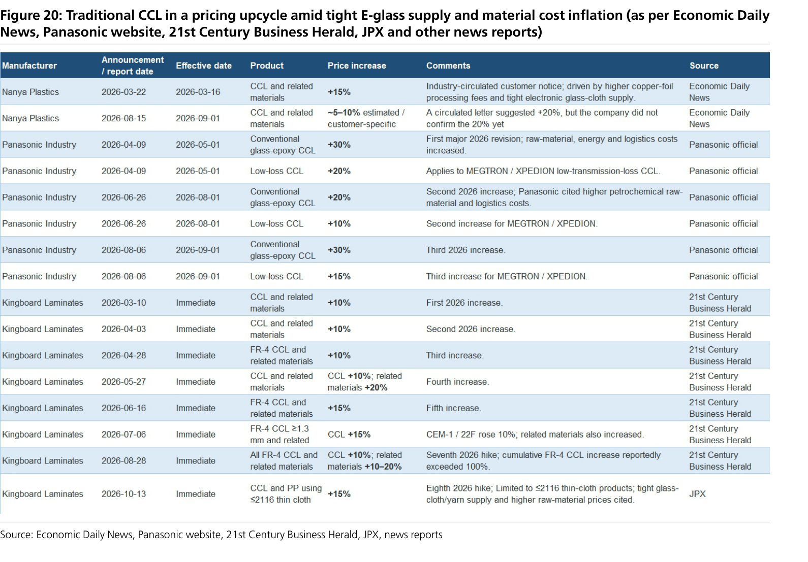

### 解讀摘要
此表彙整 2026 年南亞塑膠、Panasonic Industry、建滔的調價公告：Panasonic 對一般玻纖環氧 CCL 公告三輪調漲（+30%、+20%、+30%），複合約 103%（1.3 × 1.2 × 1.3 = 2.03）；建滔在 3–10 月共調漲 8 輪（+10% ×5、+15% ×3），UBS 引述 TPCA 指其 FR-4 7 月累計漲幅已超過 50%，媒體估計 8 月底年內漲幅逾 100%。UBS 判斷 E-glass 短缺約持續 2 年，與 Low-Dk1 同樣緊。

| 公司 | 2026 年調價輪次（摘要） |
|---|---|
| 南亞塑膠 | 3 月 +15%；8 月傳 +5–10%（公司未確認 +20%） |
| Panasonic Industry | 一般玻纖環氧 +30%（5/1）、+20%（8/1）、+30%（9/1）；低損耗 +20%、+10%、+15% |
| 建滔（KBL） | 3/10 +10%、4/3 +10%、4/28 +10%、5/27 +10%（相關材料 +20%）、6/16 +15%、7/6 +15%、8/28 +10%、10/13 +15%（僅限 ≤2116 薄布產品） |

---

## Fig. 21｜銅價走勢

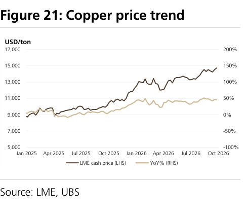

### 解讀摘要
LME 現貨銅價由 2025 年 1 月約 US\$8,800／噸升到 2026 年 10 月約 US\$14,800（圖上目測），2026 年後半段加速。對 CCL 而言銅箔占高階 CCL 成本約 35%，銅價與加工費同步上升，是原料通膨的第一個來源。

---

## Fig. 22｜E-glass 價格走勢

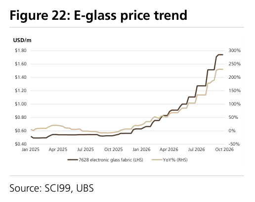

### 解讀摘要
7628 電子級玻纖布價格由 2025 年初約 US\$0.6／公尺升到 2026 年 10 月約 US\$1.6（圖上目測，約 2.7x），2026 年下半年斜率陡升，與 E-glass 短缺自 2026 年初出現的說法一致。特殊玻纖擴產排擠傳統織機，使傳統 CCL 成為這一輪調價的先行者。

---

## Fig. 23｜環氧樹脂價格走勢

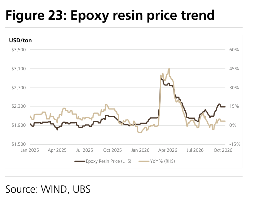

### 解讀摘要
環氧樹脂價格波動較大，2026 年 4 月前後急升至約 US\$3,100／噸後回落，近期約在 US\$2,300，並且已開始再度上升。UBS 認為樹脂是三項主要原料中供給最寬鬆者（採購相對開放，核心在配方 know-how），所以對成本的壓力小於銅箔與玻纖布。

---

## Fig. 24｜高階 CCL 物料成本結構

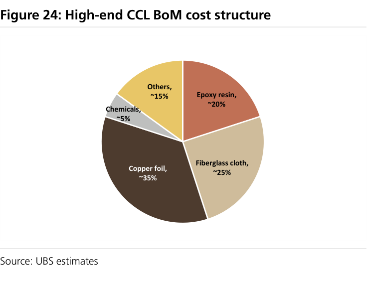

### 解讀摘要
高階 CCL 成本中銅箔約 35%、玻纖布約 25%、環氧樹脂約 20%、其他 15%、化學品 5%。文字補充 M9+ 若採 Q-glass，玻纖布可占 BoM 最高 40%、銅箔 35–40%；低階 CCL 銅箔占比最高可達 50%。UBS 因此判斷高階玻纖布漲價時，EMC 的成本壓力大於 TUC／ITEQ。

> **值得驗證**：UBS 文字稱「原料各漲 10% 使 CCL 成本增加 3.0%（玻纖布）／3.5%（銅箔）／2.0%（樹脂），合計 8.5%」，但本圖玻纖布占比約 25%，10% 漲價只對應 2.5%，與文字的 3.0% 對不上（合計會是 8.0%）；可能是文字採用不同產品組合，使用該敏感度時需留意。

---

## Fig. 25｜高階 ABF 物料成本結構

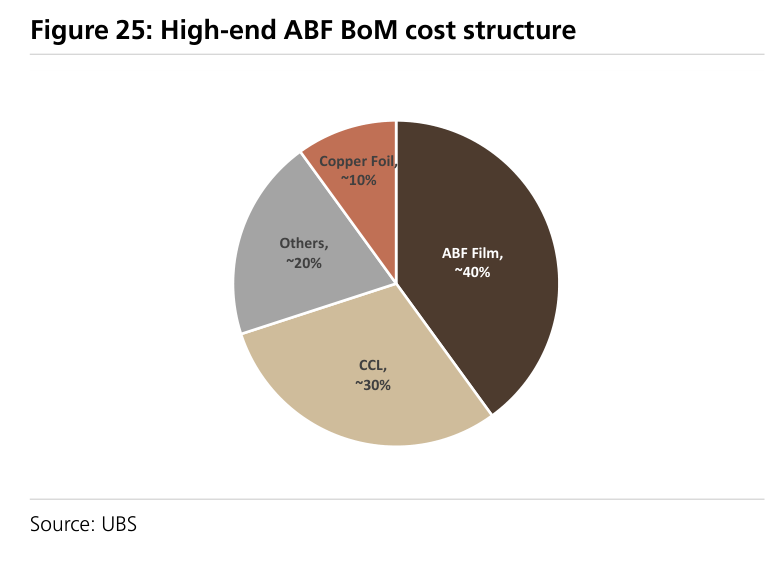

### 解讀摘要
高階 ABF 載板 BoM 中 ABF 膜約 40%、CCL 約 30%、其他 20%、銅箔約 10%。UBS 估計 CCL 占 ABF 載板 BoM 5–30%（依層數）、占 BT 載板約 15–20%，因此 CCL 漲價會往載板廠傳導（見 Fig. 27）。

---

## Fig. 26｜CCL 供應鏈與主要業者

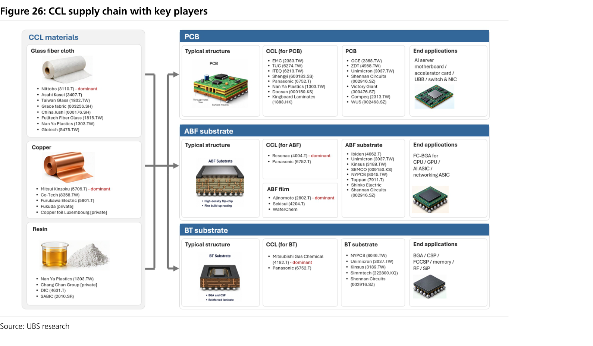

### 解讀摘要
供應鏈由上游材料（玻纖布、銅箔、樹脂）到中游 CCL（PCB／ABF／BT 用）到下游 PCB／載板廠，再到最終應用（AI 伺服器、GPU/ASIC 載板、網通）。圖為供應鏈地圖，圖面文字過小、數字資訊有限；內文補充的廠商分布為：玻纖布 Nittobo 為主，台玻、富喬、南亞塑膠完成低 CTE 開發；銅箔以三井金屬、古河、金居為主要供應商；ABF 載板端欣興、景碩，BT 載板端南電。

---

## Fig. 27｜CCL 原料漲價對基板廠 COGS 的敏感度

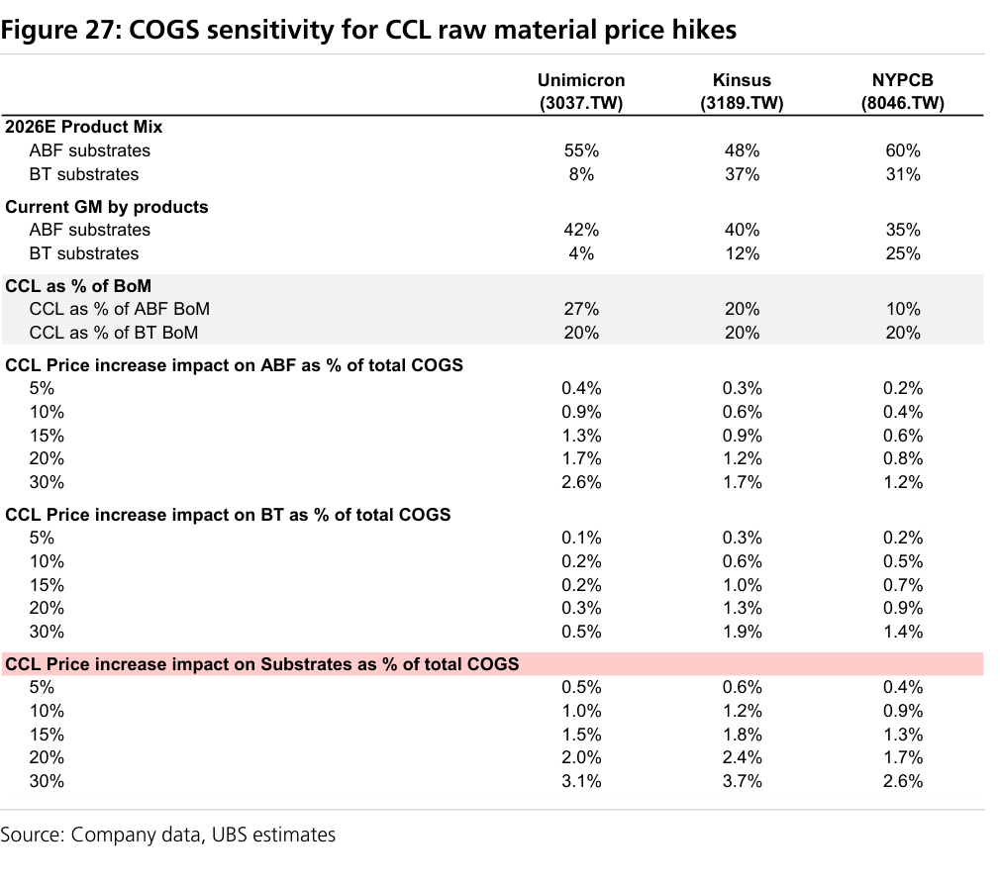

### 解讀摘要
CCL 價格每上漲 10%，欣興／景碩／南電的總 COGS 分別增加 1.0%／1.2%／0.9%；景碩最敏感，因 85–90% 營收來自 IC 載板且 CPU 載板比重增加。欣興 ABF 占 2026E 產品組合 55%，AI 比重約 70%（2H26E），高層數使 CCL 占 BoM 比重更高（欣興 ABF 27%、景碩 20%、南電 10%）。

| CCL 價格漲幅 | 欣興（3037）占總 COGS | 景碩（3189） | 南電（8046） |
|---|---|---|---|
| 5% | 0.5% | 0.6% | 0.4% |
| 10% | 1.0% | 1.2% | 0.9% |
| 15% | 1.5% | 1.8% | 1.3% |
| 20% | 2.0% | 2.4% | 1.7% |
| 30% | 3.1% | 3.7% | 2.6% |

---

## Fig. 28｜NPO 交換器托盤上視圖

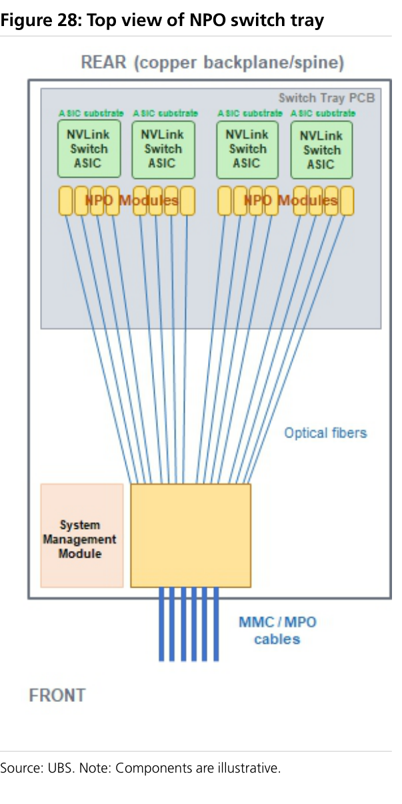

### 解讀摘要
NPO 把光引擎放在距 ASIC 約 50mm 處，縮短 PCB 上的銅走線；圖中 NVLink Switch ASIC 與 NPO 模組都在托盤 PCB 上，光纖拉向前面板。UBS 的論點是：每片板的銅走線變短，但板面積、層數、板數與規格要求四個乘數反而都增加，所以整體 CCL 含量不降反升（見 Fig. 31）。

---

## Fig. 29｜CPO 交換器托盤上視圖

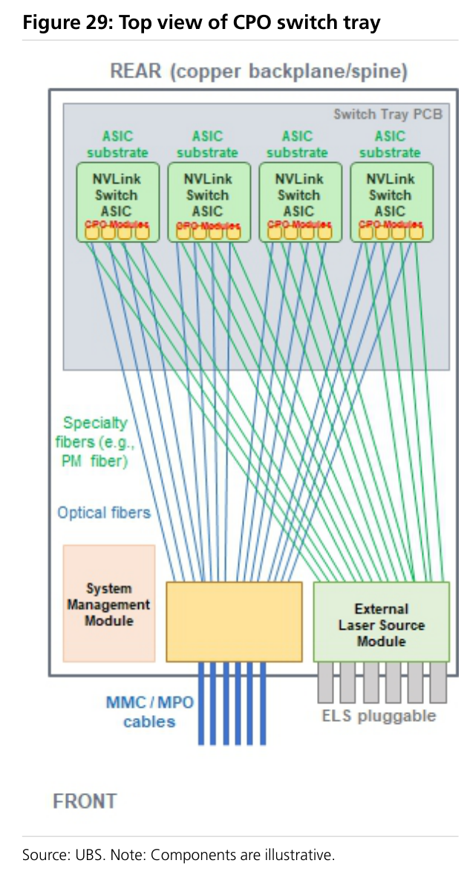

### 解讀摘要
CPO 把光引擎共封裝在 ASIC 基板，托盤另需外部雷射光源模組（ELS）與更多光纖，板上高速電走線大幅減少。UBS 判斷 CPO 先從 scale-out（2027 年前）、再到混合 scale-up（2028–29）、完整 scale-up（2029–30），NPO 則是未來 2–3 年主流，三者與可插拔模組將長期並存。

---

## Fig. 30｜CPO 交換器托盤示意

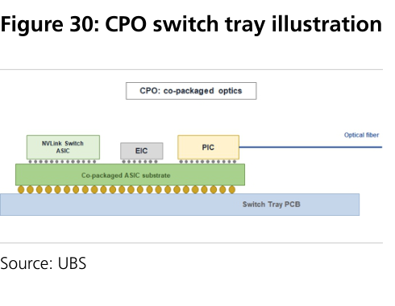

### 解讀摘要
示意圖顯示 CPO：NVLink Switch ASIC、EIC、PIC 共同坐落在共封裝 ASIC 基板上，光纖由 PIC 直接引出，下方是交換器托盤 PCB。此架構下 PCB 主要負責電源與其他高速介面。

---

## Fig. 31｜NPO 交換器托盤示意

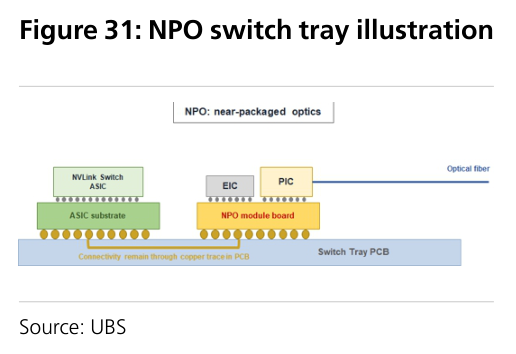

### 解讀摘要
NPO 的光引擎（EIC＋PIC）放在獨立的「NPO module board」上，仍透過托盤 PCB 銅走線連到 ASIC 基板。UBS 估算 NPO 系統層級的 CCL 含量四個乘數都上升：面積約倍增、交換器板由 24 層（Blackwell）升到 32 層（Rubin，正交背板 78–100+ 層）、NVL72 每機架交換托盤由 9 片倍增到 18 片、NPO 模組板為 18–24 層 HDI（1.6T 可插拔為 14–18 層），並要求 CTE < 2ppm/°C。

---

## Fig. 32｜可插拔光模組交換器托盤示意

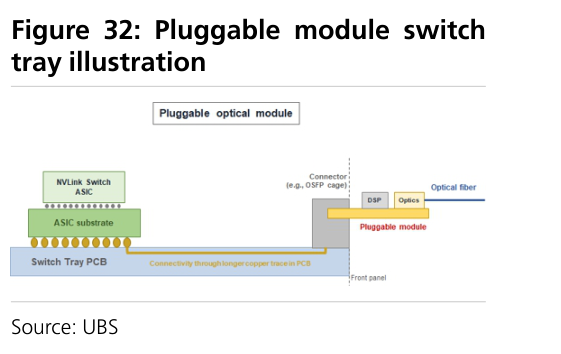

### 解讀摘要
可插拔架構是基準對照：光模組（DSP＋光學）插在前面板連接器籠，ASIC 到前面板之間靠托盤 PCB 上較長的銅走線傳輸，因此對 PCB 損耗最敏感、規格要求最高。這也是為什麼「光引擎移近 ASIC」會被市場解讀為 CCL 降規，但 UBS 認為這忽略了其他乘數的增加。

> **洞察五（配合 Fig. 28–32）**：UBS 給的是質化論證而非量化估計，直接寫「目前無法量化 CCL 含量變化」；實際影響取決於 NVL576 是否採 18 片交換托盤、NPO 與 CPO 的採用時間表。這也是整份報告最大的未量化變數。

---

## Fig. 33｜高速 CCL 路線圖與狀態更新

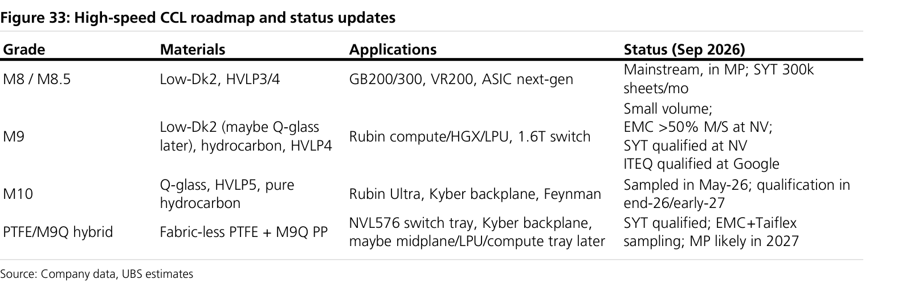

### 解讀摘要
M8／M8.5 已量產，M9 小量出貨，M10 在 2026 年 5 月送樣、預計 2026 年底至 2027 年初完成認證，PTFE／M9Q 混合樣品測試中、2027 年可能量產。M9 的客戶狀態：EMC 在 NVIDIA 的市占逾 50%；SYT 已通過 NVIDIA 認證；ITEQ 已通過 Google 認證。

| 等級 | 材料 | 應用 | 狀態（2026/9） |
|---|---|---|---|
| M8／M8.5 | Low-Dk2、HVLP3/4 | GB200/300、VR200、ASIC 新一代 | 量產中；SYT 月產 30 萬張 |
| M9 | Low-Dk2（之後可能 Q-glass）、碳氫樹脂、HVLP4 | Rubin 運算／HGX／LPU、1.6T 交換器 | 小量出貨；EMC 在 NV 市占 >50%；SYT 通過 NV；ITEQ 通過 Google |
| M10 | Q-glass、HVLP5、純碳氫 | Rubin Ultra、Kyber 背板、Feynman | 2026/5 送樣，預計 2026 年底至 2027 年初完成認證 |
| PTFE／M9Q 混合 | 無織物 PTFE + M9Q PP | NVL576 交換托盤、Kyber 背板，之後可能延伸到 mid-plane／運算托盤 | SYT 認證通過；EMC 與台郡（Taiflex）合作送樣；MP 可能 2027 |

> **洞察六**：PTFE 的瓶頸在製程：UBS 估 PTFE 設計良率「遠低於 50%」，現行 M9 為 80–90%；EMC 的 M10 + Q-glass 實驗室測試可達到接近 PTFE 的電氣性能且良率 80–90%。但未來 NVL576 交換托盤與 Kyber 背板可能要求 Df < 0.0004，現行 M10 約 0.00043–0.00045，因此 UBS 預期「M10 vs. PTFE」之爭延續到 2027 年。

---

## Fig. 40｜OAM 插入 UBB 構成模組化 AI 運算節點

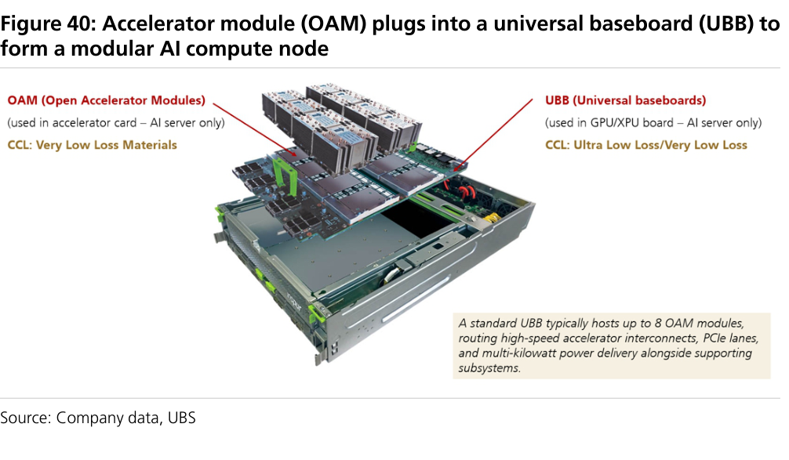

### 解讀摘要
圖示加速器模組（OAM）插到通用基板（UBB），一個 UBB 通常容納最多 8 個 OAM。OAM 用 Very Low Loss 材料，UBB 用 Ultra Low Loss／Very Low Loss；UBB 的層數（由 A100 的 24–26 層增至 B300 的 28–30 層）與材料等級，是 HGX 世代 CCL 規格上移的主要場景。（原報告圖號中未見圖 34 標籤；圖 35–39 為個股財務摘要、歷史 P/E 與多公司估值比較，依跳過規則不收錄。）

---

## 相關個股清單

| 類別 | 公司 | Ticker | 評等 | 備註 |
|---|---|---|---|---|
| 台灣 CCL | 台光電 EMC | 2383.TW | Buy | PT NT\$5,000（20 Nov 價 NT\$2,810）；12x 2028E P/E |
| 台灣 CCL | 台燿 TUC | 6274.TWO | Buy | PT NT\$1,150（20 Nov 價 NT\$623）；8x 2028E P/E |
| 台灣 CCL | 聯茂 ITEQ | 6213.TW | Buy | PT NT\$650（20 Nov 價 NT\$355.5）；10x 2028E P/E |
| 中國 CCL | 生益科技 Shengyi | 600183.SS | — | PTFE 若普及的主要受益者 |
| 日商材料 | Nittobo／三井金屬 | 3110.JP／5706.JP | — | T-glass 約 90% 市占／HVLP4 市占 40–60% |
| 基板 | 欣興、景碩、南電 | 3037／3189／8046 | — | CCL 漲價 10% → 總 COGS +1.0%／1.2%／0.9% |
