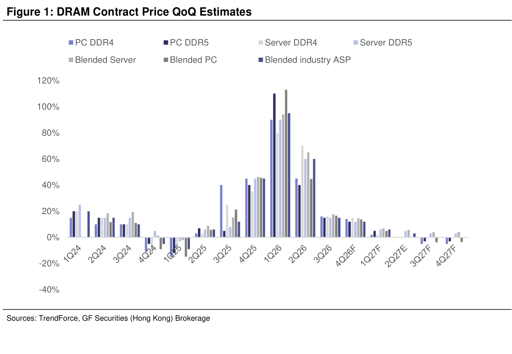
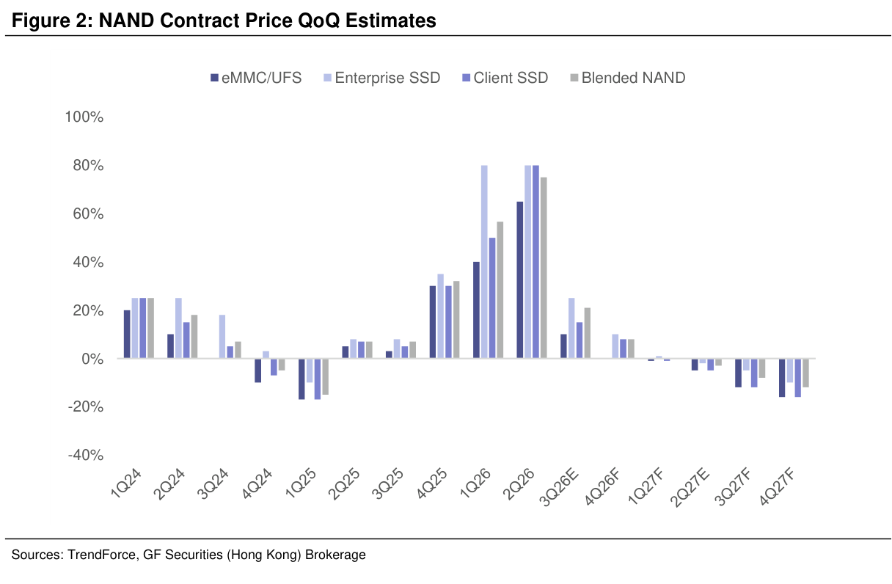
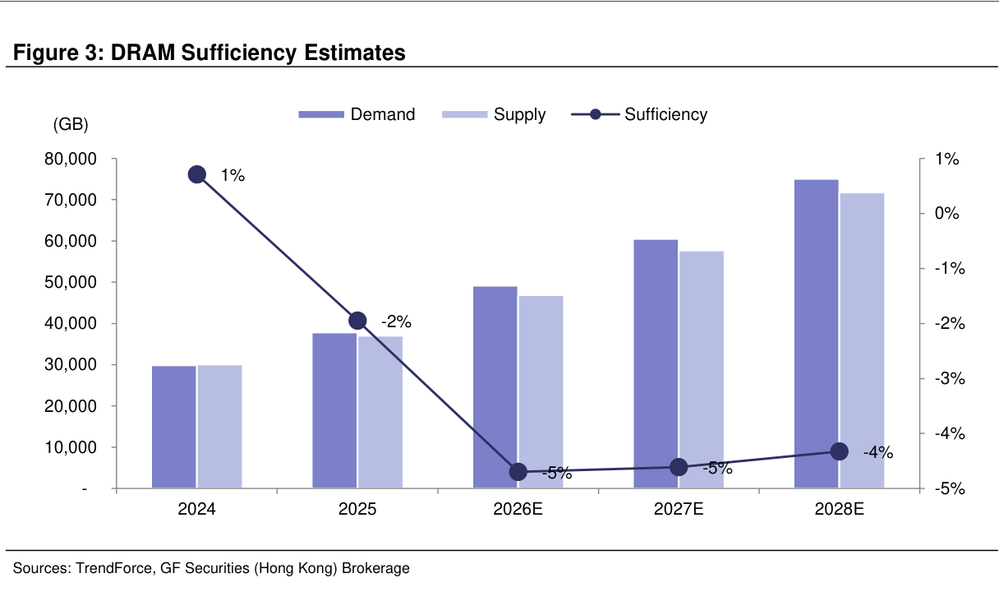
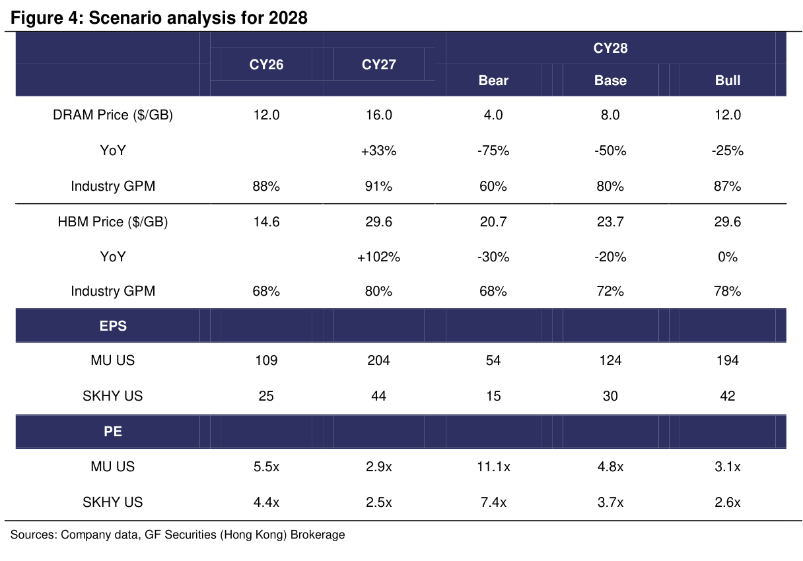

# GFHK｜Memory: Modest DRAM Pricing Downward Revision

**券商**：GF Securities (Hong Kong)  
**分析師**：Elaine Fang、Jeff Pu, CFA、Evan Lee  
**日期**：2026-11-26  
**主題**：DRAM 2027 年合約價小幅下修（1Q–4Q27 QoQ 由 10%/7%/5%/3% 降至 6%/3%/0%/0%）、供給缺口仍在、2028 年情境分析  
**評級**：報告未標示產業評級；個股面正面看 Micron、SK Hynix、Samsung，負面看南亞科（2408 TT）、華邦電（2344 TT）  
<a href="https://layx.uk/dl?g=產業&b=GFHK&d=20261126&h=DRAM-Pricing-Revision">📎 下載 PDF</a>

---

## 報告總結

GFHK 引用 TrendForce 資料，認為 DRAM 需求弱於預期（中國 CSP 採購動能放緩、消費性需求疲軟），因此把 2027 年 1Q–4Q 合約價季增幅由 10%/7%/5%/3% 下修為 6%/3%/0%/0%。

供給缺口仍在（2026/27/28E 充足率 -5%/-5%/-4%），若價格轉弱，減產可支撐 LTA 底價。偏好 Micron、SK Hynix、Samsung，看空 DDR4 比重高的南亞科與華邦電。

---

## GFHK 完整投資邏輯鏈

| 論點層次 | Exhibit | 內容 |
|---|---|---|
| 需求轉弱 | Fig. 1 | 2027 年合約價季增幅全面下修，3Q27、4Q27 持平 |
| 需求缺口來源 | 報告文字 | 中國 CSP 伺服器 DRAM 砍單約占總需求 1%，可由美系 CSP 吸收 |
| 消費端壓力 | 報告文字 | eSSD 砍單與消費電子降規，DDR4 最受壓 |
| 供給仍緊 | Fig. 3 | 2026/27/28E 充足率 -5%/-5%/-4% |
| 價格保護 | 報告文字 | 價格轉弱時考慮減產以支撐 LTA 底價 |
| 2028 情境 | Fig. 4 | 傳統 DRAM \$4/\$8/\$12 per GB（熊/基/牛） |
| **結論** | 報告封面 | **偏好 Micron、SK Hynix、Samsung；看空南亞科、華邦電** |

> **報告最大邏輯缺口**：報告看空南亞科與華邦電，只給定性理由（DDR4 比重高、消費性曝險大），沒有提供兩家公司的獲利預估或目標價；2028 年三個情境（價格 -25%～-75%）也未說明觸發條件與時點，只給出對應的 EPS 區間。

---

## 報告核心觀點

| 主題 | GFHK 觀點 | 市場共識 | 是否 Contra-Consensus |
|---|---|---|---|
| 2027 年 DRAM 合約價 | 1Q–4Q27 QoQ 6%/3%/0%/0%（前次 10%/7%/5%/3%） | 報告未載明，僅與自身前次預期比較 | 無法判定 |
| 需求面 | 中國 CSP 砍單約 1% 總需求，可由美系 CSP 吸收；消費性需求疲軟，DDR4 最弱 | 報告未載明 | 無法判定 |
| 供需 | 缺口持續，充足率 -5%/-5%/-4%（2026/27/28E）；HBM 擠壓晶圓產能，供應商傳統 DRAM 資本支出克制 | 報告未載明 | 無法判定 |
| DRAM vs NAND | DRAM 供需好於 NAND（中國 DRAM 廠仍以滿足內需為主） | 報告未載明 | 無法判定 |
| 2028 年 | 傳統 DRAM 熊/基/牛 \$4/\$8/\$12 per GB；HBM \$20.7/\$23.7/\$29.6 per GB | 報告未載明 | 無法判定 |

**偏好排序**：Micron（MU US）、SK Hynix（SKHY US）、Samsung Electronics（005930 KS）正面，報告未再排序  
**需監控風險**：南亞科（2408 TT）、華邦電（2344 TT）以 DDR4 為主，消費性曝險高；報告列風險：AI 需求放緩、基礎建設部署、供給限制、競爭

---

## Fig. 1｜DRAM Contract Price QoQ Estimates

### 解讀摘要

圖中 Blended industry ASP 的季增幅從 1Q26 高點（約 +95%）逐季收斂：2Q26 約 +60%、3Q26 約 +15%、4Q26F 約 +12%，2027 年 1Q–4Q 為 +6%/+3%/0%/0%，下半年不再成長。漲幅減速而非轉跌，但減速幅度比前次預期更大，且各產品線（PC DDR4／DDR5、Server DDR4／DDR5）在 2027 年都落在個位數內，沒有單一產品拉高整體。

> **原文補充**：下修原因是需求端——GPU 短缺使中國 CSP 削減伺服器 DRAM 訂單，約影響總 DRAM 需求的 1%，可由美系 CSP 吸收；消費端因 eSSD 砍單與消費電子降規而偏弱，對消費性 DRAM 價格形成下行壓力，尤其是 DDR4。

### 表格

2027 年合約價預估（取自報告文字）：

| 季度 | 新預估 QoQ | 前次預估 QoQ | 差異 |
|---|---|---|---|
| 1Q27 | 6% | 10% | -4ppt |
| 2Q27 | 3% | 7% | -4ppt |
| 3Q27 | 0% | 5% | -5ppt |
| 4Q27 | 0% | 3% | -3ppt |

2026 年 Blended industry ASP QoQ（視覺估算，圖無數據標籤；2027 年 1Q／2Q 讀值 +6%/+3% 與文字一致，交叉驗證通過）：

| 1Q26 | 2Q26 | 3Q26 | 4Q26F |
|---|---|---|---|
| 約 +95% | 約 +60% | 約 +15% | 約 +12% |

> **洞察一**：新預估使 4Q27 價格水位只比 4Q26 高約 9.2%（1.06 × 1.03 × 1.00 × 1.00 − 1）；前次預估為 +27.3%（1.10 × 1.07 × 1.05 × 1.03 − 1）。年底價格水位比前次預估低約 14%（1.0918 / 1.2729 − 1 = −14.2%）。

> **洞察二（配合 Fig. 4）**：Fig. 4 的 CY27 DRAM 價格 \$16 比 CY26 的 \$12 高 33%，與「2027 年季增幅幾乎走平」並不矛盾。以上表 2026 年各季漲幅推算（視覺估算），4Q26 價格水位已比 2026 年均價高約 27%，所以 2027 年均價的年增幅主要來自 2026 年漲幅的結轉；新路徑 2027 年均價較 2026 年均價約 +37%（前次路徑約 +52%），與 Fig. 4 的 +33% 同一量級。

---

## Fig. 2｜NAND Contract Price QoQ Estimates

### 解讀摘要

Blended NAND 的季增幅在 2Q26 達到高點（約 +75%）後急速收斂，3Q26E 約 +21%、4Q26F 約 +8%；2027 年 1Q 起轉為小幅負成長，並逐季擴大，4Q27F 約 -12%。對比 Fig. 1 的 DRAM（2027 年仍是 +6%/+3%/0%/0%），NAND 在 2027 下半年出現連續季減，與報告「DRAM 供需好於 NAND」的判斷一致。各產品線中，Enterprise SSD 在 1Q26、2Q26 漲幅最大（約 +80%），2027 年跌幅則以 eMMC/UFS 與 Client SSD 較深（4Q27F 約 -16%）。

> **原文補充**：報告對 NAND 價格路徑沒有另外的文字說明，只在 DRAM 段落提到中國 DRAM 廠仍以滿足內需為主，因此 DRAM 供需比 NAND 好；本圖是這個結論的對照。

### 表格

Blended NAND 合約價 QoQ（視覺估算，圖無數據標籤、文字未提供數值，無法交叉驗證）：

| 季度 | Blended NAND QoQ |
|---|---|
| 1Q26 | 約 +57% ❓ |
| 2Q26 | 約 +75% ❓ |
| 3Q26E | 約 +21% ❓ |
| 4Q26F | 約 +8% ❓ |
| 1Q27F | 約 -1% ❓ |
| 2Q27E | 約 -3% ❓ |
| 3Q27F | 約 -8% ❓ |
| 4Q27F | 約 -12% ❓ |

---

## Fig. 3｜DRAM Sufficiency Estimates

### 解讀摘要

DRAM 充足率從 2024 年的 +1% 轉為 2025 年 -2%，2026E 起連續三年維持短缺：-5%/-5%/-4%。缺口不是因為供給下降——供給逐年成長，而是需求（含 HBM 排擠晶圓產能）成長得更快；傳統 DRAM 的資本支出克制，使供給追不上。這個缺口是報告仍看好 Micron、SK Hynix、Samsung 的基礎，也是 2027 年價格即使下修，仍維持持平到正成長（而非下跌）的原因。

### 表格

需求與供給（取自圖，單位 GB，視覺估算；各年充足率與圖上標籤相符，交叉驗證通過）：

| 年度 | 需求 | 供給 | 充足率 |
|---|---|---|---|
| 2024 | 約 29,800 | 約 30,000 | +1% |
| 2025 | 約 37,700 | 約 36,800 | -2% |
| 2026E | 約 49,000 | 約 46,700 | -5% |
| 2027E | 約 60,300 | 約 57,400 | -5% |
| 2028E | 約 74,900 | 約 71,500 | -4% |

> **洞察一**：2026E→2027E 需求與供給的年增幅幾乎相同（約 +23%：60,300 / 49,000 − 1 = +23.1%，57,400 / 46,700 − 1 = +22.9%），缺口維持 -5% 不再擴大。對價格來說，重要的是缺口的變化而不是水位，缺口不再擴大，與 Fig. 1 的 2027 年合約價季增幅降到個位數相符。

> **洞察二（配合 Fig. 4）**：2028E 仍有 -4% 的缺口，但 Fig. 4 的三個情境（熊/基/牛）價格全部低於 2027 年的 \$16/GB（-75%/-50%/-25%），這隱含報告把 2027 年視為這一輪價格的高點，缺口收斂（-5% 到 -4%）本身就足以讓價格回落（自行推論）。

---

## Fig. 4｜Scenario analysis for 2028

### 解讀摘要

2028 年三個情境的 DRAM 價格分別對應：熊市 \$4/GB（pre-AI 定價）、基準 \$8/GB（LTA 底價）、牛市 \$12/GB（較佳需求下的定價），較 2027 年 \$16/GB 下跌 75%/50%/25%；HBM 價格 \$20.7/\$23.7/\$29.6，較 2027 年 \$29.6/GB 下跌 30%/20%/0%。Micron 與 SK Hynix 2028E EPS 落在 \$54/\$124/\$194 與 \$15/\$30/\$42，說明 EPS 對傳統 DRAM 價格高度敏感；牛市情境的 HBM 價格持平（0%），EPS 幾乎不降。

> **原文補充**：報告以「LTA 底價」定義基準情境，並說明若需求疲弱、價格轉跌，原廠可能減產以支撐 LTA 底價。文字敘述的 HBM 產業毛利率為 67%/73%/78%，與圖表的 68%/72%/78% 差 1ppt，本筆記以圖表為準。

### 表格

| 項目 | CY26 | CY27 | CY28 熊 | CY28 基 | CY28 牛 |
|---|---|---|---|---|---|
| **DRAM 價格（\$/GB）** | 12.0 | 16.0 | 4.0 | 8.0 | 12.0 |
| 　YoY | — | +33% | -75% | -50% | -25% |
| 　產業毛利率 | 88% | 91% | 60% | 80% | 87% |
| **HBM 價格（\$/GB）** | 14.6 | 29.6 | 20.7 | 23.7 | 29.6 |
| 　YoY | — | +102% | -30% | -20% | 0% |
| 　產業毛利率 | 68% | 80% | 68% | 72% | 78% |
| **EPS（US\$）** | | | | | |
| 　MU US | 109 | 204 | 54 | 124 | 194 |
| 　SKHY US | 25 | 44 | 15 | 30 | 42 |
| **本益比** | | | | | |
| 　MU US | 5.5x | 2.9x | 11.1x | 4.8x | 3.1x |
| 　SKHY US | 4.4x | 2.5x | 7.4x | 3.7x | 2.6x |

> **洞察一**：2028E EPS 相對 2027E 的跌幅，MU 在熊/基/牛情境為 -73.5%/-39.2%/-4.9%（54 / 204 − 1、124 / 204 − 1、194 / 204 − 1），SK Hynix 為 -65.9%/-31.8%/-4.5%（15 / 44 − 1、30 / 44 − 1、42 / 44 − 1）。牛市情境價格仍跌 25%，EPS 卻只跌約 5%，因為 HBM 價格持平（0%）與毛利率 78% 撐住獲利。

> **洞察二**：表中本益比用同一股價除以各情境 EPS，反推出隱含股價：MU 約 \$600（5.5 × 109 = 600、2.9 × 204 = 592、11.1 × 54 = 599、4.8 × 124 = 595、3.1 × 194 = 601），SK Hynix 約 \$110（4.4 × 25 = 110、2.5 × 44 = 110、7.4 × 15 = 111、3.7 × 30 = 111、2.6 × 42 = 109）。這是自行推算，報告未寫出股價。依此，基準情境下 MU 2028E 本益比 4.8x、SK Hynix 3.7x；熊市情境為 11.1x 與 7.4x。

> **值得驗證**：基準情境的價格（\$8/GB）完全建立在「LTA 底價守得住」這個假設上，但報告沒有揭露 LTA 的價格、期限與覆蓋比例。若底價守不住，價格回到熊市情境的 \$4，MU 2028E EPS 由 \$124 降到 \$54（-56.5%，54 / 124 − 1），SK Hynix 由 \$30 降到 \$15（-50.0%）。

---

## 相關個股清單

| 類別 | 公司 | Ticker | 評等 | 備註 |
|---|---|---|---|---|
| DRAM／HBM 原廠 | Micron | MU US | 正面（constructive） | 2028E EPS \$54/\$124/\$194（熊/基/牛） |
| DRAM／HBM 原廠 | SK Hynix | SKHY US | 正面（constructive） | 2028E EPS \$15/\$30/\$42（熊/基/牛） |
| DRAM／HBM 原廠 | Samsung Electronics | 005930 KS | 正面（constructive） | 報告未提供情境 EPS |
| 台股 DRAM（DDR4 為主） | 南亞科 | 2408 TT | 負面 | 消費性曝險高，獲利較易受衝擊 |
| 台股 DRAM／利基型記憶體 | 華邦電 | 2344 TT | 負面 | DDR4 為主、消費性曝險高 |
